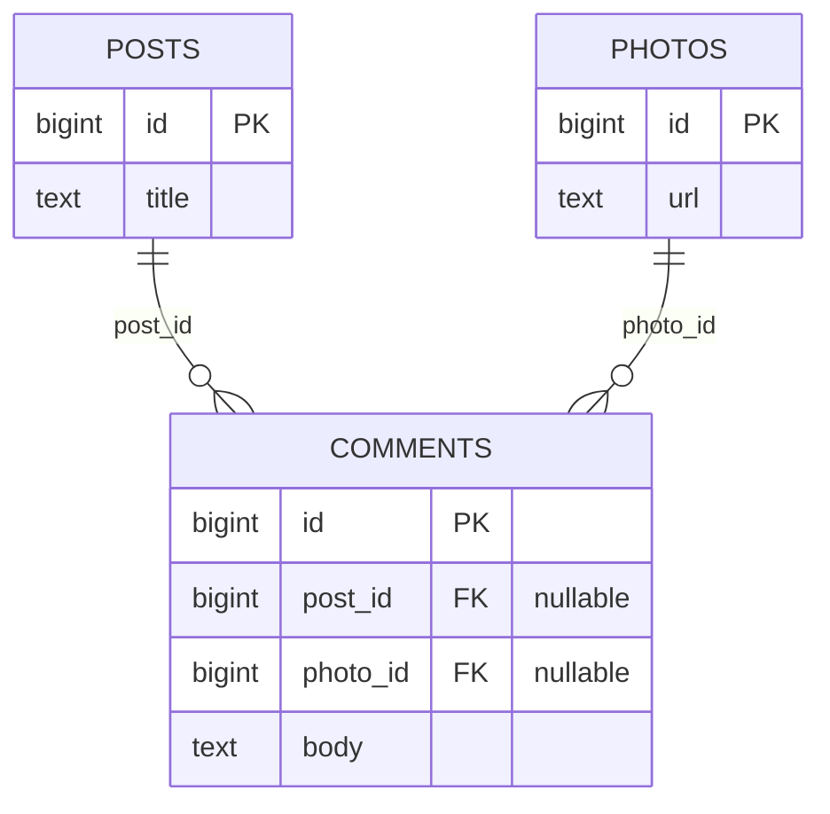

Most application schemas are built from the same dozen recurring shapes. Every team rediscovers them, and many rediscover the same mistakes: soft deletes that break unique constraints, polymorphic foreign keys the database cannot check, entity-attribute-value tables that make every query a pivot. This guide collects the patterns you will reach for in almost every product, shows a working PostgreSQL implementation of each, and names the better alternative where the popular version is a trap.

## created_at and updated_at

Every mutable table should have both. Set `created_at` with a default and maintain `updated_at` with a trigger, so it stays correct for writes from scripts and other services, not just from your ORM.

```sql
CREATE OR REPLACE FUNCTION set_updated_at() RETURNS trigger AS $$
BEGIN
  NEW.updated_at := now();
  RETURN NEW;
END;
$$ LANGUAGE plpgsql;

CREATE TABLE projects (
  id         bigint GENERATED ALWAYS AS IDENTITY PRIMARY KEY,
  name       text NOT NULL,
  version    integer NOT NULL DEFAULT 1,
  created_at timestamptz NOT NULL DEFAULT now(),
  updated_at timestamptz NOT NULL DEFAULT now()
);

CREATE TRIGGER projects_set_updated_at
  BEFORE UPDATE ON projects
  FOR EACH ROW EXECUTE FUNCTION set_updated_at();
```

`now()` returns the transaction start time, so every row touched in one transaction gets the same timestamp. Use `clock_timestamp()` if you need wall time per statement. MySQL can do this declaratively with `ON UPDATE CURRENT_TIMESTAMP`.

## Soft delete and its pitfalls

Soft delete adds a `deleted_at timestamptz` column and marks rows instead of removing them. It makes undo easy and keeps references intact. It also has real costs.

Unique constraints break first. If `email` is unique, a deleted user blocks re-registration with the same address. Replace the constraint with a partial unique index over live rows only.

```sql
ALTER TABLE users ADD COLUMN deleted_at timestamptz;
ALTER TABLE users DROP CONSTRAINT users_email_key;
CREATE UNIQUE INDEX users_email_live_key ON users (lower(email)) WHERE deleted_at IS NULL;
CREATE VIEW active_users AS SELECT * FROM users WHERE deleted_at IS NULL;
```

Every query must then filter `deleted_at IS NULL`, and every forgotten filter is a bug that shows deleted data to users. Mitigate with a view the application reads from, an ORM default scope, or row-level security that hides deleted rows for the application role. Foreign keys no longer protect you either: a live order can point at a deleted customer, and cascades do not fire. Finally, privacy law may require that deleted personal data is actually erased.

The alternative is an archive table: on delete, copy the row as JSONB into `deleted_records` and then really delete it. The main table stays clean, constraints keep working, and restores are rare manual operations. Prefer the archive approach unless users genuinely need an undo or trash feature.

```sql
CREATE TABLE deleted_records (
  id          bigint GENERATED ALWAYS AS IDENTITY PRIMARY KEY,
  table_name  text NOT NULL,
  record_id   text NOT NULL,
  data        jsonb NOT NULL,
  deleted_at  timestamptz NOT NULL DEFAULT now(),
  deleted_by  text
);
```

## Audit log and history tables

An audit log records who changed what and when. A generic trigger can capture every insert, update and delete into one table, with the acting user passed from the application through a transaction-local setting.

```sql
CREATE TABLE audit_log (
  id          bigint GENERATED ALWAYS AS IDENTITY PRIMARY KEY,
  table_name  text NOT NULL,
  record_id   text NOT NULL,
  action      text NOT NULL CHECK (action IN ('INSERT', 'UPDATE', 'DELETE')),
  old_data    jsonb,
  new_data    jsonb,
  actor       text,
  changed_at  timestamptz NOT NULL DEFAULT now()
);
CREATE INDEX audit_log_record_idx ON audit_log (table_name, record_id, changed_at);

CREATE OR REPLACE FUNCTION audit_row() RETURNS trigger AS $$
DECLARE
  old_row jsonb;
  new_row jsonb;
BEGIN
  IF TG_OP <> 'INSERT' THEN old_row := to_jsonb(OLD); END IF;
  IF TG_OP <> 'DELETE' THEN new_row := to_jsonb(NEW); END IF;
  INSERT INTO audit_log (table_name, record_id, action, old_data, new_data, actor)
  VALUES (
    TG_TABLE_NAME,
    COALESCE(new_row, old_row) ->> 'id',
    TG_OP,
    old_row,
    new_row,
    current_setting('app.actor', true)
  );
  RETURN NULL;
END;
$$ LANGUAGE plpgsql;

CREATE TRIGGER projects_audit
  AFTER INSERT OR UPDATE OR DELETE ON projects
  FOR EACH ROW EXECUTE FUNCTION audit_row();
```

The application runs `SET LOCAL app.actor = 'usr_123'` at the start of each transaction. For business-level history that users see, such as "price changed from 10 to 12", a dedicated history table with explicit columns is easier to query than diffing JSON. Audit tables grow fast; partition them by month and set a retention policy. For high-volume systems, change data capture from the WAL avoids the write overhead of triggers.

## Row versioning for optimistic locking

Two users edit the same record; the second save silently overwrites the first. Optimistic locking prevents this with a `version` column that the update must match.

```sql
UPDATE projects
SET name = 'New name', version = version + 1
WHERE id = 42 AND version = 7
RETURNING version;
```

If zero rows come back, someone else updated first; return 409 Conflict and let the client reload or merge. The check and the increment happen in one atomic statement, so there is no race between reading the version and writing it. Pessimistic locking with `SELECT ... FOR UPDATE` is the alternative when conflicts are frequent and retries are expensive, but it should only hold locks within a single short transaction, never while waiting for a human. This needs no locks held across user think time, which is why it suits web applications. Expose the version as an ETag and require `If-Match` on updates.

## Polymorphic associations

Rails and Laravel popularised `commentable_type` plus `commentable_id`, letting comments attach to posts, photos or videos. The database cannot enforce a foreign key on it, so orphans and typos in the type string go unnoticed, and joins need a CASE per type.

Two better alternatives exist. An exclusive arc uses one nullable foreign key per parent type plus a CHECK that exactly one is set. Every reference is a real foreign key.

```sql
CREATE TABLE comments (
  id        bigint GENERATED ALWAYS AS IDENTITY PRIMARY KEY,
  post_id   bigint REFERENCES posts (id) ON DELETE CASCADE,
  photo_id  bigint REFERENCES photos (id) ON DELETE CASCADE,
  body      text NOT NULL,
  CONSTRAINT comments_one_parent CHECK (num_nonnulls(post_id, photo_id) = 1)
);
CREATE INDEX comments_post_id_idx ON comments (post_id) WHERE post_id IS NOT NULL;
CREATE INDEX comments_photo_id_idx ON comments (photo_id) WHERE photo_id IS NOT NULL;
```

This works well up to a handful of parent types. Beyond that, use separate join tables (`post_comments`, `photo_comments`), or introduce a shared supertype: a `commentable_items` table that posts and photos each reference, and that comments point to with a single real foreign key.



## EAV and why to avoid it

Entity-attribute-value stores every field as a row: `(entity_id, attribute, value)`. It looks flexible, but values lose their types, nothing can be NOT NULL or unique, and fetching one entity with ten attributes means ten joins or a pivot. Query plans and performance degrade badly as the table grows.

For genuinely variable attributes, such as product specs that differ by category, use a JSONB column with a GIN index, and promote attributes you filter on often to real columns.

```sql
ALTER TABLE products ADD COLUMN attributes jsonb NOT NULL DEFAULT '{}';
CREATE INDEX products_attributes_gin ON products USING gin (attributes jsonb_path_ops);
SELECT id FROM products WHERE attributes @> '{"color": "red"}';
```

## Tagging

The normalised design is a `tags` table plus a `post_tags` junction table with a composite primary key. It supports tag renames, counts and tag metadata. For simple, user-local labels, a `text[]` column with a GIN index is simpler and fast for `tags @> ARRAY['urgent']` queries, but it cannot enforce a shared vocabulary.

## User settings and preferences

Typed, known settings that code depends on, like `timezone` or `locale`, belong in columns on a `user_settings` table with defaults. For a long tail of feature-specific preferences, a single `preferences jsonb` column merged with defaults in code avoids a migration per toggle. A key-value table `(user_id, key, value)` is EAV in miniature and has the same problems.

## Status state machines

A `status` column with CHECK tells you the valid states but not the valid moves. A transition table makes allowed moves data, and a trigger or the update statement itself enforces them.

```sql
CREATE TABLE order_status_transitions (
  from_status text NOT NULL,
  to_status   text NOT NULL,
  PRIMARY KEY (from_status, to_status)
);
INSERT INTO order_status_transitions VALUES
  ('pending', 'paid'), ('pending', 'cancelled'), ('paid', 'shipped'), ('paid', 'refunded');

UPDATE orders o SET status = 'shipped'
WHERE o.id = 42
  AND EXISTS (SELECT 1 FROM order_status_transitions t
              WHERE t.from_status = o.status AND t.to_status = 'shipped');
```

Keep an `order_status_history` table with timestamps for each change; it answers "how long do orders sit in paid" without log digging. When the transition rules are simple and rarely change, encoding them in application code is fine, but the history table is worth having either way.

## Translations

For user-facing content in several languages, a translation table keyed by entity and locale keeps the base table clean and adds languages without migrations.

```sql
CREATE TABLE product_translations (
  product_id  bigint NOT NULL REFERENCES products (id) ON DELETE CASCADE,
  locale      text NOT NULL,
  name        text NOT NULL,
  description text,
  PRIMARY KEY (product_id, locale)
);
```

Query with a left join on the requested locale and `COALESCE` to a default locale. A `name jsonb` column like `{"en": "Shoe", "de": "Schuh"}` is a valid lighter option when you have few translated fields.

## Ordering lists

User-ordered lists, like tasks in a column or songs in a playlist, need a stored position. Integer positions (1, 2, 3) require renumbering every following row when an item moves to the top, which means write contention on large lists. Gapped integers (1000, 2000, 3000) let you insert between neighbours until a gap runs out, then rebalance.

Fractional indexing generalises this. Store the position as a string key that sorts lexicographically and generate a key strictly between two neighbours, such as `'a0'` and `'a1'` giving `'a0V'`. One move touches one row and never needs rebalancing. Jira's LexoRank is a variant. Use `text COLLATE "C"` so sorting is byte-wise rather than locale-dependent.

```sql
CREATE TABLE board_cards (
  id        bigint GENERATED ALWAYS AS IDENTITY PRIMARY KEY,
  column_id bigint NOT NULL REFERENCES board_columns (id) ON DELETE CASCADE,
  title     text NOT NULL,
  rank      text COLLATE "C" NOT NULL,
  UNIQUE (column_id, rank)
);
```

## Trade-offs and pitfalls

- **Soft delete everywhere** multiplies query bugs and breaks constraints; use it only where undo matters.
- **Triggers for audit** add write latency and hide logic; document them and consider CDC at scale.
- **Polymorphic type/id columns** cannot be foreign keys; prefer exclusive arcs or join tables.
- **EAV** destroys typing and performance; use JSONB.
- **Contiguous integer positions** cause mass updates on reorder; use gaps or fractional keys.

## Interview angle

- Discuss the soft delete versus archive table choice and the partial unique index fix.
- Propose optimistic locking with a version column for concurrent edits.
- Reject polymorphic associations in favour of real foreign keys and explain why.
- For ordered lists in collaborative apps, mention fractional indexing.

## Key takeaways

- Maintain `updated_at` with a trigger so every writer keeps it accurate.
- Soft delete needs partial unique indexes and a filter on every query; archive tables are often simpler.
- Capture audit history with a trigger and a transaction-local actor setting.
- Use a `version` column to stop lost updates.
- Replace polymorphic associations and EAV with real foreign keys and JSONB.
- Model state machines, translations and list ordering explicitly in the schema.
