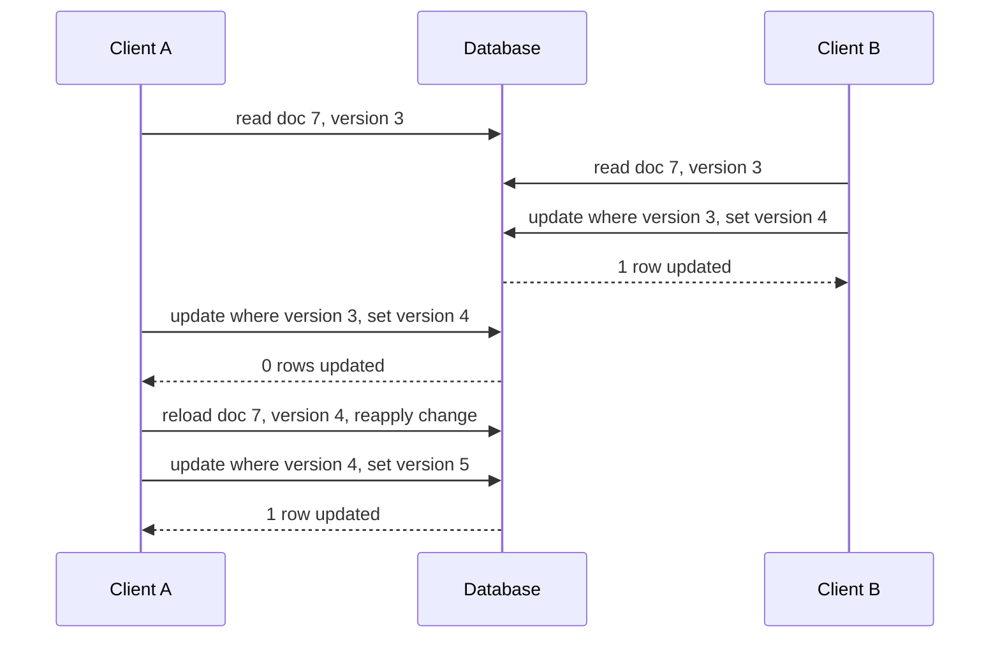

Most data corruption in web applications is not caused by bugs in a single request. It comes from two correct requests running at the same moment: two checkouts buying the last item, two webhook deliveries creating two payments, two tabs saving the same document. Isolation levels alone rarely fix this, because the default levels allow lost updates and check-then-act races. What fixes it is a small set of patterns that push the decision into a single atomic statement or a constraint the database enforces. This guide gives those patterns as recipes, in SQL first and then in MongoDB and DynamoDB, with the failure each one prevents.

## Atomic updates instead of read-modify-write

The most common race is reading a value into application memory, changing it, and writing it back. Two requests read 10, both write 11, and one increment is lost. The fix is to let the database compute the new value:

```sql
UPDATE posts SET like_count = like_count + 1 WHERE id = $1 RETURNING like_count;
```

This is safe at every isolation level in every relational engine. The row lock taken by the `UPDATE` serialises concurrent writers on that row, and each one applies its expression to the latest committed value: Postgres re-reads the row after waiting, and InnoDB `UPDATE` always reads the current version. The rule generalises: anything you can express as `SET col = f(col)` should never be computed in the application.

## Conditional updates for inventory

When the change is only allowed if a condition holds, put the condition in the `WHERE` clause and check the affected row count:

```sql
UPDATE products SET stock = stock - $2
WHERE id = $1 AND stock >= $2;
-- 1 row: reserved. 0 rows: insufficient stock (or no such product).
```

There is no window between check and write, because they are one statement under one row lock, and the condition is re-evaluated against the latest version after any wait. A `CHECK (stock >= 0)` constraint is a good backstop for bugs elsewhere.

For a cart with several products, run the conditional updates in one transaction, in ascending product ID order so two carts with overlapping items never lock in opposite orders and deadlock. If any update affects zero rows, roll back the whole transaction and report which item ran out. At 10 items per cart and a few milliseconds per transaction, this handles hundreds of checkouts per second on one primary.

## Optimistic locking with a version column

Some edits cannot be one statement: a user opens a form, edits for two minutes, and saves. Holding a lock for two minutes is not an option. Add a version column, read it with the data, and make the save conditional on it being unchanged:

```sql
UPDATE documents
SET body = $1, version = version + 1, updated_at = now()
WHERE id = $2 AND version = $3;
```

Zero affected rows means someone else saved first. For user edits, return HTTP 409 and show the newer version; over HTTP this maps naturally onto `ETag` and `If-Match`. For automated read-compute-write loops, reload and retry with a cap of three to five attempts and jittered backoff.



Optimistic locking shines when conflicts are rare. Under heavy contention on the same row it degrades into retry storms, and pessimistic locking or a single atomic statement becomes cheaper.

## Pessimistic locking with SELECT ... FOR UPDATE

When a decision depends on several rows and cannot be folded into one statement, lock what you read:

```sql
BEGIN;
SELECT id, balance FROM accounts WHERE id IN ($1, $2) ORDER BY id FOR UPDATE;
-- application checks balance, limits, account status
UPDATE accounts SET balance = balance - $3 WHERE id = $1;
UPDATE accounts SET balance = balance + $3 WHERE id = $2;
INSERT INTO ledger_entries (...) VALUES (...);
COMMIT;
```

Lock in a consistent order (`ORDER BY id`) to avoid deadlocks, keep the work between lock and commit to a few milliseconds, and set a lock timeout so a stuck transaction fails fast instead of queueing everyone behind it. InnoDB's default `innodb_lock_wait_timeout` is 50 seconds, far too long for request traffic. Both Postgres and MySQL 8.0 support `NOWAIT` to fail immediately if the row is already locked.

## Unique constraints as concurrency control

A unique index is the strongest concurrency primitive you have: the engine guarantees that of any number of concurrent inserts, exactly one wins. Many races are best solved by turning them into an insert that can conflict.

**Idempotency keys.** A client sends `Idempotency-Key: 8f1c...` with a payment request. The first thing the handler does is insert it:

```sql
CREATE TABLE idempotency_keys (
  key          text PRIMARY KEY,
  request_hash text NOT NULL,
  response     jsonb,
  created_at   timestamptz NOT NULL DEFAULT now()
);
INSERT INTO idempotency_keys (key, request_hash) VALUES ($1, $2)
ON CONFLICT (key) DO NOTHING;
```

If the insert succeeds, process the request and store the response in the same transaction as the business write. If it conflicts, return the stored response, or 409 if the request hash differs or processing is still in flight. Expire keys after 24 hours to a week.

**One active subscription per user.** "A user may have many past subscriptions but only one active" is a partial unique index in Postgres, SQL Server, SQLite and MongoDB:

```sql
CREATE UNIQUE INDEX one_active_sub ON subscriptions (user_id) WHERE status = 'active';
```

MySQL has no partial indexes; emulate it with a generated column that is `user_id` when active and `NULL` otherwise, and put a unique index on that, since unique indexes allow multiple `NULL`s. For "no two bookings overlap in time", Postgres offers exclusion constraints on ranges, which is the same idea extended to intervals.

## Upsert and its pitfalls

`INSERT ... ON CONFLICT` in Postgres and SQLite, `INSERT ... ON DUPLICATE KEY UPDATE` in MySQL, and `MERGE` elsewhere combine "insert or update" into one statement and avoid the select-then-insert race:

```sql
INSERT INTO daily_stats (site_id, day, views) VALUES ($1, $2, 1)
ON CONFLICT (site_id, day) DO UPDATE SET views = daily_stats.views + EXCLUDED.views;
```

The pitfalls are specific. It requires a unique index that matches the conflict target exactly; for a partial index you must repeat its predicate. `DO NOTHING ... RETURNING` returns no row when the key existed, so you need a follow-up `SELECT`. Each attempt may consume a sequence or auto-increment value, leaving gaps. MySQL's `ON DUPLICATE KEY` fires on any unique key, so a table with two unique indexes can update a row you did not intend. Postgres `MERGE` does not use the same conflict handling and can raise a unique violation under concurrent inserts, so prefer `ON CONFLICT` for concurrent upserts. And an upsert in a hot loop still serialises on the row it updates.

## Hot rows and counter sharding

Every pattern above serialises writers on a row lock. That is correct, but a single row can only take so many commits per second: if each transaction holds the lock for 2 milliseconds including commit, the ceiling is about 500 updates per second for that row, regardless of how many cores you have. A global "total orders" counter or a viral post's like count hits that wall.

Shard the counter: keep N rows per logical counter and update a random one. Pick the shard number in the application; calling `random()` inside the `WHERE` clause is evaluated per row and can match zero or several shards.

```sql
UPDATE counter_shards SET n = n + 1
WHERE counter_id = $1 AND shard = $2;  -- $2 = random 0..15 chosen by the app
SELECT sum(n) FROM counter_shards WHERE counter_id = $1;
```

Sixteen shards give sixteen times the write ceiling, and reads sum 16 rows. Alternatively, buffer increments in memory or Redis and flush an aggregated `+N` every second, accepting a second of lag and a small loss window on crash. For exact money balances, do not shard; append ledger rows and compute or periodically snapshot the sum.

## Job queues with SKIP LOCKED

A table works as a job queue if workers can claim different rows without blocking each other. `FOR UPDATE SKIP LOCKED`, supported in Postgres 9.5+, MySQL 8.0+ and Oracle, skips rows another transaction has locked:

```sql
UPDATE jobs SET status = 'running', locked_until = now() + interval '5 minutes',
               attempts = attempts + 1
WHERE id IN (
  SELECT id FROM jobs
  WHERE status = 'ready' AND run_at <= now()
  ORDER BY run_at LIMIT 10
  FOR UPDATE SKIP LOCKED)
RETURNING id, payload;
```

Claim in a short transaction and use a lease (`locked_until`) rather than holding the transaction open during the job; a reaper returns expired leases to `ready`. Index `(status, run_at)`, ideally partial on `status = 'ready'`, and delete or archive finished rows so the queue table stays small. This comfortably handles thousands of jobs per second; beyond that, or for fan-out to many consumers, use a real broker.

## Reservations with expiry

Seat holds, cart reservations and username claims need a lock that disappears on its own. Make expiry part of the predicate instead of relying on a cleanup job:

```sql
-- hold a seat for 10 minutes
UPDATE seats SET held_by = $2, held_until = now() + interval '10 minutes'
WHERE id = $1 AND status = 'available'
  AND (held_by IS NULL OR held_until < now());

-- confirm only if the hold is still ours and still valid
UPDATE seats SET status = 'sold'
WHERE id = $1 AND held_by = $2 AND held_until > now();
```

An expired hold is immediately claimable by the next request, a sweeper is only housekeeping, and the database clock (`now()`) is the single time source, so clock skew between app servers cannot extend a hold.

## The same patterns in MongoDB

Single-document operations are atomic, and filters act as conditions:

```javascript
// conditional decrement
db.products.findOneAndUpdate(
  { _id: sku, stock: { $gte: qty } },
  { $inc: { stock: -qty } },
  { returnDocument: "after" });          // null means insufficient stock

// optimistic locking
const r = await db.docs.updateOne({ _id: id, v: 3 }, { $set: { body }, $inc: { v: 1 } });
if (r.matchedCount === 0) { /* conflict: reload and retry */ }

// one active subscription
db.subscriptions.createIndex({ userId: 1 }, { unique: true,
  partialFilterExpression: { status: "active" } });

// claim a job
db.jobs.findOneAndUpdate({ status: "ready", runAt: { $lte: new Date() } },
  { $set: { status: "running", lockedUntil: new Date(Date.now() + 300000) } },
  { sort: { runAt: 1 } });
```

Upserts with `{ upsert: true }` need a unique index on the filter fields; without one, two concurrent upserts can both insert.

## The same patterns in DynamoDB

Condition expressions make any single-item write conditional, and a failed condition raises `ConditionalCheckFailedException` and changes nothing (it still consumes write capacity):

```javascript
// conditional decrement
UpdateExpression: "SET stock = stock - :q", ConditionExpression: "stock >= :q"
// optimistic locking
UpdateExpression: "SET body = :b, version = :next", ConditionExpression: "version = :v"
// idempotency key or create-only insert
PutItem with ConditionExpression: "attribute_not_exists(pk)"
// reservation expiry
ConditionExpression: "attribute_not_exists(heldBy) OR heldUntil < :now"
```

Use `ADD` for counters. Uniqueness of a non-key attribute such as email is enforced with `TransactWriteItems` writing the user item plus a marker item `pk = "EMAIL#a@b.com"` with `attribute_not_exists(pk)`; `ClientRequestToken` makes the transaction idempotent for 10 minutes. Do not rely on TTL for expiry correctness, since TTL deletion can lag by days; check the timestamp in the condition. Hot keys are bounded by 1,000 write units per second per partition, so shard counters with a key suffix exactly as above.

## Trade-offs and pitfalls

- **Read-modify-write in application code** where a single `UPDATE ... SET n = n + 1` would do.
- **Ignoring the affected-row count**, so a failed conditional update looks like success.
- **Optimistic locking on hot rows**, producing retry storms instead of throughput.
- **Locking in inconsistent order**, producing deadlocks under load.
- **Upserts without a matching unique index**, which silently duplicate under concurrency.
- **Expiry enforced by cron or TTL** rather than in the predicate, leaving stale holds valid.

## Interview angle

- For any "two users at once" question, name the atomic statement or constraint that makes it safe.
- Explain when you pick optimistic versus pessimistic locking, with contention as the deciding factor.
- Show idempotency keys backed by a unique index for payment and webhook handling.
- Estimate the hot-row ceiling from lock hold time and propose sharding.
- Translate the pattern to DynamoDB condition expressions or MongoDB filters.

## Key takeaways

- Push decisions into one conditional statement and check the row count.
- Unique and partial unique indexes are the most reliable concurrency control you have.
- Use version columns for long think-time edits, row locks for short multi-row decisions.
- A single row tops out at hundreds of commits per second; shard hot counters.
- The same recipes exist in MongoDB filters and DynamoDB condition expressions.
