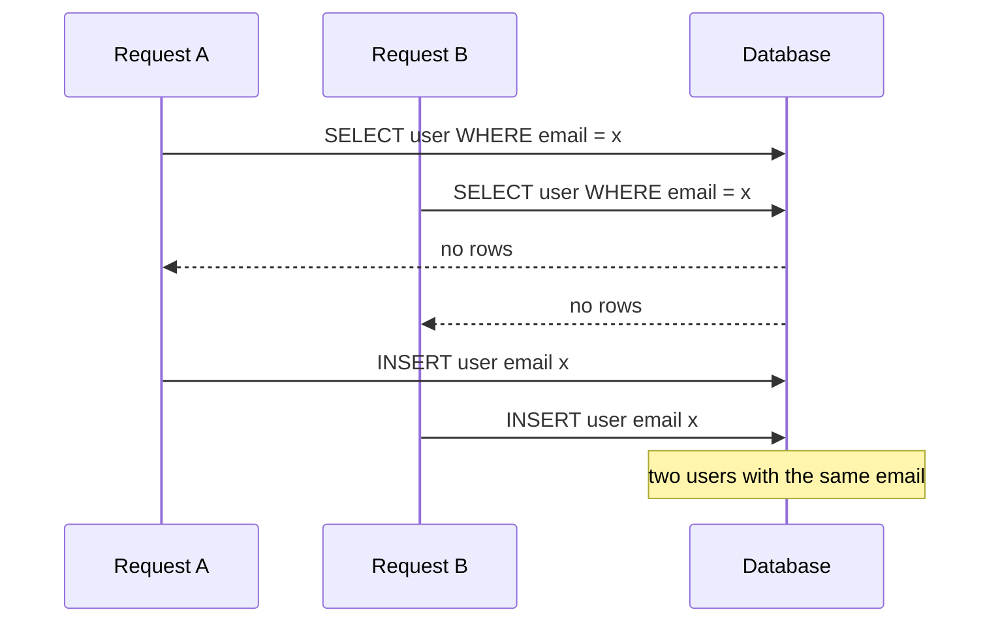

Your data will outlive your application code. Over a few years a database gets written to by the main API, background workers, admin scripts, a data migration someone ran at 2 a.m., and probably a second service in another language. Validation in one codebase protects only that codebase. Constraints in the schema protect the data from every writer, forever, and they are checked atomically with the write. This guide covers the constraint toolbox in PostgreSQL, when to use each tool, and how to turn constraint violations into useful API responses.

## Why application checks are not enough

The classic bug is the "check then insert" pattern for unique values.



Both requests pass the application check because neither sees the other's uncommitted row. Under the default READ COMMITTED isolation this happens whenever two requests arrive close together, which a double-clicked signup button produces reliably. The same race affects stock levels that must not go negative, bookings that must not overlap, and "only one active subscription per user". Locks or SERIALIZABLE isolation can fix it in the application, but a constraint fixes it with less code and without trusting every writer to remember.

Keep application validation too. It gives friendly field-level error messages before a round trip. Treat it as user experience, and the constraint as the guarantee.

## NOT NULL and CHECK

Make every column `NOT NULL` unless there is a specific meaning for "unknown" or "not applicable". Nullable columns spread three-valued logic through every query and every consumer has to handle the missing case. Adding `NOT NULL` later requires a full table scan to validate, so it is cheaper to start strict.

`CHECK` constraints express rules about a single row. They can reference several columns of that row but not other rows or tables.

```sql
CREATE TABLE products (
  id             bigint GENERATED ALWAYS AS IDENTITY PRIMARY KEY,
  sku            text NOT NULL,
  name           text NOT NULL CHECK (length(name) BETWEEN 1 AND 200),
  price_cents    bigint NOT NULL CHECK (price_cents >= 0),
  sale_cents     bigint CHECK (sale_cents >= 0),
  stock          integer NOT NULL DEFAULT 0 CHECK (stock >= 0),
  status         text NOT NULL DEFAULT 'draft'
                 CHECK (status IN ('draft', 'active', 'archived')),
  CONSTRAINT products_sale_below_price CHECK (sale_cents IS NULL OR sale_cents < price_cents)
);
```

A `CHECK` passes when its expression is true or null, which is why `sale_cents >= 0` allows a null `sale_cents`. Name multi-column constraints explicitly; the name is what you match on when translating errors. The `stock >= 0` check means that a concurrent `UPDATE products SET stock = stock - 1` can never oversell, because the row lock serialises the updates and the second one fails if it would go negative.

## UNIQUE in all its forms

A plain `UNIQUE` constraint covers the basic case. Three variations handle most real requirements.

Partial unique indexes enforce uniqueness over a subset of rows. "One active subscription per user" and "email unique among non-deleted users" are both partial uniqueness.

```sql
CREATE UNIQUE INDEX subscriptions_one_active_per_user
  ON subscriptions (user_id) WHERE status = 'active';
```

Case-insensitive uniqueness needs an expression index. Without it, `Alice@example.com` and `alice@example.com` are two accounts.

```sql
CREATE UNIQUE INDEX users_email_lower_key ON users (lower(email));
```

Queries must then filter on `lower(email) = lower($1)` to use the index. The `citext` extension or a nondeterministic collation are alternatives.

By default, `NULL` values are distinct from each other, so a unique constraint on `(org_id, external_ref)` allows many rows with a null `external_ref`. Often that is what you want. When it is not, PostgreSQL 15+ supports `NULLS NOT DISTINCT`:

```sql
ALTER TABLE integrations
  ADD CONSTRAINT integrations_org_provider_key
  UNIQUE NULLS NOT DISTINCT (org_id, provider, account_ref);
```

Uniqueness is also the foundation of idempotency. A unique `idempotency_key` column on `payments` turns a retried request into a clean conflict instead of a double charge, and `INSERT ... ON CONFLICT DO NOTHING` relies on a unique index to decide what a conflict is.

## Foreign keys

Foreign keys stop orphans and enforce that references are valid. Declare them on every relationship inside one database, index the referencing column, and choose `ON DELETE` deliberately. On a large existing table, add them without a long lock in two steps: `ADD CONSTRAINT ... NOT VALID`, which enforces the rule for new writes immediately, then `VALIDATE CONSTRAINT`, which scans existing rows with a weaker lock. The same two-step pattern works for `CHECK` constraints.

```sql
ALTER TABLE orders ADD CONSTRAINT orders_user_fk
  FOREIGN KEY (user_id) REFERENCES users (id) NOT VALID;
ALTER TABLE orders VALIDATE CONSTRAINT orders_user_fk;
```

## Exclusion constraints

Some invariants span rows in a way `UNIQUE` cannot express. The best example is "no two bookings for the same room may overlap in time". An exclusion constraint generalises uniqueness: no two rows may have values for which all the listed operators return true.

```sql
CREATE EXTENSION IF NOT EXISTS btree_gist;

CREATE TABLE room_bookings (
  id       bigint GENERATED ALWAYS AS IDENTITY PRIMARY KEY,
  room_id  bigint NOT NULL REFERENCES rooms (id),
  during   tstzrange NOT NULL,
  status   text NOT NULL DEFAULT 'confirmed',
  CONSTRAINT room_bookings_no_overlap
    EXCLUDE USING gist (room_id WITH =, during WITH &&)
    WHERE (status <> 'cancelled')
);

INSERT INTO room_bookings (room_id, during)
VALUES (1, tstzrange('2026-11-10 09:00+00', '2026-11-10 10:00+00', '[)'));
```

`btree_gist` lets the GiST index handle the plain equality on `room_id`. The half-open `[)` range means a booking ending at 10:00 does not conflict with one starting at 10:00. This replaces application-level locking that is easy to get wrong, and it holds under any concurrency. MySQL has no equivalent; there you use `SELECT ... FOR UPDATE` on a parent row or a serialisable transaction.

## Deferrable constraints

Constraints are normally checked at the end of each statement. Some valid end states require passing through invalid intermediate ones: swapping the `position` values of two list items under a unique constraint, or inserting two rows that reference each other. Declare those constraints `DEFERRABLE` and defer them inside the transaction so they are checked at commit.

```sql
ALTER TABLE playlist_items
  ADD CONSTRAINT playlist_items_position_key
  UNIQUE (playlist_id, position) DEFERRABLE INITIALLY IMMEDIATE;

BEGIN;
SET CONSTRAINTS playlist_items_position_key DEFERRED;
UPDATE playlist_items SET position = 2 WHERE id = 10;
UPDATE playlist_items SET position = 1 WHERE id = 11;
COMMIT;
```

A deferrable unique constraint cannot be used as the arbiter for `ON CONFLICT`, so do not make every constraint deferrable by default.

## Domains and generated columns

A domain is a named type with constraints attached. It keeps rules consistent across tables, so every email or currency code column validates the same way.

```sql
CREATE DOMAIN currency_code AS char(3) CHECK (VALUE ~ '^[A-Z]{3}$');
CREATE DOMAIN positive_cents AS bigint CHECK (VALUE > 0);

CREATE TABLE payments (
  id              bigint GENERATED ALWAYS AS IDENTITY PRIMARY KEY,
  idempotency_key text NOT NULL UNIQUE,
  amount_cents    positive_cents NOT NULL,
  currency        currency_code NOT NULL,
  fee_cents       bigint NOT NULL DEFAULT 0 CHECK (fee_cents >= 0),
  net_cents       bigint GENERATED ALWAYS AS (amount_cents - fee_cents) STORED
);
```

Generated columns compute a value from other columns of the same row and cannot drift out of sync, because nobody can write to them directly. Use them for derived values you filter or index on, like `net_cents` or a normalised search key. They must use immutable functions and cannot reference other rows. PostgreSQL 18 adds virtual generated columns computed on read; earlier versions support only `STORED`.

## Triggers, sparingly

Triggers can enforce rules no declarative constraint can, such as "an order's total equals the sum of its line items" or "a status may only move forward". They are also invisible to someone reading application code, slow down bulk writes, and are a common source of surprising behaviour. Prefer declarative constraints first, then triggers for genuinely cross-row rules or audit columns, and keep each trigger small and documented. Cross-row checks in triggers still have race conditions unless you lock appropriately, because two transactions cannot see each other's uncommitted rows.

## MongoDB

MongoDB has no foreign keys or CHECK constraints in the relational sense, but it does have two useful tools. Unique indexes work like PostgreSQL's, including partial ones via `partialFilterExpression` and case-insensitive ones via a collation with strength 2. Schema validation with `$jsonSchema` rejects documents that lack required fields or have the wrong types.

```javascript
db.createCollection("users", {
  validator: { $jsonSchema: {
    bsonType: "object",
    required: ["email", "createdAt"],
    properties: {
      email: { bsonType: "string", pattern: "^.+@.+$" },
      createdAt: { bsonType: "date" }
    }
  }},
  validationAction: "error"
});
db.users.createIndex({ email: 1 }, { unique: true, collation: { locale: "en", strength: 2 } });
```

Mongoose validation runs only inside your Node process. The collection validator is the one that protects you from every other writer.

## Mapping database errors to API errors

A constraint violation is not a 500. PostgreSQL reports a SQLSTATE code plus the constraint name, and your data access layer should translate them.

| SQLSTATE | Meaning | Typical API response |
|----------|---------|----------------------|
| `23505` | unique_violation | 409 Conflict, "email already registered" |
| `23503` | foreign_key_violation | 422 or 404, "referenced customer not found" |
| `23502` | not_null_violation | 422, "field required" |
| `23514` | check_violation | 422, field-specific message |
| `23P01` | exclusion_violation | 409, "room already booked for that time" |
| `40001` | serialization_failure | retry the transaction |

```javascript
const messages = {
  users_email_lower_key: { status: 409, code: "email_taken" },
  room_bookings_no_overlap: { status: 409, code: "slot_unavailable" },
};
function toApiError(err) {
  if (["23505", "23P01", "23514"].includes(err.code) && messages[err.constraint]) {
    return messages[err.constraint];
  }
  return null; // let it surface as a 500 and get logged
}
```

Map by constraint name, not by parsing the message text, which changes with locale and version. MySQL reports duplicates as error 1062 and foreign key failures as 1452. MongoDB reports duplicate keys as error code 11000.

## Trade-offs and pitfalls

- **Constraints cost a little write time**, mostly from the indexes behind `UNIQUE` and exclusion constraints. That cost is almost always worth it.
- **Adding constraints to big tables** takes locks and scans. Use `NOT VALID` then `VALIDATE`, and `CREATE UNIQUE INDEX CONCURRENTLY` followed by `ADD CONSTRAINT ... USING INDEX`.
- **Over-tight CHECKs** encode business rules that change, like a maximum order size. Keep volatile policy in code and stable invariants in the schema.
- **Nullable unique columns** silently allow duplicates of null. Decide explicitly.
- **Triggers as hidden logic** surprise people. Document them and keep them few.

## Interview angle

- Explain the check-then-insert race and why a unique constraint is the fix.
- Use an exclusion constraint for booking or reservation systems; it shows depth.
- Mention partial unique indexes for soft deletes and "one active per user" rules.
- Describe mapping `23505` to a 409 so constraint errors become API responses, not outages.

## Key takeaways

- The database is the only place an invariant holds for every writer and every race.
- Default to `NOT NULL`, add `CHECK` for row rules, and `UNIQUE` (partial or expression) for identity rules.
- Exclusion constraints solve overlap problems that applications usually get wrong.
- Use deferrable constraints only for the few cases that need invalid intermediate states.
- Name constraints and translate violations by SQLSTATE and constraint name into clean API errors.
