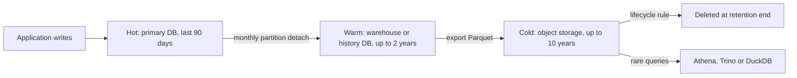

Every table is designed for its first year and lives with its fifth. The `events` table that held 2 million rows at launch holds 3 billion now, vacuum takes a day, index rebuilds need a maintenance window, the nightly backup no longer finishes overnight, and a regulator has asked you to prove that a customer who closed their account in 2023 has been deleted everywhere, including backups. None of that is fixable cheaply after the fact. Data lifecycle design means deciding at schema time how long each kind of data lives, where it lives as it ages, and how it gets deleted, then building the schema so those decisions are cheap to execute.

## Plan the growth first

Start with arithmetic. For each large table, estimate rows per day, bytes per row including index overhead, and how long you must keep it.

| Table | Rows/day | Bytes/row incl. indexes | Retention | Steady-state size |
|---|---|---|---|---|
| `orders` | 50,000 | 600 | 10 years (tax law) | 110 GB |
| `order_events` | 400,000 | 300 | 2 years online | 88 GB |
| `api_request_log` | 30,000,000 | 250 | 30 days | 225 GB |
| `sessions` | 2,000,000 | 200 | 14 days | 5.6 GB |

The log table is by far the biggest despite the shortest retention, and without any retention it would grow by 2.7 TB a year. A rough rule for Postgres or MySQL: indexes add 30 to 100 percent on top of heap size, and you want the hot working set, meaning recent rows and their indexes, to fit in memory. If steady-state size is unbounded, the design is incomplete.

## Hot, warm and cold tiers

Access frequency falls sharply with age. Orders from this week are read constantly; orders from three years ago are read for a refund dispute once a month. Match storage cost to access:

- **Hot**: the primary database on fast SSD, fully indexed, millisecond latency. Recent data only.
- **Warm**: cheaper storage that is still queryable with SQL, such as older partitions on a slower tablespace, a read replica holding history, or the warehouse.
- **Cold**: object storage such as S3, GCS or Azure Blob, in columnar files, queried rarely through Athena, BigQuery external tables, Trino or DuckDB, or restored on demand.



## Partition by time, drop instead of delete

Deleting old rows with `DELETE FROM api_request_log WHERE created_at < now() - interval '30 days'` looks harmless and is one of the most expensive statements you can run on a large table. It must find and mark every row, write WAL or undo for each one, update every index, and leave dead tuples that vacuum must later clean, while the table's file does not shrink. Deleting 30 million rows a day this way can saturate I/O and create replica lag every night.

Partitioning by time turns retention into a metadata operation. In Postgres:

```sql
CREATE TABLE api_request_log (
  id          bigint GENERATED ALWAYS AS IDENTITY,
  created_at  timestamptz NOT NULL,
  route       text NOT NULL,
  status      smallint NOT NULL,
  duration_ms integer NOT NULL,
  PRIMARY KEY (id, created_at)
) PARTITION BY RANGE (created_at);

CREATE TABLE api_request_log_2026_11_03 PARTITION OF api_request_log
  FOR VALUES FROM ('2026-11-03') TO ('2026-11-04');

-- retention: instant, no dead tuples, space returned to the OS
ALTER TABLE api_request_log DETACH PARTITION api_request_log_2026_10_03 CONCURRENTLY;
DROP TABLE api_request_log_2026_10_03;
```

The primary key must include the partition key, which is why it is `(id, created_at)`. Choose partition size so you have tens to a few hundred partitions, not thousands: daily for a 30-day log, monthly for multi-year orders. Automate creation of future partitions and dropping of old ones with pg_partman or a scheduled job; a missing partition for tomorrow means inserts fail at midnight. MySQL supports the same with `PARTITION BY RANGE` and `ALTER TABLE ... DROP PARTITION`. Queries that filter on `created_at` also benefit from partition pruning and read only relevant partitions.

## Archive to object storage as Parquet

Before dropping a partition that must be retained for longer, export it. Parquet is the standard archive format: columnar, compressed with Snappy or Zstandard, self-describing with its schema, and readable by every analytical engine. A month of `orders` that occupies 1 GB in Postgres with indexes is often 100 to 200 MB in Parquet. Write files under a partitioned path such as `s3://archive/orders/year=2023/month=04/part-000.parquet`, which query engines use to prune by date.

DuckDB makes the export a single statement:

```sql
INSTALL postgres; LOAD postgres; INSTALL httpfs; LOAD httpfs;
ATTACH 'dbname=shop host=db.internal' AS pg (TYPE postgres, READ_ONLY);
COPY (SELECT * FROM pg.public.orders_2023_04)
  TO 's3://archive/orders/year=2023/month=04/orders.parquet'
  (FORMAT parquet, COMPRESSION zstd);
```

Verify row counts and a checksum of key columns before dropping the source. Then let object storage lifecycle rules move files to cheaper classes, for example S3 Standard to Glacier Instant Retrieval after 90 days, and delete them at the end of retention.

## TTL in NoSQL stores

Several stores delete expired data for you, which suits sessions, caches, tokens and short-lived events.

- **MongoDB**: a TTL index on a date field. A background task runs every 60 seconds and removes expired documents, so deletion is approximate and still generates write load.
  ```js
  db.sessions.createIndex({ expiresAt: 1 }, { expireAfterSeconds: 0 });
  ```
- **DynamoDB**: enable TTL on a numeric attribute holding epoch seconds. Expired items are deleted in the background at no write cost, typically within a few days of expiry, so filter `expiresAt > now` in reads. Deletions appear in DynamoDB Streams, which you can use to archive items.
- **Cassandra and ScyllaDB**: `USING TTL 2592000` per write or `default_time_to_live` per table. Expired cells become tombstones; pair TTL tables with `TimeWindowCompactionStrategy` so whole SSTables expire together instead of leaving tombstones scattered through partitions.

TTL is not a compliance mechanism. It is lazy, approximate and silent on failure, so anything with a legal deadline needs a job you can monitor.

## Retention policy per data class

Retention is set per class of data, not per database, and different laws pull in opposite directions. Tax and accounting rules often require invoices for 6 to 10 years. Privacy law, notably GDPR's storage limitation principle, requires deleting personal data once it is no longer needed for its purpose. Write a policy table and encode it in the schema and the jobs:

| Data class | Example tables | Retention | Action at end |
|---|---|---|---|
| Financial records | orders, invoices, payments | 10 years | Delete; PII fields pseudonymised after account closure |
| Account PII | users, addresses | Life of account + 30 days | Hard delete or crypto-shred |
| Operational logs | api_request_log | 30 days | Drop partition |
| Security audit logs | auth_events | 1 year | Archive, then delete |
| Analytics events | clickstream | 13 months raw, aggregates kept | Drop raw, keep anonymised rollups |

Tag each table, and ideally each column, with its data class in schema comments or a data catalog, so new tables cannot be added without a retention decision.

## Designing for erasure

The right to erasure becomes manageable when personal data is concentrated rather than scattered. Isolate PII in a small set of tables keyed by `user_id`, and have other tables reference the user id rather than copy names, emails and addresses. Then erasure is "delete or anonymise these rows" plus clean-up in derived systems: search indexes, caches, the warehouse, CDC topics and third-party processors. Keep a registry of every system that receives user data, and drive deletion from a single `user_deleted` event that each consumer handles and acknowledges.

Financial records you must retain can have their personal fields replaced with a pseudonym: keep the order, amount and tax, null out the name and address, and keep the `user_id` pointing at a tombstone row.

**Backups are the hard part.** You cannot edit a 2 TB backup to remove one person. The accepted approaches are to keep backup retention short (for example 35 days), document that deleted data ages out of backups within that window, and re-apply deletions if a backup is ever restored by replaying the deletion log. The stronger technique is **crypto-shredding**: encrypt each user's PII with a per-user data key stored in a key table or KMS, and delete the key to erase. The ciphertext in every backup, archive and replica becomes unreadable at once.

```sql
CREATE TABLE user_key (
  user_id      bigint PRIMARY KEY,
  wrapped_dek  bytea NOT NULL,   -- data key encrypted by a KMS master key
  created_at   timestamptz NOT NULL DEFAULT now()
);
-- erasure: DELETE FROM user_key WHERE user_id = 42;
```

The key table itself must not be backed up for longer than the erasure deadline, or the shredding is undone by a restore. Encrypted fields also cannot be indexed or searched in the database, so keep only genuinely sensitive values encrypted.

## Legal hold

Litigation or investigation can require preserving data that retention would otherwise delete. Model it explicitly: a `legal_hold` table listing held entities or date ranges, checked by every deletion and partition-drop job, which must skip held data and log that it did. For object storage, S3 Object Lock in governance or compliance mode and equivalents on other clouds enforce holds at the storage layer. A legal hold overrides both retention schedules and erasure requests, and the release of a hold should trigger the deletions that were deferred.

## Backups, archives and PITR

Backups and archives serve different purposes and should not substitute for each other. A **backup** exists to restore the system after failure or mistakes; it is a full copy, kept briefly, and restored in full. An **archive** exists to keep specific records for years; it is selective, queryable, and organised by business date. Using backups as archives means keeping years of full copies, including data you were obliged to delete.

**Point-in-time recovery** combines a base backup with continuous WAL or binlog archiving, letting you restore to any second within the window. Managed services allow up to 35 days on Amazon RDS and Aurora. Size the window to how long a silent data-corruption bug might go unnoticed, commonly 7 to 14 days, and test restores regularly; a backup that has never been restored is a hope, not a plan.

## Cost math

Illustrative list prices, which vary by region and change over time, show why tiering matters. Provisioned SSD block storage for a database costs about 0.08 to 0.12 USD per GB-month before replicas; with a primary and two replicas, 1 TB of hot data is around 300 USD a month in storage alone, plus the instance memory needed to cache it. The same terabyte, compressed 6 times into Parquet, is about 170 GB in S3 Standard at roughly 0.023 USD per GB-month, about 4 USD a month, or under 1 USD in Glacier tiers.

## Trade-offs and pitfalls

- **No retention decision at design time.** Unbounded tables become a migration project later.
- **Bulk `DELETE` for retention.** Use partition drops; delete rows only for small, targeted removals.
- **Relying on TTL for compliance.** It is approximate and unmonitored.
- **PII copied everywhere.** Every copy is another system the erasure process must reach.
- **Backups kept for years.** They become archives of data you were required to delete.
- **Crypto-shredding with backed-up keys.** Restoring the key table restores the data.
- **Untested restores.** PITR that has never been exercised fails when you need it.

## Interview angle

- Estimate growth per table and show the steady-state size with retention applied.
- Propose time partitioning with partition drops and a hot, warm, cold tiering plan.
- Distinguish backups from archives and size the PITR window.
- Explain erasure with PII isolation and crypto-shredding, including the backup problem.
- Mention legal hold as an override on retention jobs.

## Key takeaways

- Every large table needs a growth estimate and a retention period at design time.
- Partition by time and drop partitions instead of deleting rows.
- Archive old data as compressed Parquet in object storage with lifecycle rules.
- TTL is convenient for ephemeral data but not a compliance guarantee.
- Isolate PII and use crypto-shredding so erasure reaches backups too.
- Backups restore systems, archives keep records; size and test each separately.
