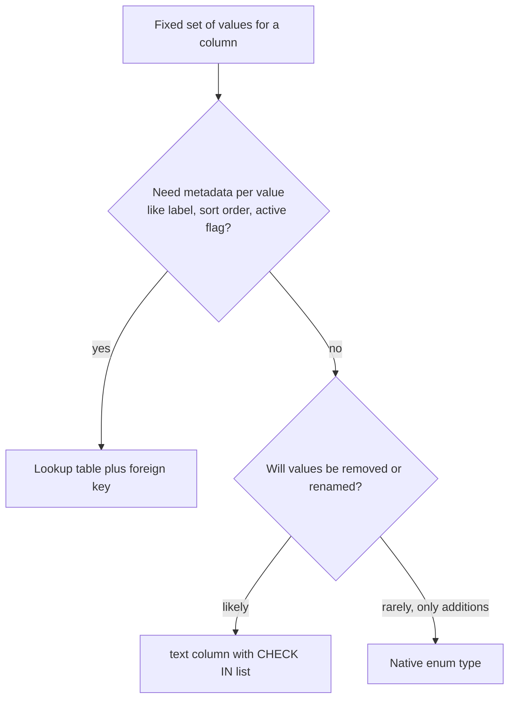

A column type is a constraint, a storage decision and a contract with every consumer of the data. Pick the wrong one and you get rounding errors in invoices, timestamps that shift by an hour twice a year, or a migration that rewrites a 500 GB table to widen an integer. This guide uses PostgreSQL types and notes where MySQL and MongoDB differ.

## Integers

PostgreSQL has `smallint` (2 bytes, up to 32,767), `integer` (4 bytes, about 2.1 billion) and `bigint` (8 bytes, about 9.2 quintillion). Use `bigint` for primary keys and anything that counts events, bytes or money in minor units. Use `integer` for bounded quantities like stock levels, retry counts or ages. `smallint` rarely saves space because of alignment padding. PostgreSQL has no unsigned integers; add `CHECK (x >= 0)` instead. MySQL has `UNSIGNED`, which doubles the positive range but complicates arithmetic that can go negative.

Widening `integer` to `bigint` later rewrites the whole table and every index under an exclusive lock, so err on the larger side for anything that grows with traffic.

## Money: never float

`real` and `double precision` are binary floating point. They cannot represent 0.10 exactly, so `0.1 + 0.2` is `0.30000000000000004`, and sums over millions of rows drift. Never store money in a float column.

There are two correct options. `numeric(19,4)` stores exact decimals and is convenient for reports and currency conversion where you need fractional cents. Integer minor units (`bigint amount_cents`) store the amount in the currency's smallest unit; they are faster, smaller, map cleanly to integers in every language, and are what payment providers like Stripe use in their APIs. Minor units differ by currency: USD and EUR have 2 decimals, JPY has 0, KWD and BHD have 3. Store the currency alongside every amount.

```sql
CREATE TABLE invoice_lines (
  id           bigint GENERATED ALWAYS AS IDENTITY PRIMARY KEY,
  invoice_id   bigint NOT NULL REFERENCES invoices (id) ON DELETE CASCADE,
  description  text NOT NULL,
  quantity     integer NOT NULL CHECK (quantity > 0),
  unit_amount  bigint NOT NULL CHECK (unit_amount >= 0),  -- minor units
  currency     char(3) NOT NULL CHECK (currency ~ '^[A-Z]{3}$'),
  tax_rate     numeric(6,4) NOT NULL DEFAULT 0            -- 0.2000 = 20%
);
```

Avoid PostgreSQL's `money` type: its formatting and precision depend on the `lc_monetary` setting and it holds no currency. Decide and document the rounding rule (banker's rounding or half-up, per line or per invoice) in one place in the code.

## Time: timestamptz and UTC

PostgreSQL has `timestamp` (without time zone) and `timestamptz` (with time zone). The names mislead: `timestamptz` does not store a zone. It stores an absolute instant as UTC, converting input from the session's `TimeZone` and converting back on output. `timestamp` stores a wall-clock reading with no zone at all, so `2026-03-29 02:30` could be any of 24 different instants, or one that does not exist in a DST gap.

Use `timestamptz` for anything that happened at a moment: `created_at`, `paid_at`, `expires_at`. Set the application connection's time zone to UTC so serialised values are unambiguous, and convert to local time in the presentation layer. Both types are 8 bytes, so there is no storage reason to choose `timestamp`.

`timestamp` without time zone is correct for future local events tied to a place, such as "the store opens at 09:00 local time" or a recurring meeting. Store the wall time plus an IANA zone name like `'Europe/Berlin'`, and compute the instant when needed, because time zone rules change after you store the data.

MySQL's `TIMESTAMP` converts to UTC but only covers 1970 to 2038; `DATETIME` has no zone handling. Store UTC in `DATETIME` and handle zones in the application. MongoDB's `Date` is a UTC millisecond instant.

## Dates and durations

Use `date` (4 bytes) for values with no time component: birth dates, billing periods, holidays. Storing a birth date as midnight UTC in a `timestamptz` shows the wrong day to users west of Greenwich.

Use `interval` for durations like trial lengths or SLA windows. It stores months, days and microseconds separately, so `'1 month'` added to January 31 gives the end of February and `'1 day'` across a DST change stays a calendar day. For pure elapsed time measured in seconds, an `integer` or `bigint` of seconds or milliseconds is simpler and easier to aggregate. For periods with a start and end, use range types like `tstzrange` or `daterange`, which support overlap checks and exclusion constraints.

## Text

In PostgreSQL, `text` and `varchar(n)` share the same storage. `varchar(n)` only adds a length check, and `char(n)` pads with spaces and is almost never what you want except for fixed codes. Use `text` by default and add `CHECK (length(col) <= n)` when there is a real business limit. Changing a CHECK is a fast metadata-plus-validation operation; reducing a `varchar` limit requires a table rewrite.

MySQL is different. `VARCHAR(n)` lengths are in characters, affect index key limits (3,072 bytes in InnoDB, which is 768 characters in `utf8mb4`) and memory use in temporary tables, so sizing matters more. Always use `utf8mb4` there; MySQL's legacy `utf8` cannot store emoji.

## Enums, lookup tables and CHECK

A column with a fixed set of values has three implementations, and the difference is mostly the cost of changing the set later.



A native `ENUM` type is compact (4 bytes) and self-documenting. Adding a value is cheap with `ALTER TYPE ... ADD VALUE`, but removing or renaming one means creating a new type and rewriting the column. Enum ordering follows declaration order, which can surprise sorting.

A `text` column with `CHECK (status IN (...))` is easy to change: drop and re-add the constraint. A lookup table with a foreign key lets you attach labels and "active" flags, and changes through ordinary inserts.

```sql
CREATE TYPE order_status AS ENUM ('pending', 'paid', 'shipped', 'cancelled');
ALTER TYPE order_status ADD VALUE 'refunded' AFTER 'shipped';

CREATE TABLE plan_tiers (
  code        text PRIMARY KEY,
  label       text NOT NULL,
  sort_order  integer NOT NULL,
  is_active   boolean NOT NULL DEFAULT true
);
```

MySQL `ENUM` changes can require a table rebuild, so `CHECK` (enforced since 8.0.16) or lookup tables are usually safer.

## Booleans vs status columns

`boolean` is right for a true two-state fact: `email_verified`, `is_admin`. Be suspicious when a table grows `is_active`, `is_suspended` and `is_deleted`. Those flags form a state machine with impossible combinations, like active and deleted at once. Replace them with a single `status` column. Similarly, `is_verified boolean` often wants to be `verified_at timestamptz`, which records when as well as whether.

## NULL and three-valued logic

`NULL` means unknown or not applicable, and comparisons with it return `NULL`, not true or false. `WHERE discount <> 10` skips rows where `discount` is null. `NOT IN (subquery)` returns no rows at all if the subquery yields a single null; use `NOT EXISTS` instead. `count(col)` ignores nulls while `count(*)` does not, and `sum` over zero rows returns null, so wrap it in `coalesce(sum(x), 0)`. Use `IS DISTINCT FROM` for null-safe comparison.

The schema-level rule is simple: `NOT NULL` by default, and allow null only when a missing value carries meaning you can state in one sentence.

## JSON and JSONB

`jsonb` stores parsed binary JSON with GIN indexing and containment operators. Prefer it over `json`, which keeps the raw text and is only useful when you must preserve key order or whitespace.

JSONB is the right choice for data that is genuinely variable or owned by someone else: webhook payloads, per-integration settings, product attributes that differ by category, feature flags. It is abuse when it hides core relational data. If you query a key in every request, join on it, aggregate it, or need a foreign key or uniqueness on it, it should be a column. Updating one key rewrites the whole value, and large documents (over about 2 KB) are moved to TOAST storage, so frequently updated large blobs are slow. A good compromise is promoting hot keys to generated columns or expression indexes.

## Arrays and specialised types

Arrays (`text[]`, `bigint[]`) suit small lists that are read and written as a whole, like tags on a post with a GIN index. They cannot hold foreign keys, so for references to other rows use a junction table.

PostgreSQL also has types that validate and compress values you would otherwise store as text. `uuid` takes 16 bytes instead of 36 for the string form. `inet` and `cidr` store IPv4 and IPv6 addresses with containment operators, so "is this IP in 10.0.0.0/8" is an indexed query. `citext` is case-insensitive text, useful for emails and usernames. `bytea` holds binary data, though large files belong in object storage.

## Storage sizes

| Type | Size | Notes |
|------|------|-------|
| `boolean` | 1 byte | |
| `smallint` / `integer` / `bigint` | 2 / 4 / 8 bytes | alignment may pad small types |
| `numeric` | variable, about 2 bytes per 4 digits plus overhead | exact, slower arithmetic |
| `real` / `double precision` | 4 / 8 bytes | never for money |
| `date` | 4 bytes | |
| `timestamp` / `timestamptz` | 8 bytes | microsecond precision |
| `interval` | 16 bytes | |
| `uuid` | 16 bytes | |
| `inet` | 7 or 19 bytes | IPv4 or IPv6 |
| `text` / `varchar` | 1 or 4 bytes header plus data | compressed or TOASTed when large |
| `jsonb` | variable | binary, TOASTed when large |

Every row also carries about 23 bytes of header, and the null bitmap means null values take no data space.

## Trade-offs and pitfalls

- **Floats for money** produce rounding errors that accountants find months later.
- **`timestamp` for instants** breaks as soon as servers or users span time zones.
- **Undersized integers** force full-table rewrites when they overflow.
- **Enums you need to shrink** are painful; use CHECK or lookup tables for volatile sets.
- **JSONB as a schema escape hatch** loses constraints, types and query planner statistics.

## Interview angle

- State that money is stored as integer minor units or `numeric`, with a currency column.
- Explain `timestamptz` as an absolute instant and why you store UTC.
- Give a clear rule for JSONB: variable or external data yes, core queried fields no.
- Show you know the `NOT IN` with null trap.

## Key takeaways

- Use `bigint` for IDs and counters, `integer` for bounded quantities.
- Store money as integer minor units or `numeric`, always with a currency.
- Use `timestamptz` for instants, `date` for days, `timestamp` plus a zone name for future local times.
- Prefer `text` with CHECK limits in PostgreSQL; size `VARCHAR` carefully in MySQL.
- Choose enums, CHECK lists or lookup tables by how often the set will change.
- Default to `NOT NULL`, and use JSONB for variable data, not as a substitute for columns.
