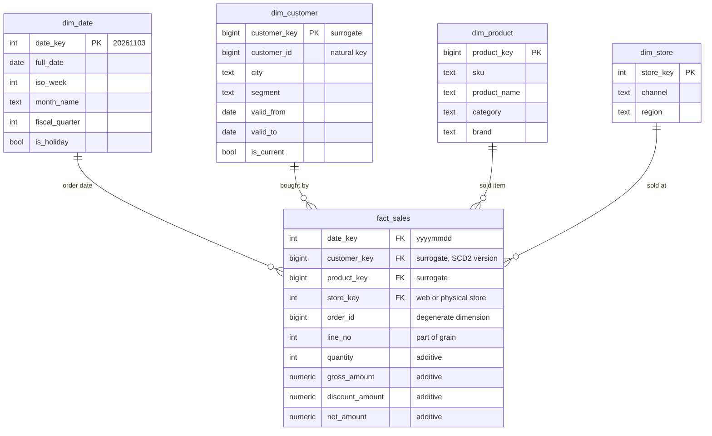
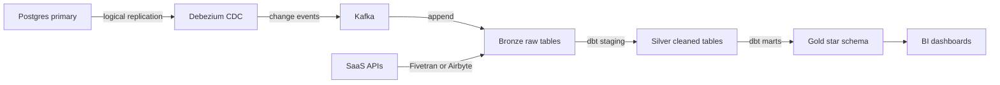

An application database and an analytical database answer different questions with different shapes of query. The application asks "load order 9001 and its five line items" thousands of times per second. The analyst asks "revenue by product category by week for the last two years, excluding refunds" a few times an hour, touching hundreds of millions of rows. A schema normalised for the first question is slow and confusing for the second, and running the second on the production primary can take the application down. Warehouse modelling is the discipline of reshaping operational data into a form that makes analytical questions fast, correct and easy to ask.

## OLTP versus OLAP

| Property | OLTP (application) | OLAP (warehouse) |
|---|---|---|
| Typical query | Point lookups and small updates by key | Scans and aggregates over millions of rows |
| Rows touched per query | 1 to 100 | 10^6 to 10^10 |
| Concurrency | Thousands of short transactions | Tens of long queries |
| Schema | Normalised, third normal form | Denormalised: star schema or wide tables |
| Storage layout | Row-oriented | Column-oriented |
| Latency target | Milliseconds | Seconds |
| Examples | Postgres, MySQL, SQL Server | BigQuery, Snowflake, Redshift, ClickHouse |

Running analytics on the primary is tempting because the data is already there. The problems arrive together. A query that scans the 200 GB `order_item` table evicts the working set from the buffer cache, so application queries that used to hit memory now hit disk. Long-running reads hold back vacuum in Postgres, bloating hot tables. Locks and I/O saturation raise p99 latency for checkout. And analysts end up writing eight-way joins against a schema designed for the application's convenience, with column names only the backend team understands. A read replica fixes the first problems partly, but not the row-oriented storage or the schema.

## Why columnar storage wins for analytics

A row store keeps all columns of a row together on a page. To sum `revenue` across 500 million rows, it reads every column of every row. A column store keeps each column in its own contiguous file segments, so the same query reads only `revenue` and whatever columns appear in the filter. If the table has 40 columns and the query touches 3, that alone cuts I/O by more than 90 percent.

Columns also compress far better because neighbouring values have the same type and often repeat. A `country` column with 30 distinct values over a billion rows compresses with dictionary and run-length encoding to a few megabytes. Compression ratios of 5 to 10 times are routine. Engines then process compressed column chunks in vectorised batches of thousands of values, and skip whole blocks using per-block min/max statistics, which is why sorting or clustering a table by date makes date-filtered queries cheap. In BigQuery, which bills by bytes scanned, selecting 3 columns instead of `SELECT *` directly cuts the bill.

## The star schema

The star schema, from Ralph Kimball's dimensional modelling, splits data into two kinds of table. **Fact tables** record measurable events: a sale, a page view, a shipment. They are long and narrow, holding foreign keys and numeric measures. **Dimension tables** describe the context of those events: who, what, where, when. They are short and wide, holding descriptive text attributes that analysts filter and group by.



A typical query joins the fact table to the dimensions it needs, filters on dimension attributes and aggregates measures:

```sql
SELECT d.iso_week, p.category, SUM(f.net_amount) AS revenue
FROM fact_sales f
JOIN dim_date d     ON d.date_key = f.date_key
JOIN dim_product p  ON p.product_key = f.product_key
JOIN dim_customer c ON c.customer_key = f.customer_key
WHERE d.full_date >= DATE '2026-01-01'
  AND c.segment = 'B2B'
GROUP BY 1, 2
ORDER BY 1, 2;
```

Each join is from a large fact table to a small dimension, which every warehouse optimises well. Analysts can learn the model in an afternoon because every question has the same shape.

## Grain comes first

The **grain** is the precise statement of what one fact row represents. For `fact_sales` above it is "one line item on one order". Declare the grain before choosing columns, because it decides everything else. Every dimension must be single-valued at that grain, and every measure must belong to it. A common error is mixing grains: putting the order-level shipping fee on every line-item row, so `SUM(shipping_fee)` multiplies it by the number of lines. Either allocate the fee across lines (and document the rule) or keep a separate order-grain fact table. Choose the most atomic grain the source supports; you can always aggregate up, never down.

## Additive, semi-additive and non-additive measures

**Additive** measures can be summed across every dimension: quantity, net amount, cost. **Semi-additive** measures can be summed across some dimensions but not time. Account balances and inventory levels are the classic examples: summing the stock level across warehouses on one day is meaningful, but summing Monday's and Tuesday's stock is not. For those, aggregate over time with the last value in the period or an average. These usually live in **periodic snapshot** fact tables, such as one row per product per warehouse per day. **Non-additive** measures, such as ratios, percentages and unit prices, should not be stored for summing at all; store the numerator and denominator and compute the ratio after aggregation. Average order value is `SUM(net_amount) / COUNT(DISTINCT order_id)`, not the average of a stored per-row value.

## Snowflake schemas

A snowflake schema normalises dimensions further: `dim_product` references `dim_category`, which references `dim_department`. It saves a little storage and keeps hierarchies in one place, but adds joins to every query and makes the model harder to browse. In columnar warehouses the storage saving is negligible because repeated category names compress to almost nothing. The usual recommendation is to keep dimensions flat and snowflake only when a sub-dimension is large and shared, or when a tool demands it.

## Slowly changing dimensions

When a customer moves from Lyon to Paris, should last year's sales show under Lyon or Paris? Using a surrogate `customer_key` instead of the natural `customer_id` in the fact table is what makes both answers possible. With SCD type 2, the dimension gets a new row with a new surrogate key when a tracked attribute changes, and new fact rows point at the new key. Old facts keep pointing at the Lyon version, so reports show history as it happened. A query wanting current attributes joins on `customer_id` to the `is_current` row instead. Type 1 attributes, such as a corrected spelling, overwrite in place. The ETL step that loads facts must look up the dimension version valid at the event time, which is the most error-prone part of the pipeline and deserves tests.

## Wide denormalised tables

Modern cloud warehouses have shifted practice. BigQuery, Snowflake and ClickHouse handle very wide tables well thanks to columnar storage, and BigQuery supports nested and repeated fields (`STRUCT` and `ARRAY`) that can store line items inside an order row. Many teams now publish **one big table** per subject, joining facts and dimensions ahead of time into a table with 150 columns, because BI tools and casual users find a single table easier and join cost disappears. ClickHouse in particular favours denormalised tables sorted by an `ORDER BY` key, since its joins are less optimised than its scans.

The trade-off is rebuild cost and history semantics. A wide table bakes in one choice of dimension version, and changing a dimension attribute means rewriting large parts of it. A good compromise is to keep the star schema as the modelled core and build wide tables as derived marts on top.

## ELT with dbt

Classic ETL transformed data before loading it into the warehouse. Cheap warehouse compute made **ELT** the norm: load raw data first, then transform it inside the warehouse with SQL. dbt is the standard tool. Each model is a `SELECT` statement in a file; dbt resolves dependencies through `ref()`, materialises models as views, tables or incremental tables, runs tests and generates lineage documentation.

```sql
-- models/marts/fact_sales.sql
{{ config(materialized='incremental', unique_key=['order_id','line_no']) }}

select
  cast(format_date('%Y%m%d', o.placed_at) as int64) as date_key,
  c.customer_key,
  p.product_key,
  o.order_id,
  i.line_no,
  i.quantity,
  i.quantity * i.unit_price as gross_amount,
  i.discount as discount_amount,
  i.quantity * i.unit_price - i.discount as net_amount,
  o.updated_at as source_updated_at
from {{ ref('stg_order_items') }} i
join {{ ref('stg_orders') }} o using (order_id)
join {{ ref('dim_customer') }} c
  on c.customer_id = o.customer_id
 and o.placed_at >= c.valid_from and o.placed_at < coalesce(c.valid_to, timestamp '9999-12-31')
join {{ ref('dim_product') }} p on p.sku = i.sku

where o.updated_at > (select max(source_updated_at) from {{ this }})

```

Tests such as `unique`, `not_null` and `relationships` on keys catch broken grain and orphaned facts before dashboards show wrong numbers. dbt snapshots implement SCD type 2 for source tables that only hold current state.

## Medallion layers

The medallion architecture names the stages data passes through:

- **Bronze**: raw data exactly as received, append-only, with ingestion timestamps. Never edited, so you can always reprocess.
- **Silver**: cleaned and conformed. Types cast, duplicates removed, CDC events collapsed into current rows, IDs standardised, PII masked where needed.
- **Gold**: business-level models such as star schemas, wide marts and metric tables, the only layer BI tools and analysts query.

In dbt terms these map roughly to sources, staging models and marts.



## CDC from OLTP into the warehouse

Nightly full dumps of production tables stop working once tables pass a few hundred gigabytes, and they miss intermediate states. **Change data capture** reads the database's replication log (Postgres WAL via logical decoding, MySQL binlog) and emits an event for every insert, update and delete with the before and after row. Debezium is the common open-source option; managed tools like Fivetran, Airbyte, AWS DMS and Datastream do the same. CDC adds negligible load on the primary, captures deletes that timestamp-based extraction misses, and delivers changes within seconds.

In the warehouse, CDC events land in bronze as an append-only log, and the silver layer applies them with a `MERGE` keyed on primary key and ordered by log position, so the latest version wins. Keep the raw log: it gives you full history for free and lets you rebuild SCD dimensions retroactively. Watch replication slots on the primary; a stalled Postgres slot retains WAL until the disk fills.

## Trade-offs and pitfalls

- **Undeclared or mixed grain.** Sums double-count when order-level values sit on line-level rows.
- **Summing semi-additive measures over time.** Balances and stock levels need last-value or average semantics.
- **Storing ratios.** Store numerator and denominator; compute the ratio after aggregation.
- **Natural keys in facts.** Without surrogate keys, SCD type 2 history cannot be represented.
- **Over-snowflaking.** More joins and a harder model for storage savings columnar compression already gives.
- **Analysts querying bronze.** Raw tables change shape with the source; expose only gold.
- **Unmonitored CDC slots.** A stuck slot fills the primary's disk.

## Interview angle

- Separate OLTP and OLAP early and explain why analytics on the primary hurts latency.
- Draw a star schema, state its grain in one sentence and classify each measure.
- Explain columnar storage benefits: read only needed columns, compression, block skipping.
- Describe the pipeline: CDC into bronze, dbt into silver and gold, BI on gold.
- Mention SCD type 2 with surrogate keys for history-correct reports.

## Key takeaways

- Never run heavy analytics on the production primary; move data to a columnar warehouse.
- Star schemas put events in narrow fact tables and context in wide dimension tables.
- Declare the grain first and keep every measure consistent with it.
- Know which measures are additive, semi-additive and non-additive.
- Wide denormalised tables suit modern warehouses as derived marts over a modelled core.
- ELT with dbt, medallion layers and CDC ingestion form the standard modern pipeline.
