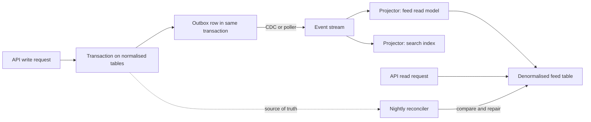

Denormalisation means storing a fact in more than one place so that a read is cheaper. It is a legitimate tool, not a sign of a bad schema, but it trades read cost for write cost and for a permanent consistency obligation: every copy must be updated when the source changes, and something must notice when it is not. Teams that denormalise "for performance" before measuring end up with drifting counters and stale summaries and still have the slow query. The rule is simple: start normalised, measure the hot path, denormalise the specific thing that is slow, and name the mechanism that keeps the copy right.

## When to denormalise

Denormalise when all of these hold. The query is on a hot path, such as a feed, a product listing or a dashboard that loads on every visit. It is read far more often than its inputs change. You have measured it with `EXPLAIN (ANALYZE, BUFFERS)` on realistic data, and indexes, query rewrites and caching have already been tried. And you can state how stale the copy may be: zero (must update in the same transaction), seconds, or hours.

Typical signals are a count or sum computed over many rows on every page load, a join through three tables to fetch one display field, or an aggregation over months of data in a report that runs every minute. If the slow query runs once a day, leave it alone.

## Duplicated columns

The simplest technique copies a column from a parent into a child to avoid a join or to enable an index. A comments table might store `post_author_id` so "comments on my posts" can be served by one index without joining `posts`. A multi-tenant schema stores `tenant_id` on every table so every query and index can lead with it.

Prefer duplicating immutable values. A tenant never changes for a row, so the copy cannot drift. If the value can change, enforce it: a composite foreign key such as `FOREIGN KEY (post_id, post_author_id) REFERENCES posts (id, author_id) ON UPDATE CASCADE` (with a matching unique constraint on `posts`) makes the database keep the copy correct.

## Counter caches

A `likes_count` on `posts` saves a `count(*)` over `post_likes` on every feed render. It is also the most common source of wrong numbers. There are three ways to maintain it.

**Transactional update in the same statement.** Do the insert and the increment together, so either both happen or neither does. The `ON CONFLICT DO NOTHING` makes a double-click idempotent, and the counter only moves if a row was actually inserted.

```sql
CREATE TABLE posts (
  id          bigint GENERATED ALWAYS AS IDENTITY PRIMARY KEY,
  author_id   bigint NOT NULL,
  body        text   NOT NULL,
  likes_count bigint NOT NULL DEFAULT 0 CHECK (likes_count >= 0),
  created_at  timestamptz NOT NULL DEFAULT now()
);

CREATE TABLE post_likes (
  post_id    bigint NOT NULL REFERENCES posts (id) ON DELETE CASCADE,
  user_id    bigint NOT NULL,
  created_at timestamptz NOT NULL DEFAULT now(),
  PRIMARY KEY (post_id, user_id)
);

WITH ins AS (
  INSERT INTO post_likes (post_id, user_id)
  VALUES ($1, $2)
  ON CONFLICT DO NOTHING
  RETURNING post_id
)
UPDATE posts SET likes_count = likes_count + 1
WHERE id IN (SELECT post_id FROM ins);
```

**Trigger.** A trigger guarantees the counter moves no matter which code path writes to `post_likes`, including manual fixes and other services.

```sql
CREATE FUNCTION post_likes_counter() RETURNS trigger
LANGUAGE plpgsql AS $$
BEGIN
  IF TG_OP = 'INSERT' THEN
    UPDATE posts SET likes_count = likes_count + 1 WHERE id = NEW.post_id;
  ELSIF TG_OP = 'DELETE' THEN
    UPDATE posts SET likes_count = likes_count - 1 WHERE id = OLD.post_id;
  END IF;
  RETURN NULL;
END;
$$;

CREATE TRIGGER post_likes_counter
AFTER INSERT OR DELETE ON post_likes
FOR EACH ROW EXECUTE FUNCTION post_likes_counter();
```

Use one of these two, not both, or every like counts twice. Both share a weakness: every like on a viral post updates the same row, so writers queue on its row lock, and each update creates a new row version that vacuum must clean. For very hot counters, spread the writes across slots (`post_like_counts(post_id, slot, n)` with a random slot from 0 to 15) and sum the slots on read, or buffer increments in Redis and flush them in batches.

**Asynchronous with reconciliation.** When exact real-time counts are not required, publish a "liked" event and let a worker apply increments. This removes contention from the request path but means the counter can lag and, after bugs or replays, drift. Whichever method you choose, run a reconciliation job that recomputes the truth for a range of rows and fixes only those that differ:

```sql
UPDATE posts p
SET likes_count = sub.actual
FROM (
  SELECT p2.id, count(l.user_id) AS actual
  FROM posts p2
  LEFT JOIN post_likes l ON l.post_id = p2.id
  WHERE p2.id BETWEEN $1 AND $2
  GROUP BY p2.id
) sub
WHERE p.id = sub.id
  AND p.likes_count IS DISTINCT FROM sub.actual;
```

Run it in batches of a few thousand IDs, log how many rows it corrected, and alert when that number is not near zero. A reconciler that silently fixes things hides the bug that caused the drift.

## Summary and rollup tables

When a dashboard aggregates millions of rows, precompute the aggregate at the grain the dashboard needs, such as per product per day, and query the small table instead.

```sql
CREATE TABLE daily_product_sales (
  day           date   NOT NULL,
  product_id    bigint NOT NULL,
  units         bigint NOT NULL,
  revenue_cents bigint NOT NULL,
  PRIMARY KEY (day, product_id)
);

INSERT INTO daily_product_sales (day, product_id, units, revenue_cents)
SELECT (o.placed_at AT TIME ZONE 'UTC')::date,
       ol.product_id,
       sum(ol.quantity),
       sum(ol.quantity * ol.unit_price_cents)
FROM orders o
JOIN order_lines ol ON ol.order_id = o.id
WHERE o.status = 'paid'
  AND o.placed_at >= $1 AND o.placed_at < $2
GROUP BY 1, 2
ON CONFLICT (day, product_id) DO UPDATE
SET units = EXCLUDED.units,
    revenue_cents = EXCLUDED.revenue_cents;
```

Recomputing a whole day and upserting it, rather than adding deltas, makes the job idempotent: rerunning it after a failure or a late refund produces the same answer. Recompute the last few days on every run to absorb late-arriving changes, and pin the day boundary to an explicit time zone so the result does not depend on the session setting. In MySQL the same pattern uses `INSERT ... ON DUPLICATE KEY UPDATE`.

## Materialized views

A PostgreSQL materialized view stores the result of a query as a table that you refresh on demand. It is a rollup table where the database owns the definition.

```sql
CREATE MATERIALIZED VIEW product_sales_30d AS
SELECT ol.product_id,
       sum(ol.quantity) AS units,
       sum(ol.quantity * ol.unit_price_cents) AS revenue_cents
FROM orders o
JOIN order_lines ol ON ol.order_id = o.id
WHERE o.status = 'paid'
  AND o.placed_at >= now() - interval '30 days'
GROUP BY ol.product_id;

CREATE UNIQUE INDEX product_sales_30d_pk ON product_sales_30d (product_id);

REFRESH MATERIALIZED VIEW CONCURRENTLY product_sales_30d;
```

A plain `REFRESH` takes an exclusive lock and blocks readers until it finishes. `REFRESH ... CONCURRENTLY` builds the new result, diffs it against the old one and applies the changes, so reads continue. It requires a unique index on plain columns covering all rows, and the view must already be populated. It is slower and generates more write traffic than a plain refresh, so it suits views where blocking reads is unacceptable.

The limitation is that every refresh recomputes the entire query. PostgreSQL has no built-in incremental refresh. Alternatives when full recomputation is too slow: a trigger- or job-maintained rollup table that only touches changed keys, the `pg_ivm` extension for incremental view maintenance, TimescaleDB continuous aggregates for time-series, or a stream processor feeding a summary table. MySQL has no materialized views at all, so rollup tables are the pattern there. MongoDB offers on-demand materialized views by running an aggregation that ends in `$merge` into a target collection.

## Snapshots are facts, not copies

Not every repeated value is denormalisation. An order line stores `unit_price_cents` and often the product name at the time of purchase. These look like copies of `products.price_cents` and `products.name`, but they are different facts: what the customer was charged, and what the receipt said. If the product price changes tomorrow, yesterday's order must not change.

```sql
CREATE TABLE order_lines (
  order_id         bigint NOT NULL REFERENCES orders (id) ON DELETE CASCADE,
  line_no          int    NOT NULL,
  product_id       bigint NOT NULL REFERENCES products (id),
  product_name     text   NOT NULL,
  unit_price_cents int    NOT NULL CHECK (unit_price_cents >= 0),
  quantity         int    NOT NULL CHECK (quantity > 0),
  PRIMARY KEY (order_id, line_no)
);
```

The same applies to a shipping address on an order or the tax rate on an invoice. Snapshots are written once and never synchronised, so they carry no consistency cost. A whole snapshot can also live in a `jsonb` column when it is only read for display or audit.

## Read models and CQRS

At the far end, you build an entire read-optimised store from the write-side events or change log. The write model stays normalised and enforces invariants; one or more read models, shaped exactly for specific screens, are updated asynchronously. This is command query responsibility segregation (CQRS).



Read models can be tables in the same database, a search index or a cache. They are eventually consistent, so the UI must tolerate a user not seeing their own write immediately (or read from the write side for that user). Because they are derived, they must be rebuildable from scratch, which is your recovery plan when a projector bug corrupts them.

## The cost of keeping copies consistent

Every copy adds write amplification (one logical change becomes several physical writes), lock contention on shared rows, more code paths that must remember to update it, and a reconciliation job to run and monitor. Count those costs before adding a copy, and remove copies whose hot path no longer exists.

## Trade-offs and pitfalls

- **Denormalising before measuring.** The slow part is often a missing index.
- **Counters maintained in two places**, such as a trigger plus application code, double-count.
- **Hot-row contention** on viral counters; shard the counter or batch increments.
- **No reconciliation.** Every counter eventually drifts; detect and alert on it.
- **Blocking refreshes.** Plain `REFRESH MATERIALIZED VIEW` blocks reads; use `CONCURRENTLY` with a unique index.
- **Calling snapshots redundancy** and "fixing" them with a join, which rewrites history.

## Interview angle

- Say you would start normalised, measure, and denormalise one named hot path.
- For a like counter, explain transactional update or trigger, hot-row contention and reconciliation.
- Distinguish rollup tables and materialized views, and mention `REFRESH CONCURRENTLY` and its unique-index requirement.
- Explain that an order line's price is a historical fact, not a denormalised copy.
- For large systems, describe CQRS with an outbox, projectors and rebuildable read models.

## Key takeaways

- Denormalise only measured hot paths, and name the mechanism and staleness bound for each copy.
- Keep counters right with a transactional update or trigger, shard hot counters, and reconcile.
- Rollup tables recomputed idempotently and materialized views trade freshness for cheap reads.
- `REFRESH MATERIALIZED VIEW CONCURRENTLY` avoids blocking reads but still recomputes everything.
- Snapshots such as order line prices are facts; read models must be rebuildable from the source of truth.
