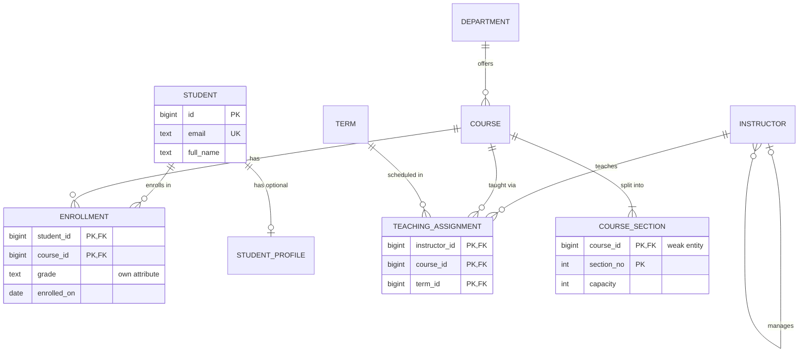

An entity-relationship model is the bridge between how the business talks and what the database stores. Get it right and the tables almost write themselves; get it wrong and you discover months later that a user can belong to only one team, that a course can have only one instructor, or that deleting a customer silently orphans their invoices. ER modelling is not about drawing pretty boxes. It is about answering, for every pair of things in the system, two precise questions: how many, and is it required? This guide covers the building blocks, crow's-foot notation, every common relationship shape, and how each one maps to PostgreSQL and to MongoDB.

## Entities, attributes and identifiers

An **entity** is a thing the business needs to remember that has its own identity and lifecycle: a student, a course, an order. Two students with the same name are still two students, which is what identity means. An **attribute** is a property of an entity: a student's email, a course's title. If an "attribute" has its own attributes or is shared by many entities (an address used by several orders, a country), consider promoting it to an entity.

An **identifier** distinguishes one instance from another. Natural identifiers come from the domain: an ISBN, a course code, a country's ISO code. Surrogate identifiers are generated by the database. In practice you give most tables a surrogate primary key and still enforce the natural identifier with a unique constraint, because natural keys change more often than people expect (emails, phone numbers, even national ID formats).

Attributes also have kinds worth noticing early. A **multivalued** attribute (a student's phone numbers) becomes its own table. A **derived** attribute (age from date of birth) is usually computed, not stored. A **composite** attribute (an address) is either split into columns or stored as a structured value, depending on whether you query its parts.

## Cardinality, optionality and crow's-foot notation

**Cardinality** is the maximum number of related instances: one or many. **Optionality** (or participation) is the minimum: zero or one. Every relationship end has both, and crow's-foot notation draws them as two symbols next to the entity. The symbol closest to the entity is the maximum; the inner one is the minimum.

| Symbol (Mermaid) | Meaning |
|------------------|---------|
| `\|\|` | exactly one (minimum one, maximum one) |
| `\|o` / `o\|` | zero or one |
| `}\|` / `\|{` | one or more |
| `}o` / `o{` | zero or more |

Read each relationship in both directions. `DEPARTMENT ||--o{ COURSE` says a course belongs to exactly one department, and a department offers zero or more courses. The diagram below is a small university model that uses most of the shapes discussed in this guide.



In SQL, optionality on the "one" side maps to nullability of the foreign key: a `NOT NULL` foreign key is a mandatory "exactly one", a nullable foreign key is "zero or one". Optionality on the "many" side ("a department must offer at least one course") cannot be expressed with a plain foreign key; it needs a deferred constraint trigger or an application rule, and is usually left unenforced.

## One-to-many

One-to-many is the workhorse. The foreign key goes on the "many" side.

```sql
CREATE TABLE departments (
  id   bigint GENERATED ALWAYS AS IDENTITY PRIMARY KEY,
  code text NOT NULL UNIQUE,
  name text NOT NULL
);

CREATE TABLE courses (
  id            bigint GENERATED ALWAYS AS IDENTITY PRIMARY KEY,
  department_id bigint NOT NULL REFERENCES departments (id) ON DELETE RESTRICT,
  code          text   NOT NULL UNIQUE,
  title         text   NOT NULL
);
CREATE INDEX courses_department_idx ON courses (department_id);
```

Decide `ON DELETE` deliberately. `RESTRICT` (or the default `NO ACTION`) protects history; `CASCADE` is right when children have no meaning without the parent, such as order lines; `SET NULL` is right when the relationship is optional. Index the foreign key column: PostgreSQL does not create one automatically, and without it every parent delete scans the child table. MySQL InnoDB creates the index for you.

## One-to-one and when to split tables

A true one-to-one usually means the data belongs in one table. Split it into two only for a reason:

- **Optional, sparse data.** Most students never fill in a profile; a separate table avoids dozens of NULL columns.
- **Different access patterns.** A large bio or preferences blob read rarely should not bloat the hot row that every query touches.
- **Security boundaries.** Password hashes or medical details in a separate table with tighter grants.
- **Different lifecycles or owners.** A billing record owned by another team or service.

Implement it by making the child's primary key also its foreign key, which guarantees at most one row per parent:

```sql
CREATE TABLE students (
  id        bigint GENERATED ALWAYS AS IDENTITY PRIMARY KEY,
  email     text NOT NULL UNIQUE,
  full_name text NOT NULL
);

CREATE TABLE student_profiles (
  student_id bigint PRIMARY KEY REFERENCES students (id) ON DELETE CASCADE,
  bio        text,
  avatar_url text,
  settings   jsonb NOT NULL DEFAULT '{}'
);
```

## Many-to-many with junction tables

Many-to-many relationships need a junction (associative) table holding both foreign keys. The interesting part is that the junction almost always grows attributes of its own: an enrollment has a grade and a date; a team membership has a role and a joined date. When that happens, treat the junction as a first-class entity.

```sql
CREATE TABLE enrollments (
  student_id  bigint NOT NULL REFERENCES students (id) ON DELETE CASCADE,
  course_id   bigint NOT NULL REFERENCES courses (id),
  enrolled_on date   NOT NULL DEFAULT current_date,
  grade       text   CHECK (grade IN ('A', 'B', 'C', 'D', 'F')),
  PRIMARY KEY (student_id, course_id)
);
CREATE INDEX enrollments_course_idx ON enrollments (course_id);

CREATE TABLE memberships (
  org_id    bigint NOT NULL,
  user_id   bigint NOT NULL,
  role      text   NOT NULL CHECK (role IN ('owner', 'admin', 'member', 'viewer')),
  joined_at timestamptz NOT NULL DEFAULT now(),
  PRIMARY KEY (org_id, user_id)
);
CREATE INDEX memberships_user_idx ON memberships (user_id);
```

The composite primary key enforces "at most one enrollment per student per course" and serves lookups from the student side; the second index serves lookups from the course side. If a student may retake a course, the identity changes: add `term_id` to the key, because the real entity is "enrollment in a course in a term".

## Self-referencing relationships

An entity can relate to itself. A hierarchy (instructor manages instructor, category has parent category) is one-to-many on the same table: a nullable foreign key pointing back to the table.

```sql
CREATE TABLE instructors (
  id         bigint GENERATED ALWAYS AS IDENTITY PRIMARY KEY,
  full_name  text   NOT NULL,
  manager_id bigint REFERENCES instructors (id) ON DELETE SET NULL,
  CHECK (manager_id <> id)
);
CREATE INDEX instructors_manager_idx ON instructors (manager_id);
```

Walk the tree with a recursive CTE (`WITH RECURSIVE`). For deep trees read often, alternatives include materialised paths, the `ltree` extension, or a closure table.

A network (user follows user) is many-to-many on the same table, so it needs a junction with two foreign keys to the same parent:

```sql
CREATE TABLE follows (
  follower_id bigint NOT NULL REFERENCES students (id) ON DELETE CASCADE,
  followee_id bigint NOT NULL REFERENCES students (id) ON DELETE CASCADE,
  created_at  timestamptz NOT NULL DEFAULT now(),
  PRIMARY KEY (follower_id, followee_id),
  CHECK (follower_id <> followee_id)
);
CREATE INDEX follows_followee_idx ON follows (followee_id, follower_id);
```

Direction matters here: "who do I follow" uses the primary key, "who follows me" uses the second index. For a symmetric relationship like friendship, either store one row with `CHECK (user_a < user_b)` or store both directions and keep them in sync.

## Ternary relationships

Some facts involve three entities at once and cannot be split into pairs without losing meaning. "Instructor X teaches course Y in term Z" is not the same as knowing X teaches Y, Y runs in Z, and X works in Z: those three pairs could be true while X never teaches Y in Z. Model it as one table with three foreign keys.

```sql
CREATE TABLE terms (
  id   bigint GENERATED ALWAYS AS IDENTITY PRIMARY KEY,
  name text NOT NULL UNIQUE
);

CREATE TABLE teaching_assignments (
  instructor_id bigint NOT NULL REFERENCES instructors (id),
  course_id     bigint NOT NULL REFERENCES courses (id),
  term_id       bigint NOT NULL REFERENCES terms (id),
  PRIMARY KEY (instructor_id, course_id, term_id)
);
CREATE INDEX teaching_course_term_idx ON teaching_assignments (course_id, term_id);
```

Think carefully about the key. If a course has exactly one instructor per term, the business rule is `UNIQUE (course_id, term_id)` and the instructor is just an attribute of that pair. The key you pick is a statement about cardinality.

## Weak entities

A weak entity cannot be identified on its own; its identity includes its owner's key. A course section is "section 2 of CS101", an order line is "line 3 of order 981". Its primary key combines the parent key with a local discriminator, and it is deleted with the parent.

```sql
CREATE TABLE course_sections (
  course_id  bigint NOT NULL REFERENCES courses (id) ON DELETE CASCADE,
  section_no int    NOT NULL CHECK (section_no > 0),
  capacity   int    NOT NULL CHECK (capacity > 0),
  PRIMARY KEY (course_id, section_no)
);
```

You can also give weak entities a surrogate `id` for simpler foreign keys from other tables, while keeping `UNIQUE (course_id, section_no)` to preserve the real identity.

## Mapping to MongoDB: embed or reference

MongoDB has no joins in the relational sense (`$lookup` exists but is costly), so the ER model maps to a choice per relationship: embed the related data inside the parent document, or store a reference (an ID) and query separately.

Embed when the children are owned by the parent, read together with it, bounded in number, and rarely updated independently. Course sections and order lines are good fits:

```json
{
  "_id": "CS101",
  "title": "Intro to Databases",
  "departmentId": "CS",
  "sections": [
    { "sectionNo": 1, "capacity": 40 },
    { "sectionNo": 2, "capacity": 35 }
  ]
}
```

Reference when the related set is unbounded (a user's followers), shared by many parents (departments), or updated independently. Many-to-many relationships with attributes, like enrollments, usually become their own collection with `{ studentId, courseId, grade }` and a compound unique index, which is the same junction table in document form. Watch the 16 MB document limit and the cost of rewriting large documents when an embedded array grows. Unlike PostgreSQL, MongoDB enforces no foreign keys, so referential integrity becomes application code plus periodic consistency checks.

## Trade-offs and pitfalls

- **Missing junction attributes.** A plain `(user_id, org_id)` table that later needs a role leads to a migration under load; ask early.
- **Splitting 1:1 tables for no reason.** Every split adds a join to every read of the full entity.
- **Nullable foreign keys that should be mandatory.** They let orphaned rows in and turn inner joins into silent data loss.
- **Decomposing ternary facts into pairs.** You lose information that cannot be recovered with joins.
- **Unindexed foreign keys** in PostgreSQL make deletes and reverse lookups slow.
- **Embedding unbounded arrays in MongoDB.** Documents grow until updates are slow or hit the size limit.

## Interview angle

- State cardinality and optionality for each relationship out loud before writing tables.
- Promote junction tables to entities when they carry attributes, and say what their key means.
- Show the self-referencing follows table with both indexes and explain which query each serves.
- For MongoDB, justify embed versus reference by ownership, boundedness and access pattern.

## Key takeaways

- Entities have identity and lifecycle; attributes describe them; promote attributes that need their own attributes.
- Crow's foot marks maximum on the outside, minimum on the inside; nullability of the FK encodes optionality.
- 1:N puts the FK on the many side; 1:1 shares the primary key; M:N needs a junction that often becomes an entity.
- Self-references, ternary relationships and weak entities each have a precise table shape and key.
- In MongoDB, embed owned, bounded data and reference shared or unbounded data.
