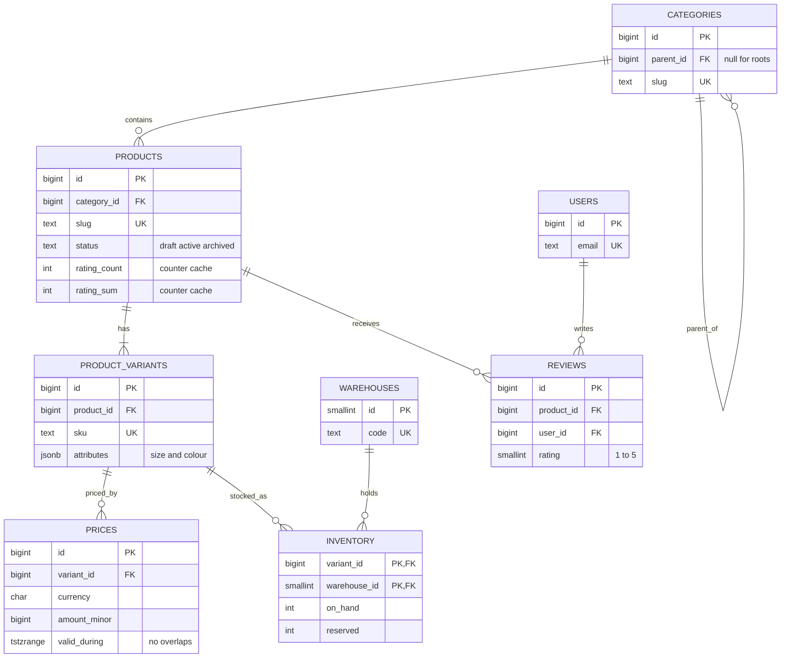
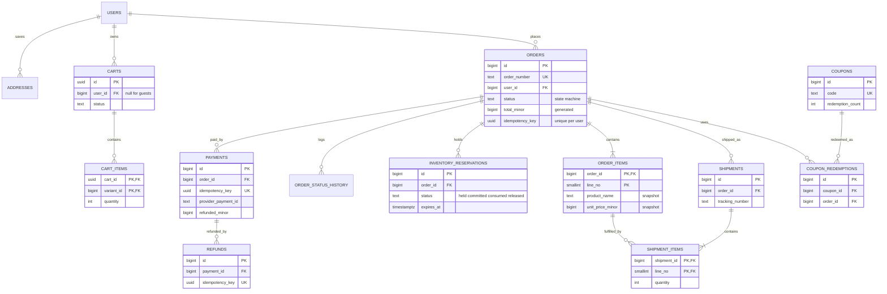

This is a complete, production-shaped schema for an online store that sells physical goods from several warehouses in several currencies. It is meant to be copied and adapted. Every table exists because an access pattern or an invariant needs it, every constraint protects a rule the business would otherwise break by accident, and every index is there to serve a named query. The money rules are strict: amounts are integer minor units, an order records what the customer saw at the time, stock can never go negative, and a retried request never charges twice.

## Requirements and access patterns

The store has 10 million registered users, 2 million daily actives, 500,000 products with about 3 variants each, 8 warehouses and 3 currencies. It takes about 6 million orders a month (roughly 2.3 per second on average) and 100 per second at a flash-sale peak. Reads dominate by two orders of magnitude.

Invariants the schema must enforce on its own, not just in application code:

- Reserved stock never exceeds stock on hand, and neither goes below zero.
- One live price per variant per currency at any instant.
- An order total is always the sum of its parts, and its lines never change when a product is renamed or repriced.
- An order moves only through allowed status transitions.
- A payment, refund or order placement retried with the same idempotency key happens once.
- A user reviews a product at most once; a coupon is never redeemed beyond its limit.

| Access pattern | Peak QPS | Served by |
|----------------|----------|-----------|
| Product page by slug, with variants, price and stock | 5,000 | `products.slug` unique, `product_variants (product_id, ...)`, prices exclusion index, inventory PK |
| Category listing with keyset pagination | 2,000 | `products (category_id, created_at DESC, id DESC) WHERE status = 'active'` |
| Full-text and faceted search | 3,000 | Search engine, not PostgreSQL |
| View and edit cart | 800 | `cart_items` PK `(cart_id, variant_id)` |
| Place order (reserve stock, snapshot lines) | 100 | Conditional update on inventory PK, `orders (user_id, idempotency_key)` unique |
| Payment webhook | 150 | `payments (provider, provider_payment_id)` unique, `payment_events` PK |
| My orders, newest first | 300 | `orders (user_id, placed_at DESC)` |
| Published reviews for a product | 1,500 | `reviews (product_id, created_at DESC) WHERE status = 'published'` |
| Fulfilment queue | 20 | `orders (status, placed_at) WHERE status IN (...)` |
| Expired reservation sweep | 1 per minute | `inventory_reservations (expires_at) WHERE status = 'held'` |

## Entity-relationship model

The model splits naturally into a catalogue side that is read-heavy and cache-friendly, and a transactional side where correctness matters more than speed.





## Design decisions before the DDL

**Keys.** Internal keys are `bigint GENERATED ALWAYS AS IDENTITY`: compact, ordered, cheap to index. Things a stranger might guess are kept unguessable: carts use random UUIDs because a guest cart ID lives in a cookie, and orders expose an `order_number` generated by the application instead of the raw ID.

**Enumerations.** Statuses are `text` with a `CHECK` list rather than `CREATE TYPE ... AS ENUM`. Both are cheap; a check constraint can drop a value as well as add one, which matters for state machines that evolve.

**Money.** Every amount is a `bigint` in minor units (cents) next to an ISO 4217 `char(3)` currency. Floats are never used. Order totals are generated columns, so the arithmetic cannot drift from its parts.

**Prices.** Prices live in their own table with a validity range. An exclusion constraint guarantees no two prices for the same variant and currency overlap in time, which makes scheduled sales safe: insert a future row, close the current row's range, and the database rejects any mistake.

**Snapshots.** `order_items` copies SKU, product name, variant attributes and unit price. Orders copy the shipping address as JSONB. A product rename or an address edit must never rewrite a receipt.

**Inventory.** One row per variant per warehouse, holding `on_hand` (physically present) and `reserved` (promised to orders not yet shipped). Available stock is `on_hand - reserved`. Reservations are rows too, so they can expire, be audited and be released precisely.

## DDL

Tables are created in dependency order. The only extension needed is `btree_gist`, which lets an exclusion constraint combine equality on scalar columns with range overlap.

```sql
CREATE EXTENSION IF NOT EXISTS btree_gist;

-- Identity -------------------------------------------------------------
CREATE TABLE users (
  id            bigint GENERATED ALWAYS AS IDENTITY PRIMARY KEY,
  email         text NOT NULL CHECK (email = btrim(email) AND email LIKE '%_@_%'),
  password_hash text,                                   -- null for SSO-only accounts
  full_name     text NOT NULL,
  phone         text,
  status        text NOT NULL DEFAULT 'active'
                CHECK (status IN ('active', 'suspended', 'anonymised')),
  created_at    timestamptz NOT NULL DEFAULT now(),
  updated_at    timestamptz NOT NULL DEFAULT now()
);
CREATE UNIQUE INDEX users_email_uk ON users (lower(email));

CREATE TABLE addresses (
  id           bigint GENERATED ALWAYS AS IDENTITY PRIMARY KEY,
  user_id      bigint NOT NULL REFERENCES users (id) ON DELETE CASCADE,
  label        text,
  recipient    text NOT NULL,
  line1        text NOT NULL,
  line2        text,
  city         text NOT NULL,
  region       text,
  postal_code  text,
  country_code char(2) NOT NULL CHECK (country_code ~ '^[A-Z]{2}$'),
  phone        text,
  is_default   boolean NOT NULL DEFAULT false,
  created_at   timestamptz NOT NULL DEFAULT now()
);
CREATE INDEX addresses_user_idx ON addresses (user_id);
CREATE UNIQUE INDEX addresses_one_default_uk ON addresses (user_id) WHERE is_default;

-- Catalogue ------------------------------------------------------------
CREATE TABLE categories (
  id         bigint GENERATED ALWAYS AS IDENTITY PRIMARY KEY,
  parent_id  bigint REFERENCES categories (id),          -- RESTRICT: move children first
  slug       text NOT NULL UNIQUE CHECK (slug ~ '^[a-z0-9-]+$'),
  name       text NOT NULL,
  sort_order int  NOT NULL DEFAULT 0,
  CHECK (parent_id <> id)
);
CREATE INDEX categories_parent_idx ON categories (parent_id);

CREATE TABLE products (
  id            bigint GENERATED ALWAYS AS IDENTITY PRIMARY KEY,
  category_id   bigint NOT NULL REFERENCES categories (id),
  slug          text NOT NULL UNIQUE CHECK (slug ~ '^[a-z0-9-]+$'),
  name          text NOT NULL,
  brand         text,
  description   text NOT NULL DEFAULT '',
  status        text NOT NULL DEFAULT 'draft'
                CHECK (status IN ('draft', 'active', 'archived')),
  rating_count  int  NOT NULL DEFAULT 0 CHECK (rating_count >= 0),
  rating_sum    int  NOT NULL DEFAULT 0 CHECK (rating_sum >= 0),
  rating_avg    numeric(3, 2) GENERATED ALWAYS AS (
                  CASE WHEN rating_count > 0
                       THEN round(rating_sum::numeric / rating_count, 2) END) STORED,
  created_at    timestamptz NOT NULL DEFAULT now(),
  updated_at    timestamptz NOT NULL DEFAULT now()
);
CREATE INDEX products_category_listing_idx
  ON products (category_id, created_at DESC, id DESC) WHERE status = 'active';

CREATE TABLE product_variants (
  id           bigint GENERATED ALWAYS AS IDENTITY PRIMARY KEY,
  product_id   bigint NOT NULL REFERENCES products (id),
  sku          text NOT NULL UNIQUE,
  attributes   jsonb NOT NULL DEFAULT '{}' CHECK (jsonb_typeof(attributes) = 'object'),
  weight_grams int CHECK (weight_grams > 0),
  is_active    boolean NOT NULL DEFAULT true,
  created_at   timestamptz NOT NULL DEFAULT now(),
  UNIQUE (product_id, attributes)                       -- also serves lookups by product_id
);
CREATE INDEX product_variants_attributes_gin
  ON product_variants USING gin (attributes jsonb_path_ops);

CREATE TABLE prices (
  id               bigint GENERATED ALWAYS AS IDENTITY PRIMARY KEY,
  variant_id       bigint NOT NULL REFERENCES product_variants (id),
  currency         char(3) NOT NULL CHECK (currency ~ '^[A-Z]{3}$'),
  amount_minor     bigint NOT NULL CHECK (amount_minor >= 0),
  compare_at_minor bigint,                              -- struck-through "was" price
  valid_during     tstzrange NOT NULL DEFAULT tstzrange(now(), NULL),
  CHECK (compare_at_minor IS NULL OR compare_at_minor > amount_minor),
  CHECK (NOT isempty(valid_during)),
  CONSTRAINT prices_no_overlap
    EXCLUDE USING gist (variant_id WITH =, currency WITH =, valid_during WITH &&)
);

-- Inventory ------------------------------------------------------------
CREATE TABLE warehouses (
  id           smallint GENERATED ALWAYS AS IDENTITY PRIMARY KEY,
  code         text NOT NULL UNIQUE,
  name         text NOT NULL,
  country_code char(2) NOT NULL CHECK (country_code ~ '^[A-Z]{2}$'),
  is_active    boolean NOT NULL DEFAULT true
);

CREATE TABLE inventory (
  variant_id   bigint   NOT NULL REFERENCES product_variants (id),
  warehouse_id smallint NOT NULL REFERENCES warehouses (id),
  on_hand      int NOT NULL DEFAULT 0 CHECK (on_hand >= 0),
  reserved     int NOT NULL DEFAULT 0 CHECK (reserved >= 0),
  updated_at   timestamptz NOT NULL DEFAULT now(),
  PRIMARY KEY (variant_id, warehouse_id),
  CHECK (reserved <= on_hand)
);

-- Carts ----------------------------------------------------------------
CREATE TABLE carts (
  id         uuid PRIMARY KEY DEFAULT gen_random_uuid(),
  user_id    bigint REFERENCES users (id) ON DELETE CASCADE,  -- null for guest carts
  currency   char(3) NOT NULL CHECK (currency ~ '^[A-Z]{3}$'),
  status     text NOT NULL DEFAULT 'active'
             CHECK (status IN ('active', 'converted', 'abandoned')),
  created_at timestamptz NOT NULL DEFAULT now(),
  updated_at timestamptz NOT NULL DEFAULT now()
);
CREATE UNIQUE INDEX carts_one_active_per_user_uk
  ON carts (user_id) WHERE status = 'active' AND user_id IS NOT NULL;
CREATE INDEX carts_abandon_sweep_idx ON carts (updated_at) WHERE status = 'active';

CREATE TABLE cart_items (
  cart_id    uuid   NOT NULL REFERENCES carts (id) ON DELETE CASCADE,
  variant_id bigint NOT NULL REFERENCES product_variants (id),
  quantity   int    NOT NULL CHECK (quantity BETWEEN 1 AND 99),
  added_at   timestamptz NOT NULL DEFAULT now(),
  PRIMARY KEY (cart_id, variant_id)
);

-- Discounts ------------------------------------------------------------
CREATE TABLE coupons (
  id                 bigint GENERATED ALWAYS AS IDENTITY PRIMARY KEY,
  code               text NOT NULL,
  kind               text NOT NULL CHECK (kind IN ('percent', 'fixed')),
  percent_off_bp     int CHECK (percent_off_bp BETWEEN 1 AND 10000),  -- basis points
  amount_off_minor   bigint CHECK (amount_off_minor > 0),
  currency           char(3),
  min_subtotal_minor bigint NOT NULL DEFAULT 0 CHECK (min_subtotal_minor >= 0),
  starts_at          timestamptz NOT NULL,
  ends_at            timestamptz,
  max_redemptions    int CHECK (max_redemptions > 0),
  per_user_limit     int NOT NULL DEFAULT 1 CHECK (per_user_limit > 0),
  redemption_count   int NOT NULL DEFAULT 0 CHECK (redemption_count >= 0),
  is_active          boolean NOT NULL DEFAULT true,
  created_at         timestamptz NOT NULL DEFAULT now(),
  CHECK ((kind = 'percent' AND percent_off_bp IS NOT NULL AND amount_off_minor IS NULL)
      OR (kind = 'fixed' AND amount_off_minor IS NOT NULL AND currency IS NOT NULL
          AND percent_off_bp IS NULL)),
  CHECK (ends_at IS NULL OR ends_at > starts_at),
  CHECK (max_redemptions IS NULL OR redemption_count <= max_redemptions)
);
CREATE UNIQUE INDEX coupons_code_uk ON coupons (upper(code));

-- Orders ---------------------------------------------------------------
CREATE TABLE orders (
  id               bigint GENERATED ALWAYS AS IDENTITY PRIMARY KEY,
  order_number     text NOT NULL UNIQUE,
  user_id          bigint NOT NULL REFERENCES users (id),
  status           text NOT NULL DEFAULT 'pending_payment'
                   CHECK (status IN ('pending_payment', 'paid', 'fulfilling', 'shipped',
                                     'delivered', 'cancelled', 'refunded')),
  currency         char(3) NOT NULL CHECK (currency ~ '^[A-Z]{3}$'),
  subtotal_minor   bigint NOT NULL CHECK (subtotal_minor >= 0),
  discount_minor   bigint NOT NULL DEFAULT 0 CHECK (discount_minor >= 0),
  shipping_minor   bigint NOT NULL DEFAULT 0 CHECK (shipping_minor >= 0),
  tax_minor        bigint NOT NULL DEFAULT 0 CHECK (tax_minor >= 0),
  total_minor      bigint GENERATED ALWAYS AS
                   (subtotal_minor - discount_minor + shipping_minor + tax_minor) STORED,
  shipping_address jsonb NOT NULL,                      -- snapshot, not an FK
  billing_address  jsonb,
  idempotency_key  uuid NOT NULL,
  placed_at        timestamptz NOT NULL DEFAULT now(),
  updated_at       timestamptz NOT NULL DEFAULT now(),
  CHECK (discount_minor <= subtotal_minor),
  UNIQUE (user_id, idempotency_key)
);
CREATE INDEX orders_user_placed_idx ON orders (user_id, placed_at DESC);
CREATE INDEX orders_open_status_idx ON orders (status, placed_at)
  WHERE status IN ('pending_payment', 'paid', 'fulfilling');

CREATE TABLE order_status_transitions (
  from_status text NOT NULL,
  to_status   text NOT NULL,
  PRIMARY KEY (from_status, to_status)
);
INSERT INTO order_status_transitions (from_status, to_status) VALUES
  ('pending_payment', 'paid'), ('pending_payment', 'cancelled'),
  ('paid', 'fulfilling'),      ('paid', 'cancelled'), ('paid', 'refunded'),
  ('fulfilling', 'shipped'),   ('fulfilling', 'cancelled'),
  ('shipped', 'delivered'),    ('delivered', 'refunded');

CREATE TABLE order_status_history (
  id          bigint GENERATED ALWAYS AS IDENTITY PRIMARY KEY,
  order_id    bigint NOT NULL REFERENCES orders (id),
  from_status text,
  to_status   text NOT NULL,
  changed_at  timestamptz NOT NULL DEFAULT now(),
  changed_by  text NOT NULL DEFAULT current_user
);
CREATE INDEX order_status_history_order_idx ON order_status_history (order_id, changed_at);

CREATE FUNCTION orders_enforce_transition() RETURNS trigger
LANGUAGE plpgsql AS $$
BEGIN
  IF NEW.status IS DISTINCT FROM OLD.status THEN
    IF NOT EXISTS (SELECT 1 FROM order_status_transitions
                   WHERE from_status = OLD.status AND to_status = NEW.status) THEN
      RAISE EXCEPTION 'illegal order transition % -> %', OLD.status, NEW.status
        USING ERRCODE = 'check_violation';
    END IF;
    INSERT INTO order_status_history (order_id, from_status, to_status)
    VALUES (NEW.id, OLD.status, NEW.status);
    NEW.updated_at := now();
  END IF;
  RETURN NEW;
END $$;

CREATE TRIGGER orders_status_transition
  BEFORE UPDATE OF status ON orders
  FOR EACH ROW EXECUTE FUNCTION orders_enforce_transition();

CREATE TABLE order_items (
  order_id           bigint   NOT NULL REFERENCES orders (id),
  line_no            smallint NOT NULL CHECK (line_no > 0),
  variant_id         bigint   NOT NULL REFERENCES product_variants (id),
  sku                text     NOT NULL,                 -- snapshot
  product_name       text     NOT NULL,                 -- snapshot
  variant_attributes jsonb    NOT NULL,                 -- snapshot
  unit_price_minor   bigint   NOT NULL CHECK (unit_price_minor >= 0),
  quantity           int      NOT NULL CHECK (quantity > 0),
  discount_minor     bigint   NOT NULL DEFAULT 0 CHECK (discount_minor >= 0),
  line_total_minor   bigint GENERATED ALWAYS AS
                     (unit_price_minor * quantity - discount_minor) STORED,
  PRIMARY KEY (order_id, line_no),
  CHECK (discount_minor <= unit_price_minor * quantity)
);
CREATE INDEX order_items_variant_idx ON order_items (variant_id);

CREATE TABLE inventory_reservations (
  id           bigint GENERATED ALWAYS AS IDENTITY PRIMARY KEY,
  order_id     bigint   NOT NULL REFERENCES orders (id),
  variant_id   bigint   NOT NULL,
  warehouse_id smallint NOT NULL,
  quantity     int      NOT NULL CHECK (quantity > 0),
  status       text     NOT NULL DEFAULT 'held'
               CHECK (status IN ('held', 'committed', 'consumed', 'released')),
  expires_at   timestamptz NOT NULL,
  created_at   timestamptz NOT NULL DEFAULT now(),
  FOREIGN KEY (variant_id, warehouse_id) REFERENCES inventory (variant_id, warehouse_id),
  UNIQUE (order_id, variant_id, warehouse_id)
);
CREATE INDEX inventory_reservations_expiry_idx
  ON inventory_reservations (expires_at) WHERE status = 'held';

CREATE TABLE coupon_redemptions (
  id             bigint GENERATED ALWAYS AS IDENTITY PRIMARY KEY,
  coupon_id      bigint NOT NULL REFERENCES coupons (id),
  user_id        bigint NOT NULL REFERENCES users (id),
  order_id       bigint NOT NULL REFERENCES orders (id),
  discount_minor bigint NOT NULL CHECK (discount_minor > 0),
  redeemed_at    timestamptz NOT NULL DEFAULT now(),
  UNIQUE (coupon_id, order_id)
);
CREATE INDEX coupon_redemptions_coupon_user_idx ON coupon_redemptions (coupon_id, user_id);
CREATE INDEX coupon_redemptions_order_idx ON coupon_redemptions (order_id);

-- Payments -------------------------------------------------------------
CREATE TABLE payments (
  id                  bigint GENERATED ALWAYS AS IDENTITY PRIMARY KEY,
  order_id            bigint NOT NULL REFERENCES orders (id),
  provider            text   NOT NULL,
  provider_payment_id text,                             -- set once the provider answers
  idempotency_key     uuid   NOT NULL UNIQUE,           -- also sent to the provider
  amount_minor        bigint NOT NULL CHECK (amount_minor > 0),
  currency            char(3) NOT NULL,
  status              text   NOT NULL DEFAULT 'pending'
                      CHECK (status IN ('pending', 'authorized', 'captured', 'failed', 'voided')),
  failure_code        text,
  refunded_minor      bigint NOT NULL DEFAULT 0 CHECK (refunded_minor >= 0),
  created_at          timestamptz NOT NULL DEFAULT now(),
  updated_at          timestamptz NOT NULL DEFAULT now(),
  UNIQUE (provider, provider_payment_id),
  CHECK (refunded_minor <= amount_minor)
);
CREATE INDEX payments_order_idx ON payments (order_id);
CREATE UNIQUE INDEX payments_one_live_per_order_uk
  ON payments (order_id) WHERE status IN ('authorized', 'captured');

CREATE TABLE refunds (
  id                 bigint GENERATED ALWAYS AS IDENTITY PRIMARY KEY,
  payment_id         bigint NOT NULL REFERENCES payments (id),
  provider_refund_id text UNIQUE,
  idempotency_key    uuid   NOT NULL UNIQUE,
  amount_minor       bigint NOT NULL CHECK (amount_minor > 0),
  reason             text   NOT NULL,
  status             text   NOT NULL DEFAULT 'pending'
                     CHECK (status IN ('pending', 'succeeded', 'failed')),
  created_at         timestamptz NOT NULL DEFAULT now(),
  updated_at         timestamptz NOT NULL DEFAULT now()
);
CREATE INDEX refunds_payment_idx ON refunds (payment_id);

CREATE TABLE payment_events (                           -- webhook inbox, dedupes deliveries
  provider          text NOT NULL,
  provider_event_id text NOT NULL,
  payment_id        bigint REFERENCES payments (id),
  event_type        text NOT NULL,
  payload           jsonb NOT NULL,
  received_at       timestamptz NOT NULL DEFAULT now(),
  processed_at      timestamptz,
  PRIMARY KEY (provider, provider_event_id)
);

-- Fulfilment -----------------------------------------------------------
CREATE TABLE shipments (
  id              bigint GENERATED ALWAYS AS IDENTITY PRIMARY KEY,
  order_id        bigint   NOT NULL REFERENCES orders (id),
  warehouse_id    smallint NOT NULL REFERENCES warehouses (id),
  carrier         text,
  tracking_number text,
  status          text NOT NULL DEFAULT 'pending'
                  CHECK (status IN ('pending', 'label_created', 'in_transit',
                                    'delivered', 'returned', 'lost')),
  shipped_at      timestamptz,
  delivered_at    timestamptz,
  created_at      timestamptz NOT NULL DEFAULT now(),
  UNIQUE (id, order_id),                                -- target for the composite FK below
  UNIQUE (carrier, tracking_number)
);
CREATE INDEX shipments_order_idx ON shipments (order_id);

CREATE TABLE shipment_items (
  shipment_id bigint   NOT NULL,
  order_id    bigint   NOT NULL,
  line_no     smallint NOT NULL,
  quantity    int      NOT NULL CHECK (quantity > 0),
  PRIMARY KEY (shipment_id, line_no),
  FOREIGN KEY (shipment_id, order_id) REFERENCES shipments (id, order_id) ON DELETE CASCADE,
  FOREIGN KEY (order_id, line_no) REFERENCES order_items (order_id, line_no)
);
CREATE INDEX shipment_items_order_line_idx ON shipment_items (order_id, line_no);

-- Reviews --------------------------------------------------------------
CREATE TABLE reviews (
  id                bigint GENERATED ALWAYS AS IDENTITY PRIMARY KEY,
  product_id        bigint NOT NULL REFERENCES products (id),
  user_id           bigint NOT NULL REFERENCES users (id),
  rating            smallint NOT NULL CHECK (rating BETWEEN 1 AND 5),
  title             text,
  body              text NOT NULL DEFAULT '',
  verified_purchase boolean NOT NULL DEFAULT false,
  status            text NOT NULL DEFAULT 'pending'
                    CHECK (status IN ('pending', 'published', 'rejected')),
  created_at        timestamptz NOT NULL DEFAULT now(),
  updated_at        timestamptz NOT NULL DEFAULT now(),
  UNIQUE (product_id, user_id)                          -- one review per user per product
);
CREATE INDEX reviews_product_published_idx
  ON reviews (product_id, created_at DESC) WHERE status = 'published';
CREATE INDEX reviews_user_idx ON reviews (user_id);
```

Three details are easy to miss. The composite foreign key from `shipment_items` to `shipments (id, order_id)` guarantees a shipment can only contain lines from its own order; a plain FK on `shipment_id` would allow shipping someone else's line. `UNIQUE (product_id, attributes)` on variants stops two "Blue / 42" variants of the same shoe and, because `product_id` leads, also serves "variants of this product". The partial unique index on `payments` allows any number of failed attempts but only one authorised or captured payment per order.

## Key queries and the index that serves each

Product page. The slug hits its unique index, variants come from the `(product_id, attributes)` unique index, the current price uses the GiST index behind the exclusion constraint, and stock is a primary-key range scan on inventory.

```sql
SELECT p.id, p.name, p.rating_avg, p.rating_count,
       v.id AS variant_id, v.sku, v.attributes,
       pr.amount_minor, pr.compare_at_minor,
       COALESCE(s.available, 0) AS available
FROM products p
JOIN product_variants v ON v.product_id = p.id AND v.is_active
LEFT JOIN prices pr ON pr.variant_id = v.id
                   AND pr.currency = 'EUR'
                   AND pr.valid_during @> now()
LEFT JOIN LATERAL (
  SELECT sum(i.on_hand - i.reserved) AS available
  FROM inventory i WHERE i.variant_id = v.id
) s ON true
WHERE p.slug = 'trail-runner-2' AND p.status = 'active';
```

Category listing with keyset pagination over the category subtree. The recursive CTE walks `categories_parent_idx`; the listing uses `products_category_listing_idx`. Categories are a small, rarely changing tree (a few thousand rows), so the subtree is cheap to compute and worth caching. Use `ltree` or a closure table only if the tree becomes large or deep.

```sql
WITH RECURSIVE subtree AS (
  SELECT id FROM categories WHERE slug = 'running-shoes'
  UNION ALL
  SELECT c.id FROM categories c JOIN subtree s ON c.parent_id = s.id
)
SELECT p.id, p.slug, p.name, p.rating_avg
FROM products p
WHERE p.category_id IN (SELECT id FROM subtree)
  AND p.status = 'active'
  AND (p.created_at, p.id) < ('2026-10-01 00:00:00+00', 900000)  -- cursor from last page
ORDER BY p.created_at DESC, p.id DESC
LIMIT 24;
```

My orders uses `orders_user_placed_idx`; the fulfilment workers pull from `orders_open_status_idx` with `SKIP LOCKED` so several workers never grab the same order.

```sql
SELECT id, order_number, status, total_minor, currency, placed_at
FROM orders WHERE user_id = 7
ORDER BY placed_at DESC LIMIT 20;

SELECT id FROM orders
WHERE status = 'paid'
ORDER BY placed_at
LIMIT 50
FOR UPDATE SKIP LOCKED;
```

## Concurrency: reserving stock and placing an order

Overselling is prevented by a conditional update, not by reading stock and then writing it. The `WHERE` clause re-checks availability against the latest committed row after acquiring the row lock, so two buyers racing for the last unit cannot both succeed. The `CHECK (reserved <= on_hand)` is the backstop if application code ever forgets the condition.

```sql
UPDATE inventory
SET reserved = reserved + 2, updated_at = now()
WHERE variant_id = 42 AND warehouse_id = 1
  AND on_hand - reserved >= 2
RETURNING on_hand - reserved AS still_available;      -- zero rows means out of stock
```

Placing an order is one short transaction. It does not call the payment provider: holding row locks across a network call to an external service turns a slow provider into a database outage.

```sql
BEGIN;

-- 1. Idempotent header. A retry with the same key inserts nothing; the app then
--    returns the order that already exists for (user_id, idempotency_key).
INSERT INTO orders (order_number, user_id, currency, subtotal_minor, discount_minor,
                    shipping_minor, tax_minor, shipping_address, idempotency_key)
VALUES ('ORD-7K2M9Q', 7, 'EUR', 25980, 2598, 499, 0,
        '{"recipient": "A. Khan", "line1": "1 Main St", "city": "Berlin", "country_code": "DE"}',
        '6f1c1d2e-8a3b-4c5d-9e0f-112233445566')
ON CONFLICT (user_id, idempotency_key) DO NOTHING
RETURNING id;                                         -- assume it returns 1001

-- 2. Snapshot the cart lines at today's prices.
INSERT INTO order_items (order_id, line_no, variant_id, sku, product_name,
                         variant_attributes, unit_price_minor, quantity)
SELECT 1001, row_number() OVER (ORDER BY ci.variant_id), v.id, v.sku, p.name,
       v.attributes, pr.amount_minor, ci.quantity
FROM cart_items ci
JOIN product_variants v ON v.id = ci.variant_id
JOIN products p        ON p.id = v.product_id
JOIN prices pr         ON pr.variant_id = v.id AND pr.currency = 'EUR'
                      AND pr.valid_during @> now()
WHERE ci.cart_id = '0b6e2a52-3f43-4a8e-9d55-7a1f6c2b9e10';

-- 3. Reserve each line in variant_id order (a consistent lock order avoids deadlocks).
--    The app runs the conditional UPDATE above per line and rolls back if any returns 0 rows.
INSERT INTO inventory_reservations (order_id, variant_id, warehouse_id, quantity, expires_at)
SELECT 1001, oi.variant_id, 1, oi.quantity, now() + interval '15 minutes'
FROM order_items oi WHERE oi.order_id = 1001;

-- 4. Redeem the coupon. The conditional update locks the coupon row, so the
--    per-user count that follows cannot race with another checkout.
UPDATE coupons
SET redemption_count = redemption_count + 1
WHERE upper(code) = 'WELCOME10' AND is_active
  AND now() >= starts_at AND (ends_at IS NULL OR now() < ends_at)
  AND (max_redemptions IS NULL OR redemption_count < max_redemptions)
RETURNING id, per_user_limit;                         -- assume id 3, limit 1

SELECT count(*) FROM coupon_redemptions WHERE coupon_id = 3 AND user_id = 7;  -- must be < limit

INSERT INTO coupon_redemptions (coupon_id, user_id, order_id, discount_minor)
VALUES (3, 7, 1001, 2598);

-- 5. Close the cart.
UPDATE carts SET status = 'converted', updated_at = now()
WHERE id = '0b6e2a52-3f43-4a8e-9d55-7a1f6c2b9e10' AND status = 'active';

COMMIT;
```

The application computes `subtotal_minor` from the same price join before step 1, or inserts the header with a placeholder and updates it after step 2 in the same transaction. After commit it creates a `payments` row with a fresh idempotency key and calls the provider with that key, so a retried call cannot create a second charge. When the provider's webhook arrives, the handler inserts into `payment_events` first. A duplicate delivery hits the primary key and is ignored. Then, in one transaction, it marks the payment captured, moves the order from `pending_payment` to `paid` (the trigger rejects any other starting state) and flips the reservations from `held` to `committed`, which removes their expiry. When the shipment leaves, committed reservations become `consumed` and both `on_hand` and `reserved` drop by the same quantity.

A sweeper runs every minute. It selects `held` reservations past `expires_at` using the partial index with `FOR UPDATE SKIP LOCKED`, marks them `released`, decrements `reserved`, and cancels the order. Refunds lock the payment row and run `UPDATE payments SET refunded_minor = refunded_minor + $amount`. The `CHECK (refunded_minor <= amount_minor)` makes over-refunding impossible even with two support agents clicking at once.

During a flash sale one hot SKU row can become the bottleneck, because every reservation for it queues on the same row lock. Keep the transaction short. If that still is not enough, split the stock into several bucket rows (an extra `bucket smallint` in the inventory key) and pick a bucket at random.

## Denormalised counters

`products.rating_count` and `rating_sum` are counter caches. Computing an average across 40,000 reviews on every product page view would be wasteful. Storing the sum rather than the average keeps updates exact and reversible. A trigger keeps them correct for every write path, including moderation:

```sql
CREATE FUNCTION reviews_maintain_rating() RETURNS trigger
LANGUAGE plpgsql AS $$
BEGIN
  IF TG_OP IN ('UPDATE', 'DELETE') AND OLD.status = 'published' THEN
    UPDATE products SET rating_count = rating_count - 1, rating_sum = rating_sum - OLD.rating
    WHERE id = OLD.product_id;
  END IF;
  IF TG_OP IN ('INSERT', 'UPDATE') AND NEW.status = 'published' THEN
    UPDATE products SET rating_count = rating_count + 1, rating_sum = rating_sum + NEW.rating
    WHERE id = NEW.product_id;
  END IF;
  RETURN NULL;
END $$;

CREATE TRIGGER reviews_rating_counters
  AFTER INSERT OR DELETE OR UPDATE OF status, rating ON reviews
  FOR EACH ROW EXECUTE FUNCTION reviews_maintain_rating();
```

The cost is a row lock on the product for each published review. That is fine for reviews, which arrive slowly. For something hot like view counts, buffer increments in Redis and flush them in batches. Also run a nightly job that recomputes the counters from source and alerts on drift.

## What to partition later

`orders`, `order_items`, `order_status_history` and `payment_events` grow without bound; the catalogue does not. At 6 million orders a month, `orders` reaches about 70 million rows a year and `order_items` about 200 million, which a well-indexed single table still handles. Plan the move to monthly range partitioning on `placed_at` when vacuum times, index sizes or archival needs start to hurt. PostgreSQL requires the partition key in every unique constraint on a partitioned table, so the primary key becomes `(id, placed_at)`, the idempotency key becomes `(user_id, idempotency_key, placed_at)`, and tables referencing orders must carry `placed_at` to point at it. Adding that column to `order_items` and `payments` early is cheap insurance. `payment_events` is the easiest candidate: partition by `received_at` and drop partitions past the retention window.

## What goes to search and cache

PostgreSQL stays the system of record. Full-text search, typo tolerance, faceted counts ("Brand: Acme (124)") and relevance ranking go to a search engine such as OpenSearch. A change-data-capture stream or an outbox table feeds it, carrying denormalised product documents that already contain variants, current prices and an in-stock flag. Product pages and category listings are cached in Redis or at the CDN, keyed by slug and currency and invalidated on catalogue change events. Displayed stock can be cached for a few seconds. Reservations never read from cache, because only the conditional update on `inventory` decides.

## If you used MongoDB instead

The same design maps cleanly. Products embed their variants and per-currency prices, because they are always read together and bounded in size. Inventory stays a separate collection keyed by `{variantId, warehouseId}`, using the same conditional `updateOne` with a filter on available quantity. Orders embed their line snapshots, status history and shipping address. Payments, refunds and webhook events are separate collections with unique indexes on idempotency keys and provider IDs. Reviews are a separate collection with a unique compound index on `{productId, userId}`. What you lose is declarative enforcement: no foreign keys, no exclusion constraint on price windows, no generated totals and no transition trigger. Those rules move into application code and schema validation, and order placement needs a multi-document transaction on a replica set.

## Trade-offs and pitfalls

- **Text plus CHECK instead of enums** is easier to evolve, but typos in application code surface only at runtime as constraint violations. Test every state transition.
- **Address snapshots as JSONB** keep orders immutable but cannot be queried as cleanly as columns. Index specific keys such as `country_code` if reporting needs them.
- **Triggers for counters and transitions** guarantee consistency across all writers but hide work from people reading the application code. Document them and test them.
- **Hard-deleting users** breaks order history. Anonymise the row (`status = 'anonymised'`, scrub PII) and keep the ID so financial records remain intact.
- **Reserving at add-to-cart** rather than at checkout locks stock in abandoned carts. Reserve at checkout with a short expiry.
- **Forgetting the partition key** in unique constraints turns a later partitioning migration into a rewrite of every referencing table.

## Interview angle

- Start from the invariants (no oversell, no double charge, immutable receipts) and show which constraint or statement enforces each.
- Explain why the price is copied into `order_items` and why amounts are integers.
- Show the conditional `UPDATE ... WHERE on_hand - reserved >= n` and explain why read-then-write fails under concurrency.
- Keep the payment call outside the database transaction and make it idempotent with a stored key.
- Name the tables that grow fastest and the key you would partition them on.

## Key takeaways

- Model money as `bigint` minor units with a currency, and generate totals from their parts.
- Snapshot anything a receipt shows; reference only what may legitimately change.
- Enforce invariants with constraints: exclusion for price windows, checks for stock, partial unique indexes for "one live payment" and "one active cart".
- Stock reservation is a conditional update plus a reservation row with an expiry.
- Every index here maps to a named access pattern. Search, facets and hot reads live outside PostgreSQL.
