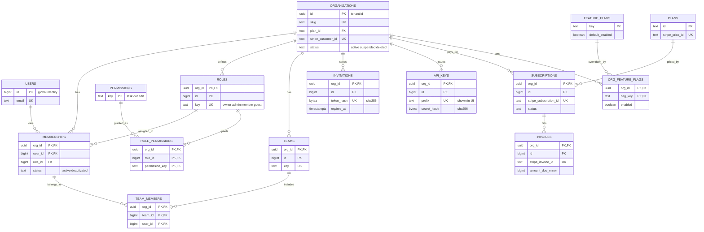
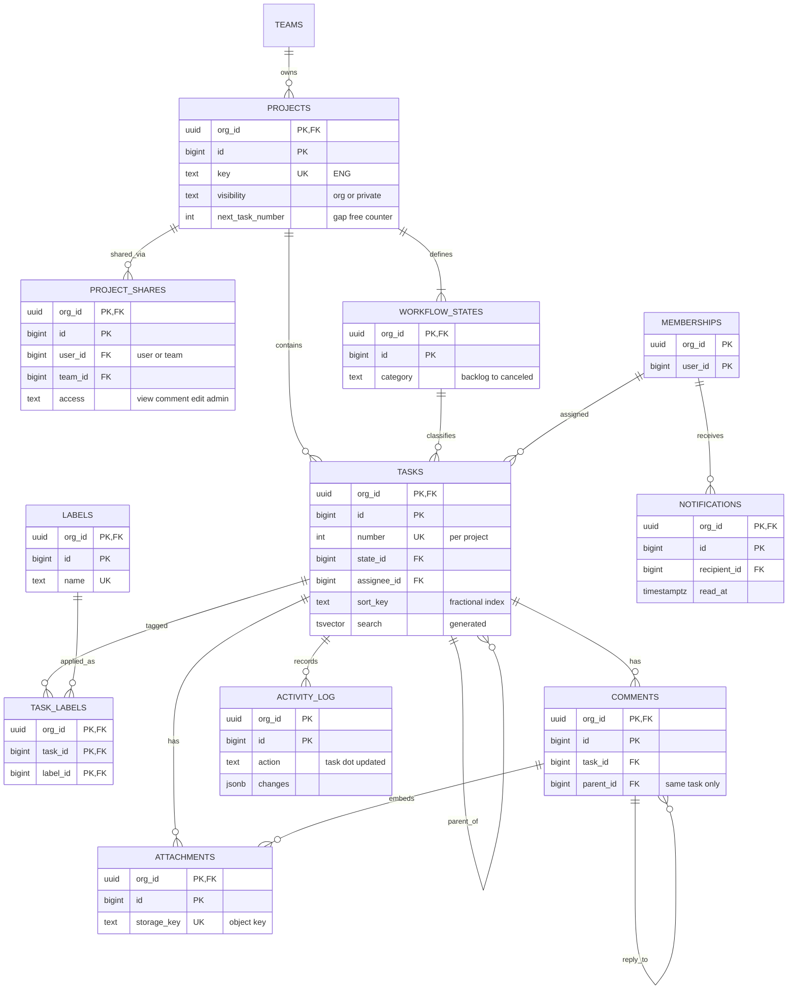

This is a complete schema for a multi-tenant B2B project-management product in the style of Linear or Asana, written for PostgreSQL 16 and later. It is meant to be copied and adapted. Every customer organization shares the same tables, so the schema's first job is to make it impossible for one tenant's data to touch another's. Every tenant row carries `org_id`, every reference between tenant rows includes `org_id` in a composite foreign key, and row-level security filters every query by the tenant set for the current transaction. The second job is to serve the screens people use all day: my tasks, the project board, search, the task page and the inbox.

## Requirements and access patterns

The product has 50,000 organizations, from 3-person startups to 20,000-seat enterprises. There are 2 million users and 400,000 daily actives, about 300 million tasks, and roughly 3,000 queries per second at the weekday peak. Reads outnumber writes about ten to one.

Invariants the schema must enforce on its own:

- A row in one tenant can never reference a row in another tenant, even if application code passes the wrong ID.
- A query that forgets its tenant filter returns nothing rather than everyone's data.
- Task numbers (`ENG-142`) are unique within a project and assigned without gaps.
- Assignees, comment authors and team members are always members of the same organization.
- Invitation tokens and API keys are stored only as hashes. A database leak cannot be replayed as credentials.
- A Stripe webhook delivered twice, or out of order, never corrupts subscription state.

| Access pattern | Peak QPS | Served by |
|----------------|----------|-----------|
| Resolve API key or session, set tenant context | 3,000 | `api_keys.prefix` unique, `memberships` PK |
| My open tasks across projects | 400 | `tasks (org_id, assignee_id, priority, updated_at DESC)` partial |
| Project board, one column at a time | 900 | `tasks (org_id, project_id, state_id, sort_key)` unique |
| Task page with comments and activity | 1,000 | `tasks` PK, `comments (org_id, task_id, id)`, `activity_log (org_id, task_id, id)` |
| Full-text search and title typeahead | 300 | GIN `(org_id, search)` and GIN `(org_id, title gin_trgm_ops)` |
| Create, edit, move or reorder a task | 250 | `projects` PK row lock, `tasks` PK with version check |
| Inbox and unread badge | 800 | `notifications` partial indexes on recipient |
| Permission check for a project | 1,500 (mostly cached) | `memberships` PK, `role_permissions` PK, `project_shares` indexes |
| Stripe webhook | 2 | `billing_events` PK, `subscriptions.stripe_subscription_id` unique |
| Tenant export or deletion | a few per day | `org_id` leading every primary key |

## Entity-relationship model

Identity, access and billing are small, change rarely and cache well. Work items are the large, write-heavy half.





## Design decisions before the DDL

**Tenant key.** Organizations use a random `uuid`. The application generates it before the organization row exists, so it can set the tenant context first and insert under row-level security like any other write. It also survives moving a tenant to another database without renumbering.

**Row keys.** Everything else uses `bigint GENERATED ALWAYS AS IDENTITY`, with the primary key `(org_id, id)`. The ID alone is globally unique, but leading with `org_id` means every primary-key index also serves tenant-scoped lookups. It also gives every table the target that composite foreign keys need.

**Composite foreign keys.** A task's assignee is `FOREIGN KEY (org_id, assignee_id) REFERENCES memberships (org_id, user_id)`, not a plain reference to `users`. Because `org_id` is shared, the assignee must be a member of the same tenant. This matters because PostgreSQL runs foreign-key checks without row-level security, so RLS alone would happily accept a reference to another tenant's row.

**Global versus tenant tables.** `users`, `permissions`, `plans` and `feature_flags` are global. One person has one login across organizations, and the catalogues are shared. Everything else is tenant-scoped.

**Authorization split.** Row-level security enforces only the tenant boundary. Within a tenant, roles, permissions and project shares are checked by the application using the queries shown later. Encoding per-user permissions in RLS policies makes every query slower and every bug harder to diagnose.

**Workflow states.** Board columns are rows, not an enum, because every project customises them. Each state has a fixed `category` that the product reasons about. The task copies the category, and a composite foreign key pins the copy to the state, so it can never drift.

## DDL

Tables are created in dependency order. `pg_trgm` provides trigram search; `btree_gin` lets a GIN index lead with the `org_id` equality column.

```sql
CREATE EXTENSION IF NOT EXISTS pg_trgm;
CREATE EXTENSION IF NOT EXISTS btree_gin;

-- app_user: the web and API tier. Subject to row-level security.
-- app_worker: trusted background jobs (billing, export, deletion). Bypasses RLS.
CREATE ROLE app_user NOLOGIN;
CREATE ROLE app_worker NOLOGIN BYPASSRLS;

-- Tenant context helpers. NULL when unset, so policies match nothing.
CREATE FUNCTION app_org_id() RETURNS uuid
LANGUAGE sql STABLE PARALLEL SAFE
AS $$ SELECT NULLIF(current_setting('app.org_id', true), '')::uuid $$;

CREATE FUNCTION app_user_id() RETURNS bigint
LANGUAGE sql STABLE PARALLEL SAFE
AS $$ SELECT NULLIF(current_setting('app.user_id', true), '')::bigint $$;

CREATE FUNCTION touch_updated_at() RETURNS trigger
LANGUAGE plpgsql AS $$
BEGIN
  NEW.updated_at := now();
  RETURN NEW;
END $$;

-- Global tables ----------------------------------------------------------
CREATE TABLE users (
  id            bigint GENERATED ALWAYS AS IDENTITY PRIMARY KEY,
  email         text NOT NULL CHECK (email = btrim(email) AND email LIKE '%_@_%'),
  full_name     text NOT NULL,
  avatar_key    text,
  password_hash text,                                   -- null for SSO-only accounts
  status        text NOT NULL DEFAULT 'active'
                CHECK (status IN ('active', 'disabled', 'erased')),
  created_at    timestamptz NOT NULL DEFAULT now(),
  updated_at    timestamptz NOT NULL DEFAULT now()
);
CREATE UNIQUE INDEX users_email_uk ON users (lower(email));

CREATE TABLE permissions (
  key         text PRIMARY KEY CHECK (key ~ '^[a-z_]+\.[a-z_]+$'),
  description text NOT NULL
);
INSERT INTO permissions (key, description) VALUES
  ('org.manage',      'Rename the organization and change settings'),
  ('billing.manage',  'Change plan, seats and payment method'),
  ('member.invite',   'Invite people and change their roles'),
  ('member.remove',   'Deactivate members'),
  ('api_key.manage',  'Create and revoke API keys'),
  ('project.create',  'Create projects'),
  ('project.admin',   'Manage any project, including private ones'),
  ('task.create',     'Create tasks'),
  ('task.edit',       'Edit, move and assign tasks'),
  ('task.delete',     'Move tasks to the trash'),
  ('comment.create',  'Comment on tasks');

CREATE TABLE plans (
  id                  text PRIMARY KEY,                 -- 'free', 'team', 'business'
  name                text NOT NULL,
  stripe_price_id     text UNIQUE,                      -- null for the free plan
  seat_limit          int CHECK (seat_limit > 0),       -- null means unlimited
  monthly_price_minor bigint NOT NULL DEFAULT 0 CHECK (monthly_price_minor >= 0),
  currency            char(3) NOT NULL DEFAULT 'USD' CHECK (currency ~ '^[A-Z]{3}$'),
  is_public           boolean NOT NULL DEFAULT true
);
INSERT INTO plans (id, name, stripe_price_id, seat_limit, monthly_price_minor) VALUES
  ('free', 'Free', NULL, 10, 0),
  ('team', 'Team', 'price_team_monthly', NULL, 1000),
  ('business', 'Business', 'price_business_monthly', NULL, 1800);

CREATE TABLE feature_flags (
  key             text PRIMARY KEY CHECK (key ~ '^[a-z0-9_]+$'),
  description     text NOT NULL,
  default_enabled boolean NOT NULL DEFAULT false,
  created_at      timestamptz NOT NULL DEFAULT now()
);

CREATE TABLE billing_events (                           -- Stripe webhook inbox
  stripe_event_id text PRIMARY KEY,
  type            text NOT NULL,
  stripe_created  timestamptz NOT NULL,
  payload         jsonb NOT NULL,
  received_at     timestamptz NOT NULL DEFAULT now(),
  processed_at    timestamptz
);
CREATE INDEX billing_events_pending_idx ON billing_events (received_at)
  WHERE processed_at IS NULL;

CREATE TABLE object_deletions (                         -- queue for the storage sweeper
  storage_key  text PRIMARY KEY,
  org_id       uuid NOT NULL,
  requested_at timestamptz NOT NULL DEFAULT now()
);
```

The tenant root, identity and access tables come next. Every foreign key between tenant rows includes `org_id`.

```sql
CREATE TABLE organizations (
  id                    uuid PRIMARY KEY,               -- generated by the application
  slug                  text NOT NULL UNIQUE CHECK (slug ~ '^[a-z0-9][a-z0-9-]{1,39}$'),
  name                  text NOT NULL,
  plan_id               text NOT NULL DEFAULT 'free' REFERENCES plans (id),
  stripe_customer_id    text UNIQUE,
  status                text NOT NULL DEFAULT 'active'
                        CHECK (status IN ('active', 'suspended', 'pending_deletion', 'deleted')),
  deletion_requested_at timestamptz,
  created_at            timestamptz NOT NULL DEFAULT now(),
  updated_at            timestamptz NOT NULL DEFAULT now(),
  CHECK (status <> 'pending_deletion' OR deletion_requested_at IS NOT NULL)
);
CREATE TRIGGER organizations_touch BEFORE UPDATE ON organizations
  FOR EACH ROW EXECUTE FUNCTION touch_updated_at();

CREATE TABLE roles (
  org_id     uuid   NOT NULL REFERENCES organizations (id),
  id         bigint GENERATED ALWAYS AS IDENTITY,
  key        text   NOT NULL CHECK (key ~ '^[a-z_]+$'),
  name       text   NOT NULL,
  is_system  boolean NOT NULL DEFAULT false,            -- owner, admin, member, guest
  created_at timestamptz NOT NULL DEFAULT now(),
  PRIMARY KEY (org_id, id),
  UNIQUE (org_id, key)
);

CREATE TABLE role_permissions (
  org_id         uuid   NOT NULL,
  role_id        bigint NOT NULL,
  permission_key text   NOT NULL REFERENCES permissions (key),
  PRIMARY KEY (org_id, role_id, permission_key),
  FOREIGN KEY (org_id, role_id) REFERENCES roles (org_id, id) ON DELETE CASCADE
);

CREATE TABLE memberships (
  org_id         uuid   NOT NULL REFERENCES organizations (id),
  user_id        bigint NOT NULL REFERENCES users (id),
  role_id        bigint NOT NULL,
  status         text   NOT NULL DEFAULT 'active'
                 CHECK (status IN ('active', 'deactivated')),
  joined_at      timestamptz NOT NULL DEFAULT now(),
  deactivated_at timestamptz,
  PRIMARY KEY (org_id, user_id),
  FOREIGN KEY (org_id, role_id) REFERENCES roles (org_id, id),
  CHECK ((status = 'deactivated') = (deactivated_at IS NOT NULL))
);
CREATE INDEX memberships_user_idx ON memberships (user_id) WHERE status = 'active';
CREATE INDEX memberships_role_idx ON memberships (org_id, role_id);

CREATE TABLE teams (
  org_id      uuid   NOT NULL REFERENCES organizations (id),
  id          bigint GENERATED ALWAYS AS IDENTITY,
  key         text   NOT NULL CHECK (key ~ '^[A-Z][A-Z0-9]{1,9}$'),
  name        text   NOT NULL,
  created_at  timestamptz NOT NULL DEFAULT now(),
  archived_at timestamptz,
  PRIMARY KEY (org_id, id),
  UNIQUE (org_id, key)
);

CREATE TABLE team_members (
  org_id   uuid    NOT NULL,
  team_id  bigint  NOT NULL,
  user_id  bigint  NOT NULL,
  is_lead  boolean NOT NULL DEFAULT false,
  added_at timestamptz NOT NULL DEFAULT now(),
  PRIMARY KEY (org_id, team_id, user_id),
  FOREIGN KEY (org_id, team_id) REFERENCES teams (org_id, id) ON DELETE CASCADE,
  FOREIGN KEY (org_id, user_id) REFERENCES memberships (org_id, user_id) ON DELETE CASCADE
);
CREATE INDEX team_members_user_idx ON team_members (org_id, user_id);

CREATE TABLE invitations (
  org_id           uuid   NOT NULL REFERENCES organizations (id),
  id               bigint GENERATED ALWAYS AS IDENTITY,
  email            text   NOT NULL,
  role_id          bigint NOT NULL,
  invited_by       bigint NOT NULL,
  token_hash       bytea  NOT NULL UNIQUE CHECK (octet_length(token_hash) = 32),
  expires_at       timestamptz NOT NULL,
  accepted_at      timestamptz,
  accepted_user_id bigint REFERENCES users (id),
  revoked_at       timestamptz,
  created_at       timestamptz NOT NULL DEFAULT now(),
  PRIMARY KEY (org_id, id),
  FOREIGN KEY (org_id, role_id) REFERENCES roles (org_id, id),
  FOREIGN KEY (org_id, invited_by) REFERENCES memberships (org_id, user_id),
  CHECK (expires_at > created_at),
  CHECK (num_nonnulls(accepted_at, revoked_at) <= 1),
  CHECK ((accepted_at IS NULL) = (accepted_user_id IS NULL))
);
CREATE UNIQUE INDEX invitations_one_open_uk ON invitations (org_id, lower(email))
  WHERE accepted_at IS NULL AND revoked_at IS NULL;

CREATE TABLE api_keys (
  org_id       uuid   NOT NULL REFERENCES organizations (id),
  id           bigint GENERATED ALWAYS AS IDENTITY,
  name         text   NOT NULL,
  prefix       text   NOT NULL UNIQUE CHECK (prefix ~ '^pm_[a-z0-9]{8}$'),  -- shown in the UI
  secret_hash  bytea  NOT NULL CHECK (octet_length(secret_hash) = 32),    -- sha256 of full key
  scopes       text[] NOT NULL DEFAULT '{}',
  created_by   bigint NOT NULL,
  last_used_at timestamptz,
  expires_at   timestamptz,
  revoked_at   timestamptz,
  created_at   timestamptz NOT NULL DEFAULT now(),
  PRIMARY KEY (org_id, id),
  FOREIGN KEY (org_id, created_by) REFERENCES memberships (org_id, user_id)
);
```

Work items. `sort_key` uses the `C` collation so that byte order, which fractional-indexing libraries assume, is also the database's sort order.

```sql
CREATE TABLE projects (
  org_id           uuid   NOT NULL,
  id               bigint GENERATED ALWAYS AS IDENTITY,
  team_id          bigint NOT NULL,
  key              text   NOT NULL CHECK (key ~ '^[A-Z][A-Z0-9]{1,9}$'),
  name             text   NOT NULL,
  description      text   NOT NULL DEFAULT '',
  visibility       text   NOT NULL DEFAULT 'org' CHECK (visibility IN ('org', 'private')),
  lead_id          bigint,
  next_task_number int    NOT NULL DEFAULT 1 CHECK (next_task_number > 0),
  created_at       timestamptz NOT NULL DEFAULT now(),
  updated_at       timestamptz NOT NULL DEFAULT now(),
  archived_at      timestamptz,
  deleted_at       timestamptz,
  PRIMARY KEY (org_id, id),
  UNIQUE (org_id, key),                                 -- keys are never reused
  FOREIGN KEY (org_id, team_id) REFERENCES teams (org_id, id),
  FOREIGN KEY (org_id, lead_id) REFERENCES memberships (org_id, user_id)
);
CREATE INDEX projects_team_idx ON projects (org_id, team_id) WHERE deleted_at IS NULL;
CREATE TRIGGER projects_touch BEFORE UPDATE ON projects
  FOR EACH ROW EXECUTE FUNCTION touch_updated_at();

CREATE TABLE project_shares (
  org_id     uuid   NOT NULL,
  id         bigint GENERATED ALWAYS AS IDENTITY,
  project_id bigint NOT NULL,
  user_id    bigint,
  team_id    bigint,
  access     text   NOT NULL CHECK (access IN ('view', 'comment', 'edit', 'admin')),
  granted_by bigint NOT NULL,
  created_at timestamptz NOT NULL DEFAULT now(),
  PRIMARY KEY (org_id, id),
  FOREIGN KEY (org_id, project_id) REFERENCES projects (org_id, id) ON DELETE CASCADE,
  FOREIGN KEY (org_id, user_id) REFERENCES memberships (org_id, user_id) ON DELETE CASCADE,
  FOREIGN KEY (org_id, team_id) REFERENCES teams (org_id, id) ON DELETE CASCADE,
  FOREIGN KEY (org_id, granted_by) REFERENCES memberships (org_id, user_id),
  CHECK (num_nonnulls(user_id, team_id) = 1),
  UNIQUE (org_id, project_id, user_id),
  UNIQUE (org_id, project_id, team_id)
);
CREATE INDEX project_shares_user_idx ON project_shares (org_id, user_id) WHERE user_id IS NOT NULL;
CREATE INDEX project_shares_team_idx ON project_shares (org_id, team_id) WHERE team_id IS NOT NULL;

CREATE TABLE workflow_states (
  org_id     uuid   NOT NULL,
  project_id bigint NOT NULL,
  id         bigint GENERATED ALWAYS AS IDENTITY,
  name       text   NOT NULL,
  category   text   NOT NULL
             CHECK (category IN ('backlog', 'unstarted', 'started', 'completed', 'canceled')),
  sort_key   text COLLATE "C" NOT NULL,
  PRIMARY KEY (org_id, id),
  UNIQUE (org_id, project_id, id, category),            -- target for the tasks FK below
  UNIQUE (org_id, project_id, name),
  FOREIGN KEY (org_id, project_id) REFERENCES projects (org_id, id) ON DELETE CASCADE
);

CREATE TABLE tasks (
  org_id         uuid     NOT NULL,
  id             bigint   GENERATED ALWAYS AS IDENTITY,
  project_id     bigint   NOT NULL,
  number         int      NOT NULL CHECK (number > 0),
  parent_id      bigint,
  title          text     NOT NULL CHECK (length(title) BETWEEN 1 AND 500),
  description    text     NOT NULL DEFAULT '',
  state_id       bigint   NOT NULL,
  state_category text     NOT NULL,                     -- copy, pinned by the FK
  priority       smallint CHECK (priority BETWEEN 1 AND 4),  -- 1 urgent .. 4 low, null none
  assignee_id    bigint,
  creator_id     bigint   NOT NULL,
  sort_key       text COLLATE "C" NOT NULL CHECK (sort_key ~ '^[0-9A-Za-z]{1,64}$'),
  due_date       date,
  estimate       smallint CHECK (estimate >= 0),
  version        int      NOT NULL DEFAULT 1,           -- optimistic concurrency
  search         tsvector GENERATED ALWAYS AS (
                   setweight(to_tsvector('english', title), 'A') ||
                   setweight(to_tsvector('english', description), 'B')) STORED,
  created_at     timestamptz NOT NULL DEFAULT now(),
  updated_at     timestamptz NOT NULL DEFAULT now(),
  completed_at   timestamptz,
  deleted_at     timestamptz,                           -- trash, purged after 30 days
  PRIMARY KEY (org_id, id),
  UNIQUE (org_id, project_id, number),
  UNIQUE (org_id, project_id, state_id, sort_key),      -- also the board index
  FOREIGN KEY (org_id, project_id) REFERENCES projects (org_id, id),
  FOREIGN KEY (org_id, project_id, state_id, state_category)
    REFERENCES workflow_states (org_id, project_id, id, category) ON UPDATE CASCADE,
  FOREIGN KEY (org_id, parent_id) REFERENCES tasks (org_id, id) ON DELETE SET NULL (parent_id),
  FOREIGN KEY (org_id, assignee_id) REFERENCES memberships (org_id, user_id),
  FOREIGN KEY (org_id, creator_id) REFERENCES memberships (org_id, user_id),
  CHECK (parent_id <> id)
);
CREATE INDEX tasks_my_open_idx ON tasks (org_id, assignee_id, priority, updated_at DESC)
  WHERE state_category IN ('unstarted', 'started') AND deleted_at IS NULL;
CREATE INDEX tasks_parent_idx ON tasks (org_id, parent_id) WHERE parent_id IS NOT NULL;
CREATE INDEX tasks_search_idx ON tasks USING gin (org_id, search);
CREATE INDEX tasks_title_trgm_idx ON tasks USING gin (org_id, title gin_trgm_ops);
CREATE INDEX tasks_trash_idx ON tasks (deleted_at) WHERE deleted_at IS NOT NULL;

CREATE FUNCTION tasks_touch() RETURNS trigger
LANGUAGE plpgsql AS $$
BEGIN
  NEW.updated_at := now();
  IF NEW.state_category = 'completed' THEN
    NEW.completed_at := COALESCE(NEW.completed_at, now());
  ELSE
    NEW.completed_at := NULL;
  END IF;
  RETURN NEW;
END $$;
CREATE TRIGGER tasks_touch BEFORE INSERT OR UPDATE ON tasks
  FOR EACH ROW EXECUTE FUNCTION tasks_touch();

CREATE TABLE labels (
  org_id     uuid   NOT NULL REFERENCES organizations (id),
  id         bigint GENERATED ALWAYS AS IDENTITY,
  team_id    bigint,                                    -- null means organization-wide
  name       text   NOT NULL,
  color      text   NOT NULL CHECK (color ~ '^#[0-9a-f]{6}$'),
  created_at timestamptz NOT NULL DEFAULT now(),
  PRIMARY KEY (org_id, id),
  FOREIGN KEY (org_id, team_id) REFERENCES teams (org_id, id) ON DELETE CASCADE
);
CREATE UNIQUE INDEX labels_name_uk ON labels (org_id, team_id, lower(name)) NULLS NOT DISTINCT;

CREATE TABLE task_labels (
  org_id   uuid   NOT NULL,
  task_id  bigint NOT NULL,
  label_id bigint NOT NULL,
  added_at timestamptz NOT NULL DEFAULT now(),
  PRIMARY KEY (org_id, task_id, label_id),
  FOREIGN KEY (org_id, task_id) REFERENCES tasks (org_id, id) ON DELETE CASCADE,
  FOREIGN KEY (org_id, label_id) REFERENCES labels (org_id, id) ON DELETE CASCADE
);
CREATE INDEX task_labels_label_idx ON task_labels (org_id, label_id, task_id);

CREATE TABLE comments (
  org_id     uuid   NOT NULL,
  id         bigint GENERATED ALWAYS AS IDENTITY,
  task_id    bigint NOT NULL,
  parent_id  bigint,                                    -- null for top-level comments
  author_id  bigint NOT NULL,
  body       text   NOT NULL,
  created_at timestamptz NOT NULL DEFAULT now(),
  edited_at  timestamptz,
  deleted_at timestamptz,                               -- tombstone keeps the thread shape
  PRIMARY KEY (org_id, id),
  UNIQUE (org_id, task_id, id),                         -- FK target and task-thread index
  FOREIGN KEY (org_id, task_id) REFERENCES tasks (org_id, id) ON DELETE CASCADE,
  FOREIGN KEY (org_id, task_id, parent_id)
    REFERENCES comments (org_id, task_id, id) ON DELETE CASCADE,
  FOREIGN KEY (org_id, author_id) REFERENCES memberships (org_id, user_id)
);

CREATE TABLE attachments (
  org_id       uuid   NOT NULL,
  id           bigint GENERATED ALWAYS AS IDENTITY,
  task_id      bigint NOT NULL,
  comment_id   bigint,
  uploaded_by  bigint NOT NULL,
  storage_key  text   NOT NULL UNIQUE,
  file_name    text   NOT NULL,
  content_type text   NOT NULL,
  byte_size    bigint NOT NULL CHECK (byte_size >= 0),
  sha256       bytea  CHECK (octet_length(sha256) = 32),
  status       text   NOT NULL DEFAULT 'pending'
               CHECK (status IN ('pending', 'ready', 'quarantined')),
  created_at   timestamptz NOT NULL DEFAULT now(),
  PRIMARY KEY (org_id, id),
  FOREIGN KEY (org_id, task_id) REFERENCES tasks (org_id, id) ON DELETE CASCADE,
  FOREIGN KEY (org_id, task_id, comment_id)
    REFERENCES comments (org_id, task_id, id) ON DELETE CASCADE,
  FOREIGN KEY (org_id, uploaded_by) REFERENCES memberships (org_id, user_id),
  CHECK (storage_key LIKE 'orgs/' || org_id::text || '/%')
);
CREATE INDEX attachments_task_idx ON attachments (org_id, task_id);
CREATE INDEX attachments_pending_idx ON attachments (created_at) WHERE status = 'pending';

CREATE FUNCTION attachments_enqueue_object_delete() RETURNS trigger
LANGUAGE plpgsql SECURITY DEFINER SET search_path = public, pg_temp AS $$
BEGIN
  INSERT INTO object_deletions (storage_key, org_id)
  SELECT storage_key, org_id FROM old_rows
  ON CONFLICT (storage_key) DO NOTHING;
  RETURN NULL;
END $$;
CREATE TRIGGER attachments_object_cleanup AFTER DELETE ON attachments
  REFERENCING OLD TABLE AS old_rows
  FOR EACH STATEMENT EXECUTE FUNCTION attachments_enqueue_object_delete();

CREATE TABLE activity_log (                             -- append-only audit trail
  org_id           uuid   NOT NULL,
  id               bigint GENERATED ALWAYS AS IDENTITY,
  occurred_at      timestamptz NOT NULL DEFAULT now(),
  actor_user_id    bigint,                              -- both null for system actions
  actor_api_key_id bigint,
  action           text   NOT NULL CHECK (action ~ '^[a-z_]+\.[a-z_]+$'),
  subject_type     text   NOT NULL,
  subject_id       bigint NOT NULL,
  project_id       bigint,
  task_id          bigint,
  changes          jsonb  NOT NULL DEFAULT '{}',
  ip               inet,
  request_id       uuid,
  PRIMARY KEY (org_id, id),
  CHECK (num_nonnulls(actor_user_id, actor_api_key_id) <= 1)
);
CREATE INDEX activity_task_idx ON activity_log (org_id, task_id, id) WHERE task_id IS NOT NULL;
CREATE INDEX activity_org_time_idx ON activity_log (org_id, occurred_at DESC);

CREATE TABLE notifications (
  org_id       uuid   NOT NULL,
  id           bigint GENERATED ALWAYS AS IDENTITY,
  recipient_id bigint NOT NULL,
  kind         text   NOT NULL CHECK (kind IN ('assigned', 'mentioned', 'commented',
                                                'status_changed', 'due_soon')),
  task_id      bigint,
  comment_id   bigint,
  actor_id     bigint,
  activity_id  bigint,
  created_at   timestamptz NOT NULL DEFAULT now(),
  read_at      timestamptz,
  archived_at  timestamptz,
  PRIMARY KEY (org_id, id),
  FOREIGN KEY (org_id, recipient_id) REFERENCES memberships (org_id, user_id) ON DELETE CASCADE,
  FOREIGN KEY (org_id, actor_id) REFERENCES memberships (org_id, user_id),
  FOREIGN KEY (org_id, task_id) REFERENCES tasks (org_id, id) ON DELETE CASCADE,
  FOREIGN KEY (org_id, task_id, comment_id)
    REFERENCES comments (org_id, task_id, id) ON DELETE CASCADE,
  UNIQUE (org_id, recipient_id, activity_id)            -- fan-out retries insert once
);
CREATE INDEX notifications_inbox_idx ON notifications (org_id, recipient_id, id DESC)
  WHERE archived_at IS NULL;
CREATE INDEX notifications_unread_idx ON notifications (org_id, recipient_id)
  WHERE read_at IS NULL AND archived_at IS NULL;
CREATE INDEX notifications_task_idx ON notifications (org_id, task_id) WHERE task_id IS NOT NULL;
```

Billing mirrors Stripe rather than replacing it. Stripe owns the money; these tables are a webhook-maintained copy so entitlement checks never call Stripe.

```sql
CREATE TABLE subscriptions (
  org_id                 uuid   NOT NULL REFERENCES organizations (id),
  id                     bigint GENERATED ALWAYS AS IDENTITY,
  plan_id                text   NOT NULL REFERENCES plans (id),
  stripe_subscription_id text   NOT NULL UNIQUE,
  status                 text   NOT NULL CHECK (status IN ('incomplete', 'trialing', 'active',
                                                           'past_due', 'unpaid', 'canceled')),
  seats                  int    NOT NULL CHECK (seats > 0),
  current_period_start   timestamptz NOT NULL,
  current_period_end     timestamptz NOT NULL,
  trial_ends_at          timestamptz,
  cancel_at_period_end   boolean NOT NULL DEFAULT false,
  ended_at               timestamptz,
  stripe_updated_at      timestamptz NOT NULL,          -- event time of last applied webhook
  created_at             timestamptz NOT NULL DEFAULT now(),
  PRIMARY KEY (org_id, id),
  CHECK (current_period_end > current_period_start)
);
CREATE UNIQUE INDEX subscriptions_one_live_uk ON subscriptions (org_id) WHERE ended_at IS NULL;

CREATE TABLE invoices (
  org_id            uuid    NOT NULL REFERENCES organizations (id),
  id                bigint  GENERATED ALWAYS AS IDENTITY,
  subscription_id   bigint,                             -- null for one-off invoices
  stripe_invoice_id text    NOT NULL UNIQUE,
  number            text,
  status            text    NOT NULL
                    CHECK (status IN ('draft', 'open', 'paid', 'void', 'uncollectible')),
  currency          char(3) NOT NULL CHECK (currency ~ '^[A-Z]{3}$'),
  amount_due_minor  bigint  NOT NULL CHECK (amount_due_minor >= 0),
  amount_paid_minor bigint  NOT NULL DEFAULT 0 CHECK (amount_paid_minor >= 0),
  period_start      timestamptz,
  period_end        timestamptz,
  hosted_url        text,
  issued_at         timestamptz,
  paid_at           timestamptz,
  PRIMARY KEY (org_id, id),
  FOREIGN KEY (org_id, subscription_id) REFERENCES subscriptions (org_id, id),
  CHECK (amount_paid_minor <= amount_due_minor)
);
CREATE INDEX invoices_org_idx ON invoices (org_id, issued_at DESC);

CREATE TABLE org_feature_flags (
  org_id     uuid    NOT NULL REFERENCES organizations (id),
  flag_key   text    NOT NULL REFERENCES feature_flags (key) ON DELETE CASCADE,
  enabled    boolean NOT NULL,
  reason     text,
  updated_by text    NOT NULL,                          -- staff email or 'billing'
  updated_at timestamptz NOT NULL DEFAULT now(),
  PRIMARY KEY (org_id, flag_key)
);
```

Three details are easy to miss. The four-column foreign key to `workflow_states` keeps a task in a state of its own project, and `ON UPDATE CASCADE` rewrites the copied category if a column is recategorised. The comment parent key includes `task_id`, so a reply cannot be attached to a comment on another task. `ON DELETE SET NULL (parent_id)` uses the column list added in PostgreSQL 15. A plain `SET NULL` on a composite key would also null `org_id` and fail.

## Row-level security, grants and pre-tenant lookups

One loop enables and forces RLS on every tenant table with the same policy. `FORCE` applies policies to the table owner too.

```sql
DO $$
DECLARE t text;
BEGIN
  FOREACH t IN ARRAY ARRAY[
    'roles', 'role_permissions', 'memberships', 'teams', 'team_members', 'invitations',
    'api_keys', 'projects', 'project_shares', 'workflow_states', 'tasks', 'labels',
    'task_labels', 'comments', 'attachments', 'activity_log', 'notifications',
    'subscriptions', 'invoices', 'org_feature_flags']
  LOOP
    EXECUTE format('ALTER TABLE %I ENABLE ROW LEVEL SECURITY', t);
    EXECUTE format('ALTER TABLE %I FORCE ROW LEVEL SECURITY', t);
    EXECUTE format('CREATE POLICY tenant_isolation ON %I
                      USING (org_id = app_org_id()) WITH CHECK (org_id = app_org_id())', t);
  END LOOP;
END $$;

ALTER TABLE organizations ENABLE ROW LEVEL SECURITY;
ALTER TABLE organizations FORCE ROW LEVEL SECURITY;
CREATE POLICY tenant_isolation ON organizations
  USING (id = app_org_id()) WITH CHECK (id = app_org_id());

-- Users are global, but a tenant sees only itself and members of the current org.
ALTER TABLE users ENABLE ROW LEVEL SECURITY;
CREATE POLICY users_self ON users USING (id = app_user_id());
CREATE POLICY users_same_org ON users FOR SELECT
  USING (EXISTS (SELECT 1 FROM memberships m WHERE m.user_id = users.id));

GRANT USAGE ON SCHEMA public TO app_user, app_worker;
GRANT SELECT, INSERT, UPDATE, DELETE ON ALL TABLES IN SCHEMA public TO app_worker;
GRANT SELECT, INSERT, UPDATE, DELETE ON
  roles, role_permissions, memberships, teams, team_members, invitations, api_keys,
  projects, project_shares, workflow_states, tasks, labels, task_labels, comments,
  attachments, notifications TO app_user;
GRANT SELECT, INSERT, UPDATE ON organizations TO app_user;
GRANT SELECT, INSERT ON activity_log TO app_user;      -- no UPDATE or DELETE: append-only
GRANT SELECT ON subscriptions, invoices, org_feature_flags, plans, permissions,
  feature_flags TO app_user;
GRANT SELECT, UPDATE (full_name, avatar_key) ON users TO app_user;

-- Lookups that must happen before the tenant is known. Narrow, read-only,
-- owned by the RLS-bypassing role, callable by the app.
CREATE FUNCTION auth_api_key(p_prefix text, p_secret_hash bytea)
RETURNS TABLE (org_id uuid, api_key_id bigint, scopes text[])
LANGUAGE sql STABLE SECURITY DEFINER SET search_path = public, pg_temp AS $$
  SELECT k.org_id, k.id, k.scopes
  FROM api_keys k JOIN organizations o ON o.id = k.org_id
  WHERE k.prefix = p_prefix AND k.secret_hash = p_secret_hash
    AND k.revoked_at IS NULL AND (k.expires_at IS NULL OR k.expires_at > now())
    AND o.status = 'active'
$$;

CREATE FUNCTION resolve_invitation(p_token_hash bytea)
RETURNS TABLE (org_id uuid, invitation_id bigint, email text, role_id bigint)
LANGUAGE sql STABLE SECURITY DEFINER SET search_path = public, pg_temp AS $$
  SELECT i.org_id, i.id, i.email, i.role_id
  FROM invitations i
  WHERE i.token_hash = p_token_hash
    AND i.accepted_at IS NULL AND i.revoked_at IS NULL AND i.expires_at > now()
$$;

CREATE FUNCTION my_organizations()
RETURNS TABLE (org_id uuid, slug text, name text, role_key text)
LANGUAGE sql STABLE SECURITY DEFINER SET search_path = public, pg_temp AS $$
  SELECT o.id, o.slug, o.name, r.key
  FROM memberships m
  JOIN organizations o ON o.id = m.org_id
  JOIN roles r ON r.org_id = m.org_id AND r.id = m.role_id
  WHERE m.user_id = app_user_id() AND m.status = 'active'
    AND o.status IN ('active', 'suspended')
  ORDER BY o.name
$$;

ALTER FUNCTION auth_api_key(text, bytea) OWNER TO app_worker;
ALTER FUNCTION resolve_invitation(bytea) OWNER TO app_worker;
ALTER FUNCTION my_organizations() OWNER TO app_worker;
ALTER FUNCTION attachments_enqueue_object_delete() OWNER TO app_worker;
REVOKE EXECUTE ON FUNCTION auth_api_key(text, bytea), resolve_invitation(bytea),
  my_organizations() FROM PUBLIC;
GRANT EXECUTE ON FUNCTION auth_api_key(text, bytea), resolve_invitation(bytea),
  my_organizations() TO app_user;
```

`my_organizations()` reads the user from `app.user_id`, which the app sets from the verified session, instead of taking a parameter. Otherwise any caller could list any user's organizations.

## Request context and onboarding

Every request runs in one transaction that sets the tenant and user with `set_config(..., true)`, the parameterisable form of `SET LOCAL`. The settings vanish at `COMMIT` or `ROLLBACK`, which keeps them safe behind PgBouncer in transaction mode, where a session `SET` would leak to the next client. The policy helpers turn an unset or reset value into `NULL`, so a forgotten context returns zero rows. Creating an organization works the same way, because the application generates the UUID first:

```sql
BEGIN;
SELECT set_config('app.org_id', '7b0e6c1a-3f2d-4e5b-9a8c-1d2e3f4a5b6c', true),
       set_config('app.user_id', '1', true);

INSERT INTO organizations (id, slug, name)
VALUES (app_org_id(), 'acme', 'Acme Inc');

INSERT INTO roles (org_id, key, name, is_system) VALUES
  (app_org_id(), 'owner', 'Owner', true), (app_org_id(), 'admin', 'Admin', true),
  (app_org_id(), 'member', 'Member', true), (app_org_id(), 'guest', 'Guest', true);

INSERT INTO role_permissions (org_id, role_id, permission_key)
SELECT r.org_id, r.id, p.key
FROM roles r CROSS JOIN permissions p
WHERE r.org_id = app_org_id()
  AND (r.key IN ('owner', 'admin') AND (r.key = 'owner' OR p.key <> 'billing.manage')
       OR r.key = 'member' AND p.key IN ('project.create', 'task.create', 'task.edit',
                                         'task.delete', 'comment.create')
       OR r.key = 'guest' AND p.key IN ('task.edit', 'comment.create'));

INSERT INTO memberships (org_id, user_id, role_id)
SELECT app_org_id(), app_user_id(), id FROM roles
WHERE org_id = app_org_id() AND key = 'owner';
COMMIT;
```

An API request first calls `auth_api_key` with the prefix parsed from the key and the SHA-256 of the whole key, then opens the tenant transaction with the returned `org_id`. Invitation acceptance does the same with `resolve_invitation`. It inserts the membership and stamps `accepted_at` in one transaction, and the partial unique index allows only one open invitation per email. Update `api_keys.last_used_at` at most once a minute per key, so a busy integration does not turn every read into a write.

## Key queries and the index that serves each

All queries run inside the request transaction and still filter on `org_id` explicitly, here via `app_org_id()` and in application code as a bound parameter.

My open tasks reads `tasks_my_open_idx` in order and stops after 50 rows. The query must repeat the partial-index predicate exactly.

```sql
SELECT t.id, p.key || '-' || t.number AS ref, t.title, t.priority, t.state_category, t.due_date
FROM tasks t
JOIN projects p ON p.org_id = t.org_id AND p.id = t.project_id
WHERE t.org_id = app_org_id() AND t.assignee_id = app_user_id()
  AND t.state_category IN ('unstarted', 'started') AND t.deleted_at IS NULL
ORDER BY t.priority, t.updated_at DESC
LIMIT 50;
```

The board loads each column separately with keyset pagination on the unique `(org_id, project_id, state_id, sort_key)` index, so a column with 10,000 completed tasks costs no more than one with ten. Labels come from the `task_labels` primary key.

```sql
SELECT t.id, t.number, t.title, t.priority, t.assignee_id, t.sort_key,
       ARRAY(SELECT tl.label_id FROM task_labels tl
             WHERE tl.org_id = t.org_id AND tl.task_id = t.id) AS label_ids
FROM tasks t
WHERE t.org_id = app_org_id() AND t.project_id = 1 AND t.state_id = 2
  AND t.sort_key > ''                                   -- cursor: last sort_key seen
  AND t.deleted_at IS NULL
ORDER BY t.sort_key
LIMIT 50;
```

Search uses the generated `tsvector` and typeahead uses trigrams, each through a GIN index that leads with `org_id`. There is a catch. Under RLS, PostgreSQL uses a query condition as an index condition only if its operator is leakproof, and `@@` and `ILIKE` are not. Run as `app_user`, both searches scan every row of the tenant. The fix is two narrow definer functions that apply the tenant filter themselves:

```sql
CREATE FUNCTION search_tasks(p_query text, p_limit int DEFAULT 20)
RETURNS TABLE (id bigint, title text, rank real)
LANGUAGE sql STABLE SECURITY DEFINER SET search_path = public, pg_temp AS $$
  SELECT t.id, t.title, ts_rank(t.search, q)
  FROM tasks t
  CROSS JOIN websearch_to_tsquery('english', p_query) AS q
  WHERE t.org_id = app_org_id() AND t.search @@ q AND t.deleted_at IS NULL
  ORDER BY 3 DESC
  LIMIT least(p_limit, 100)
$$;

CREATE FUNCTION typeahead_tasks(p_fragment text)
RETURNS TABLE (id bigint, title text)
LANGUAGE sql STABLE SECURITY DEFINER SET search_path = public, pg_temp AS $$
  SELECT t.id, t.title
  FROM tasks t
  WHERE t.org_id = app_org_id() AND length(p_fragment) >= 3 AND t.deleted_at IS NULL
    AND t.title ILIKE '%' || replace(replace(replace(p_fragment, '\', '\\'),
                                             '%', '\%'), '_', '\_') || '%'
  ORDER BY t.updated_at DESC
  LIMIT 10
$$;

ALTER FUNCTION search_tasks(text, int) OWNER TO app_worker;
ALTER FUNCTION typeahead_tasks(text) OWNER TO app_worker;
REVOKE EXECUTE ON FUNCTION search_tasks(text, int), typeahead_tasks(text) FROM PUBLIC;
GRANT EXECUTE ON FUNCTION search_tasks(text, int), typeahead_tasks(text) TO app_user;

SELECT * FROM search_tasks('login redirect');
SELECT * FROM typeahead_tasks('redir');
```

The app parses a pasted reference such as `ENG-42` and resolves it through `projects (org_id, key)` and `tasks (org_id, project_id, number)`.

The task page reads comments in ID order through `UNIQUE (org_id, task_id, id)`, which doubles as the thread index because identity values increase with time. The app builds the tree from `parent_id`. Activity uses `activity_task_idx`.

```sql
SELECT c.id, c.parent_id, c.author_id, c.created_at,
       CASE WHEN c.deleted_at IS NULL THEN c.body END AS body
FROM comments c
WHERE c.org_id = app_org_id() AND c.task_id = 1
ORDER BY c.id;

SELECT id, occurred_at, actor_user_id, action, changes
FROM activity_log
WHERE org_id = app_org_id() AND task_id = 1
ORDER BY id DESC
LIMIT 50;
```

The inbox and badge read the two partial indexes on `notifications`. The badge is polled, so it is capped: counting at most 100 rows keeps it an index-only scan of bounded size, and the UI shows "99+". Marking read takes the highest ID the user saw, so notifications that arrive in the meantime stay unread.

```sql
SELECT id, kind, task_id, actor_id, created_at, read_at
FROM notifications
WHERE org_id = app_org_id() AND recipient_id = app_user_id() AND archived_at IS NULL
ORDER BY id DESC
LIMIT 30;

SELECT count(*) FROM (
  SELECT 1 FROM notifications
  WHERE org_id = app_org_id() AND recipient_id = app_user_id()
    AND read_at IS NULL AND archived_at IS NULL
  LIMIT 100) AS unread;

UPDATE notifications SET read_at = now()
WHERE org_id = app_org_id() AND recipient_id = app_user_id()
  AND read_at IS NULL AND id <= 1234;
```

Authorization combines what a role may do with where the user may do it. A permission check needs the role permission, plus access to the project. Org-visible projects are open to every active member. Private projects need a direct or team share at a sufficient level, or the `project.admin` permission.

```sql
SELECT EXISTS (
  SELECT 1
  FROM memberships m
  JOIN role_permissions rp ON rp.org_id = m.org_id AND rp.role_id = m.role_id
                          AND rp.permission_key = 'task.edit'
  JOIN projects p ON p.org_id = m.org_id AND p.id = 1 AND p.deleted_at IS NULL
  WHERE m.org_id = app_org_id() AND m.user_id = app_user_id() AND m.status = 'active'
    AND (p.visibility = 'org'
         OR EXISTS (SELECT 1 FROM role_permissions a
                    WHERE a.org_id = m.org_id AND a.role_id = m.role_id
                      AND a.permission_key = 'project.admin')
         OR EXISTS (SELECT 1 FROM project_shares s
                    WHERE s.org_id = p.org_id AND s.project_id = p.id
                      AND s.access IN ('edit', 'admin')
                      AND (s.user_id = m.user_id
                           OR s.team_id IN (SELECT tm.team_id FROM team_members tm
                                            WHERE tm.org_id = m.org_id
                                              AND tm.user_id = m.user_id))))
) AS allowed;

SELECT f.key, COALESCE(o.enabled, f.default_enabled) AS enabled
FROM feature_flags f
LEFT JOIN org_feature_flags o ON o.org_id = app_org_id() AND o.flag_key = f.key;
```

## Concurrency: task numbers and reordering

Task numbers come from a counter on the project row, not a sequence. A sequence never rolls back, so failed inserts leave gaps. The increment and the insert are one statement. The row lock on the project serialises concurrent creators in that project. If the transaction rolls back, the increment rolls back with it, so numbers have no gaps. A short transaction allows hundreds of creates per second per project, and different projects never contend.

```sql
BEGIN;
SELECT set_config('app.org_id', '7b0e6c1a-3f2d-4e5b-9a8c-1d2e3f4a5b6c', true),
       set_config('app.user_id', '1', true);

WITH n AS (
  UPDATE projects SET next_task_number = next_task_number + 1
  WHERE org_id = app_org_id() AND id = 1 AND deleted_at IS NULL
  RETURNING org_id, id, next_task_number - 1 AS number
)
INSERT INTO tasks (org_id, project_id, number, title, state_id, state_category,
                   priority, creator_id, sort_key)
SELECT n.org_id, n.id, n.number, 'Fix login redirect', 2, 'unstarted', 2, app_user_id(), 'a0'
FROM n
RETURNING id, number;

INSERT INTO activity_log (org_id, actor_user_id, action, subject_type, subject_id,
                          project_id, task_id, changes)
SELECT org_id, app_user_id(), 'task.created', 'task', id, project_id, id,
       jsonb_build_object('title', title)
FROM tasks WHERE org_id = app_org_id() AND project_id = 1 AND number = 1;
COMMIT;
```

Ordering uses a fractional index: the client computes a key that sorts between its new neighbours (`'a0' < 'a0V' < 'a1'`), so a drag-and-drop updates one row instead of renumbering the column. Two users dropping into the same gap at the same moment compute the same key. The unique index rejects the second, which then refetches neighbours and retries. Edits use the `version` column for optimistic concurrency, so a stale client cannot silently overwrite a newer change:

```sql
UPDATE tasks
SET sort_key = 'a0V', state_id = 3, state_category = 'started', version = version + 1
WHERE org_id = app_org_id() AND id = 1 AND version = 1
RETURNING version;                                      -- zero rows: refetch and retry
```

Keys grow longer when people repeatedly insert in the same spot. The 64-character check catches runaway keys. A rebalance job rewrites one column's keys evenly in a single transaction when the longest key passes about 20 characters.

Stripe webhooks are inserted into `billing_events` first; a duplicate delivery hits the primary key and is skipped. The worker applies an event to `subscriptions` only `WHERE stripe_updated_at < $event_created`, so an older event arriving late cannot roll a cancellation back to active. It then updates the denormalised `organizations.plan_id`.

## Soft delete, hard delete, export and tenant deletion

Deletion style follows what users expect to undo and what other rows depend on:

- **Tasks** are soft-deleted into a 30-day trash. Hot indexes are partial on `deleted_at IS NULL`, and a purge job hard-deletes through `tasks_trash_idx`, cascading to labels, comments, attachments and notifications.
- **Projects** are archived (read-only, hidden) or soft-deleted. Project keys are never reused, so old references stay unambiguous.
- **Comments** keep a tombstone so replies still make sense.
- **Memberships** are deactivated, never deleted, because tasks, comments and the audit log reference them. A deactivated member stops counting as a seat.
- **Labels, label links, shares and attachments** are hard-deleted. Deleting an attachment row enqueues its object key through the statement trigger, so even cascaded deletes clean up storage.
- **Activity log** rows are never updated or deleted by the app. Retention and tenant deletion are worker jobs.
- **Users** who ask to be erased are anonymised (`status = 'erased'`), keeping their ID.

Because `org_id` leads every primary key, exporting a tenant is one index range scan per table. Run it as `app_worker` in a single repeatable-read transaction so all tables share a snapshot, and copy the `orgs/<org_id>/` storage prefix alongside.

```sql
BEGIN ISOLATION LEVEL REPEATABLE READ READ ONLY;
COPY (SELECT * FROM projects WHERE org_id = '7b0e6c1a-3f2d-4e5b-9a8c-1d2e3f4a5b6c')
  TO STDOUT WITH (FORMAT csv, HEADER);
COPY (SELECT org_id, id, project_id, number, title, description, state_id, priority,
             assignee_id, created_at, completed_at
      FROM tasks WHERE org_id = '7b0e6c1a-3f2d-4e5b-9a8c-1d2e3f4a5b6c')
  TO STDOUT WITH (FORMAT csv, HEADER);
-- ...one COPY per tenant table
COMMIT;
```

Deleting a tenant starts with a 30-day grace period (`status = 'pending_deletion'`) and cancelling the Stripe subscription. A worker then purges in batches, children before parents, committing between batches so no single transaction locks millions of rows or bloats replication. Foreign keys to `organizations` deliberately do not cascade. A single `DELETE FROM organizations` would try to remove the whole tenant in one transaction. Invoices are kept for tax retention, so the organization row remains as a scrubbed tombstone.

```sql
CREATE PROCEDURE purge_tenant(p_org uuid, p_batch int DEFAULT 5000)
LANGUAGE plpgsql AS $$
DECLARE
  t text;
  n bigint;
BEGIN
  FOREACH t IN ARRAY ARRAY[
    'notifications', 'activity_log', 'attachments', 'comments', 'task_labels', 'tasks',
    'labels', 'workflow_states', 'project_shares', 'projects', 'team_members', 'teams',
    'api_keys', 'invitations', 'org_feature_flags', 'memberships', 'role_permissions', 'roles']
  LOOP
    LOOP
      EXECUTE format('DELETE FROM %I WHERE ctid = ANY (ARRAY(
                        SELECT ctid FROM %I WHERE org_id = $1 LIMIT $2))', t, t)
        USING p_org, p_batch;
      GET DIAGNOSTICS n = ROW_COUNT;
      COMMIT;
      EXIT WHEN n = 0;
    END LOOP;
  END LOOP;

  UPDATE organizations
  SET status = 'deleted', name = 'Deleted organization',
      slug = 'deleted-' || left(replace(id::text, '-', ''), 24)
  WHERE id = p_org;
  COMMIT;
END $$;
GRANT EXECUTE ON PROCEDURE purge_tenant(uuid, int) TO app_worker;
```

The order matters. Tasks go before memberships because they reference assignees, and memberships go before roles. Batching tasks works despite the self-reference, because `ON DELETE SET NULL (parent_id)` releases children whose parent went in an earlier batch.

## What to partition later

`activity_log` and `notifications` grow fastest. Range-partition `activity_log` by month on `occurred_at` once it passes a few hundred million rows, with the primary key becoming `(org_id, id, occurred_at)`, so retention becomes dropping a partition. Read notifications older than 90 days can simply be deleted. When one database is no longer enough, the `org_id`-leading keys let you distribute by tenant (Citus, for example) or move the largest customers to their own database with no schema change.

## Trade-offs and pitfalls

- **Composite keys everywhere** make every foreign key and join two columns wide and add 16 bytes per reference. In return, cross-tenant references are impossible by construction. It is far cheaper to adopt on day one than to retrofit.
- **RLS is a safety net, not an authorization system.** It stops cross-tenant leaks. Who may edit a private project is still application logic, and it needs tests.
- **Fail-closed context returns empty results, not errors.** A missing `set_config` looks like an empty account, so assert the context in middleware.
- **Non-leakproof operators lose their indexes under RLS.** Full-text, trigram and JSONB operators silently fall back to scans. Check `EXPLAIN` as `app_user`, not as a superuser, which bypasses policies.
- **SECURITY DEFINER functions bypass RLS.** Keep them few, read-only and narrow, pin `search_path`, and never let them take a tenant or user ID that the caller controls.
- **The project counter row is a hotspot.** Imports that create 50,000 tasks should reserve a block of numbers with one `UPDATE ... + 50000` rather than incrementing per row.
- **Forgetting `FORCE ROW LEVEL SECURITY`** leaves the table owner unfiltered. If the app ever connects as the owner, isolation silently disappears.

## Interview angle

- Start from the isolation guarantee and show the two layers: composite foreign keys for writes, and RLS for reads, with `SET LOCAL` per transaction because of connection pooling.
- Explain why foreign-key checks bypass RLS, which makes composite keys necessary, and why leakproofness decides whether RLS queries can use an index.
- Walk through gap-free task numbering with a row-lock counter, and why a sequence does not work.
- Show fractional-index reordering as a single-row update protected by a unique index and a version check.
- Separate soft-deletable user content from hard-deleted links, and describe batched tenant deletion with retained billing records.

## Key takeaways

- Put `org_id` on every tenant row and at the front of every primary key, and reference other tenant rows only through composite foreign keys that include it.
- Enforce tenant isolation in the database with forced RLS and a transaction-scoped setting. Keep fine-grained authorization in the application.
- Store credentials only as hashes, and resolve pre-tenant lookups through a few narrow definer functions.
- Every main screen has a matching `(org_id, ...)` index, often partial. Verify plans as the RLS role, and route non-leakproof searches through definer functions.
- Plan deletion and export per tenant from the start: leading `org_id`, non-cascading roots, batched purges and an object-deletion queue.
