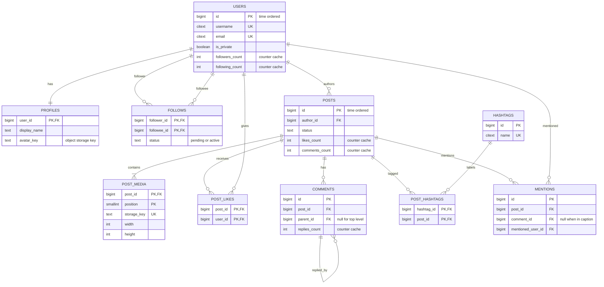
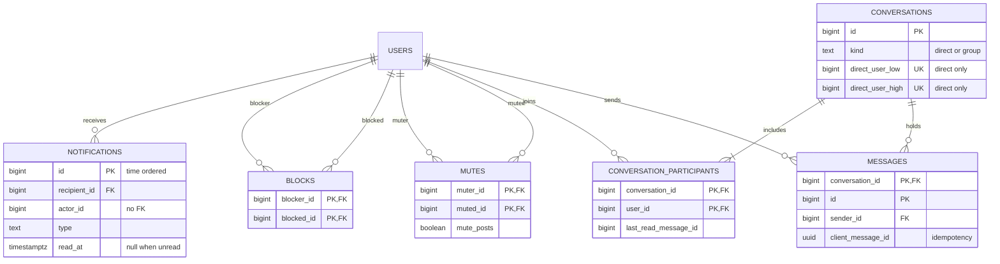

This is a complete, production-shaped schema for a photo-sharing social app in the style of Instagram. It is meant to be copied and adapted. It covers the system of record only; feed assembly and ranking live in a separate fan-out pipeline. Three facts about social data shape it: edges vastly outnumber entities, a few celebrity rows take a disproportionate share of writes, and almost every read is "the newest N things attached to this one thing", so composite keys and time-ordered IDs do most of the work.

## Requirements and access patterns

The app has 100 million registered users and 30 million daily actives. They create about 5 million posts a day (60 per second on average, 300 at peak), each with one to ten photos or videos. They leave 300 million likes a day (3,500 per second, 15,000 at peak) and 25 million comments. The average user follows 150 accounts, so the follow graph holds about 15 billion edges. A few accounts have over 100 million followers.

Invariants the schema enforces on its own:

- Usernames are unique regardless of case, and nobody follows, blocks or mutes themselves.
- A user likes a post at most once and follows an account at most once.
- A reply belongs to the same post as the comment it replies to.
- Media items in a post have a unique, bounded position.
- A one-to-one conversation exists at most once per pair of users, and a retried message send is stored once.

| Access pattern | Peak QPS | Served by |
|----------------|----------|-----------|
| Profile header by username | 20,000 | `users.username` unique (citext) |
| Profile grid, newest first | 15,000 | `posts (author_id, id DESC) WHERE status = 'published'` plus `post_media` PK |
| Has the viewer liked these 20 posts | 40,000 | `post_likes` PK `(post_id, user_id)` |
| Like or unlike | 15,000 | `post_likes` PK, counter on `posts` |
| Comments page and replies | 8,000 | `comments (post_id, id DESC)` and `comments (parent_id, id)` partial indexes |
| Followers or following list, keyset paged | 3,000 | `follows (followee_id, created_at DESC, follower_id DESC)` and the mirror |
| Follow or unfollow | 2,000 | `follows` PK, counters on `users` |
| Notifications inbox and unread badge | 10,000 | `notifications (recipient_id, id DESC)` and an unread partial index |
| Block check between two users | 30,000 | `blocks` PK and reverse index |
| DM inbox and conversation history | 5,000 | `conversation_participants (user_id, ...)`, `messages` PK |
| Home feed | 50,000 | Feed store (Redis or wide-column), not this schema |
| User and hashtag search | 5,000 | Search engine, not PostgreSQL |

## Entity-relationship model

The model splits into the social graph and content on one side, and per-user inbox-style data (notifications, blocks, mutes, DMs) on the other.





## Design decisions before the DDL

**Time-ordered 64-bit IDs.** Users, posts, comments, notifications and messages take their key from `next_id()`, a Snowflake-style function: milliseconds since a custom epoch, a 13-bit shard number and a 10-bit sequence. Sorting by `id` means sorting by creation time, so one B-tree column serves lookup and "newest first", and a cursor is a single number. Given any post ID, the router knows its shard without a lookup table.

**Edges get composite primary keys.** `follows`, `post_likes`, `post_hashtags`, `blocks` and `mutes` have no surrogate key. The pair is the identity and the dedupe, and `ON CONFLICT DO NOTHING` makes double-taps harmless.

**Counters are denormalised, deliberately.** `COUNT(*)` over 80 million follower rows on every profile view is not an option. Counter columns sit on `users`, `posts` and `comments`, and those tables use `fillfactor = 90` so increments can be HOT updates that stay on the same page and never touch an index.

**Soft delete for people, hard delete for edges.** Accounts move to `status = 'deleted'` and a background job purges them in batches; one giant cascade would stall everything. Likes, follows and blocks are deleted outright.

**Media lives in object storage.** The database holds the key, dimensions, type and order, never bytes or full URLs, so a CDN migration is a configuration change.

## DDL

Tables are created in dependency order. The only extension is `citext`, for case-insensitive usernames, emails and hashtags.

```sql
CREATE EXTENSION IF NOT EXISTS citext;

-- Time-ordered IDs: 41 bits ms since 2025-01-01, 13 bits shard, 10 bits sequence.
CREATE SEQUENCE global_id_seq;

CREATE FUNCTION next_id(shard_id int DEFAULT 1) RETURNS bigint
LANGUAGE plpgsql AS $$
DECLARE
  epoch_ms bigint := 1735689600000;
  now_ms   bigint := floor(extract(epoch FROM clock_timestamp()) * 1000);
  seq      bigint := nextval('global_id_seq') % 1024;
BEGIN
  RETURN ((now_ms - epoch_ms) << 23) | ((shard_id::bigint % 8192) << 10) | seq;
END $$;

-- Identity -------------------------------------------------------------
CREATE TABLE users (
  id              bigint PRIMARY KEY DEFAULT next_id(),
  username        citext NOT NULL UNIQUE CHECK (username ~ '^[a-z0-9._]{1,30}$'),
  email           citext NOT NULL UNIQUE CHECK (email LIKE '%_@_%'),
  password_hash   text,                                  -- null for SSO-only accounts
  is_private      boolean NOT NULL DEFAULT false,
  status          text NOT NULL DEFAULT 'active'
                  CHECK (status IN ('active', 'deactivated', 'suspended', 'deleted')),
  followers_count int NOT NULL DEFAULT 0 CHECK (followers_count >= 0),
  following_count int NOT NULL DEFAULT 0 CHECK (following_count >= 0),
  posts_count     int NOT NULL DEFAULT 0 CHECK (posts_count >= 0),
  created_at      timestamptz NOT NULL DEFAULT now()
) WITH (fillfactor = 90);

CREATE TABLE profiles (
  user_id      bigint PRIMARY KEY REFERENCES users (id) ON DELETE CASCADE,
  display_name text NOT NULL DEFAULT '' CHECK (char_length(display_name) <= 64),
  bio          text NOT NULL DEFAULT '' CHECK (char_length(bio) <= 150),
  website      text,
  avatar_key   text,                                     -- object storage key
  updated_at   timestamptz NOT NULL DEFAULT now()
);

-- Social graph ---------------------------------------------------------
CREATE TABLE follows (
  follower_id bigint NOT NULL REFERENCES users (id) ON DELETE CASCADE,
  followee_id bigint NOT NULL REFERENCES users (id) ON DELETE CASCADE,
  status      text NOT NULL DEFAULT 'active'
              CHECK (status IN ('pending', 'active')),  -- pending = request to a private account
  created_at  timestamptz NOT NULL DEFAULT now(),
  PRIMARY KEY (follower_id, followee_id),
  CHECK (follower_id <> followee_id)
);
-- "Who follows X", newest first. Also serves the cascade when X is deleted.
CREATE INDEX follows_followee_idx
  ON follows (followee_id, created_at DESC, follower_id DESC);
-- "Who does X follow", newest first. The PK alone is ordered by followee_id.
CREATE INDEX follows_follower_recent_idx
  ON follows (follower_id, created_at DESC, followee_id DESC);

CREATE TABLE blocks (
  blocker_id bigint NOT NULL REFERENCES users (id) ON DELETE CASCADE,
  blocked_id bigint NOT NULL REFERENCES users (id) ON DELETE CASCADE,
  created_at timestamptz NOT NULL DEFAULT now(),
  PRIMARY KEY (blocker_id, blocked_id),
  CHECK (blocker_id <> blocked_id)
);
CREATE INDEX blocks_blocked_idx ON blocks (blocked_id, blocker_id);

CREATE TABLE mutes (
  muter_id     bigint NOT NULL REFERENCES users (id) ON DELETE CASCADE,
  muted_id     bigint NOT NULL REFERENCES users (id) ON DELETE CASCADE,
  mute_posts   boolean NOT NULL DEFAULT true,
  mute_stories boolean NOT NULL DEFAULT false,
  created_at   timestamptz NOT NULL DEFAULT now(),
  PRIMARY KEY (muter_id, muted_id),
  CHECK (muter_id <> muted_id),
  CHECK (mute_posts OR mute_stories)
);
CREATE INDEX mutes_muted_idx ON mutes (muted_id);       -- cascade on user delete
```

Content tables follow. Comments use an adjacency list with a composite foreign key so a reply cannot point at a comment on another post.

```sql
-- Content --------------------------------------------------------------
CREATE TABLE posts (
  id                bigint PRIMARY KEY DEFAULT next_id(),
  author_id         bigint NOT NULL REFERENCES users (id),
  caption           text NOT NULL DEFAULT '' CHECK (char_length(caption) <= 2200),
  location_name     text,
  status            text NOT NULL DEFAULT 'processing'
                    CHECK (status IN ('processing', 'published', 'archived', 'deleted')),
  comments_disabled boolean NOT NULL DEFAULT false,
  media_count       smallint NOT NULL DEFAULT 0 CHECK (media_count BETWEEN 0 AND 10),
  likes_count       int NOT NULL DEFAULT 0 CHECK (likes_count >= 0),
  comments_count    int NOT NULL DEFAULT 0 CHECK (comments_count >= 0),
  created_at        timestamptz NOT NULL DEFAULT now(),
  updated_at        timestamptz NOT NULL DEFAULT now()
) WITH (fillfactor = 90);
CREATE INDEX posts_author_grid_idx
  ON posts (author_id, id DESC) WHERE status = 'published';

CREATE TABLE post_media (
  post_id     bigint   NOT NULL REFERENCES posts (id) ON DELETE CASCADE,
  position    smallint NOT NULL CHECK (position BETWEEN 0 AND 9),
  media_type  text     NOT NULL CHECK (media_type IN ('image', 'video')),
  storage_key text     NOT NULL UNIQUE,                  -- e.g. m/7/20261103/ab12cd.jpg
  width       int      NOT NULL CHECK (width > 0),
  height      int      NOT NULL CHECK (height > 0),
  duration_ms int      CHECK (duration_ms > 0),
  byte_size   bigint   NOT NULL CHECK (byte_size > 0),
  blurhash    text,                                      -- placeholder while loading
  alt_text    text CHECK (char_length(alt_text) <= 1000),
  PRIMARY KEY (post_id, position),
  CHECK ((media_type = 'video') = (duration_ms IS NOT NULL))
);

CREATE TABLE post_likes (
  post_id    bigint NOT NULL REFERENCES posts (id) ON DELETE CASCADE,
  user_id    bigint NOT NULL REFERENCES users (id) ON DELETE CASCADE,
  created_at timestamptz NOT NULL DEFAULT now(),
  PRIMARY KEY (post_id, user_id)                         -- dedupe and has-liked check
);
CREATE INDEX post_likes_user_idx ON post_likes (user_id, created_at DESC);

CREATE TABLE comments (
  id            bigint PRIMARY KEY DEFAULT next_id(),
  post_id       bigint NOT NULL REFERENCES posts (id) ON DELETE CASCADE,
  author_id     bigint NOT NULL REFERENCES users (id),
  parent_id     bigint,                                  -- null for top-level comments
  body          text NOT NULL CHECK (char_length(body) BETWEEN 1 AND 2200),
  status        text NOT NULL DEFAULT 'visible'
                CHECK (status IN ('visible', 'hidden', 'deleted')),
  likes_count   int NOT NULL DEFAULT 0 CHECK (likes_count >= 0),
  replies_count int NOT NULL DEFAULT 0 CHECK (replies_count >= 0),
  created_at    timestamptz NOT NULL DEFAULT now(),
  UNIQUE (post_id, id),
  FOREIGN KEY (post_id, parent_id) REFERENCES comments (post_id, id),
  CHECK (parent_id <> id)
) WITH (fillfactor = 90);
CREATE INDEX comments_top_level_idx
  ON comments (post_id, id DESC) WHERE parent_id IS NULL AND status = 'visible';
CREATE INDEX comments_replies_idx
  ON comments (parent_id, id) WHERE parent_id IS NOT NULL AND status = 'visible';
CREATE INDEX comments_author_idx ON comments (author_id, id DESC);

CREATE TABLE hashtags (
  id          bigint GENERATED ALWAYS AS IDENTITY PRIMARY KEY,
  name        citext NOT NULL UNIQUE CHECK (name ~ '^[[:alnum:]_]{1,100}$'),
  posts_count bigint NOT NULL DEFAULT 0,                 -- async, approximate
  created_at  timestamptz NOT NULL DEFAULT now()
);

CREATE TABLE post_hashtags (
  hashtag_id bigint NOT NULL REFERENCES hashtags (id),
  post_id    bigint NOT NULL REFERENCES posts (id) ON DELETE CASCADE,
  PRIMARY KEY (hashtag_id, post_id)                      -- tag page, newest post first
);
CREATE INDEX post_hashtags_post_idx ON post_hashtags (post_id);

CREATE TABLE mentions (
  id                bigint GENERATED ALWAYS AS IDENTITY PRIMARY KEY,
  post_id           bigint NOT NULL REFERENCES posts (id) ON DELETE CASCADE,
  comment_id        bigint,                              -- null when in the caption
  mentioned_user_id bigint NOT NULL REFERENCES users (id) ON DELETE CASCADE,
  created_at        timestamptz NOT NULL DEFAULT now(),
  FOREIGN KEY (post_id, comment_id) REFERENCES comments (post_id, id) ON DELETE CASCADE,
  UNIQUE NULLS NOT DISTINCT (post_id, comment_id, mentioned_user_id)
);
CREATE INDEX mentions_user_idx ON mentions (mentioned_user_id, created_at DESC);
```

Notifications, DMs and the comment counter trigger complete the schema. Notifications reference posts and actors by ID without foreign keys: they are ephemeral, expire after 90 days, and a dangling reference is simply filtered out at read time. That is cheaper than indexing every column a cascade would need.

```sql
-- Notifications --------------------------------------------------------
CREATE TABLE notifications (
  id           bigint PRIMARY KEY DEFAULT next_id(),
  recipient_id bigint NOT NULL REFERENCES users (id) ON DELETE CASCADE,
  actor_id     bigint,                                   -- no FK, see text
  type         text NOT NULL CHECK (type IN
                 ('like', 'comment', 'reply', 'mention', 'follow', 'follow_request')),
  post_id      bigint,                                   -- no FK
  comment_id   bigint,                                   -- no FK
  read_at      timestamptz,
  created_at   timestamptz NOT NULL DEFAULT now(),
  CHECK (type IN ('follow', 'follow_request') OR post_id IS NOT NULL)
);
CREATE INDEX notifications_inbox_idx ON notifications (recipient_id, id DESC);
CREATE INDEX notifications_unread_idx ON notifications (recipient_id) WHERE read_at IS NULL;
-- Like, unlike, like again must not notify twice.
CREATE UNIQUE INDEX notifications_dedupe_uk
  ON notifications (recipient_id, type, actor_id, post_id) NULLS NOT DISTINCT
  WHERE type IN ('like', 'follow', 'follow_request');

-- Direct messages ------------------------------------------------------
CREATE TABLE conversations (
  id               bigint PRIMARY KEY DEFAULT next_id(),
  kind             text NOT NULL CHECK (kind IN ('direct', 'group')),
  title            text,                                 -- groups only
  direct_user_low  bigint REFERENCES users (id),
  direct_user_high bigint REFERENCES users (id),
  last_message_at  timestamptz,
  created_at       timestamptz NOT NULL DEFAULT now(),
  UNIQUE (direct_user_low, direct_user_high),            -- one DM thread per pair
  CHECK ((kind = 'direct') = (direct_user_low IS NOT NULL AND direct_user_high IS NOT NULL)),
  CHECK (direct_user_low < direct_user_high)
);

CREATE TABLE conversation_participants (
  conversation_id      bigint NOT NULL REFERENCES conversations (id) ON DELETE CASCADE,
  user_id              bigint NOT NULL REFERENCES users (id) ON DELETE CASCADE,
  joined_at            timestamptz NOT NULL DEFAULT now(),
  last_read_message_id bigint,
  is_muted             boolean NOT NULL DEFAULT false,
  PRIMARY KEY (conversation_id, user_id)
);
CREATE INDEX conversation_participants_user_idx
  ON conversation_participants (user_id, conversation_id);

CREATE TABLE messages (
  conversation_id   bigint NOT NULL REFERENCES conversations (id) ON DELETE CASCADE,
  id                bigint NOT NULL DEFAULT next_id(),
  sender_id         bigint NOT NULL REFERENCES users (id),
  body              text CHECK (char_length(body) <= 4000),
  media_key         text,
  client_message_id uuid NOT NULL,                       -- generated on the device
  created_at        timestamptz NOT NULL DEFAULT now(),
  deleted_at        timestamptz,
  PRIMARY KEY (conversation_id, id),
  UNIQUE (conversation_id, sender_id, client_message_id),
  CHECK (body IS NOT NULL OR media_key IS NOT NULL)
);

-- Comment counters -----------------------------------------------------
CREATE FUNCTION comments_maintain_counts() RETURNS trigger
LANGUAGE plpgsql AS $$
DECLARE
  delta int;
  c     comments;
BEGIN
  IF TG_OP = 'INSERT' THEN
    IF NEW.status <> 'visible' THEN RETURN NULL; END IF;
    delta := 1;  c := NEW;
  ELSIF TG_OP = 'DELETE' THEN
    IF OLD.status <> 'visible' THEN RETURN NULL; END IF;
    delta := -1; c := OLD;
  ELSE
    IF (OLD.status = 'visible') = (NEW.status = 'visible') THEN RETURN NULL; END IF;
    delta := CASE WHEN NEW.status = 'visible' THEN 1 ELSE -1 END;
    c := NEW;
  END IF;
  UPDATE posts SET comments_count = comments_count + delta WHERE id = c.post_id;
  IF c.parent_id IS NOT NULL THEN
    UPDATE comments SET replies_count = replies_count + delta WHERE id = c.parent_id;
  END IF;
  RETURN NULL;
END $$;

CREATE TRIGGER comments_counters
  AFTER INSERT OR DELETE OR UPDATE OF status ON comments
  FOR EACH ROW EXECUTE FUNCTION comments_maintain_counts();
```

Two details are easy to miss. `UNIQUE NULLS NOT DISTINCT` on mentions (PostgreSQL 15 and later) treats two caption mentions of the same user as duplicates even though `comment_id` is null in both. Ordering the pair in `conversations` (`direct_user_low < direct_user_high`) makes "is there already a DM between A and B" a unique-key lookup and a duplicate thread impossible.

## Counter caches and how they stay correct

Counters can be maintained in two ways, and this schema uses both.

**Transactional increment.** The edge insert and the counter update commit together, so they can never disagree. The insert's `RETURNING` drives the update, so a duplicate like (`ON CONFLICT DO NOTHING` returns no row) does not bump anything. Comments use the trigger above for the same guarantee across every write path, including moderation.

```sql
-- Like: counter moves only if the edge was actually created.
WITH ins AS (
  INSERT INTO post_likes (post_id, user_id) VALUES (1001, 7)
  ON CONFLICT DO NOTHING
  RETURNING post_id
)
UPDATE posts SET likes_count = likes_count + 1
WHERE id IN (SELECT post_id FROM ins);

-- Unlike.
WITH del AS (
  DELETE FROM post_likes WHERE post_id = 1001 AND user_id = 7
  RETURNING post_id
)
UPDATE posts SET likes_count = likes_count - 1
WHERE id IN (SELECT post_id FROM del);

-- Follow: pending for private accounts, refused across a block, only active edges count.
WITH f AS (
  INSERT INTO follows (follower_id, followee_id, status)
  SELECT 7, u.id, CASE WHEN u.is_private THEN 'pending' ELSE 'active' END
  FROM users u
  WHERE u.id = 42 AND u.status = 'active'
    AND NOT EXISTS (SELECT 1 FROM blocks b
                    WHERE (b.blocker_id, b.blocked_id) IN ((7, 42), (42, 7)))
  ON CONFLICT DO NOTHING
  RETURNING follower_id, followee_id, status
)
UPDATE users u
SET following_count = following_count + (u.id = f.follower_id)::int,
    followers_count = followers_count + (u.id = f.followee_id)::int
FROM f
WHERE f.status = 'active' AND u.id IN (f.follower_id, f.followee_id);
```

**Async with reconciliation.** The transactional version has a hot-row problem. When a celebrity posts, 20,000 likes may arrive in a minute, each queuing on the same `posts` row lock and writing a new row version. Throughput collapses to what one row can absorb, and the table bloats. Past a popularity threshold the like edge is still written synchronously, but the application increments a Redis counter (`INCR post:1001:likes`) instead, and a worker flushes deltas to PostgreSQL every few seconds as one `UPDATE` per post. Follower counts on huge accounts work the same way. A nightly or on-demand job recomputes exact counts from the edge tables and repairs drift:

```sql
UPDATE posts p
SET likes_count = s.n
FROM (
  SELECT post_id, count(*)::int AS n
  FROM post_likes
  WHERE post_id IN (1001, 1002, 1003)
  GROUP BY post_id
) s
WHERE p.id = s.post_id AND p.likes_count <> s.n;
```

Displayed counts are approximate anyway ("1.2M likes"). The edge itself (one like per user) is never relaxed, only its count.

## Key queries and the index that serves each

Profile grid. A backward-ordered range scan on `posts_author_grid_idx` returns the next 12 post IDs, and each cover image is a primary-key probe on `post_media` at position 0. The cursor is the last post ID seen.

```sql
SELECT p.id, p.media_count, p.likes_count, p.comments_count,
       m.storage_key, m.width, m.height, m.media_type
FROM posts p
JOIN post_media m ON m.post_id = p.id AND m.position = 0
WHERE p.author_id = 42 AND p.status = 'published'
  AND p.id < 9223372036854775807                  -- cursor: last id from previous page
ORDER BY p.id DESC
LIMIT 12;
```

Followers list with keyset pagination. `follows_followee_idx` is ordered exactly like the query, so every page is one 50-entry range scan however deep the reader scrolls.

```sql
SELECT f.follower_id, u.username, pr.display_name, pr.avatar_key, f.created_at
FROM follows f
JOIN users u     ON u.id = f.follower_id
JOIN profiles pr ON pr.user_id = f.follower_id
WHERE f.followee_id = 42 AND f.status = 'active'
  AND (f.created_at, f.follower_id) < ('2026-11-01 12:00:00+00', 900000)  -- cursor
ORDER BY f.created_at DESC, f.follower_id DESC
LIMIT 50;
```

Has the viewer liked these posts. One query does a primary-key probe on `(post_id, user_id)` per feed post and returns only the matches.

```sql
SELECT post_id
FROM post_likes
WHERE user_id = 7
  AND post_id = ANY (ARRAY[1001, 1002, 1003, 1004]::bigint[]);
```

Comments page and replies. Top-level comments come newest first from the partial index. Comments by anyone the viewer has blocked are excluded with an anti-join on the `blocks` primary key. Replies load on demand per parent, oldest first.

```sql
SELECT c.id, c.author_id, u.username, c.body, c.likes_count, c.replies_count, c.created_at
FROM comments c
JOIN users u ON u.id = c.author_id
WHERE c.post_id = 1001 AND c.parent_id IS NULL AND c.status = 'visible'
  AND c.id < 9223372036854775807                  -- cursor
  AND NOT EXISTS (SELECT 1 FROM blocks b
                  WHERE b.blocker_id = 7 AND b.blocked_id = c.author_id)
ORDER BY c.id DESC
LIMIT 20;

SELECT c.id, c.author_id, c.body, c.created_at
FROM comments c
WHERE c.parent_id = 5001 AND c.status = 'visible'
ORDER BY c.id
LIMIT 10;
```

Blocking removes the follow edges in both directions and fixes the counters in the same transaction. Only edges that were active are subtracted.

```sql
BEGIN;
INSERT INTO blocks (blocker_id, blocked_id) VALUES (7, 42) ON CONFLICT DO NOTHING;

WITH gone AS (
  DELETE FROM follows
  WHERE (follower_id, followee_id) IN ((7, 42), (42, 7))
  RETURNING follower_id, followee_id, status
)
UPDATE users u
SET following_count = following_count
      - (SELECT count(*) FROM gone g WHERE g.follower_id = u.id AND g.status = 'active'),
    followers_count = followers_count
      - (SELECT count(*) FROM gone g WHERE g.followee_id = u.id AND g.status = 'active')
WHERE u.id IN (7, 42);
COMMIT;
```

## Which tables grow fastest

Rough per-row sizes include the 24-byte tuple header and every index.

| Table | Rows per day | Bytes per row with indexes | Growth per year | Shard key |
|-------|--------------|----------------------------|-----------------|-----------|
| `post_likes` | 300 M | about 120 | about 13 TB | `post_id` |
| `messages` | 200 M | about 250 | about 18 TB | `conversation_id` |
| `notifications` | 350 M | about 150 | capped near 5 TB by a 90-day TTL | `recipient_id` |
| `comments` | 25 M | about 350 | about 3 TB | `post_id` |
| `follows` | 15 B total, slow churn | about 150 | about 2.2 TB standing | `follower_id`, mirrored by `followee_id` |
| `posts` and `post_media` | 5 M and 8 M | about 400 and 250 | about 1.4 TB | `author_id` via the shard bits in `post_id` |

Users (100 million rows) fit one primary comfortably. Likes alone outgrow a node within a year, so sharding is planned from day one.

The key choice follows the reads. Posts are placed by author, because the profile grid must be a single-shard query. Then `next_id(shard_id)` stamps the author's shard into the post ID. So `post_likes`, `comments`, `post_media`, `post_hashtags` and `mentions`, sharded by `post_id`, land beside their post: a like plus its counter is a local transaction and the comments page a local join. The cost is that the has-liked batch for a feed of many authors fans out, one parallel probe per shard, or hits a per-user cache of recent likes.

`follows` cannot be co-located for both directions, so it becomes two physical tables. The authoritative copy is keyed by `follower_id` and written transactionally. A mirror keyed by `followee_id` is maintained asynchronously from change data capture. `blocks` gets the same treatment. `notifications` shard by recipient and `messages` by conversation, so an inbox or a chat history is always one shard.

## Where relational stops

PostgreSQL remains the system of record. Several jobs leave it as scale arrives:

- **Home feeds** are precomputed lists of post IDs per user in Redis or a wide-column store such as Cassandra, written by fan-out workers and rebuilt from `follows` and `posts` if lost.
- **Hot counters** for viral posts and celebrity follower counts live in Redis and are flushed back in batches, as described above.
- **Search**, hashtag autocomplete and ranked hashtag pages go to OpenSearch or similar, fed by change data capture, so "top posts for #sunset" is never a cross-shard SQL query.
- **Notifications and messages** at tens of billions of rows move to a wide-column store partitioned by recipient or conversation, with a TTL: append and read the newest page is what those stores do best.

## Trade-offs and pitfalls

- **Counter caches** make reads cheap but add a write to every like and follow. Keep them transactional for ordinary rows, go async for hot rows, and always run reconciliation. Drift will happen.
- **Unindexed cascade columns** turn one user deletion into sequential scans of billion-row tables. Every `ON DELETE CASCADE` above has an index led by the referencing key.
- **Offset pagination** gets slower with every page. Use keyset cursors.
- **Foreign keys across shards** do not exist. Once tables are split, the `post_likes` to `users` reference becomes an application-level rule backed by asynchronous cleanup.
- **Clock-based IDs.** A server clock stepping backwards produces out-of-order IDs from `next_id()`. Run NTP with slewing.
- **Block filtering** must be applied on every read path: comments, likers, search, mentions and DMs. Missing one is a safety bug, not a cosmetic one.

## Interview angle

- Start from the edges: composite primary keys for follows and likes give dedupe, idempotent retries and the has-liked check in one structure.
- Draw both follow indexes and explain why "followers of X" and "followed by X" need separate orderings, then keyset paginate one of them.
- Explain counter caches, the celebrity hot-row problem and the move to async counters with reconciliation.
- Show why time-ordered IDs carrying a shard number let likes and comments co-locate with their post.
- Say clearly what leaves PostgreSQL: feeds, hot counters, search, and eventually notifications and messages.

## Key takeaways

- Model relationships as narrow tables with composite primary keys, and index both directions of every graph edge you read.
- Use 64-bit time-ordered IDs so one B-tree column gives identity, ordering and a single-value cursor.
- Store media as object storage keys plus dimensions and order, never as bytes or full URLs.
- Maintain counters in the same transaction as the edge by default, and switch hot rows to buffered increments with periodic reconciliation.
- Choose shard keys from the dominant read: author for posts, post for likes and comments, recipient for notifications, conversation for messages.
