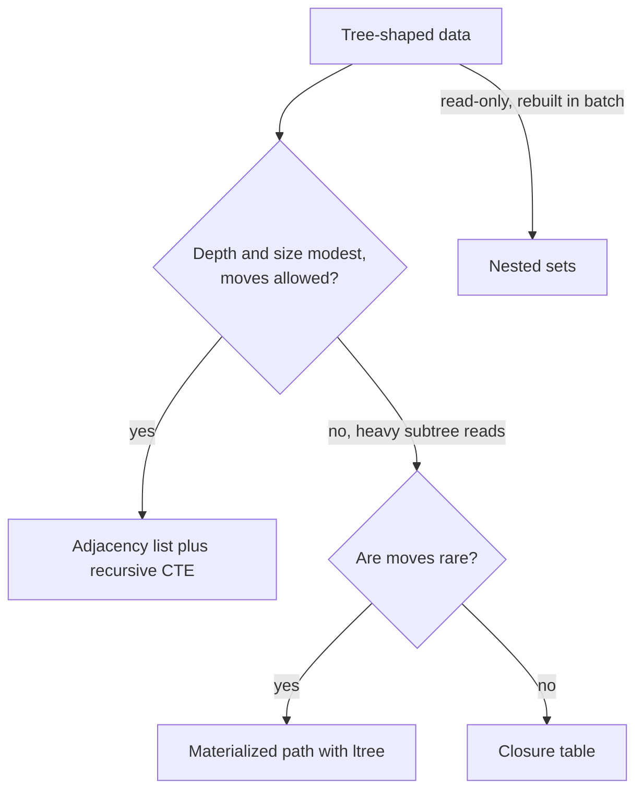

Trees show up in almost every product: product categories, org charts, folder structures, threaded comments, bill-of-materials, permission hierarchies. Relational tables are flat, so you have to choose how to encode parent and child relationships, and that choice decides which questions are cheap. "Who is my parent" is easy in every model. "Give me the entire subtree under this node, in order" and "move this folder somewhere else" are where the models differ sharply. This guide covers the four standard models with runnable PostgreSQL, compares them, and finishes with a threaded-comments design.

## Adjacency list

Each row stores a reference to its parent. It is the most natural model, the cheapest to write, and with recursive CTEs it handles subtree and ancestor queries well.

```sql
CREATE TABLE categories (
  id        bigint GENERATED ALWAYS AS IDENTITY PRIMARY KEY,
  parent_id bigint REFERENCES categories (id) ON DELETE RESTRICT,
  name      text NOT NULL,
  CHECK (parent_id <> id)
);
CREATE INDEX categories_parent_id_idx ON categories (parent_id);
```

Fetching a subtree uses `WITH RECURSIVE`. Track depth so you can indent and limit, and track the path so you can sort and detect cycles. The foreign key guarantees every parent exists, but nothing stops a bad update from creating a loop like A under B under A, and a recursive query over a loop never terminates without a guard.

```sql
WITH RECURSIVE subtree AS (
  SELECT id, parent_id, name, 0 AS depth, ARRAY[id] AS path
  FROM categories
  WHERE id = 1
  UNION ALL
  SELECT c.id, c.parent_id, c.name, s.depth + 1, s.path || c.id
  FROM categories c
  JOIN subtree s ON c.parent_id = s.id
  WHERE NOT c.id = ANY (s.path)   -- cycle guard
    AND s.depth < 50              -- depth guard
)
SELECT id, name, depth FROM subtree ORDER BY path;
```

PostgreSQL 14+ also has a `CYCLE id SET is_cycle USING path` clause that does the same job declaratively. Ancestors (breadcrumbs) are the same query in reverse, joining `c.id = s.parent_id`. Moving a subtree is a single `UPDATE categories SET parent_id = $new WHERE id = $node`; to prevent cycles, check first that `$new` is not in the subtree of `$node`, inside the same transaction.

The weakness is that each recursion level is another index lookup, so very deep trees or very large subtrees get slower, and counting all descendants means walking them. For most category trees and org charts with thousands of nodes and a depth under ten, this is fast enough and should be your default. MySQL 8 supports `WITH RECURSIVE` with the same syntax.

## Materialized path with ltree

A materialized path stores the full ancestry in each row, like `electronics.computers.laptops`. Subtree queries become prefix matches. PostgreSQL's `ltree` extension provides a dedicated type with operators and GiST index support.

```sql
CREATE EXTENSION IF NOT EXISTS ltree;

CREATE TABLE folders (
  id    bigint GENERATED ALWAYS AS IDENTITY PRIMARY KEY,
  name  text NOT NULL,
  path  ltree NOT NULL UNIQUE
);
CREATE INDEX folders_path_gist ON folders USING gist (path);

INSERT INTO folders (name, path) VALUES
  ('root', '1'), ('docs', '1.2'), ('specs', '1.2.3'), ('images', '1.4');

-- whole subtree of docs, including docs itself
SELECT * FROM folders WHERE path <@ '1.2';
-- all ancestors of specs
SELECT * FROM folders WHERE path @> '1.2.3';
-- depth
SELECT name, nlevel(path) FROM folders;
```

Build paths from IDs, not names, so renaming a node does not rewrite its descendants. `ltree` labels are limited to letters, digits, underscores and hyphens (hyphens since PostgreSQL 16), which IDs satisfy. Reads are excellent: one indexed query for subtrees, ancestors or depth. The cost is moves: relocating a node means rewriting the path of every descendant.

```sql
UPDATE folders
SET path = '1.4' || subpath(path, nlevel('1.2') - 1)
WHERE path <@ '1.2';
```

That moves `docs` and everything under it beneath `images`, so `1.2.3` becomes `1.4.2.3`. Without `ltree`, the same pattern works with a `text` column and `LIKE '1/2/%'` on a B-tree index with `text_pattern_ops`, which is how you would do it in MySQL.

## Nested sets

Nested sets give each node a `lft` and `rgt` number from a depth-first traversal. A node's descendants are exactly the rows whose `lft` falls between its `lft` and `rgt`.

```sql
CREATE TABLE nested_categories (
  id    bigint GENERATED ALWAYS AS IDENTITY PRIMARY KEY,
  name  text NOT NULL,
  lft   integer NOT NULL,
  rgt   integer NOT NULL,
  CHECK (lft < rgt)
);

SELECT child.*
FROM nested_categories parent
JOIN nested_categories child ON child.lft BETWEEN parent.lft AND parent.rgt
WHERE parent.id = 1
ORDER BY child.lft;
```

Subtree reads and descendant counts (`(rgt - lft - 1) / 2`) are very fast and need no recursion. Ancestors are the rows whose interval contains the node's `lft`, and leaves are the rows where `rgt = lft + 1`. Depth, however, is not stored and has to be computed by counting ancestors, so many implementations add a `depth` column as well. Every insert, however, shifts the `lft` and `rgt` of roughly half the table, and moves are worse. Under concurrent writes this becomes a locking hotspot. Nested sets made sense when databases lacked recursive queries. Today, use them only for large trees that are read constantly and rebuilt in batch, such as a nightly product taxonomy import.

## Closure table

A closure table stores every ancestor and descendant pair, including each node paired with itself at depth 0. It is the most flexible model and the only one where every query is a simple indexed join without recursion.

```sql
CREATE TABLE nodes (
  id   bigint GENERATED ALWAYS AS IDENTITY PRIMARY KEY,
  name text NOT NULL
);

CREATE TABLE node_paths (
  ancestor_id   bigint NOT NULL REFERENCES nodes (id) ON DELETE CASCADE,
  descendant_id bigint NOT NULL REFERENCES nodes (id) ON DELETE CASCADE,
  depth         integer NOT NULL CHECK (depth >= 0),
  PRIMARY KEY (ancestor_id, descendant_id)
);
CREATE INDEX node_paths_descendant_idx ON node_paths (descendant_id, depth);

INSERT INTO nodes (name) VALUES ('root'), ('a'), ('b'), ('c'), ('d');
INSERT INTO node_paths VALUES (1,1,0), (2,2,0), (1,2,1), (3,3,0), (2,3,1), (1,3,2);

-- insert node 5 as a child of node 3
INSERT INTO node_paths (ancestor_id, descendant_id, depth)
SELECT ancestor_id, 5, depth + 1 FROM node_paths WHERE descendant_id = 3
UNION ALL
SELECT 5, 5, 0;

-- subtree of 3
SELECT n.* FROM nodes n JOIN node_paths p ON p.descendant_id = n.id
WHERE p.ancestor_id = 3;
```

Moving a subtree means deleting the paths that link it to its old ancestors and inserting the cross product with the new ancestors. Storage is the cost: a tree with depth d stores up to d rows per node, so a deep tree with a million nodes can produce tens of millions of path rows. Closure tables shine when nodes can be queried at any depth by many access patterns and when you need fast "is X an ancestor of Y" checks, for example in permission inheritance.

## Comparing the models

| Model | Subtree read | Ancestors | Insert leaf | Move subtree | Storage | Integrity |
|-------|--------------|-----------|-------------|--------------|---------|-----------|
| Adjacency list | Recursive CTE, one lookup per level | Recursive CTE | One row | One row update | Minimal | Foreign key on parent |
| Materialized path (ltree) | One indexed query | One indexed query | One row | Rewrite all descendants | Path per row | Path consistency is manual |
| Nested sets | One range query | One range query | Shift half the table | Renumber large ranges | Two integers per row | Fragile under concurrency |
| Closure table | One join | One join | Depth + 1 rows | Delete and reinsert path rows | Up to depth rows per node | Foreign keys on both columns |

The practical choice: start with an adjacency list. Add a materialized path column (maintained by the application or a trigger) when subtree reads become a measured bottleneck and moves are rare. Use a closure table when moves are frequent and you need fast ancestor checks at arbitrary depth. Avoid nested sets for anything users edit live. Combining models is common and fine: keep `parent_id` as the source of truth and derive `path` from it. If the derived structure ever drifts, you can rebuild it from the adjacency list with one recursive query, which makes the hybrid safe to operate. Whatever you choose, write the three queries your product actually needs (subtree, breadcrumbs, move) against realistic data volumes before committing.



## MongoDB tree patterns

MongoDB documents suggest a few patterns. Parent references (`{ _id, parent }`) are the adjacency list; `$graphLookup` walks them recursively in an aggregation, with a `maxDepth` option. Child references store an array of child IDs in the parent, which suits small fixed trees but makes "find my parent" a multikey lookup. The ancestors array pattern stores `{ _id, parent, ancestors: [rootId, ..., parentId] }` with a multikey index on `ancestors`, so `db.categories.find({ ancestors: rootId })` returns a whole subtree in one indexed query and the array itself is the breadcrumb. It is MongoDB's equivalent of a materialized path, with the same move cost. Small, bounded trees like a menu can simply be embedded as nested subdocuments.

## A threaded comments example

Threaded comments are a tree per post, usually shallow, read far more often than written, and almost never moved. That favours an adjacency list for integrity plus a materialized sort path for fast ordered reads of a whole thread.

```sql
CREATE TABLE post_comments (
  id         bigint GENERATED ALWAYS AS IDENTITY PRIMARY KEY,
  post_id    bigint NOT NULL REFERENCES posts (id) ON DELETE CASCADE,
  parent_id  bigint REFERENCES post_comments (id) ON DELETE CASCADE,
  author_id  bigint NOT NULL REFERENCES users (id),
  body       text NOT NULL,
  path       ltree NOT NULL,
  depth      integer GENERATED ALWAYS AS (nlevel(path) - 1) STORED,
  created_at timestamptz NOT NULL DEFAULT now()
);
CREATE INDEX post_comments_post_path_idx ON post_comments (post_id, path);
CREATE INDEX post_comments_parent_idx ON post_comments (parent_id);
```

On insert, the application sets `path` to the parent's path plus the new comment's ID, encoded as fixed-width base36 or zero-padded so lexical order matches creation order (for example `'00001k.00002f'`). Because `ltree` sorts label by label, `ORDER BY path` returns the thread in depth-first display order. Loading a page of a thread is one indexed range scan.

```sql
SELECT id, parent_id, author_id, body, depth
FROM post_comments
WHERE post_id = 42
ORDER BY path
LIMIT 200;
```

Collapsing a branch is `WHERE path <@ $branch_path`. In practice, deleted comments are usually replaced with a "[deleted]" placeholder rather than removed, so replies keep their context; that is one place a soft-delete flag is clearly right.

## Trade-offs and pitfalls

- **Unguarded recursion** on data with an accidental cycle hangs the query. Always add a cycle or depth guard.
- **Paths built from names** must be rewritten on every rename. Use IDs.
- **Nested sets under concurrent writes** create lock contention across the whole table.
- **Closure tables on deep trees** grow quadratically in the worst case; check depth before choosing.
- **Missing parent_id index** makes each recursion step a sequential scan.

## Interview angle

- Name all four models and state the read, write and move trade-off of each in one sentence.
- Default to adjacency list with a recursive CTE, and explain when you would add a path column.
- For threaded comments, show the sort-path trick for ordered single-query reads.
- Mention `$graphLookup` and the ancestors array for MongoDB.

## Key takeaways

- An adjacency list with `WITH RECURSIVE` is the right default for most trees.
- Materialized paths with `ltree` make subtree and ancestor reads one indexed query at the cost of expensive moves.
- Nested sets are for read-only or batch-rebuilt trees.
- Closure tables handle frequent moves and arbitrary-depth ancestor checks at a storage cost.
- Combine models when needed, keeping `parent_id` as the source of truth.
