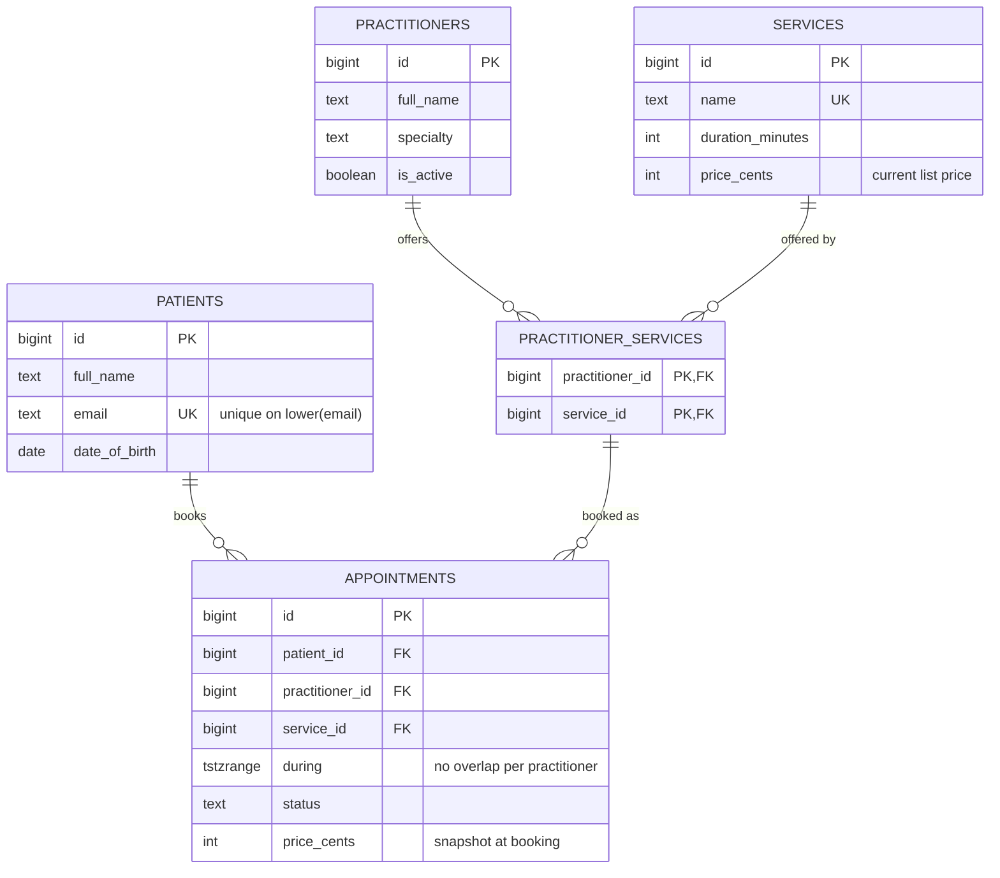

Most schema problems are not caused by a lack of SQL knowledge. They come from skipping steps: a team starts typing `CREATE TABLE` before anyone has written down which queries the application will run, how often, and how fast they must be. Six months later the hot page needs four joins and a sort over ten million rows, and nobody dares rename anything. A schema designed in a fixed order, from requirements to physical DDL to a review, avoids most of this. This guide lays out that order, gives you a worksheet you can copy into a design doc, and walks a small clinic booking app through every step.

## How to read this category

The guides in this category build on each other, so read them in order. This guide is the map: it names every step and shows them working together on one small example. The next guides go deep on each step. Entity-relationship modelling teaches you to find entities and express cardinality precisely. Normalisation shows how to remove redundancy and the anomalies it causes. Denormalisation and materialized views cover the deliberate, measured reversal of normalisation for read performance. Later guides cover keys and constraints, schema patterns, indexing, storage engines, concurrency, NoSQL and warehouse modelling, migrations, and full worked schemas.

## Step 1: Gather requirements and access patterns

Start with the product, not the database. Write down the features, the business rules ("a practitioner cannot be double-booked"), expected volumes in year one and year three, and retention or compliance rules.

Then list every query the application will run. This is the most valuable artifact in the process. For each query record the inputs, the outputs, the expected frequency, the latency target, and whether it is a read or a write. Be honest about the hot ones: the query behind the booking screen drives index design far more than the monthly report. Include writes, because write rates decide how many indexes you can afford.

## Step 2: Identify entities and relationships

Read your feature list and underline the nouns that have identity and a lifecycle: patient, practitioner, appointment. Those are entities. Nouns that only describe something (an email, a duration) are attributes. Verbs between entities are relationships: a patient books an appointment, a practitioner offers a service.

For each relationship decide its cardinality (one-to-one, one-to-many, many-to-many) and its optionality (must a patient have an appointment? no). Many-to-many relationships become their own tables, and they often turn out to be entities in disguise with their own attributes. "Practitioner offers service" is a plain junction; "patient books practitioner for service" is an appointment with a status and a price.

## Step 3: Conceptual, logical, physical

Work in three passes, each adding detail. The conceptual model names entities and relationships only, the kind of diagram you can show a product manager. The logical model adds every attribute, primary keys, foreign keys and normalisation, but stays independent of any specific engine. The physical model commits to PostgreSQL (or MySQL, or MongoDB): exact types, constraints, indexes, partitioning, extensions and storage settings. Keeping them separate stops you arguing about `bigint` versus `uuid` before you know whether an appointment can involve two practitioners.

## Step 4: Choose keys and types

Give each table a surrogate primary key unless a natural key is truly immutable and compact. `bigint GENERATED ALWAYS AS IDENTITY` is the PostgreSQL default; use UUIDs (preferably time-ordered UUIDv7) when IDs are generated by clients, exposed in URLs where enumeration matters, or merged across databases. Still enforce natural uniqueness with a `UNIQUE` constraint: the surrogate key identifies the row, the unique constraint stops duplicate patients.

Pick the narrowest correct type. Use `timestamptz` for instants, `date` for calendar dates such as a birthday, integer cents or `numeric` for money (never `float`), `text` with a `CHECK` for short strings, and `boolean` only for true two-state facts. Every column is `NOT NULL` unless you can explain what NULL means for it. In MySQL, `TIMESTAMP` ends in 2038 and `DATETIME` has no time zone, so store UTC consistently.

## Step 5: Normalise, then selectively denormalise

Normalise the logical model to third normal form: every non-key column depends on the key, the whole key and nothing but the key. This removes update anomalies and makes each fact live in one place. Then, and only for measured hot paths, add controlled redundancy: a counter cache, a duplicated column to avoid a join, a rollup table. Each copy needs a named mechanism that keeps it correct.

Distinguish denormalisation from historical fact. The price charged on an appointment is not a copy of the current service price; it is what was agreed at booking time and must not change when the price list does.

## Step 6: Design indexes from the queries

Go back to the access-pattern list and design an index for each hot query. Put equality columns first, then the range or sort column, so `WHERE patient_id = $1 ORDER BY starts_at DESC LIMIT 20` is served by an index on `(patient_id, starts_at DESC)` with no sort. Index every foreign key you join or delete through; PostgreSQL does not do this automatically, while MySQL InnoDB does. Use partial indexes for queries that only touch a small subset, such as upcoming non-cancelled appointments. An index with no query behind it is pure write cost.

## Step 7: Plan for growth, partitioning and retention

Estimate rows and bytes per table for year one and year three. Most tables stay small; one or two (events, messages, audit logs) grow without bound. For those, decide now how old data leaves: range partitioning by month lets you detach and drop a partition instantly instead of running a huge `DELETE`. If a single node will clearly not be enough, choose the sharding key now (usually the tenant or user) and make sure every hot query includes it.

## Step 8: Plan migrations and evolution

Schemas change. Design so they can change safely: additive changes (new nullable column, new table) are cheap; renames and type changes need an expand-and-contract sequence where you add the new shape, dual-write, backfill in batches, switch reads, and finally drop the old shape. In PostgreSQL, build indexes on live tables with `CREATE INDEX CONCURRENTLY`, and add foreign keys and checks as `NOT VALID` followed by `VALIDATE CONSTRAINT` to avoid long locks.

## Step 9: Review

Before the first migration ships, review the design against the access-pattern list. For each query, write the SQL and run `EXPLAIN` against generated data at realistic volume. Check that every business rule that can be a constraint is one. Ask what happens on delete for every foreign key.

## The schema-design worksheet

Copy this into the design doc for any new feature or service.

```markdown
# Schema design worksheet: <feature or service>

## 1. Requirements
- Features in scope:
- Business rules / invariants (each one -> constraint, trigger, or app check?):
- Volumes: rows per table at 1 year / 3 years; peak writes/sec; peak reads/sec
- Retention, privacy and compliance rules:

## 2. Access patterns
| # | Query (in words) | Inputs | Output | R/W | Freq (per sec) | p99 target | Index |
|---|------------------|--------|--------|-----|----------------|------------|-------|
| Q1 |                 |        |        |     |                |            |       |

## 3. Entities and relationships
| Entity | Identifier (natural) | Lifecycle | Relationships (cardinality, optional?) |
|--------|----------------------|-----------|----------------------------------------|

## 4. Keys and types
- Primary key strategy (identity / UUIDv7) and why:
- Natural unique constraints:
- Money, time, enum representation:

## 5. Normalisation and denormalisation
- Normal form reached:
- Each denormalised copy -> which hot query -> how it is kept correct:
- Historical snapshots (not denormalisation):

## 6. Indexes
| Index | Serves query | Write cost acceptable? |
|-------|--------------|------------------------|

## 7. Growth
- Largest tables and growth rate:
- Partitioning / archiving / deletion plan:
- Future shard key:

## 8. Evolution
- Expected changes in next 6 months:
- Migration approach (expand/contract, backfill size):

## 9. Review checklist
- [ ] Every query in section 2 has an EXPLAIN on realistic data
- [ ] Every invariant is enforced as low in the stack as possible
- [ ] Every FK has a deliberate ON DELETE behaviour and an index
- [ ] No nullable column without a documented meaning
```

## Worked example: a clinic booking app

**Requirements.** A clinic has practitioners who offer services (consultation 15 minutes, physiotherapy 45 minutes). Patients book appointments online. Rules: a practitioner cannot have overlapping appointments; a practitioner can only be booked for services they offer; the price is fixed at booking. Volume: 50 practitioners, 200,000 patients, about 2,000 appointments a day, roughly 2 million rows over three years.

**Access patterns.**

| # | Query | Freq | p99 |
|---|-------|------|-----|
| Q1 | Practitioner's appointments in a date range (calendar view) | 20/s | 30 ms |
| Q2 | Check a slot is free and book it | 1/s | 100 ms |
| Q3 | A patient's upcoming and past appointments | 10/s | 30 ms |
| Q4 | Find patient by email at login | 5/s | 10 ms |
| Q5 | Services a practitioner offers | 20/s | 10 ms |

**Entities.** Patient, Practitioner, Service, Appointment. Practitioner and Service are many-to-many through PractitionerService. Appointment links one patient, one practitioner and one service.

**Keys and types.** Identity `bigint` keys, because IDs are generated by the server and the app is single-database. Email is unique case-insensitively. Time is a `tstzrange` so PostgreSQL can enforce no overlap. Money is integer cents.

**Normalisation.** Already in 3NF: practitioner names live only in `practitioners`, service durations only in `services`. `appointments.price_cents` is a historical snapshot, not a copy.

**Indexes.** The exclusion constraint creates a GiST index on `(practitioner_id, during)` that serves Q1 and Q2. Q3 gets a B-tree on `(patient_id, lower(during))`. Q4 uses the unique index on `lower(email)`. Q5 uses the junction table primary key.

**Growth.** Two million rows is small for PostgreSQL; no partitioning yet.



```sql
CREATE EXTENSION IF NOT EXISTS btree_gist;

CREATE TABLE patients (
  id            bigint GENERATED ALWAYS AS IDENTITY PRIMARY KEY,
  full_name     text NOT NULL CHECK (length(full_name) BETWEEN 1 AND 200),
  email         text NOT NULL,
  phone         text,
  date_of_birth date NOT NULL,
  created_at    timestamptz NOT NULL DEFAULT now()
);
CREATE UNIQUE INDEX patients_email_uk ON patients (lower(email));

CREATE TABLE practitioners (
  id         bigint GENERATED ALWAYS AS IDENTITY PRIMARY KEY,
  full_name  text NOT NULL,
  specialty  text NOT NULL,
  is_active  boolean NOT NULL DEFAULT true
);

CREATE TABLE services (
  id               bigint GENERATED ALWAYS AS IDENTITY PRIMARY KEY,
  name             text NOT NULL UNIQUE,
  duration_minutes int  NOT NULL CHECK (duration_minutes BETWEEN 5 AND 240),
  price_cents      int  NOT NULL CHECK (price_cents >= 0)
);

CREATE TABLE practitioner_services (
  practitioner_id bigint NOT NULL REFERENCES practitioners (id),
  service_id      bigint NOT NULL REFERENCES services (id),
  PRIMARY KEY (practitioner_id, service_id)
);
CREATE INDEX practitioner_services_service_idx ON practitioner_services (service_id);

CREATE TABLE appointments (
  id              bigint GENERATED ALWAYS AS IDENTITY PRIMARY KEY,
  patient_id      bigint NOT NULL REFERENCES patients (id),
  practitioner_id bigint NOT NULL,
  service_id      bigint NOT NULL,
  during          tstzrange NOT NULL CHECK (NOT isempty(during)),
  status          text NOT NULL DEFAULT 'booked'
                  CHECK (status IN ('booked', 'completed', 'cancelled', 'no_show')),
  price_cents     int  NOT NULL CHECK (price_cents >= 0),
  notes           text,
  created_at      timestamptz NOT NULL DEFAULT now(),
  FOREIGN KEY (practitioner_id, service_id)
    REFERENCES practitioner_services (practitioner_id, service_id),
  CONSTRAINT appointments_no_overlap
    EXCLUDE USING gist (practitioner_id WITH =, during WITH &&)
    WHERE (status <> 'cancelled')
);
CREATE INDEX appointments_patient_idx ON appointments (patient_id, lower(during) DESC);
```

The composite foreign key to `practitioner_services` enforces "only book services the practitioner offers" in the database, and the exclusion constraint enforces "no double booking" even when two requests race. Q1 becomes:

```sql
SELECT id, patient_id, service_id, during, status
FROM appointments
WHERE practitioner_id = $1
  AND during && tstzrange($2, $3)
  AND status <> 'cancelled'
ORDER BY lower(during);
```

Booking (Q2) is just an `INSERT`; a conflicting slot raises SQLSTATE `23P01` (exclusion violation), which the API maps to "slot taken". **Review** found one gap: deleting a practitioner would fail because of the foreign keys, which is correct, so the product uses `is_active = false` instead.

## Trade-offs and pitfalls

- **Skipping the access-pattern list.** Without it, index and denormalisation choices are guesses.
- **Designing for imagined scale.** Sharding a 2-million-row table adds cost with no benefit; plan the shard key, do not build it.
- **Enforcing invariants only in application code.** Races and second services will break them; use constraints where the database can express the rule.
- **No retention plan.** Deleting a billion rows later is far harder than dropping partitions from day one.

## Interview angle

- Begin with requirements and a short list of access patterns with rates before drawing tables.
- Tie each index to a named query and explain the column order.
- Name the invariants and where each is enforced; an exclusion constraint for bookings is a strong signal.
- Close with growth, retention and how you would migrate the schema later.

## Key takeaways

- Follow the order: requirements and queries, entities, conceptual to physical, keys and types, normalise, denormalise with intent, index, plan growth, plan migrations, review.
- The access-pattern table drives indexes, denormalisation and partitioning.
- Put invariants in the schema: `NOT NULL`, `CHECK`, `UNIQUE`, foreign keys and exclusion constraints.
- Historical snapshots like a booked price are facts, not redundancy.
- Review with `EXPLAIN` on realistic data before the first migration ships.
