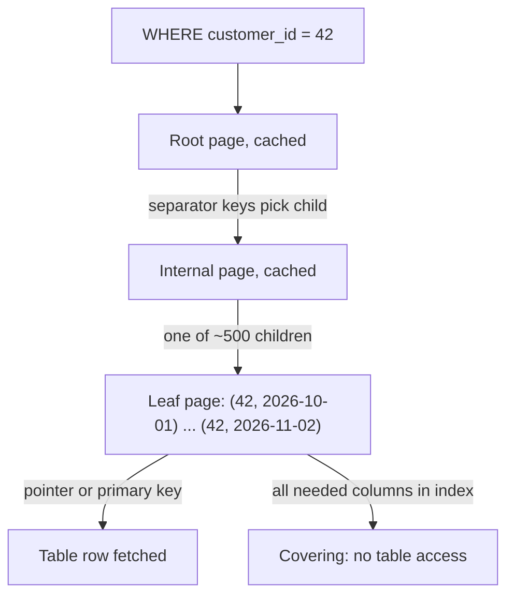

An index is a second copy of some of your columns, sorted so the database can find rows without reading the whole table. Every index speeds up some reads and slows every write, so the real question is which queries the application runs, how often, and what is the smallest set of indexes serving all of them. This guide works from that question and ends by deriving the indexes for a real table from six queries.

## What an index is and what a lookup costs

Almost every general-purpose database uses a B+tree as its default index: PostgreSQL, MySQL InnoDB, SQL Server, Oracle, SQLite and MongoDB's WiredTiger. A B+tree is a balanced tree of fixed-size pages, 8 KB in Postgres and 16 KB in InnoDB. Internal pages hold separator keys and child pointers; leaf pages hold the indexed keys plus a pointer to the row (or the row itself), and leaves are linked so a range can be walked in order.

The cost of a lookup is the height of the tree. With an 8-byte bigint key plus a pointer, an internal page holds several hundred entries, so the fanout is roughly 300 to 500. A three-level tree (root, one internal level, leaves) reaches 250,000 leaf pages, which at a few hundred keys per leaf is roughly 100 million keys; a four-level tree reaches 125 million leaf pages, tens of billions of keys. A billion-row table therefore needs about 3 to 4 page reads to find one key. The root and the second level are a few megabytes at most and live permanently in memory, so in practice a point lookup costs one or two real I/Os, often zero.



The expensive part is often not finding the first key but what follows. A range scan reads consecutive leaf entries cheaply, but if each entry points to a row on a different table page, fetching 10,000 rows can mean 10,000 random page reads.

## Selectivity and cardinality

Cardinality is the number of distinct values in a column; selectivity is the fraction of rows a predicate matches. `email = ?` on a users table matches one row in ten million, which is extremely selective. `status = 'active'` might match 90% of rows, which is useless as an index: the planner would rather scan the table sequentially than make millions of random jumps. As a rough rule, an index needing table lookups pays off below about 5 to 10% of rows; a covering index stays useful much further.

Low cardinality is not automatically bad. A `status` column with five values where the value you query, `'failed'`, is 0.1% of rows is very selective for that query. A partial index (`WHERE status = 'failed'`) in Postgres, SQL Server, SQLite or MongoDB indexes only those rows and stays tiny.

## Composite indexes and the ESR rule

A composite index on `(a, b, c)` is sorted by `a`, then by `b` within each `a`, then by `c`. It can serve any query that constrains a leading prefix of the columns. It cannot efficiently serve `WHERE b = ?` alone, because the `b` values are scattered across every `a`. (MySQL 8.0.13 and Postgres 18 add skip scan, which probes each distinct `a`; it helps only when `a` has few values.)

Column order follows the ESR rule, a name popularised by MongoDB but true of any B+tree:

1. **Equality** columns first. `customer_id = 42` narrows the scan to one contiguous slice.
2. **Sort** columns next. Within that slice, entries are already ordered by `created_at`, so `ORDER BY created_at DESC LIMIT 20` reads 20 entries and stops, with no sort step.
3. **Range** columns last. A range like `total > 1000` placed before the sort column would split the slice into many sub-ranges, each separately sorted, forcing a full sort.

Among several equality columns, put first the one other queries also filter on, so they can share the prefix.

## Covering indexes

If every column a query needs is in the index, the engine answers from the index alone: an index-only scan in Postgres, "Using index" in MySQL, a covered query in MongoDB. This removes random table lookups and can make a query 10 to 100 times faster. Postgres and SQL Server let you add non-key payload columns with `INCLUDE`, which are stored in leaves but not used for ordering. Cover a few very hot queries, not everything.

## Clustered versus heap tables

**Clustered (InnoDB, SQL Server with a clustered index, MongoDB clustered collections).** The table is the primary key B+tree: rows live in its leaves, sorted by primary key. Secondary indexes store the primary key value as their pointer, so a secondary lookup is two tree descents. So a fat primary key such as a 36-character UUID string is copied into every secondary index, and random UUIDv4 keys insert into random leaf pages, causing splits and half-full pages. Prefer a compact, roughly increasing key: `BIGINT AUTO_INCREMENT` or a time-ordered UUIDv7 stored as `BINARY(16)`.

**Heap (Postgres, Oracle by default, SQL Server without a clustered index).** Rows sit in a heap in insertion order, and every index, including the primary key, points at a physical location (a `ctid` in Postgres). Random UUIDs hurt less, though they still scatter the index's own leaves. The cost appears on updates: because Postgres writes a new row version, every index must get a new entry unless the update is HOT (no indexed column changed and the new version fits on the same page). Indexing a frequently updated column such as `last_seen_at` turns cheap HOT updates into updates of every index.

## Hash, LSM and other index structures

Hash indexes answer equality only, with no ranges or ordering. Postgres has durable hash indexes since version 10; InnoDB builds an internal adaptive hash index on hot B+tree pages; DynamoDB hashes the partition key to place items. A B+tree is usually just as fast, so explicit hash indexes are rare.

LSM-tree stores handle secondary indexes differently. In MyRocks and CockroachDB a secondary index is another key range in the same LSM: cheap to write, slower to read. Cassandra's secondary indexes are local to each node, so a query by indexed column without the partition key fans out to every node; Cassandra 5's storage-attached indexes improve this but the usual answer is still a second table keyed by the other column. DynamoDB global secondary indexes are separate, asynchronously updated tables: reads are eventually consistent, each index write consumes its own write capacity, and local secondary indexes must be defined at table creation.

| Need | PostgreSQL | MySQL InnoDB | MongoDB | Dedicated engine |
| --- | --- | --- | --- | --- |
| Full-text search | GIN on `tsvector` | `FULLTEXT` index | text index, Atlas Search | Elasticsearch inverted index |
| Geospatial | PostGIS with GiST | `SPATIAL` R-tree | `2dsphere` | Elasticsearch BKD trees |
| Vector similarity | pgvector HNSW or IVFFlat | `VECTOR` type in 9.x, ANN index only in HeatWave | Atlas Vector Search | Qdrant, Pinecone, Milvus HNSW |
| JSON and arrays | GIN on `jsonb` | multi-valued index | multikey index | n/a |

## The write cost of every index

Each index is a separate structure updated synchronously in the same transaction. A table with a primary key and six secondary indexes performs seven B+tree insertions per row insert, each potentially dirtying a different page and writing WAL. Insert throughput commonly halves between two and eight indexes, and once the indexes no longer fit in the buffer pool, every write starts with a disk read.

## Finding missing and unused indexes

Missing indexes show up as the top entries in Postgres `pg_stat_statements`, the MySQL slow query log or `performance_schema` digest tables, and the MongoDB profiler, followed by an `EXPLAIN` showing a full scan or a large "rows examined to rows returned" ratio. A query that examines 500,000 rows to return 20 needs an index.

Unused indexes are pure cost. Postgres exposes `idx_scan` in `pg_stat_user_indexes`, MySQL provides `sys.schema_unused_indexes`, and MongoDB has the `$indexStats` aggregation stage. Check across a full business cycle and on every replica, because counters are per node. Also remove redundant indexes: `(customer_id)` is redundant next to `(customer_id, created_at)`.

```sql
-- Postgres: indexes never scanned since stats reset, largest first
SELECT relname, indexrelname, idx_scan,
       pg_size_pretty(pg_relation_size(indexrelid)) AS size
FROM pg_stat_user_indexes
WHERE idx_scan = 0
ORDER BY pg_relation_size(indexrelid) DESC;
```

## Worked example: six queries, one orders table

An orders table with 200 million rows: `id, customer_id, merchant_id, status, total_cents, external_ref, created_at`. Queries and rates come first.

| # | Query | Rate |
| --- | --- | --- |
| Q1 | Fetch order by `id` | 3,000/s |
| Q2 | Customer's latest 20 orders, newest first | 800/s |
| Q3 | Merchant's pending orders older than 1 hour, oldest first | 50/s |
| Q4 | Find order by payment provider `external_ref` (webhook) | 200/s |
| Q5 | Merchant dashboard: count by status over the last 30 days | 10/s |
| Q6 | Ops report: orders over 1,000 dollars in the last 24 hours | 1/min |

Q1 is the primary key, compact and increasing.

Q2 is equality then sort: `(customer_id, created_at)`. A backward scan serves `DESC`. In InnoDB the primary key is appended to every secondary entry, so `id` comes along free.

Q3 has two equalities, then a range that is also the sort: `(merchant_id, status, created_at)`.

Q4 is a single-value lookup that must also be unique, so it becomes a unique index on `external_ref`.

Q5 filters `merchant_id` with a range on `created_at` and groups by `status`. Rather than add an index, rewrite it as `status IN ('pending','paid','shipped','cancelled','refunded')` and the Q3 index serves it as five small range probes, covering because `status` and `created_at` are in the index.

Q6 has no equality column at all. One day is about 0.3% of rows, so `(created_at)` is selective enough, and filtering `total_cents` on the fetched rows is fine at one run a minute. Do not index `total_cents` alone.

```sql
CREATE INDEX orders_customer_created ON orders (customer_id, created_at);
CREATE INDEX orders_merchant_status_created ON orders (merchant_id, status, created_at);
CREATE UNIQUE INDEX orders_external_ref ON orders (external_ref);
CREATE INDEX orders_created ON orders (created_at);
```

Four secondary indexes serve six queries. Every index maps to a named query.

## Trade-offs and pitfalls

- **Indexing every column "just in case"** multiplies write cost and buffer pool pressure while helping no real query.
- **Wrong composite order**, such as putting a range column before the sort column, silently adds a sort over thousands of rows.
- **Functions on indexed columns** (`WHERE lower(email) = ?`) disable a plain index.
- **Random wide primary keys in clustered tables** bloat every secondary index and fragment pages.
- **Trusting one node's usage stats** before dropping an index that a replica's reporting traffic depends on.

## Interview angle

- List the queries and their rates before naming any index, then map each index back to queries.
- Explain composite ordering with ESR and why a range before a sort breaks it.
- Quantify a lookup: fanout of a few hundred, 3 to 4 levels for a billion rows, upper levels cached.
- Mention the write cost and say which index you would refuse to add.

## Key takeaways

- Indexes are derived from the query list, not from the schema.
- B+tree lookups cost log-fanout page reads, about 3 to 4 for a billion rows, mostly from cache.
- Order composite columns equality, sort, range; cover only the hottest queries.
- In clustered engines the primary key is copied into every secondary index, so keep it small and increasing.
- Each index is paid for on every write; find and drop the ones nobody uses.
