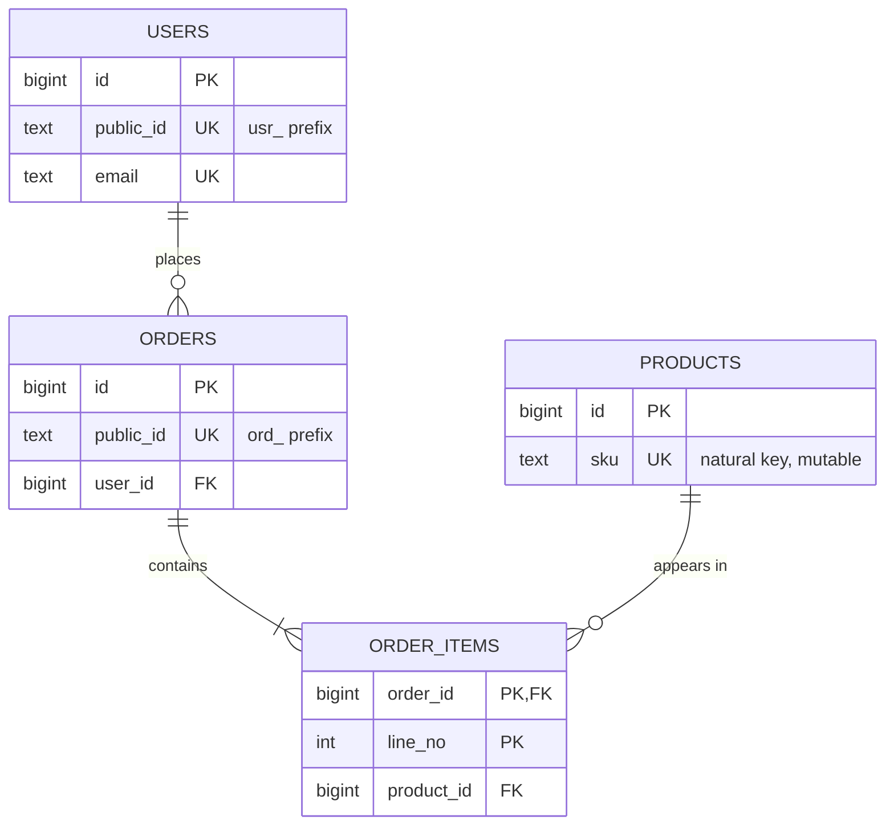

Every row needs a stable way to be found, referenced and joined, and that choice is the hardest one to change later. Primary keys leak into foreign keys, URLs, caches, event payloads and partner integrations. This guide covers the decisions you make once per table: natural or surrogate key, which surrogate type, what you expose to the outside world, and how references between tables behave when rows are deleted.

## Natural vs surrogate keys

A natural key is a value that already identifies the thing in the real world: an email address, an ISBN, a country code, a VAT number. A surrogate key is a value the database invents with no business meaning, such as an auto-incrementing integer or a UUID.

Natural keys look attractive, but most fail one of the three properties a primary key needs: unique, never null, never changing. Emails change. People share phone numbers. SKUs get renumbered. When a natural primary key changes, every foreign key pointing at it must change too, and `ON UPDATE CASCADE` across millions of rows is a locking event, not a migration.

The practical rule: use a surrogate primary key for entities, and enforce the natural key with a separate `UNIQUE` constraint. You keep the business rule (no two users with the same email) without coupling identity to a mutable attribute.

```sql
CREATE TABLE users (
  id         bigint GENERATED ALWAYS AS IDENTITY PRIMARY KEY,
  email      text NOT NULL,
  created_at timestamptz NOT NULL DEFAULT now(),
  CONSTRAINT users_email_key UNIQUE (email)
);
```

Natural keys are fine for small, stable reference data where the code itself is the meaning: ISO country codes (`'DE'`), ISO currency codes (`'EUR'`), language tags. Using `char(2)` or `text` as the primary key there makes foreign key columns self-describing and saves a join.

## Composite primary keys

A composite key uses more than one column. Two cases are common and correct.

Junction tables for many-to-many relationships should usually use the pair as the primary key. That enforces "a user is in a group at most once" for free and gives you an index for lookups from the first column. Add a second index in the reverse order for lookups from the other side.

```sql
CREATE TABLE group_members (
  group_id  bigint NOT NULL REFERENCES groups (id) ON DELETE CASCADE,
  user_id   bigint NOT NULL REFERENCES users (id) ON DELETE CASCADE,
  role      text NOT NULL DEFAULT 'member',
  joined_at timestamptz NOT NULL DEFAULT now(),
  PRIMARY KEY (group_id, user_id)
);
CREATE INDEX group_members_user_id_idx ON group_members (user_id);
```

Multi-tenant SaaS schemas often use `(tenant_id, id)` as the key of every tenant-owned table. The payoff is that foreign keys can include `tenant_id`, which makes it impossible at the database level for an invoice in tenant A to reference a customer in tenant B. It also keeps each tenant's rows clustered in the index, and it is the natural shard key if you later distribute with Citus or similar.

```sql
CREATE TABLE customers (
  tenant_id bigint NOT NULL REFERENCES tenants (id),
  id        bigint GENERATED ALWAYS AS IDENTITY,
  name      text NOT NULL,
  PRIMARY KEY (tenant_id, id)
);

CREATE TABLE invoices (
  tenant_id   bigint NOT NULL,
  id          bigint GENERATED ALWAYS AS IDENTITY,
  customer_id bigint NOT NULL,
  total_cents bigint NOT NULL,
  PRIMARY KEY (tenant_id, id),
  FOREIGN KEY (tenant_id, customer_id) REFERENCES customers (tenant_id, id)
);
```

The cost is wider foreign keys and more verbose joins.

## bigint identity vs UUIDv4 vs UUIDv7

For the surrogate itself, the realistic options in PostgreSQL are `bigint GENERATED ALWAYS AS IDENTITY` and `uuid`. Avoid `serial` in new code; identity columns are the SQL-standard replacement and handle permissions and dumps more cleanly. Avoid plain `integer` for anything that might grow: 2.1 billion sounds like a lot until a busy events table hits it and inserts start failing.

| Option | Size | Generated where | Index locality | Guessable |
|--------|------|-----------------|----------------|-----------|
| `bigint` identity | 8 bytes | Database sequence | Excellent, always appends | Yes, sequential |
| UUIDv4 | 16 bytes | Anywhere | Poor, random inserts | No |
| UUIDv7 | 16 bytes | Anywhere | Good, time-ordered | Reveals creation time |

Bigint is the smallest and fastest. New rows always land at the right edge of the B-tree, so hot pages stay in memory. The downsides: the ID is known only after insert, it reveals growth rate, and merging data across databases is awkward.

UUIDv4 is 122 random bits. You can generate it in the application before the insert, which simplifies batching, idempotency and event publishing. But random keys scatter inserts across the entire index. Once the index is larger than memory, nearly every insert touches a cold page, causing extra I/O, more WAL from full-page writes, and half-empty pages after random splits. On large write-heavy tables insert throughput can drop several times compared to sequential keys. Every foreign key column and every secondary index entry also pays the 16 bytes instead of 8.

UUIDv7 (RFC 9562) puts a 48-bit millisecond Unix timestamp in the high bits followed by random bits. It keeps the "generate anywhere" property while making inserts roughly sequential, so index behaviour is close to bigint. PostgreSQL 18 ships `uuidv7()` natively; on earlier versions generate it in the application or with an extension. The trade-off is that anyone holding the ID can read the creation time, which matters for some privacy-sensitive entities.

```sql
-- PostgreSQL 18+
CREATE TABLE orders (
  id         uuid PRIMARY KEY DEFAULT uuidv7(),
  user_id    bigint NOT NULL REFERENCES users (id),
  created_at timestamptz NOT NULL DEFAULT now()
);
```

A sensible default: bigint identity within a single database, UUIDv7 when IDs must be generated outside it. Use UUIDv4 only when IDs must leak nothing.

MySQL with InnoDB makes this choice more consequential. InnoDB clusters the table by primary key, so the whole row is stored in primary key order and every secondary index stores the primary key as its row pointer. Random UUIDs there fragment the table itself, not just an index. If you use UUIDs in MySQL, store them as `BINARY(16)` rather than `CHAR(36)`, and prefer time-ordered ones.

## Public IDs vs internal IDs

What you put in URLs and API responses does not have to be your primary key. Exposing sequential integers lets anyone enumerate `/invoices/1001`, `/invoices/1002` and so on. That is not a security boundary on its own, since authorization checks should stop unauthorized access, but it leaks business volume and turns any missing authorization check into a mass data breach.

A common pattern keeps a compact bigint primary key for joins and adds a separate public identifier with a unique constraint. Stripe popularised prefixed IDs such as `ord_2x8KfP9qLm3T`: the prefix tells humans and log searches what kind of object it is, and makes passing a customer ID where an order ID was expected obvious.

```sql
CREATE TABLE orders (
  id         bigint GENERATED ALWAYS AS IDENTITY PRIMARY KEY,
  public_id  text NOT NULL UNIQUE
             CHECK (public_id ~ '^ord_[0-9A-Za-z]{16,32}$'),
  user_id    bigint NOT NULL REFERENCES users (id),
  created_at timestamptz NOT NULL DEFAULT now()
);
```

Generate the random part from a cryptographically secure source, encoded in base62 or Crockford base32. Translate public IDs to internal IDs at the API boundary and never accept internal IDs from clients.



## Foreign keys and indexing them

A foreign key guarantees that every reference points at an existing row. Declare them. Applications that "handle it in code" end up with orphan rows after the first buggy deploy.

PostgreSQL requires a unique index on the referenced column (the primary key provides it) but does not create an index on the referencing column. You almost always want one. Without it, deleting or updating a parent row forces a sequential scan of the child table to check for references, and joins from parent to children cannot use an index. A single `DELETE FROM users WHERE id = 42` can then scan a 200-million-row `orders` table while holding locks.

```sql
CREATE INDEX orders_user_id_idx ON orders (user_id);
```

If a composite index already starts with the foreign key column, such as `(user_id, created_at)`, it covers this need. MySQL InnoDB creates an index on foreign key columns automatically if none exists.

## ON DELETE actions

The `ON DELETE` clause decides what happens to children when a parent row is deleted. Choose it per relationship based on ownership.

- **CASCADE** when the child has no meaning without the parent and is owned by it: order items of an order, members of a deleted group, a user's sessions. Be careful with deep cascade chains; one delete can remove millions of rows in a single transaction.
- **RESTRICT** or the default **NO ACTION** when the child is an independent record that must not silently disappear: you cannot delete a customer who has invoices; you cancel or anonymise them instead. The difference is timing: `NO ACTION` checks at the end of the statement (or at commit if deferred), `RESTRICT` checks immediately.
- **SET NULL** when the relationship is optional and the child should survive: a ticket's `assignee_id` when the employee leaves. The column must be nullable. PostgreSQL 15+ allows `SET NULL (col)` to null only some columns of a composite key.

For financial and audit data, default to `RESTRICT`.

## Keys in MongoDB and DynamoDB

MongoDB gives every document an `_id`, by default an `ObjectId`: 12 bytes containing a 4-byte timestamp, a 5-byte per-process random value and a 3-byte counter. It is generated by the driver, roughly time-ordered and index-friendly, much like UUIDv7. You can set `_id` to any unique, immutable value. MongoDB has no foreign keys; references are just stored values, and integrity is the application's job. In sharded clusters, a monotonically increasing shard key such as `ObjectId` sends all inserts to one chunk, so use a hashed or compound shard key there.

DynamoDB keys are a partition key, optionally plus a sort key. The partition key is hashed to choose a storage partition, so it must have high cardinality and even access, or you get hot partitions. The sort key orders items within a partition and enables range queries, which is why single-table designs use composite strings like `PK = USER#123`, `SK = ORDER#2026-11-03#ord_8f2`. There are no joins and no foreign keys; you design keys from access patterns first.

## Trade-offs and pitfalls

- **Integer overflow**: `integer` primary keys run out at about 2.1 billion. Migrating to `bigint` on a large table is a full rewrite. Start with `bigint`.
- **Random UUIDs on hot tables** bloat indexes and slow inserts once the working set exceeds memory. Use UUIDv7 or bigint.
- **Unindexed foreign keys** make parent deletes and joins scan the child table. Index every foreign key column unless you have proven you never need it.
- **Cascades that are too eager** can delete far more data than intended. Reserve `CASCADE` for true ownership.

## Interview angle

- Justify the key type: bigint for compactness and locality, UUIDv7 for distributed generation, and say why random UUIDv4 hurts B-tree inserts.
- Mention separating public IDs from internal ones to avoid enumeration.
- When drawing a schema, always point out that foreign key columns need indexes in PostgreSQL.
- For multi-tenant designs, propose `(tenant_id, id)` keys and tenant-scoped foreign keys.

## Key takeaways

- Use surrogate primary keys for entities and enforce natural keys with `UNIQUE`.
- Default to `bigint GENERATED ALWAYS AS IDENTITY`; use UUIDv7 when IDs must be created outside the database.
- Expose prefixed random public IDs, not sequential internal ones.
- Declare every foreign key and index the referencing column.
- Pick `ON DELETE` per relationship: `CASCADE` for owned children, `RESTRICT` for independent records, `SET NULL` for optional links.
