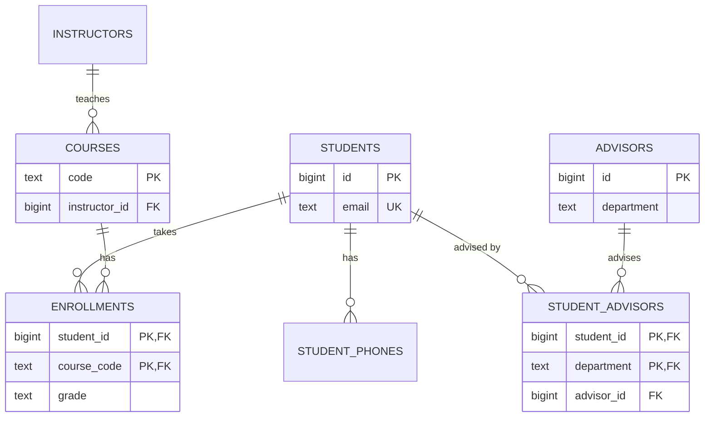

Normalisation is the discipline of storing each fact exactly once. Every engineer has met the symptoms of skipping it: a customer who changed their email but still gets invoices at the old one, or a product whose name differs between two screens. The normal forms are a checklist for catching those problems early. This guide works through one running example, a spreadsheet-style table of university enrollments, and fixes it one normal form at a time, showing the tables at each step.

## The bad table and its anomalies

Here is a table that a team might build by mirroring an export from an old system:

| student_id | student_name | student_email | phones | course_code | course_title | instructor | instructor_office | grade |
|---|---|---|---|---|---|---|---|---|
| 1 | Asha Rao | asha@uni.edu | 555-0101, 555-0102 | CS101 | Databases | Dr Lin | B-210 | A |
| 1 | Asha Rao | asha@uni.edu | 555-0101, 555-0102 | MA201 | Statistics | Dr Okafor | C-105 | B |
| 2 | Ben Cole | ben@uni.edu | 555-0199 | CS101 | Databases | Dr Lin | B-210 | B |

It works until data changes. Three kinds of anomaly appear:

- **Update anomaly.** Dr Lin moves to office B-300. You must update every row for every student in every course she teaches. Miss one and the database now holds two offices for one person, with no way to know which is right.
- **Insert anomaly.** A new course, CS305, is approved but nobody has enrolled yet. You cannot record its title or instructor without inventing a fake student, because the row is about an enrollment.
- **Delete anomaly.** Ben drops CS101 and was the only student in it. Deleting his enrollment deletes the only record that CS101 is called "Databases" and is taught by Dr Lin.

All three have one root cause: the table mixes facts about students, courses, instructors and enrollments.

## Functional dependencies in plain English

A functional dependency, written `A -> B`, means "if you know A, there is exactly one B". In our table:

- `student_id -> student_name, student_email` (a student has one name and email)
- `course_code -> course_title, instructor` (a course has one title and one instructor)
- `instructor -> instructor_office` (an instructor has one office)
- `student_id, course_code -> grade` (a student gets one grade per course)

Dependencies are business rules, not patterns in sample data. If your university allows co-taught courses, `course_code -> instructor` is false and the design changes.

A **candidate key** is a minimal set of columns that determines every other column. Here it is `(student_id, course_code)`. Columns that belong to some candidate key are **prime**; the rest are non-prime.

## First normal form: atomic values, no repeating groups

1NF requires that every column hold a single value of its type, that there are no repeating groups like `phone1, phone2, phone3`, and that rows are identifiable by a key. The `phones` column breaks this: you cannot index, constrain or join on "the second phone" reliably. Move multivalued attributes to their own table.

`student_phones`

| student_id | phone |
|---|---|
| 1 | 555-0101 |
| 1 | 555-0102 |
| 2 | 555-0199 |

The main table keeps every other column, now with one value per cell and the key `(student_id, course_code)`.

## Second normal form: no partial dependencies

2NF applies to tables with composite keys. It says every non-prime column must depend on the whole key, not part of it. Our table violates this twice: `student_name` depends only on `student_id`, and `course_title` depends only on `course_code`. Split them out.

`students`

| student_id | student_name | student_email |
|---|---|---|
| 1 | Asha Rao | asha@uni.edu |
| 2 | Ben Cole | ben@uni.edu |

`courses`

| course_code | course_title | instructor | instructor_office |
|---|---|---|---|
| CS101 | Databases | Dr Lin | B-210 |
| MA201 | Statistics | Dr Okafor | C-105 |

`enrollments`

| student_id | course_code | grade |
|---|---|---|
| 1 | CS101 | A |
| 1 | MA201 | B |
| 2 | CS101 | B |

The insert and delete anomalies for courses are gone: CS305 can exist in `courses` with no enrollments, and deleting Ben's enrollment leaves CS101 intact. A table with a single-column key is automatically in 2NF.

## Third normal form: no transitive dependencies

3NF adds that non-prime columns must not depend on other non-prime columns. In `courses`, `instructor_office` depends on `instructor`, which depends on `course_code`. That chain is a transitive dependency, and it is why Dr Lin's office repeats for every course she teaches. The classic summary of 3NF is that every non-key column depends on "the key, the whole key, and nothing but the key".

`instructors`

| instructor_id | name | office |
|---|---|---|
| 10 | Dr Lin | B-210 |
| 11 | Dr Okafor | C-105 |

`courses`

| course_code | course_title | instructor_id |
|---|---|---|
| CS101 | Databases | 10 |
| MA201 | Statistics | 11 |

Now an office move is a single-row update. Here is the 3NF schema in DDL:

```sql
CREATE TABLE students (
  id        bigint GENERATED ALWAYS AS IDENTITY PRIMARY KEY,
  full_name text NOT NULL,
  email     text NOT NULL UNIQUE
);

CREATE TABLE student_phones (
  student_id bigint NOT NULL REFERENCES students (id) ON DELETE CASCADE,
  phone      text   NOT NULL,
  PRIMARY KEY (student_id, phone)
);

CREATE TABLE instructors (
  id        bigint GENERATED ALWAYS AS IDENTITY PRIMARY KEY,
  full_name text NOT NULL,
  office    text
);

CREATE TABLE courses (
  code          text PRIMARY KEY,
  title         text NOT NULL,
  instructor_id bigint NOT NULL REFERENCES instructors (id)
);
CREATE INDEX courses_instructor_idx ON courses (instructor_id);

CREATE TABLE enrollments (
  student_id  bigint NOT NULL REFERENCES students (id) ON DELETE CASCADE,
  course_code text   NOT NULL REFERENCES courses (code) ON UPDATE CASCADE,
  grade       text   CHECK (grade IN ('A', 'B', 'C', 'D', 'F')),
  PRIMARY KEY (student_id, course_code)
);
CREATE INDEX enrollments_course_idx ON enrollments (course_code);
```

## Boyce-Codd normal form: every determinant is a key

3NF has a loophole: it only constrains non-prime columns. BCNF closes it by requiring that for every dependency `A -> B`, A is a superkey. Violations need overlapping candidate keys.

The university now assigns advisors. Rules: each advisor belongs to exactly one department, and each student has one advisor per department.

`student_advisors`

| student_id | department | advisor |
|---|---|---|
| 1 | CS | Dr Lin |
| 1 | Math | Dr Okafor |
| 2 | CS | Dr Lin |
| 3 | CS | Dr Patel |

Dependencies: `student_id, department -> advisor` and `advisor -> department`. Candidate keys are `(student_id, department)` and `(student_id, advisor)`. Every column is prime, so the table is in 3NF. But `advisor -> department` has a determinant that is not a key, so Dr Lin's department repeats on every advisee row, and you cannot record that Dr Patel is in CS without assigning a student. BCNF decomposes it:

`advisors`

| advisor | department |
|---|---|
| Dr Lin | CS |
| Dr Okafor | Math |
| Dr Patel | CS |

`student_advisors`

| student_id | advisor |
|---|---|
| 1 | Dr Lin |
| 1 | Dr Okafor |
| 2 | Dr Lin |
| 3 | Dr Patel |

The cost: the rule "one advisor per student per department" now spans two tables and is no longer enforced by a single unique constraint. BCNF decompositions do not always preserve dependencies. In PostgreSQL you can restore the rule by carrying `department` into the link table and using a composite foreign key:

```sql
CREATE TABLE advisors (
  id         bigint GENERATED ALWAYS AS IDENTITY PRIMARY KEY,
  full_name  text NOT NULL,
  department text NOT NULL,
  UNIQUE (id, department)
);

CREATE TABLE student_advisors (
  student_id bigint NOT NULL REFERENCES students (id) ON DELETE CASCADE,
  advisor_id bigint NOT NULL,
  department text   NOT NULL,
  PRIMARY KEY (student_id, department),
  FOREIGN KEY (advisor_id, department) REFERENCES advisors (id, department)
);
```

The `department` column here is redundant on purpose, but the composite foreign key guarantees it always matches the advisor, so it cannot drift. This is a common, safe pattern.



## Fourth and fifth normal forms, briefly

4NF deals with **multivalued dependencies**: two independent lists stored in one table. If `instructor_skills_languages(instructor, skill, language)` records that Dr Lin knows SQL and Python and speaks English and Mandarin, you must store all four combinations, and adding a language means adding a row per skill. Split it into `instructor_skills` and `instructor_languages`. Modelling each multivalued attribute as its own table avoids this.

5NF deals with **join dependencies**: a table that can be losslessly rebuilt only by joining three or more of its projections, because a business rule ties the pairs together. Real 5NF violations are rare; most ternary tables are genuine three-way facts that should stay whole.

## When 3NF is the sweet spot

For transactional schemas, 3NF (with BCNF where it costs nothing) is the right default. It eliminates the anomalies that cause real bugs and keeps constraints simple. A well-indexed 3NF schema serves most OLTP reads in milliseconds; for the few hot paths that need more, denormalise deliberately, with a mechanism that keeps the copy correct. Warehouse star schemas are the exception: dimensions are denormalised on purpose because a pipeline rebuilds them.

## Normalisation versus JSON columns

PostgreSQL `jsonb`, MySQL `JSON` and MongoDB documents make it tempting to skip normalisation by stuffing structure into one column. A JSON column holding a list of phone numbers is a 1NF violation with better tooling. That is acceptable when the data is owned by the row, read and written as a unit, and not subject to cross-row constraints: UI preferences, a webhook payload, per-product attributes.

It is the wrong choice when you need to join on the values, enforce uniqueness or foreign keys inside them, update one element under concurrency, or report across rows. Put stable, queried, constrained fields in columns and keep JSON for the long tail. A GIN index makes containment queries on `jsonb` fast, but it does not give you referential integrity.

## Trade-offs and pitfalls

- **Treating sample data as dependencies.** Agreeing rows do not make a rule; ask the business.
- **Normalising history away.** An invoice must keep the address and price at the time of sale; that is a fact about the invoice, not a duplicate.
- **Ignoring lost dependencies in BCNF.** Re-enforce them with composite foreign keys or accept the risk explicitly.
- **Using JSON to avoid schema decisions.** The schema still exists; it just moves into every reader.

## Interview angle

- Show a bad table and name the update, insert and delete anomalies concretely.
- State the functional dependencies as business rules before decomposing.
- Walk 1NF to 3NF quickly; mention BCNF with an overlapping-key example to show depth.
- Say why 3NF is the OLTP default and when you would denormalise or use JSON.

## Key takeaways

- Anomalies come from storing facts about different things in one table.
- A functional dependency means "knowing A fixes B"; it is a business rule.
- 1NF: atomic values. 2NF: no partial dependencies. 3NF: no transitive dependencies. BCNF: every determinant is a key.
- 3NF is the practical sweet spot for transactional systems; denormalise only with a consistency mechanism.
- JSON columns suit owned, unqueried, unconstrained data, not core relational facts.
