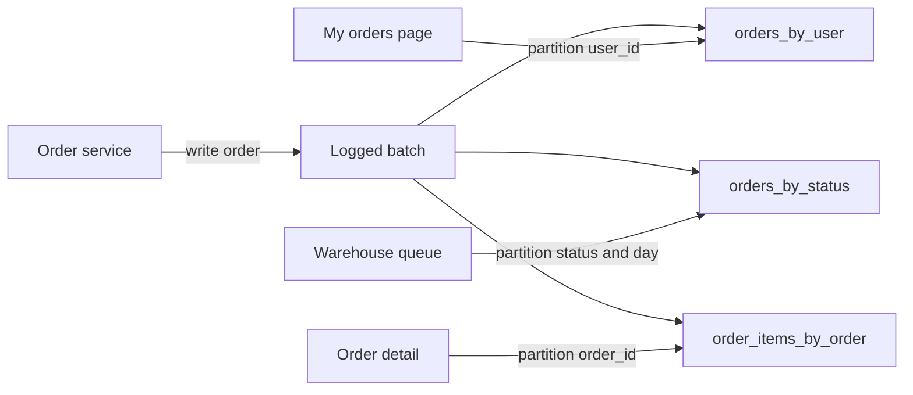

Relational modelling starts from the data: find the entities, normalise them, and let the query planner work out how to answer whatever question arrives later. NoSQL modelling runs the other way. Key-value and wide-column stores have no joins and no general-purpose planner, so every query must be answerable by reading one key or one contiguous range of keys. You therefore design the schema from the list of queries, and a query you did not plan for is either a full scan or a new index. In exchange, latency stays flat at single-digit milliseconds whether the table holds a thousand rows or ten billion.

## Start with the access pattern list

Before drawing any table, write down every read and write the application performs, with its expected rate and the key you will have in hand when you make it. For a small e-commerce service the list might look like this:

| # | Access pattern | Input | Rate |
|---|---|---|---|
| 1 | Get user profile | userId | 2,000/s |
| 2 | List a user's orders, newest first | userId | 500/s |
| 3 | Get one order with its line items | orderId | 800/s |
| 4 | Look up user by email at login | email | 300/s |
| 5 | List orders by status for the warehouse | status, date | 20/s |
| 6 | Place an order (order + items) | userId, items | 50/s |

This table is the real schema. Each row must map to exactly one key lookup or range query on a table or index. A row that cannot be mapped needs an index, a precomputed answer, or another system such as a search index or warehouse.

## DynamoDB single-table design

DynamoDB tables have a partition key and an optional sort key. The partition key is hashed to pick a storage partition; within a partition, items are stored sorted by sort key. A `Query` call reads one partition key and an optional range of sort keys, in order, and returns up to 1 MB per page. That is the only efficient read besides `GetItem`.

Single-table design puts several entity types into one table with generic key attributes, usually named `PK` and `SK`. Related items share a partition key, which forms an **item collection**: a group of items you can fetch in one `Query`. For the access patterns above:

| PK | SK | Type | Other attributes | GSI1PK | GSI1SK |
|---|---|---|---|---|---|
| `USER#u42` | `PROFILE` | User | name, email, createdAt | `EMAIL#ana@x.io` | `USER#u42` |
| `USER#u42` | `ORDER#2026-10-30#o981` | Order | status=SHIPPED, total=74.50 | `ORDER#o981` | `ORDER#o981` |
| `USER#u42` | `ORDER#2026-11-02#o1007` | Order | status=PENDING, total=19.99 | `ORDER#o1007` | `ORDER#o1007` |
| `ORDER#o1007` | `ITEM#1` | OrderItem | sku=MUG-01, qty=2, price=7.50 | | |
| `ORDER#o1007` | `ITEM#2` | OrderItem | sku=TEA-07, qty=1, price=4.99 | | |
| `ORDER#o1007` | `INFO` | OrderInfo | userId=u42, status=PENDING | `ORDER#o1007` | `INFO` |

Pattern 1 is `GetItem(PK=USER#u42, SK=PROFILE)`. Pattern 2 is `Query(PK=USER#u42, SK begins_with "ORDER#")` with `ScanIndexForward=false`; because the sort key embeds an ISO date, results come back newest first. Pattern 3 is `Query(PK=ORDER#o1007)`, returning the header and every line item in one round trip. Pattern 6 is a `TransactWriteItems` call that writes the order summary under the user, the `INFO` item and the line items atomically, up to 100 items per transaction.

```json
{
  "TableName": "shop",
  "KeyConditionExpression": "PK = :pk AND begins_with(SK, :prefix)",
  "ExpressionAttributeValues": {
    ":pk": { "S": "USER#u42" },
    ":prefix": { "S": "ORDER#" }
  },
  "ScanIndexForward": false,
  "Limit": 20
}
```

### Overloaded GSIs

A global secondary index is a second copy of the table keyed differently, maintained asynchronously. Instead of one GSI per query, single-table designs **overload** a GSI with generic attributes (`GSI1PK`, `GSI1SK`) that mean different things for different entity types. Above, `GSI1PK` holds the email for user items, which answers pattern 4 with `Query(GSI1, GSI1PK=EMAIL#ana@x.io)`. For order items it could hold `STATUS#PENDING` with `GSI1SK` set to the order date, answering pattern 5. A table may have up to 20 GSIs, but each one roughly doubles write cost for items it contains, so overloading two or three generic indexes is cheaper than creating ten specific ones. GSI reads are eventually consistent; a user who changes their email may not be findable by the new address for a fraction of a second. For uniqueness, such as one account per email, write a separate `PK=EMAIL#ana@x.io` item in the same transaction with an `attribute_not_exists(PK)` condition.

### Adjacency lists and sparse indexes

Many-to-many relationships use the **adjacency list** pattern: store an edge item for each relationship, keyed so that it can be read from either side. Users belonging to groups get items `PK=GROUP#g1, SK=USER#u42` and an inverted GSI with `GSI1PK=SK, GSI1SK=PK`. Query the table to list a group's members, query the inverted index to list a user's groups.

A **sparse index** exploits the fact that DynamoDB only copies an item into a GSI if the item has the index's key attributes. Set `openOrderFlag` only on orders that are not yet shipped, index on it, and the GSI contains only open orders. The warehouse dashboard then queries a few thousand items instead of filtering millions. When an order ships, remove the attribute and the item drops out of the index.

### Hot partitions

Each DynamoDB partition supports roughly 3,000 read units and 1,000 write units per second. A single celebrity user, or a GSI partition key like `STATUS#PENDING` that every new order writes to, can saturate one partition while the rest of the table idles. Adaptive capacity helps, but the real fix is to shard hot keys with a suffix (`STATUS#PENDING#0` to `#9`) and query all shards in parallel.

## Cassandra and ScyllaDB: one table per query

Cassandra and ScyllaDB use a similar model with different vocabulary. The **partition key** chooses the node replica set; **clustering columns** sort rows within the partition. CQL looks like SQL but rejects queries that do not supply the full partition key, unless you add `ALLOW FILTERING`, which in production almost always means a design mistake.

Instead of overloading one table, Cassandra practice is to create one table per query and write to all of them:

```sql
CREATE TABLE orders_by_user (
  user_id    uuid,
  order_date date,
  order_id   timeuuid,
  status     text,
  total      decimal,
  PRIMARY KEY ((user_id), order_date, order_id)
) WITH CLUSTERING ORDER BY (order_date DESC, order_id DESC);

CREATE TABLE orders_by_status (
  status     text,
  bucket     date,
  order_id   timeuuid,
  user_id    uuid,
  total      decimal,
  PRIMARY KEY ((status, bucket), order_id)
) WITH CLUSTERING ORDER BY (order_id DESC);
```

The second table adds a day `bucket` to the partition key. Without it, every pending order ever would land in one partition. The guideline is to keep partitions under about 100 MB and 100,000 rows; past that, compaction, repair and reads slow down, and very large partitions cause GC pauses on Cassandra nodes. Estimate the size up front: if a busy day produces 200,000 pending orders at 200 bytes each, that is 40 MB per daily partition, which is fine. An hourly bucket would be the next step if volume grew tenfold.

Writing to several tables uses a logged `BATCH` for atomicity, at extra coordination cost; high-volume paths often use separate idempotent writes with retries instead, since Cassandra writes are upserts.



## Document stores: embed or reference

Document databases such as MongoDB, Firestore and Couchbase sit between the two worlds. They allow secondary indexes on any field and limited joins, but they are still fastest when one read fetches one document. The generic rules apply across engines:

- **Embed** when the child is owned by the parent, read with it almost every time, and bounded in count. Order line items, a product's variants, an address on a shipment.
- **Reference** when the child is shared by many parents, updated independently, or unbounded. Users referenced by orders, products referenced by line items, comments on a viral post.
- **Copy a few fields** (an extended reference) when you need to display related data without a second read, such as the customer's name on an order, and accept that the copy may be stale.
- **Respect document limits**: 16 MB in MongoDB, 1 MiB in Firestore, 400 KB per item in DynamoDB. An array that grows without limit will eventually hit the ceiling and slow every update long before that.

## Denormalisation and fan-out costs

Every NoSQL design above duplicates data. The order total lives in `orders_by_user` and `orders_by_status`; the user's name is copied onto every order. Duplication is the price of single-read queries, and you pay it on writes and on change.

Write amplification is easy to count. If an order is stored in three Cassandra tables, each with replication factor 3, one logical write becomes nine replica writes. In DynamoDB, an item projected into two GSIs costs three write units instead of one.

Change fan-out is harder. If a user renames themselves and their name is copied onto 4,000 historical orders, you must update 4,000 items, asynchronously and idempotently, usually from a change stream such as DynamoDB Streams or a CDC pipeline. Decide for each copied field whether it should be updated at all. A shipping address on a placed order should reflect what was used at the time, so it is a snapshot and is never updated. A display name on a social feed should probably update, but can lag by minutes.

## When relational is the better choice

NoSQL query-first design is the right tool when access patterns are known, stable and few, when you need predictable latency at a scale a single relational primary cannot serve, or when the data is naturally a key-value or append-heavy time series. It is the wrong tool when the product is young and the queries are still changing weekly, when users need ad hoc filtering and sorting across many fields, when reports join several entities, or when invariants span entities, such as "inventory never goes negative across warehouses". A modern Postgres node handles tens of thousands of transactions per second and several terabytes, which covers most applications for years. Choosing a NoSQL store first and discovering a new query every sprint means rebuilding joins, constraints and migrations in application code.

## Trade-offs and pitfalls

- **Modelling entities before listing queries.** The result needs scans or a dozen GSIs.
- **Unbounded partitions.** A partition key without a time bucket grows forever; plan size per partition up front.
- **Hot keys.** Low-cardinality partition keys like status or country concentrate traffic on one partition.
- **Treating GSIs as consistent.** Uniqueness and read-after-write checks must go through the base table.
- **Denormalising without an update plan.** Decide per copied field: snapshot, eventually updated, or never copied.
- **`ALLOW FILTERING` and `Scan` in request paths.** Both read far more data than they return.
- **Picking NoSQL for flexibility.** Schemaless storage moves the schema into every reader, and query-first design is less flexible, not more.

## Interview angle

- Write the access pattern table first, with rates, and map each row to a key or index.
- Show a DynamoDB item collection for a parent and its children, and name the PK/SK values.
- Explain how you avoid hot partitions and oversize partitions with bucketing or sharding suffixes.
- Count the write amplification of your denormalisation and say how copies are kept in sync.
- State clearly when you would choose Postgres instead.

## Key takeaways

- NoSQL schemas are designed from the query list; each query maps to one key or range read.
- Single-table DynamoDB design groups related items into item collections and overloads a few GSIs.
- Sparse indexes and adjacency lists cover filtered queues and many-to-many relationships cheaply.
- Cassandra uses one table per query, with partition keys bucketed to stay under about 100 MB.
- Denormalisation trades cheap reads for write amplification and fan-out; plan both explicitly.
- If queries are unknown or relational invariants matter, a relational database is the better start.
