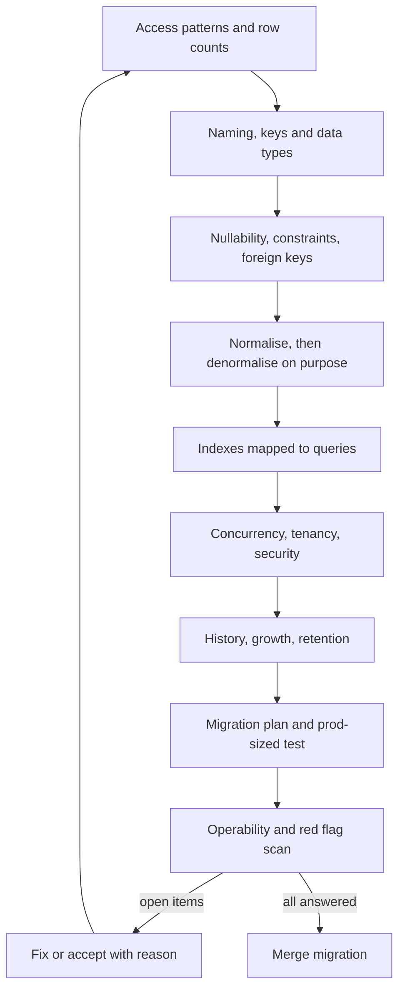

Application code can be rewritten in an afternoon. A schema that already holds two hundred million rows cannot. Every shortcut taken in a table definition, such as a nullable column that should never be empty, a missing foreign key or an integer key that will overflow, turns into a data clean-up project, a locking migration or an incident months later. This checklist is the set of questions to ask of a schema before the first migration reaches production, and again whenever a table changes shape. Each item gives the question, what a good answer looks like, and the red flag that tells you the work is not done yet. It covers only the database layer; it assumes the wider system design has already been reviewed.

## How to use the checklist

Bring the actual DDL, not a diagram. Diagrams hide types, nullability, defaults and indexes, which is where most problems live. Work through the groups in order, because the early answers drive the later ones: you cannot judge an index without knowing the query, or a partitioning plan without row counts. Mark every item as answered, accepted risk with a written reason, or open. Open items become tickets attached to the migration pull request, and the migration does not merge until they are closed or explicitly accepted.

## 1. Requirements and access patterns

A schema is a bet on how data will be read and written. If nobody has written the queries down, the bet is blind.

| Question | What good looks like | Red flag |
|---|---|---|
| What are the top queries and writes? | A list of the ten or so hottest statements with expected frequency and latency target. | "We'll see what the ORM generates." |
| What is the read/write ratio per table? | Known per table, for example orders 20:1, events 1:50. | One ratio quoted for the whole database. |
| Which invariants must never break? | Written as rules: "a seat is sold at most once", "balance never below zero". | Invariants exist only in a service method. |
| Who else reads this data? | Reporting, search indexing, exports and other services are named. | A warehouse job discovered after the column is renamed. |

## 2. Naming conventions

Names outlive the people who chose them. Pick one convention, write it down and enforce it in review, because a schema that mixes `userId`, `user_id` and `UserID` invites bugs in every query.

| Object | Convention | Example | Avoid |
|---|---|---|---|
| Tables | snake_case, plural nouns, one style throughout | `order_items` | `tblOrderItem`, mixed singular and plural |
| Columns | snake_case, no table prefix, units in name when ambiguous | `total_cents`, `weight_grams` | `orderTotal`, `amt`, `order_total` inside `orders` |
| Primary key | `id` | `orders.id` | `order_pk`, composite keys by habit |
| Foreign key column | `<referenced_singular>_id` | `customer_id`, `billing_address_id` | `cust`, `customer` holding an id |
| Indexes | `ix_<table>__<columns>`; unique `ux_` | `ix_orders__customer_id_created_at` | Auto-generated `orders_idx3` |
| Constraints | `pk_`, `fk_`, `ck_`, `uq_` plus table and purpose | `ck_orders__total_nonnegative` | Engine defaults like `orders_check1` |
| Booleans | `is_`, `has_`, `can_` prefix, positive phrasing | `is_active`, `has_shipped` | `not_deleted`, `flag`, `status2` |
| Timestamps | `_at` suffix, stored in UTC with time zone | `created_at`, `cancelled_at` | `date`, `created`, local time without zone |
| Dates without time | `_on` suffix | `birth_on`, `due_on` | Storing midnight timestamps for dates |

Named constraints matter more than they look: when a migration has to drop or replace one, a predictable name lets you write the script without querying the catalogue on every environment.

## 3. Keys and identifiers

Keys are the hardest thing to change later, because every foreign key, cache entry, URL and external system that stores an id depends on them. Decide the key type once, for the size the table will reach, not the size it has today.

| Question | What good looks like | Red flag |
|---|---|---|
| Is every table given a primary key? | Yes, including join and log tables. | Heap tables with no key, duplicates possible. |
| Surrogate or natural key? | Surrogate `id` for entities; natural values (email, SKU) enforced with a unique constraint. | Email as primary key, so a change cascades everywhere. |
| Will the key type last? | `bigint` or a time-ordered UUID (v7, ULID). | 32-bit `int` on a table that grows by millions per day. |
| Are ids exposed publicly? | Opaque or non-sequential public ids so counts and neighbours cannot be guessed. | `/invoices/1042` lets anyone walk the sequence. |
| Random UUIDs on hot inserts? | Time-ordered ids to keep B-tree inserts at the right edge. | UUIDv4 primary key causing page splits and bloated indexes. |

## 4. Data types

A type is a constraint you get for free. The right type rejects bad input, stores data compactly and keeps comparisons and sorting correct. The wrong type works in testing and then produces rounding errors, time zone bugs or slow casts in every query.

| Question | What good looks like | Red flag |
|---|---|---|
| Is money exact? | `numeric(19,4)` or integer minor units plus a currency column. | `float` or `double` for prices. |
| Are timestamps unambiguous? | `timestamptz` in UTC; conversion at the edge. | `timestamp` without zone, or epoch strings. |
| Are enumerations controlled? | A lookup table or check constraint, with a plan for adding values. | Free text where only five values are valid. |
| Is JSON justified? | JSON for genuinely variable attributes, with key fields promoted to columns. | Core, queried fields buried in a JSON blob. |
| Are sizes sensible? | Text lengths validated by a constraint where a limit is real. | `varchar(255)` everywhere by reflex, or ids stored as text. |

## 5. Nullability and constraints

The database is the last line of defence and the only one every writer passes through. Constraints written there protect you from the batch script, the admin console and the next service that nobody told about the rules.

| Question | What good looks like | Red flag |
|---|---|---|
| Is every column `NOT NULL` unless absence means something? | Nullable columns have a stated meaning for NULL. | Everything nullable because it was the default. |
| Are business rules checked? | `CHECK (quantity > 0)`, `CHECK (ends_at > starts_at)`. | Validation only in the API layer. |
| Is uniqueness enforced by the database? | Unique constraints, including partial ones such as one active subscription per user. | "Check, then insert" in application code. |
| Are defaults deliberate? | `created_at DEFAULT now()`, explicit status default. | Defaults that silently hide missing input. |

## 6. Relationships and foreign keys

Foreign keys document the model as much as they protect it. A reviewer reading the DDL should be able to reconstruct the entity diagram from the constraints alone, and should be able to say what happens to each child row when its parent is deleted.

| Question | What good looks like | Red flag |
|---|---|---|
| Is every reference a real foreign key? | FKs declared, with indexes on the referencing column. | "We dropped FKs for speed" with no measurement. |
| Is each `ON DELETE` choice deliberate? | `CASCADE` for owned children (order lines), `RESTRICT` for shared parents (customers, products), `SET NULL` only where an orphan makes sense. | Default action everywhere, or cascade from a user to invoices required by law. |
| Are many-to-many links modelled as tables? | Join table with composite unique key and its own attributes if needed. | Comma-separated id lists in a column. |
| Are hierarchies chosen consciously? | Adjacency list, closure table or materialised path picked for the actual tree queries. | Recursive queries discovered to be too slow in production. |

## 7. Normalisation and denormalisation

Start in third normal form and denormalise only for a measured read path, with a named owner for keeping the copy correct.

| Question | What good looks like | Red flag |
|---|---|---|
| Is each fact stored once? | Customer name lives in `customers`; orders reference it. | The same address edited in three tables. |
| Is historical truth snapshotted? | Order lines copy price and product name at purchase time, on purpose. | Old invoices change when the catalogue price changes. |
| Is each denormalised copy maintained? | Trigger, same-transaction update, materialised view with a refresh schedule, or event with reconciliation. | Counter columns that drift and nobody notices. |
| Is analytics separated? | Reporting runs on a replica or warehouse with its own model. | OLTP tables reshaped to suit dashboards. |

## 8. Indexes per query

Every index should be traceable to a query in section 1, and every hot query should be traceable to an index.

| Question | What good looks like | Red flag |
|---|---|---|
| Does each hot query have a plan? | `EXPLAIN` output attached for the top queries, using index scans where expected. | No plans reviewed. |
| Is column order right in composite indexes? | Equality columns first, then range or sort columns. | `(created_at, customer_id)` for a query filtering on customer. |
| Are partial and covering indexes used where they help? | `WHERE status = 'pending'` partial index; `INCLUDE` columns for index-only scans. | Full index over a column that is 99% one value. |
| Are there unused or duplicate indexes? | Index usage statistics checked; indexes that are prefixes of others removed. | `(a)` and `(a, b)` both present; ten indexes on a write-heavy table. |
| Are FK columns indexed? | Yes, so parent deletes and joins do not scan the child table. | Deleting a customer locks and scans `orders`. |

## 9. Concurrency and invariants

Most data corruption in production is not caused by bad code paths but by two correct code paths running at the same time. For each invariant from section 1, name the mechanism that holds it when two requests arrive in the same millisecond.

| Question | What good looks like | Red flag |
|---|---|---|
| How is each invariant protected under concurrency? | A constraint, a conditional update (`UPDATE ... WHERE stock >= 1`), row locks or serializable isolation, chosen per rule. | Read, compute, write with no lock or version check. |
| Is there optimistic locking where users edit the same row? | A `version` column checked on update. | Last write wins silently. |
| Are retries safe? | Idempotency keys stored with a unique constraint. | A retried payment creates a second charge row. |
| Are transactions short? | No network calls inside a transaction. | Transactions held open across an HTTP request to a third party. |

## 10. Multi-tenancy and security

Security mistakes in a schema are rarely visible until there is a breach or an audit. Treat tenant isolation and personal data as design inputs, not features to bolt on, because retrofitting a `tenant_id` or encrypting an existing column means rewriting every row.

| Question | What good looks like | Red flag |
|---|---|---|
| How is tenant data isolated? | `tenant_id` on every tenant table, leading most indexes, enforced by row-level security policies. | Isolation depends on every query remembering a `WHERE`. |
| Is PII identified? | Columns tagged as PII with an owner, retention rule and deletion path. | Nobody can list where email addresses are stored. |
| Is sensitive data encrypted? | Encryption at rest everywhere; field-level encryption or tokenisation for card, health or national id data. | Secrets or tokens in plain text columns. |
| Do roles follow least privilege? | Separate migration, application and read-only roles; the app cannot `DROP` or alter schema. | The service connects as the superuser. |

## 11. History and audit

Ask early whether anyone will need to know what a row looked like last month. Finance, support and compliance teams usually do, and the answer determines whether updates can overwrite in place.

| Question | What good looks like | Red flag |
|---|---|---|
| Do you need to know past values? | History table, temporal columns (`valid_from`, `valid_to`) or an event log, chosen by query need. | Updates overwrite values that auditors later ask for. |
| Who changed what and when? | `created_by`, `updated_by` and an append-only audit trail for sensitive tables. | Only `updated_at`, with no actor. |
| How do deletes work? | Soft delete only where restore is a real requirement, with partial unique indexes that ignore deleted rows. | `deleted_at` on every table and queries that forget to filter it. |

## 12. Growth, partitioning and retention

Row count estimates turn vague worries into concrete decisions. A table that reaches five million rows in three years needs nothing special; one that reaches five billion needs partitioning, a retention mechanism and careful index choices from the start.

| Question | What good looks like | Red flag |
|---|---|---|
| How many rows in one and three years? | Estimates per table with bytes per row and index size. | "It'll be fine." |
| Do the largest tables need partitioning? | Time or tenant partitioning planned for tables headed past hundreds of millions of rows. | Partitioning considered only after vacuum stops keeping up. |
| What is the retention rule? | Each table has a retention period and a mechanism: partition drop, archive to object storage, or scheduled purge in batches. | Event and log tables kept forever by default. |

## 13. Migrations and compatibility

During a rolling deploy, old and new application versions run against the same schema at the same time. Every migration therefore has to work with both, and every step has to be safe to pause halfway.

| Question | What good looks like | Red flag |
|---|---|---|
| Is each change backward compatible? | Expand and contract: add, dual-write, backfill, switch reads, then remove. | Rename or drop in the same deploy as the code change. |
| Will the migration lock a big table? | Concurrent index builds, `NOT VALID` constraints validated later, batched backfills, lock timeouts set. | `ALTER TABLE` that rewrites a 500 GB table during business hours. |
| Is there a rollback path? | Down migration or a forward fix, tested on a copy. | "We'll restore from backup if it goes wrong." |

## 14. Performance testing with production-sized data

Query plans change with data volume and distribution. A query that uses a sequential scan happily on ten thousand rows behaves very differently at fifty million.

| Question | What good looks like | Red flag |
|---|---|---|
| Have the hot queries run against realistic volume? | Synthetic or masked data at projected one-year size, with realistic skew such as one huge tenant. | Benchmarks on a developer laptop with seed data. |
| Has the migration been timed on that data? | Duration and lock behaviour measured. | First full-size run happens in production. |
| Is write throughput tested with all indexes present? | Load test at peak write rate. | Index cost discovered under launch traffic. |

## 15. Operability

A schema is not finished when it is created; it has to be run for years. The operators should be able to answer these questions before launch, not during the first incident.

| Question | What good looks like | Red flag |
|---|---|---|
| Are backups restorable? | Point-in-time recovery enabled and a scheduled restore test with measured time. | Backups exist but have never been restored. |
| Is bloat and vacuum monitored? | Dead tuple ratio, autovacuum lag and transaction id age on dashboards. | Wraparound warnings found in logs by accident. |
| Is the slow query log on? | Threshold set, top queries reviewed weekly with aggregated statistics. | No visibility until users complain. |
| Are connection limits managed? | A pooler in front of the database; pool size sized to cores, not to instance count. | Every pod opens fifty connections and the server hits its limit during a deploy. |

## Top schema red flags

- Money stored as floating point, or timestamps without a time zone.
- Tables with no primary key, or 32-bit keys on fast-growing tables.
- References without foreign keys, or `ON DELETE CASCADE` reaching legal or financial records.
- Everything nullable and no check constraints.
- Uniqueness enforced only in application code.
- Comma-separated lists or core fields hidden in JSON.
- Indexes added by guess, with duplicates and none on FK columns.
- Tenant isolation that depends on every query adding a filter.
- No retention rule on event, log or audit tables.
- Destructive migrations shipped in the same deploy as the code that needs them.
- Backups that have never been restored.

## How to run a schema review meeting

Keep it to forty-five minutes and five people at most: the author, one engineer from a team that reads the data, someone who operates the database and a reviewer who has not seen the design. Circulate the DDL, the top queries with their plans and the row count estimates a day ahead, so the meeting is spent on questions rather than reading. The author walks through access patterns first, then the tables. The reviewer drives the checklist and records each item as answered, accepted risk or open. End by assigning owners to open items and agreeing which ones block the migration. Repeat a lighter version for every later migration that touches a large or shared table.

## Trade-offs and pitfalls

Every constraint, foreign key and index costs some write throughput. That cost is usually small and nearly always cheaper than cleaning corrupted data, but on very hot append-only tables it is worth measuring rather than assuming either way. Denormalisation buys read speed with a permanent maintenance duty; take it only when a plan shows the join is the bottleneck. Soft deletes, history tables and audit trails all multiply storage and complicate queries, so add them where a requirement exists rather than everywhere. The most common pitfall is reviewing the schema once and never again: most damage arrives through later, small migrations that nobody checks against the original rules.

## Interview angle

When asked to design a schema in an interview, start from the access patterns and invariants before drawing tables. Then call out a few checklist items without being asked: the key type and why, money and time types, which uniqueness rules the database enforces, `ON DELETE` behaviour for the main relationship, the index for each named query, and how the largest table grows and is retained. Mentioning how you would migrate the schema safely later shows you have run real systems, not only drawn them.

## Key takeaways

- Review the DDL against written queries and invariants, not a diagram.
- Make the database enforce the rules: keys, types, `NOT NULL`, checks, uniqueness and foreign keys.
- Tie every index to a query and remove the ones nothing uses.
- Plan tenancy, PII handling, history and retention up front, because they are hardest to add later.
- Test queries and migrations on production-sized data, and prove backups by restoring them.
