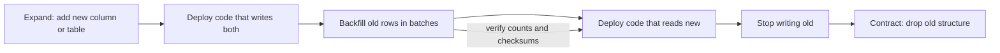

A schema is never finished. Features add columns, refactors split tables, mistakes in types and constraints surface after launch, and every one of those changes has to be applied to a database that is serving traffic and to application code that is deployed gradually across many instances. The difficulty is not writing the `ALTER TABLE`; it is that for several minutes or days, old code and new code run against the same database, and a 400 GB table may lock for an hour if the change is applied naively. Schema evolution is the practice of making every change small, versioned, reversible in intent and compatible with both versions of the code that will touch it.

## Migrations as versioned code

Every schema change lives in a migration file, committed alongside the application change that needs it, reviewed like code and applied by a tool that records which migrations have run in a table such as `flyway_schema_history` or `_prisma_migrations`. Nobody runs DDL by hand in production. That gives you a reproducible schema for every environment, a history of who changed what, and the ability to create a fresh database from zero in CI.

Two styles exist. **Imperative** tools (Flyway, Liquibase, sqitch, Rails and Django migrations, Knex) apply an ordered list of change scripts. **Declarative** tools (Atlas, Prisma Migrate's diff, Skeema for MySQL) take a desired schema and compute the diff from the current one. Declarative tools are pleasant for additive changes but can generate dangerous plans: a column rename that they interpret as drop plus add will lose data. Whatever tool you use, review the generated SQL, not just the model file.

| Tool | Style | Notes |
|---|---|---|
| Flyway | Imperative SQL files `V12__add_sku.sql` | Simple, JVM or CLI, widely used |
| Liquibase | Imperative changelogs in XML, YAML or SQL | Preconditions, rollback blocks, many databases |
| sqitch | Imperative, dependency-based plan | Deploy, revert and verify scripts per change |
| Prisma Migrate | Generates SQL from schema diff | Review the SQL; renames need manual edits |
| Atlas | Declarative or versioned, HCL or SQL | Lints migrations for destructive and locking changes |

Rollback scripts are rarely used in practice once data has been written under the new schema. A better safety net is to make each migration forward-only and small enough that the fix for a bad one is another small migration.

## Compatibility with rolling deploys

In a rolling deploy, instances are replaced one by one, so for a while version N and version N+1 of the application both run. Migrations usually run once, before the new code starts. That means:

- The **new schema must work with the old code** (backward compatibility). Old instances still issue their old queries after the migration runs.
- The **old schema must work with the new code** if the migration runs after deploy, or if you roll the code back (forward compatibility).

The practical rule: a single deploy may add things or stop using things, never both in a way that breaks the other version. Adding a nullable column is safe; old code ignores it. Dropping a column the old code still selects is not. Renaming anything in place is never safe. ORMs make this sharper, because some generate `SELECT` lists or `INSERT` statements from the model at startup and fail on an unexpected or missing column.

## Expand and contract for every change type

The general recipe is expand (add the new structure alongside the old), migrate (dual-write and backfill), switch reads, then contract (remove the old structure) once no running code depends on it. Each phase is a separate deploy.



| Change | Expand | Migrate | Contract |
|---|---|---|---|
| Rename column `name` to `full_name` | Add `full_name` nullable | Dual-write both; backfill; switch reads to `full_name` | Stop writing `name`; drop it a release later |
| Split `users` into `users` and `user_profiles` | Create `user_profiles` with FK to `users` | Dual-write profile fields; backfill; read from new table | Drop moved columns from `users` |
| Change type `price` int to `numeric(12,2)` | Add `price_v2 numeric(12,2)` | Dual-write converted value; backfill; compare; switch reads | Drop `price`, optionally rename later via the same process or a view |
| Add `NOT NULL` to `country` | Add column nullable with app-level default | Backfill nulls; deploy code that always writes it | Add a validated check or `NOT NULL` constraint |
| Drop column `legacy_flag` | Nothing to add | Deploy code that never reads or writes it; remove from ORM model | Drop the column |
| Add foreign key | Add constraint without validating existing rows | Fix orphans | Validate the constraint |
| Add unique index | Build index online | Deduplicate data first | Attach as constraint if needed |

Dual-writing can happen in application code or temporarily in a trigger. Triggers guarantee both columns stay in sync even for writes from scripts and other services, but add write latency and hidden behaviour, so remove them in the contract phase.

## Online DDL

Some DDL rewrites the whole table or takes a lock that blocks reads and writes for the duration. Knowing which operations are metadata-only on your engine is the core skill.

**Postgres.** Adding a nullable column, or one with a constant default (since Postgres 11), is metadata-only. Changing a column type usually rewrites the table under an `ACCESS EXCLUSIVE` lock. Indexes are built without blocking writes using `CREATE INDEX CONCURRENTLY`, which cannot run inside a transaction and leaves an `INVALID` index if it fails. Constraints can be added without scanning, then validated with a weaker lock:

```sql
SET lock_timeout = '3s';
ALTER TABLE orders ADD CONSTRAINT orders_country_nn
  CHECK (country IS NOT NULL) NOT VALID;          -- instant, new rows checked
ALTER TABLE orders VALIDATE CONSTRAINT orders_country_nn;  -- scans, allows writes
ALTER TABLE orders ALTER COLUMN country SET NOT NULL;     -- PG12+: uses the valid check, no scan
ALTER TABLE orders DROP CONSTRAINT orders_country_nn;
```

Even instant DDL needs an exclusive lock briefly, and it queues behind any long-running transaction; every query behind it then queues too. Always set `lock_timeout` and retry, rather than letting a migration freeze the table.

**MySQL (InnoDB).** `ALTER TABLE` accepts `ALGORITHM=INSTANT`, `INPLACE` or `COPY`. Specifying the algorithm makes the statement fail instead of silently falling back to a slow copy:

```sql
ALTER TABLE orders ADD COLUMN gift_note VARCHAR(255) NULL, ALGORITHM=INSTANT;
ALTER TABLE orders ADD INDEX idx_status_created (status, created_at), ALGORITHM=INPLACE, LOCK=NONE;
```

MySQL 8.0.29 and later can add and drop columns instantly at any position. `INPLACE` operations avoid blocking writes but still consume I/O and cause replica lag, because replicas apply the DDL serially after the primary finishes.

**gh-ost and pt-online-schema-change.** For changes MySQL cannot do online, these tools build a shadow table with the new schema, copy rows in chunks and keep it in sync, then swap names atomically. pt-online-schema-change syncs with triggers; gh-ost tails the binlog instead, so it adds no trigger overhead, can be paused and throttled on replica lag, and lets you control the cut-over moment. Both need roughly double the table's disk space during the copy. Postgres has pg_repack for rebuilding bloated tables online, and tools like pgroll and Reshape automate expand/contract with views.

## Backfills in batches

A single `UPDATE orders SET full_name = name` on 80 million rows holds row locks for its whole duration, generates a huge burst of WAL or binlog that replicas must replay, and if it fails after 40 minutes, rolls everything back. Backfill in keyed batches instead:

```sql
-- run repeatedly from a script until 0 rows updated
UPDATE users
SET full_name = name
WHERE id IN (
  SELECT id FROM users
  WHERE id > :last_id AND full_name IS NULL
  ORDER BY id
  LIMIT 5000
)
RETURNING id;
```

The script records the highest id processed, commits each batch, sleeps between batches, and checks replica lag and database CPU before continuing, pausing if lag exceeds a threshold such as 5 seconds. At 5,000 rows per batch and 100 ms per batch plus a 100 ms pause, 80 million rows take about 53 minutes, which is a predictable, interruptible job. Make it idempotent so it can restart from any point, and run it as a separate job, not inside the migration tool's transaction. Finish with a verification query that counts remaining mismatches.

## Schema evolution in document stores

MongoDB and similar stores have no `ALTER TABLE`, which means the schema lives in the data and changes are migrations of documents. The two common patterns:

- **Schema version field.** Every document carries `schemaVersion`. Readers know how to handle each version, and writers always write the newest.
- **Lazy migration.** When the application reads a document with an old version, it upgrades it in memory and writes it back. Hot documents migrate quickly; a background job sweeps the cold tail so that old-version handling can eventually be deleted.

```js
function upgrade(doc) {
  if (doc.schemaVersion === 1) {
    const [first, ...rest] = doc.name.split(' ');
    doc = { ...doc, firstName: first, lastName: rest.join(' '), schemaVersion: 2 };
    delete doc.name;
  }
  return doc;
}

const user = upgrade(await users.findOne({ _id }));
await users.updateOne(
  { _id, schemaVersion: { $lt: 2 } },
  { $set: { firstName: user.firstName, lastName: user.lastName, schemaVersion: 2 }, $unset: { name: '' } }
);
```

The `schemaVersion` filter on the write makes it safe against concurrent upgrades. Use `$jsonSchema` validators with `validationLevel: "moderate"` so new writes are checked while old documents are tolerated until migrated.

## Testing migrations against production-sized data

A migration that takes 200 ms on a developer's 10,000-row database can take two hours on production. Test against a restored copy of production, or a synthetic dataset of the same row count and index sizes, and measure duration, locks taken and replication lag. Linters help catch dangerous patterns before review: Atlas lint, squawk for Postgres and the checks built into some migration tools flag non-concurrent index creation, volatile defaults, type changes that rewrite tables and dropped columns still referenced. In CI, run every migration from an empty database and also from the current production schema, and run the previous application version's test suite against the new schema to prove backward compatibility.

## Trade-offs and pitfalls

- **Renaming in place.** Breaks every running instance of the old code instantly.
- **Contracting too early.** Drop columns only after every deployed version, job and report has stopped using them.
- **No lock timeout.** An instant DDL waiting behind a long transaction blocks the whole table.
- **Unbatched backfills.** Long transactions, replica lag and painful rollbacks.
- **Trusting generated migrations.** ORM diffs can turn renames into drop-and-add.
- **Disk headroom.** Shadow-table tools and table rewrites need about twice the table's size free.
- **Forgetting other consumers.** CDC pipelines, warehouses and other services read the schema too.

## Interview angle

- Describe expand, migrate, contract, with each step as a separate deploy.
- Explain why both code versions coexist during rolling deploys and what compatibility that requires.
- Name online techniques: `CONCURRENTLY`, `NOT VALID` then `VALIDATE`, `ALGORITHM=INSTANT`, gh-ost.
- Show a batched, throttled, resumable backfill.
- Mention testing on production-sized data and linting migrations in CI.

## Key takeaways

- Every schema change is versioned code, reviewed and applied by a tool.
- Expand and contract makes renames, splits, type changes and drops safe across deploys.
- Know which DDL is metadata-only on your engine, and set lock timeouts on everything else.
- Backfill in small committed batches with throttling on replica lag.
- Document stores evolve through version fields and lazy migration.
- Test migrations on production-sized data before they run in production.
