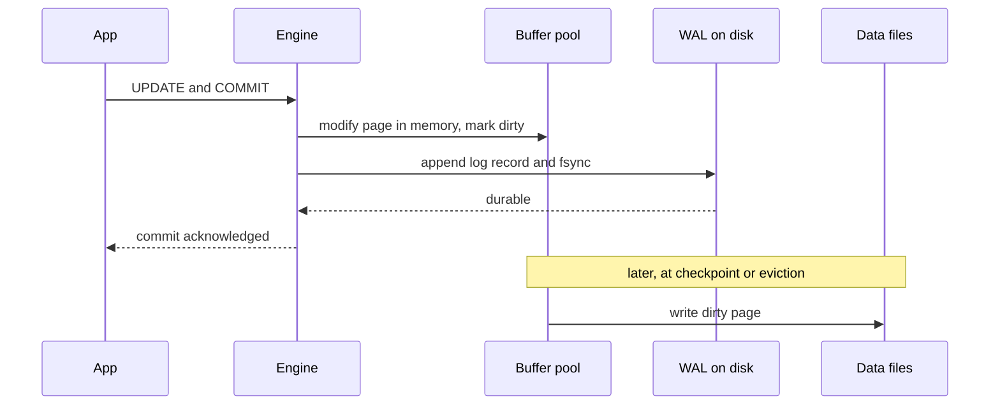
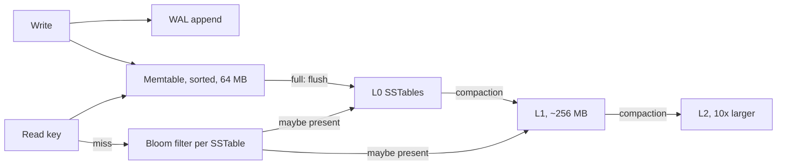

Underneath the query language, every database is a storage engine deciding how bytes reach the disk. Two designs dominate. B+tree engines (PostgreSQL, MySQL InnoDB, MongoDB WiredTiger) keep data in sorted pages and modify them in place or nearly so. LSM-tree engines (RocksDB, LevelDB, Cassandra, ScyllaDB) buffer writes in memory and append sorted immutable files, merging them in the background. Neither is better in general: each trades read cost, write cost and disk space differently. Knowing which one sits under your database should shape your primary keys, update patterns and deletion strategy.

## Pages and the buffer pool

Disks and SSDs read in blocks, so databases organise data into fixed-size pages: 8 KB in Postgres, 16 KB by default in InnoDB, and variable-sized pages in WiredTiger (leaf pages grow up to 32 KB in memory by default).

The buffer pool is the engine's in-memory cache of pages. Every read and write goes through it: a query that needs a page either finds it cached (a hit, around 100 nanoseconds) or reads it from disk (tens of microseconds on NVMe, milliseconds on network block storage). Changes are made to the cached copy, which becomes dirty and is written back later. Typical sizing is 50 to 75% of RAM for `innodb_buffer_pool_size`, about 25% for Postgres `shared_buffers` because Postgres also relies on the operating system page cache, and WiredTiger's default of 50% of (RAM minus 1 GB). Whether hot indexes and rows fit in this cache is the biggest performance fact about a B+tree database.

## WAL, crash recovery and checkpoints

Writing dirty pages to disk on every commit would be slow and would not even be safe, because a crash halfway through writing a 16 KB page leaves a torn page. Instead, engines follow the write-ahead rule: before a change to a data page reaches disk, a log record describing it must be durable. The log is sequential and compact, so committing means appending a few hundred bytes and calling `fsync` once. Group commit batches many transactions into one `fsync`, which is how a database reaches tens of thousands of commits per second on hardware that can do a few thousand `fsync` calls.

The names differ: Postgres calls it the WAL, InnoDB the redo log (plus a separate undo log for rollback and MVCC), WiredTiger the journal, Cassandra the commit log, and RocksDB the WAL. Torn pages are handled by writing a full page image to the WAL on the first change after a checkpoint (Postgres `full_page_writes`) or by a doublewrite buffer (InnoDB).

Crash recovery replays the log from the last checkpoint, reapplying changes whose pages had not reached disk and rolling back transactions that never committed. A checkpoint flushes dirty pages so older log can be recycled, bounding recovery time. Postgres checkpoints every `checkpoint_timeout` (5 minutes default) or after `max_wal_size` (1 GB default) of WAL; InnoDB flushes continuously in a fuzzy checkpoint sized by `innodb_redo_log_capacity`; WiredTiger checkpoints every 60 seconds and uses the journal for changes in between. Longer intervals mean fewer page writes but slower recovery.

## B+tree engines

A B+tree engine keeps one sorted tree per index, with a page as each node. Reads descend the tree, usually 3 to 4 levels, upper levels cached. Writes find the leaf page and change it in memory; the page is later written back as a whole. When a leaf fills, it splits into two half-full pages and the parent gains a separator.

The engines differ in detail. InnoDB updates rows in place in its clustered primary key tree and keeps old versions in the undo log. Postgres never overwrites a row: an update writes a new tuple version in the heap and the old one is reclaimed later by `VACUUM`. WiredTiger keeps updates as in-memory chains attached to a page and, at eviction or checkpoint, writes a fresh page image to a new location rather than overwriting the old block.

The strengths are predictable reads, efficient ranges and one place per key, which keeps locking and uniqueness checks simple. The weakness is write cost: changing a 100-byte row eventually costs writing a full 8 or 16 KB page, plus log, and random keys spread those writes over many pages.

## LSM trees

A log-structured merge tree never modifies data files. A write goes to the WAL and into the memtable, an in-memory sorted structure (a skiplist in RocksDB, 64 MB by default). When the memtable fills, it is frozen and flushed to disk as an SSTable, an immutable file of sorted key-value pairs with an index block and a bloom filter. Background compaction merges SSTables, discarding overwritten values and expired deletes.

A read checks the memtable, then SSTables from newest to oldest until it finds the key. To avoid opening every file, each SSTable carries a bloom filter: at 10 bits per key it answers "definitely not here" for 99% of absent keys, so a point lookup typically touches one or two files. Range scans must merge every level, and bloom filters do not help them.

Compaction strategy sets the trade-off. **Leveled compaction** (RocksDB and LevelDB default, Cassandra LCS) keeps each level about 10 times larger than the previous, with non-overlapping files within a level. Reads touch at most one file per level and space overhead is around 10%, but each byte is rewritten once per level, giving write amplification of 10 to 30. **Size-tiered compaction** (Cassandra STCS default, ScyllaDB's similar strategies) merges groups of similar-sized SSTables, by default four at a time. It writes much less, but reads cost more and a large compaction needs free space equal to its inputs, so keep up to 50% disk headroom. Cassandra also offers time-window compaction for TTL'd time-series.

## Amplification compared

| Engine style | Read amplification | Write amplification | Space amplification |
| --- | --- | --- | --- |
| B+tree | Low: one root-to-leaf path | High for small random updates: full page plus WAL | 1.3 to 1.5x from half-full pages and fragmentation |
| LSM, leveled | Medium: one file per level, bloom filters | 10 to 30x from repeated compaction | About 1.1x |
| LSM, size-tiered | Higher: many overlapping files | Lowest, often 4 to 10x | Up to 2x during compactions |

Write amplification is measured in bytes written to disk per byte of user data. The B+tree figure can be worse than an LSM for tiny random updates (100 bytes changed, 16 KB written), but much better for large sequential inserts.

## Tombstones

An LSM cannot delete a key in place, so a delete writes a tombstone, a marker that shadows older values. The tombstone must survive until compaction has merged it with every older copy, otherwise an old value reappears. Cassandra additionally keeps tombstones for `gc_grace_seconds`, 10 days by default, so replicas that missed the delete can be repaired. Until then, reads scan past them. A queue-like pattern, insert then delete thousands of rows per partition, leaves a partition full of tombstones: Cassandra warns at 1,000 tombstones per read and aborts at 100,000. The fixes are to design so deleted data ages out together (TTL plus time-window compaction, or a new partition per day you can stop reading), not to delete row by row.

B+tree engines have a softer version: Postgres dead tuples remain until `VACUUM`, and a table with heavy updates and lagging vacuum bloats to several times its live size.

## Which databases use which

B+tree family: PostgreSQL, MySQL InnoDB, SQL Server, Oracle, SQLite, MongoDB WiredTiger, LMDB and BoltDB. LSM family: RocksDB and LevelDB as embedded libraries; Cassandra, ScyllaDB, HBase and Bigtable; CockroachDB (Pebble), TiKV and YugabyteDB (RocksDB-derived); MyRocks for MySQL. DynamoDB does not document its storage engine, so design around its partitioning model instead of its file format.

As a rule, B+trees win for read-heavy OLTP, range queries, and workloads whose working set fits in memory. LSMs win for sustained high write rates, write-once data such as events and metrics, and storage-constrained deployments where compression matters.

## How this should shape your schema

**Sequential versus random keys in B+trees.** Increasing keys (auto-increment, UUIDv7, timestamps) insert into the rightmost leaf, which stays cached; InnoDB even leaves pages 15/16 full instead of splitting them in half. Random UUIDv4 keys touch a random leaf per insert. Once the index exceeds the buffer pool, each insert costs a disk read, and pages settle around 50 to 70% full.

**Sequential keys in range-partitioned distributed stores** are the opposite problem. In Bigtable, HBase, CockroachDB and TiKV, data is split into key ranges, so a timestamp-leading key sends every write to the last range on one node. Prefix with a hash bucket or a high-cardinality entity ID. Cassandra and DynamoDB hash the partition key, so sequential partition keys spread fine, but a single hot partition key still lands on one node.

**Hot pages.** Even in a B+tree, the rightmost leaf of a sequential index is a contention point at very high insert rates; latches on that page, not disk, become the limit.

**Update-heavy rows.** In Postgres, keep frequently updated columns out of indexes so updates stay HOT, consider `fillfactor` of 80 to 90 to leave room on each page, and tune autovacuum per table. In LSMs, repeated updates to one key create many versions until compaction; prefer counters via merge operators or append-then-aggregate designs.

**Deletion strategy.** Large deletes are expensive everywhere. Partition by time and drop whole partitions, or use TTLs with time-window compaction, rather than `DELETE ... WHERE created_at < ?` over hundreds of millions of rows.

## Trade-offs and pitfalls

- **Benchmarking with a dataset that fits in RAM** hides the random-key and amplification effects that appear at production size.
- **Assuming LSM means fast writes forever**: compaction debt accumulates, and writes stall when L0 has too many files.
- **Running size-tiered compaction near a full disk** until a large compaction cannot complete.
- **Delete-heavy queues on Cassandra** that drown reads in tombstones.
- **Disabling fsync or doublewrite for speed** and discovering corruption after the first power loss.

## Interview angle

- Explain the write-ahead rule and why commit is a sequential log `fsync`, not a page write.
- Draw the LSM write path and read path, including bloom filters and compaction.
- Compare read, write and space amplification for B+tree, leveled and tiered.
- Tie key design to the engine: UUIDv7 for B+trees, hashed prefixes for range-sharded stores.

## Key takeaways

- Every engine is a buffer pool plus a write-ahead log; durability comes from the log, not the data files.
- B+trees give cheap reads and ranges; LSMs give cheap sustained writes and compact storage.
- Compaction strategy chooses between write amplification and space amplification.
- Deletes in LSMs are writes; design data to expire in bulk.
- Choose primary keys with the engine's layout in mind: sequential for B+trees, spread for range-partitioned clusters.
