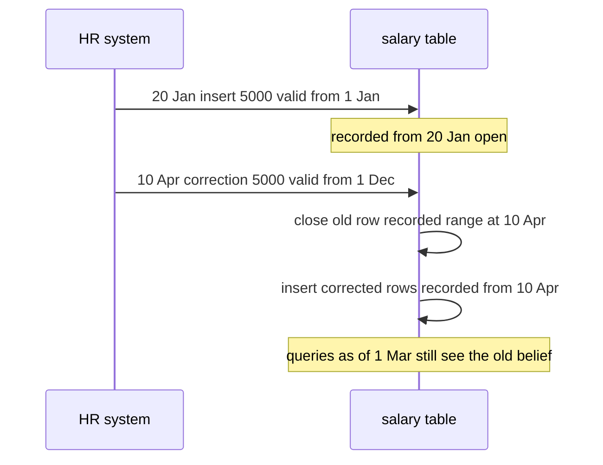

Most schemas are designed to answer "what is true now?" The product costs 20 euros, the customer lives in Lyon, the employee reports to Priya. Sooner or later someone asks a different question: what did the product cost on 14 March, which address did we ship to last year, who was the manager when this expense was approved, and what did our records say before that correction was made? An `UPDATE` destroys the answer to every one of those questions. Temporal modelling is the set of techniques for keeping the past queryable without making the present slow or the schema unreadable.

## Current state versus history

The simplest pattern keeps the main table as the current state and adds a separate history table that receives the old version of a row every time it changes. Application code and most queries keep reading the small, hot current table; audits and reports read history.

```sql
CREATE TABLE product (
  id          bigint PRIMARY KEY,
  name        text NOT NULL,
  price_cents integer NOT NULL,
  updated_at  timestamptz NOT NULL DEFAULT now()
);

CREATE TABLE product_history (
  id          bigint NOT NULL,
  name        text NOT NULL,
  price_cents integer NOT NULL,
  valid_from  timestamptz NOT NULL,
  valid_to    timestamptz NOT NULL,
  changed_by  text,
  PRIMARY KEY (id, valid_from)
);
```

This keeps the current table lean and its indexes small, which matters when 99 percent of traffic only wants the present. The cost is that "the full timeline of product 42" needs a `UNION` of history and current, and the two tables must stay in sync through a trigger or disciplined application code.

The alternative is a single table where every row carries its own validity period and the current row is simply the one whose period is open. That is cleaner for temporal queries but makes every current-state query add a filter, and every unique constraint becomes temporal.

## Validity periods done properly

A row valid from a start instant until an end instant should use a half-open interval: `[valid_from, valid_to)`, start included, end excluded. Half-open ranges tile without gaps or overlaps, because one version's end equals the next version's start. Store "still valid" as an open end, either `NULL` or `'infinity'`; Postgres supports `'infinity'::timestamptz`, which keeps comparisons simple.

Postgres has range types that make this first-class, and an exclusion constraint can enforce that no two versions of the same entity overlap. That rule is impossible to express with a plain `UNIQUE` index.

```sql
CREATE EXTENSION IF NOT EXISTS btree_gist;

CREATE TABLE product_price (
  product_id  bigint NOT NULL,
  price_cents integer NOT NULL CHECK (price_cents >= 0),
  valid       tstzrange NOT NULL,
  EXCLUDE USING gist (product_id WITH =, valid WITH &&)
);

INSERT INTO product_price VALUES
  (42, 2000, tstzrange('2026-01-01', '2026-03-01')),
  (42, 2400, tstzrange('2026-03-01', NULL));  -- NULL upper bound means unbounded

-- price on 14 March
SELECT price_cents FROM product_price
WHERE product_id = 42 AND valid @> timestamptz '2026-03-14 12:00+00';
```

The `btree_gist` extension lets the scalar `product_id` take part in the GiST index. Changing a price becomes two statements in one transaction: close the current row by setting its upper bound to now, and insert the new row starting at now. Postgres 18 adds `WITHOUT OVERLAPS` on primary and unique keys and `PERIOD` foreign keys, which express the same rule declaratively, but the exclusion constraint works on every supported version.

## Slowly changing dimensions

Data warehousing gave these patterns names, and the names are now used everywhere. They describe how a descriptive attribute, such as a customer's city or a product's category, behaves when it changes.

| Type | Behaviour | Example after Ana moves from Lyon to Paris |
|---|---|---|
| 1 | Overwrite, no history | One row: city = Paris |
| 2 | New row per version with validity dates and a current flag | Two rows: Lyon (2021 to 2026), Paris (2026 to open) |
| 3 | Extra column for the previous value | One row: city = Paris, previous_city = Lyon |
| 6 | Type 2 rows plus a type 1 "current" column on every row | Two rows, both with current_city = Paris |

Type 1 is right for corrections and attributes nobody reports on historically, such as a fixed typo. Type 2 is the workhorse: each version gets its own surrogate key, so a fact recorded in 2024 joins to the Lyon version and shows the city as it was. Type 3 handles one well-defined "before and after", such as a sales territory reorganisation, but loses anything older. Type 6 (1 + 2 + 3) lets one query group either by the city at the time or by the city today without a self-join. Choose per attribute, not per table: a customer's email may be type 1 while their segment is type 2.

## Bitemporal data

There are two independent kinds of time. **Valid time** is when something was true in the real world: Ana's salary was 5,000 from 1 January. **Transaction time** (or system time) is when the database learned it: we recorded that on 20 January. They diverge whenever information arrives late or is corrected. If payroll discovers in April that Ana's raise was actually effective from 1 December, a valid-time-only table can be fixed, but you lose the fact that the March payslip was computed from different data.

A bitemporal table carries both ranges:

```sql
CREATE TABLE salary (
  employee_id bigint NOT NULL,
  amount      numeric(12,2) NOT NULL,
  valid       tstzrange NOT NULL,                       -- when true in the world
  recorded    tstzrange NOT NULL DEFAULT tstzrange(now(), NULL),  -- when we believed it
  EXCLUDE USING gist (employee_id WITH =, valid WITH &&, recorded WITH &&)
);
```

Rows are never updated except to close their `recorded` range. A correction closes the recorded range of the old belief and inserts new rows with the corrected valid ranges and a recorded range starting now. You can then ask both "what was Ana's salary on 15 December?" and "what did we think, on 1 March, her salary was on 15 December?" The second question is the one auditors, regulators and dispute resolution teams care about. Bitemporal modelling is heavier, so reserve it for money, compliance and contracts.



## Event logs as the source of truth

The most complete history is an append-only log of what happened: `OrderPlaced`, `ItemAdded`, `AddressChanged`, `OrderShipped`. Current state is derived by folding the events, and you can rebuild state as of any moment by replaying up to it. This is event sourcing. It gives perfect audit and easy temporal queries, at the cost of needing projections (read models) for every query, careful event versioning, and snapshots once streams grow to thousands of events.

A lighter version is common and often enough: keep normal current-state tables, and write an `audit_event` row in the same transaction as each change, with the entity, the action, the old and new values as JSON, the actor and a timestamp. You get history for investigations without restructuring the application around events.

## Snapshots: prices, tax and orders

The most frequent temporal bug is joining an old order to the current price. If `order_item` stores only `product_id` and the invoice page joins to `product.price_cents`, every price change silently rewrites historical invoices. The rule: anything that a document, contract or payment depended on must be copied onto it at the moment it was created.

```sql
CREATE TABLE order_item (
  order_id          bigint NOT NULL REFERENCES orders(id),
  line_no           smallint NOT NULL,
  product_id        bigint NOT NULL REFERENCES product(id),
  product_name      text NOT NULL,           -- snapshot
  unit_price_cents  integer NOT NULL,        -- snapshot
  tax_rate_bp       integer NOT NULL,        -- 2000 = 20.00 percent, snapshot
  quantity          integer NOT NULL CHECK (quantity > 0),
  PRIMARY KEY (order_id, line_no)
);
```

Tax rates are a good case for a validity-ranged reference table (`tax_rate(region, category, rate_bp, valid tstzrange)`), because rates are announced in advance with a future effective date. The checkout looks up the rate valid at the order timestamp and copies it onto the line. Shipping addresses, exchange rates, discount rules and terms-of-service versions follow the same pattern.

## System-versioned tables

SQL:2011 standardised **system-versioned** tables, where the database itself maintains transaction-time history. MariaDB (10.3 and later), SQL Server (2016 and later), Db2 and Oracle (with Flashback) support it. In MariaDB:

```sql
CREATE TABLE account (
  id      int PRIMARY KEY,
  balance decimal(12,2)
) WITH SYSTEM VERSIONING;

SELECT * FROM account FOR SYSTEM_TIME AS OF TIMESTAMP '2026-10-01 00:00:00';
```

SQL Server is similar with `PERIOD FOR SYSTEM_TIME (ValidFrom, ValidTo)` and a named history table. The engine records every update and delete automatically, so application bugs cannot skip history. SQL:2011 also defines application-time periods (`PERIOD FOR`) for valid time; MariaDB supports both, giving bitemporal tables natively.

Postgres has no built-in system versioning. The usual options are a trigger that copies `OLD` into a history table on `UPDATE` and `DELETE`; the `temporal_tables` extension, which provides a `versioning()` trigger function that maintains a `sys_period tstzrange` column and a history table (also available as a pure PL/pgSQL port for managed services that do not allow C extensions); or a generic audit trigger that writes JSON diffs. All of them are trigger-based, so bulk loads that disable triggers bypass them.

## Querying as of a date

With validity ranges, the as-of pattern is always the same predicate: the range contains the instant. To reconstruct an order as it looked when it was placed, in a schema that did not snapshot prices, join each versioned table on its own range (here `product_history` is assumed to hold every version, including the current one with `valid_to = 'infinity'`):

```sql
SELECT o.id, p.name, pp.price_cents
FROM orders o
JOIN order_item oi ON oi.order_id = o.id
JOIN product_history p ON p.id = oi.product_id
  AND tstzrange(p.valid_from, p.valid_to) @> o.placed_at
JOIN product_price pp ON pp.product_id = oi.product_id
  AND pp.valid @> o.placed_at
WHERE o.id = 9001;
```

Index the range columns with GiST (`CREATE INDEX ON product_price USING gist (product_id, valid)`) or, for the split-column style, a B-tree on `(id, valid_from)`; a lookup is then "latest row for this id with `valid_from <= t`", which is a cheap index descent with `ORDER BY valid_from DESC LIMIT 1`.

## Trade-offs and pitfalls

- **Joining history to current reference data.** Snapshot anything a document depended on.
- **Closed intervals.** `BETWEEN` on inclusive ends double-counts the boundary instant; use half-open ranges.
- **Missing overlap constraints.** Without an exclusion constraint, a race between two writers creates two "current" versions.
- **Type 2 everywhere.** Versioning noisy attributes such as `last_login_at` explodes row counts for no analytical value.
- **Confusing valid and transaction time.** Corrections need transaction time; plain validity ranges rewrite the past.
- **Trigger-based history skipped by bulk jobs.** Make sure backfills and `COPY` paths also write history, or document that they do not.
- **Unbounded history growth.** History tables need retention and partitioning like any other large table.

## Interview angle

- Ask whether the business needs "as it was" or "as we knew it"; that decides valid time versus bitemporal.
- Show the order snapshot columns and explain why line items copy price and tax.
- Mention half-open `tstzrange` with an exclusion constraint for non-overlapping versions.
- Name SCD type 2 for warehouse dimensions and type 1 for corrections.
- Offer system-versioned tables or audit triggers for compliance history.

## Key takeaways

- `UPDATE` destroys history; decide per table whether the past must stay queryable.
- Use half-open validity ranges and enforce non-overlap in the database.
- Slowly changing dimension types 1, 2, 3 and 6 are per-attribute choices.
- Bitemporal tables separate when something was true from when you recorded it.
- Orders, invoices and contracts must snapshot prices, tax rates and addresses.
- SQL:2011 system versioning exists in MariaDB and SQL Server; Postgres uses triggers or extensions.
