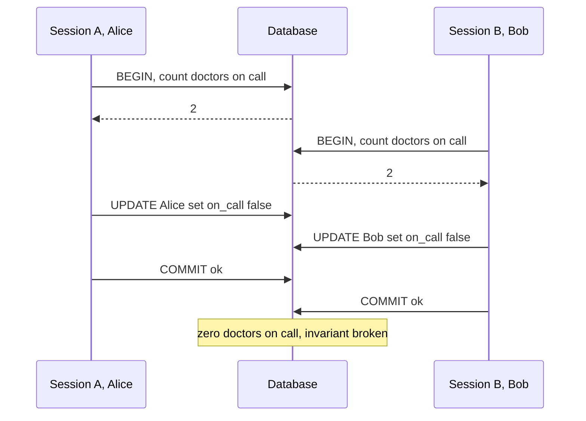

A transaction lets you group several reads and writes and have the database treat them as one unit: either all of it happens or none of it does, and concurrent transactions do not see each other's half-finished work. That promise is what makes it safe to move money, reserve stock or change a user's plan without writing your own locking. The promise is weaker than most engineers assume, though. The isolation level you get by default allows specific anomalies, the same level name means different things in different databases, and the NoSQL stores offer narrower guarantees again. This guide explains what ACID really guarantees, catalogues the anomalies with concrete timelines, and maps them onto the engines you are likely to use.

## ACID, precisely

**Atomicity** means abortability. If a transaction fails halfway, through an error, a constraint violation, a crash or an explicit `ROLLBACK`, every change it made is undone. It says nothing about concurrency.

**Consistency** means the database moves from one valid state to another according to your invariants. The engine enforces only the invariants you declare (foreign keys, unique constraints, `CHECK`, `NOT NULL`); everything else, such as "an account's balance equals the sum of its ledger entries", is the application's job. It is the least database-specific letter.

**Isolation** means concurrent transactions do not interfere. The ideal is serialisability: the outcome equals some serial order of the transactions. Most databases default to something weaker, which is the subject of the rest of this guide.

**Durability** means a committed transaction survives a crash. On one node that is the write-ahead log being `fsync`ed before commit returns. It can be weakened by settings (Postgres `synchronous_commit = off`, InnoDB `innodb_flush_log_at_trx_commit = 2`, MySQL `sync_binlog` other than 1) and by asynchronous replication: if the primary dies and a replica that had not received the last second of commits is promoted, those commits are gone. MongoDB's `writeConcern: { w: "majority", j: true }` and Postgres synchronous replicas extend durability to more than one machine at the price of a network round trip per commit.

## The anomaly catalogue

Each anomaly below is a concrete interleaving of two sessions, A and B.

**Dirty read**: reading another transaction's uncommitted data.

| Step | Session A | Session B |
| --- | --- | --- |
| 1 | `UPDATE accounts SET balance = 0 WHERE id = 1` | |
| 2 | | `SELECT balance FROM accounts WHERE id = 1` returns 0 |
| 3 | `ROLLBACK` | B acted on a balance that never existed |

**Non-repeatable read**: the same row read twice gives different values.

| Step | Session A | Session B |
| --- | --- | --- |
| 1 | `SELECT balance ... id = 1` returns 100 | |
| 2 | | `UPDATE ... SET balance = 50 WHERE id = 1; COMMIT` |
| 3 | `SELECT balance ... id = 1` returns 50 | |

**Phantom**: the same predicate query returns a different set of rows.

| Step | Session A | Session B |
| --- | --- | --- |
| 1 | `SELECT count(*) FROM bookings WHERE room = 7 AND day = '2026-11-10'` returns 0 | |
| 2 | | `INSERT INTO bookings (room, day) VALUES (7, '2026-11-10'); COMMIT` |
| 3 | Same count now returns 1 | |

**Lost update**: two read-modify-write cycles overwrite each other.

| Step | Session A | Session B |
| --- | --- | --- |
| 1 | `SELECT stock` returns 10 | |
| 2 | | `SELECT stock` returns 10 |
| 3 | `UPDATE ... SET stock = 9; COMMIT` | |
| 4 | | `UPDATE ... SET stock = 9; COMMIT`; two items sold, stock dropped by one |

**Write skew**: two transactions read an overlapping set, each writes a different row based on what it read, and together they break an invariant neither broke alone. The classic case: a hospital requires at least one doctor on call.

The two updates touch different rows, so no row lock conflicts and snapshot isolation sees nothing wrong. Double-booking a meeting room by two inserts after two "is it free" checks is the same anomaly with phantoms.

## Standard levels versus real engines

The SQL standard defines four levels by which phenomena they forbid: READ UNCOMMITTED allows dirty reads, READ COMMITTED forbids them, REPEATABLE READ also forbids non-repeatable reads, and SERIALIZABLE forbids phantoms too. The definitions predate MVCC and are ambiguous; a 1995 critique by Berenson and colleagues added snapshot isolation, which is what most "repeatable read" implementations actually are, and which the standard does not mention.

| Engine and level | Dirty read | Non-repeatable | Phantom | Lost update | Write skew |
| --- | --- | --- | --- | --- | --- |
| Postgres READ COMMITTED (default) | No | Possible | Possible | Possible | Possible |
| Postgres REPEATABLE READ | No | No | No | No, aborts | Possible |
| Postgres SERIALIZABLE | No | No | No | No | No, aborts |
| InnoDB READ COMMITTED | No | Possible | Possible | Possible | Possible |
| InnoDB REPEATABLE READ (default) | No | No for plain reads | Locking reads blocked by gap locks | Possible | Possible |
| InnoDB SERIALIZABLE | No | No | No | No, deadlocks | No |
| MongoDB transaction, snapshot | No | No | No | No, write conflict | Possible |

**PostgreSQL** treats READ UNCOMMITTED as READ COMMITTED. Its REPEATABLE READ is snapshot isolation: the transaction sees a snapshot taken at its first statement, and if it tries to update a row that another transaction changed after that snapshot, it fails with SQLSTATE `40001`, so lost updates are prevented. SERIALIZABLE uses Serializable Snapshot Isolation (since 9.1): it tracks read-write dependencies between concurrent transactions and aborts one when a cycle could make the result non-serial. Write skew is then caught, at the cost of some false-positive aborts. Any code using these levels must retry on `40001`.

**MySQL InnoDB** defaults to REPEATABLE READ, but with a twist. Plain `SELECT`s are consistent reads from a snapshot established at the first read. `UPDATE`, `DELETE` and locking reads (`FOR UPDATE`, `FOR SHARE`) instead read the latest committed version and take next-key locks, a record lock plus a lock on the gap before it, which block inserts into scanned ranges. So a locking read sees no phantoms, but an application that does a plain `SELECT` then an `UPDATE` with a computed value suffers lost updates: InnoDB does not abort it the way Postgres does. SERIALIZABLE turns plain `SELECT`s into `FOR SHARE` reads (when autocommit is off), which is essentially two-phase locking with more deadlocks.

**MongoDB** makes every single-document write atomic, including nested arrays, which covers most cases if the aggregate is one document. Multi-document transactions (replica sets since 4.0, sharded clusters since 4.2) run at snapshot isolation with `readConcern: "snapshot"`. A conflicting write aborts with a `WriteConflict` labelled `TransientTransactionError`, which drivers' `withTransaction` helpers retry. Write skew is possible. Transactions are limited to 60 seconds by default because their history is held in the WiredTiger cache.

**DynamoDB** makes single-item writes atomic and supports condition expressions on them. `TransactWriteItems` and `TransactGetItems` group up to 100 items across tables with serialisable isolation among transactions, consuming twice the capacity of plain operations. Reads outside transactions behave as read committed against transactions, `Query` and `Scan` are not isolated as a whole, and global secondary indexes are eventually consistent. There is no interactive transaction: you cannot read, think, then write inside one transaction, so you express the decision as conditions.

## MVCC versus two-phase locking

Two-phase locking (2PL) gives each transaction shared locks for what it reads and exclusive locks for what it writes, held until commit, plus range locks to prevent phantoms. It is straightforward and serialisable, but readers block writers and writers block readers, and deadlocks are frequent. SQL Server's default locking READ COMMITTED and InnoDB SERIALIZABLE work this way.

Multi-version concurrency control (MVCC) keeps old versions of rows so readers see a consistent snapshot without locking; only writers conflict with writers. Postgres stores old versions in the table and `VACUUM` removes them; InnoDB reconstructs them from the undo log and purges it; WiredTiger keeps update chains in cache. The common cost is that a long-running transaction pins old versions: a reporting query open for two hours causes Postgres table bloat, a growing InnoDB history list length, and WiredTiger cache pressure. MVCC makes reads cheap, not free.

## Designing transaction scope

The rules that prevent most production incidents are about scope, not level.

Keep transactions short, in milliseconds. Locks and pinned snapshots last as long as the transaction. A transaction that holds a row lock for 2 seconds caps that row at half an update per second and ties up a pooled connection the whole time.

Never make network calls inside a transaction. Calling a payment API, sending an email or calling another service while holding locks means the database's throughput now depends on a third party's latency, and a timeout leaves you unsure whether the external action happened. Do the external call outside, and record intent and outcome in short transactions on either side, or write to an outbox table in the same transaction and let a worker do the call.

Choose the level per transaction, not globally. Run most traffic at the default, and use SERIALIZABLE, explicit locking or conditional writes for the few transactions that enforce cross-row invariants. Wrap those in a retry loop with a limit (3 to 5 attempts) and jittered backoff, and make the body idempotent so a retry is safe.

Set guardrails: Postgres `idle_in_transaction_session_timeout` and `statement_timeout`, InnoDB `innodb_lock_wait_timeout` (50 seconds by default, usually too long for web traffic), and alert on transactions older than a minute.

## Distributed transactions in brief

Two-phase commit coordinates a transaction across several databases: a coordinator asks every participant to prepare (make the change durable but not visible), then tells all to commit. It is atomic but blocking: if the coordinator dies after prepare, participants hold locks until it recovers. XA transactions across heterogeneous databases are rarely worth it in microservices. The usual alternative is a saga, a sequence of local transactions with compensating actions on failure, driven by a transactional outbox so each step's event is published exactly when its local transaction commits. NewSQL systems such as Spanner, CockroachDB and YugabyteDB run distributed transactions internally over consensus groups and give you serialisable or snapshot isolation across shards, paying a few milliseconds more per commit within a region and tens of milliseconds across regions.

## Trade-offs and pitfalls

- **Assuming REPEATABLE READ means the same thing everywhere**; Postgres prevents lost updates at that level and InnoDB does not.
- **Check-then-act at default isolation**: reading "is the slot free" and then inserting is a race unless a constraint or lock backs it.
- **No retry loop** around SERIALIZABLE or snapshot transactions, turning normal aborts into user errors.
- **Long or idle transactions** that hold locks and pin old versions.
- **External calls inside transactions**, coupling database throughput to network latency.
- **Treating asynchronous replication as durable** for money.

## Interview angle

- Define each ACID letter precisely, especially that C is mostly the application's job.
- Walk through lost update and write skew with timelines and say which level prevents each.
- Explain how InnoDB REPEATABLE READ and Postgres REPEATABLE READ differ.
- Show the retry loop and say why the body must be idempotent.
- Prefer sagas and outboxes over two-phase commit across services.

## Key takeaways

- ACID's isolation is a spectrum; defaults allow lost updates and write skew.
- Level names are not portable; check the engine's real semantics.
- MVCC lets readers proceed without locks but makes long transactions expensive.
- Keep transactions short, free of network calls, and retried on serialisation failures.
- Across services, use local transactions plus sagas instead of distributed commit.
