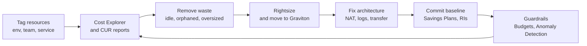

A modest MERN app on AWS often costs two or three times what the team expected, and the surprise rarely comes from compute. It comes from line items nobody designed for: NAT gateway processing, idle staging databases, verbose logs and cross-AZ chatter. Cost optimisation is mostly visibility plus a few structural decisions.

## How it works

You cannot cut what you cannot attribute. Tag resources, break spend down in Cost Explorer, then work from the largest line item down: remove waste, rightsize, fix architecture, and only then commit to discounts for the remaining baseline.



## Where MERN-on-AWS money goes

Approximate us-east-1 on-demand prices, which vary by region:

- **NAT gateway**: about $0.045 per hour per gateway, roughly $33 a month each, plus $0.045 per GB processed. Three AZs means about $100 a month before traffic. Every ECR image pull, S3 upload and third-party API call from private subnets is processed by NAT; 2 TB a month of S3 traffic through NAT adds about $90 for nothing.
- **Idle databases**: an RDS `db.r6g.large` Multi-AZ runs about $350 a month whether anyone uses it. Staging and QA copies of production-class databases running 24/7 are a classic leak.
- **Oversized tasks**: 2 vCPU Fargate tasks averaging 8 percent CPU.
- **CloudWatch Logs**: ingestion costs about $0.50 per GB. A chatty API logging 50 GB a day at debug level spends roughly $750 a month on ingestion alone, and logs default to never expire.
- **Data transfer**: internet egress is about $0.09 per GB after the first 100 GB a month; cross-AZ traffic costs $0.01 per GB in each direction.
- **Public IPv4 addresses**: about $3.60 a month each, including idle Elastic IPs.
- **Forgotten resources**: unattached EBS volumes, old snapshots, unused load balancers, and gp2 volumes that would be 20 percent cheaper as gp3.

## Rightsizing

Use two weeks of utilisation data. AWS Compute Optimizer recommends sizes for EC2, Fargate, Lambda, EBS and RDS. A Node process averaging under 20 percent CPU with p99 under 50 percent can usually halve its vCPU; keep memory headroom above peak heap, because Node OOMs rather than slowing down. Shrink one step at a time and watch latency.

```bash
aws compute-optimizer get-ecs-service-recommendations \
  --query 'ecsServiceRecommendations[].{svc:serviceArn,finding:finding,cpu:currentServiceConfiguration.cpu}'
```

## Graviton

AWS's ARM-based Graviton instances (m7g, c7g, r7g, t4g, and newer Graviton4 families like m8g) cost about 20 percent less than comparable x86 instances and often perform better per vCPU. Node.js runs natively on ARM. Build multi-arch images with `docker buildx build --platform linux/amd64,linux/arm64` and set Fargate's `runtimePlatform.cpuArchitecture` to `ARM64`. RDS, ElastiCache and DocumentDB offer Graviton classes such as `db.r7g`.

## Savings Plans, Reserved Instances and Spot

Commit only to the steady baseline you have measured after rightsizing, never to peaks.

- **Compute Savings Plans**: commit to a dollar amount per hour of compute for 1 or 3 years; up to about 66 percent off, applied automatically across EC2, Fargate and Lambda in any region, family or size. The flexible default.
- **EC2 Instance Savings Plans**: up to about 72 percent off but locked to an instance family in a region.
- **Reserved Instances**: still the main commitment discount for RDS, ElastiCache, OpenSearch and Redshift, with 1 or 3-year terms. AWS added Database Savings Plans in late 2025 as a more flexible alternative for managed databases; compare both against your fleet.
- **Spot**: up to 90 percent off, reclaimed with a two-minute notice. Ideal for stateless workers, CI runners, batch jobs and a share of web tasks. Use Fargate Spot or mixed-instance Auto Scaling groups with an on-demand base.

A typical split: a Savings Plan covering 60 to 70 percent of the baseline, on-demand for the rest and for growth, and Spot for interruptible work.

## Scaling non-prod to zero

Development, QA and staging run perhaps 50 hours a week but are billed for 168. Schedule them off nights and weekends to cut about 70 percent:

```bash
# evenings: stop staging
aws ecs update-service --cluster staging --service api --desired-count 0
aws rds stop-db-instance --db-instance-identifier staging-pg
```

Run these from EventBridge Scheduler. RDS restarts a stopped instance after 7 days, so the schedule must stop it again. Aurora Serverless v2 can scale to zero and auto-pause when idle, which suits staging well. Tear down per-PR preview environments on merge.

## S3 lifecycle

Uploads, backups and logs grow forever unless you tell S3 otherwise.

```json
{
  "Rules": [
    {
      "ID": "uploads-tiering",
      "Status": "Enabled",
      "Filter": { "Prefix": "uploads/" },
      "Transitions": [{ "Days": 0, "StorageClass": "INTELLIGENT_TIERING" }]
    },
    {
      "ID": "logs-expire",
      "Status": "Enabled",
      "Filter": { "Prefix": "logs/" },
      "Transitions": [{ "Days": 30, "StorageClass": "GLACIER_IR" }],
      "Expiration": { "Days": 365 }
    },
    {
      "ID": "abort-mpu",
      "Status": "Enabled",
      "Filter": {},
      "AbortIncompleteMultipartUpload": { "DaysAfterInitiation": 7 },
      "NoncurrentVersionExpiration": { "NoncurrentDays": 30 }
    }
  ]
}
```

Intelligent-Tiering moves objects between tiers for a small per-object fee and pays off for objects above 128 KB with unpredictable access. The last rule cleans up invisible storage from incomplete uploads and old versions. Do the same for CloudWatch Logs: set retention on every log group, such as 14 days for app logs, and use the Infrequent Access class at half the ingestion price for rarely queried logs.

## VPC endpoints

Gateway endpoints for S3 and DynamoDB are free and remove NAT processing charges for that traffic; there is almost no reason not to add them. Interface endpoints for ECR, CloudWatch Logs, Secrets Manager and STS cost about $0.01 per hour per AZ plus $0.01 per GB, so they pay off once traffic through NAT exceeds roughly 600 GB a month per service across three AZs, and they also keep traffic off the internet.

```hcl
resource "aws_vpc_endpoint" "s3" {
  vpc_id            = aws_vpc.main.id
  service_name      = "com.amazonaws.us-east-1.s3"
  vpc_endpoint_type = "Gateway"
  route_table_ids   = aws_route_table.private[*].id
}
```

For non-prod, a single NAT gateway instead of one per AZ saves about $66 a month per environment at the cost of AZ resilience you do not need there.

## Tagging, Cost Explorer, budgets and anomaly detection

Enforce a small tag set such as `env`, `service` and `team` with Terraform `default_tags` and an Organizations tag policy. Activate them as cost allocation tags in Billing; they are not retroactive. Group Cost Explorer by usage type to find surprises such as `NatGateway-Bytes`.

Set guardrails so you hear about problems in days, not on the monthly invoice:

```bash
aws budgets create-budget --account-id 123456789012 \
  --budget '{"BudgetName":"monthly-total","BudgetLimit":{"Amount":"1500","Unit":"USD"},"TimeUnit":"MONTHLY","BudgetType":"COST"}' \
  --notifications-with-subscribers '[{"Notification":{"NotificationType":"FORECASTED","ComparisonOperator":"GREATER_THAN","Threshold":80},"Subscribers":[{"SubscriptionType":"EMAIL","Address":"platform@example.com"}]}]'
```

Turn on Cost Anomaly Detection per service or tag; it alerts on unusual jumps, like a runaway Lambda loop or debug logging, usually within a day.

## Trade-offs and pitfalls

- **Committing before rightsizing** locks in waste for one to three years.
- **Spot for stateful services** or without an on-demand base invites outages.
- **One NAT gateway in production** saves money but makes one AZ a single point of failure.
- **Aggressive log retention cuts** can remove data needed for audits or incident review.
- **Untagged resources** make every optimisation a guess.

## Interview angle

- Name NAT processing, cross-AZ transfer and log ingestion as hidden cost drivers.
- Explain the order: visibility, waste, rightsizing, architecture, then commitments.
- Compare Savings Plans, Reserved Instances and Spot and where each fits.
- Mention VPC gateway endpoints as a free fix for S3 traffic through NAT.

## Key takeaways

- Tag everything, activate cost allocation tags, and read Cost Explorer by usage type.
- Kill idle non-prod resources on a schedule and set log and S3 retention.
- Rightsize with real metrics, then move to Graviton for about 20 percent off.
- Cover the measured baseline with Savings Plans or RIs and use Spot for interruptible work.
- Add S3 gateway endpoints, budgets and anomaly detection on day one.
