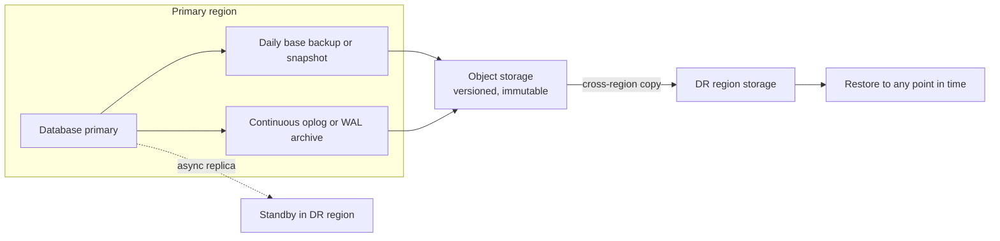

Replication is not a backup. If someone runs `db.orders.deleteMany({})` or a buggy migration corrupts a table, replicas faithfully apply the damage within milliseconds. Backups protect against human error, bugs, ransomware and provider failures; disaster recovery is the plan for using them under pressure. The question in production is never whether you have backups, but how much data you can afford to lose and how long you can afford to be down, and whether you have proven you can actually restore.

## How it works

Two numbers drive every decision. **RPO** (Recovery Point Objective) is the maximum acceptable data loss, measured in time. **RTO** (Recovery Time Objective) is the maximum acceptable downtime. Nightly dumps give an RPO of up to 24 hours. Continuous log archiving gives an RPO of seconds to minutes. A warm standby in another region gives an RTO of minutes; restoring a large dump can take hours.



Point-in-time recovery (PITR) combines the two: restore the latest full backup before the target time, then replay the log of changes up to just before the bad event.

## MongoDB backup options

### mongodump and mongorestore

Logical export to BSON. Simple, portable across versions, and good for small databases, seeding environments, or extracting one collection.

```bash
mongodump --uri="$MONGO_URL" --oplog --gzip --archive=/backups/shop-$(date +%F).gz
mongorestore --uri="$RESTORE_URL" --oplogReplay --gzip --archive=/backups/shop-2026-10-30.gz
```

`--oplog` captures writes that happen during the dump so the result is a consistent point in time (for a replica set, not through mongos for sharded clusters). Downsides: slow on large datasets, heavy load on the source (run against a secondary), indexes rebuilt on restore, and RPO limited to the dump interval.

### Filesystem or volume snapshots

EBS or disk snapshots of the data volume are fast and incremental. They must be consistent: with journaling on the same volume, a snapshot is crash-consistent; otherwise use `db.fsyncLock()` on a secondary during the snapshot. Restores are quick for large data, but the RPO is still the snapshot interval.

### Atlas cloud backup and continuous backup

Atlas takes scheduled snapshots and, with continuous cloud backup enabled, retains the oplog so you can restore to any second within the configured window. It also supports copying snapshots to other regions. For most Atlas users this is the right primary mechanism, with an occasional `mongodump` to your own storage as an independent copy in case of account-level problems.

## PostgreSQL backup options

### pg_dump

Logical backup of one database. The custom format (`-Fc`) is compressed and allows selective, parallel restore.

```bash
pg_dump -Fc -d "$DATABASE_URL" -f /backups/shop-$(date +%F).dump
pg_restore -d "$RESTORE_URL" --jobs=4 --no-owner /backups/shop-2026-10-30.dump
```

It is consistent (it runs in a single snapshot transaction), version-portable and great for migrations between hosts, but slow for large databases and limited to the dump frequency for RPO. `pg_dumpall --globals-only` is needed separately for roles.

### Base backups plus WAL archiving

Physical backups copy the data directory; Postgres writes every change to the write-ahead log, and archiving those WAL segments allows replay to any point in time. Tools like **pgBackRest** and **WAL-G** handle full, differential and incremental backups, compression, encryption, parallelism and pushing to S3 or GCS.

```ini
# postgresql.conf
wal_level = replica
archive_mode = on
archive_command = 'pgbackrest --stanza=shop archive-push %p'
```

```bash
pgbackrest --stanza=shop --type=full backup
# restore to just before a bad deploy
pgbackrest --stanza=shop --delta --type=time \
  --target="2026-10-30 14:02:00+00" --target-action=promote restore
```

RDS and Aurora do this for you: automated backups with a retention window (up to 35 days) and point-in-time restore to a new instance, typically to within the last few minutes. Manual snapshots persist until deleted and can be copied to other regions or accounts.

## Choosing a strategy

| Need | MongoDB | PostgreSQL |
|---|---|---|
| Small DB, RPO of a day is fine | Nightly `mongodump --oplog` to S3 | Nightly `pg_dump -Fc` to S3 |
| Large DB, fast restore | Volume snapshots | pgBackRest or WAL-G full plus incremental |
| RPO of minutes | Atlas continuous backup or Ops Manager | WAL archiving, or RDS automated backups |
| RTO of minutes on regional failure | Atlas multi-region cluster | Cross-region read replica or Aurora Global Database, promote on failure |

Many teams combine a platform PITR mechanism with a periodic logical dump stored in a separate account, which protects against both data errors and account compromise.

## Protecting the backups themselves

- Store in a different account or project from production, with versioning and object lock (immutability) so ransomware or a compromised admin cannot delete them.
- Encrypt at rest and control key access separately.
- Copy to a second region.
- Apply retention, for example daily for 14 days, weekly for 8 weeks, monthly for 12 months, and check compliance rules for longer requirements.
- Remember that personal data deletion requests interact with backups; document how you handle them.

## Restore drills

A backup you have not restored is a hope, not a backup. Schedule restores, ideally automated:

```bash
# weekly CI job outline
restore latest backup into a fresh instance
run: SELECT count(*) FROM orders WHERE created_at > now() - interval '1 day';
run: db.orders.countDocuments({ createdAt: { $gt: yesterday } })
compare with production counts, record duration, alert on failure, destroy instance
```

Measure the actual restore time; that is your real RTO. Write a runbook covering who decides to fail over, how to point the app at the restored database (DNS or secret update), how to handle writes made after the recovery point, and how to communicate with users. Run game days where someone other than the author follows the runbook.

## Multi-region strategy

- **Backup and restore:** copy backups cross-region; cheapest, RTO in hours.
- **Pilot light:** replicate data continuously to a small standby database in the DR region, with infrastructure as code ready to scale compute; RTO tens of minutes.
- **Warm standby:** a scaled-down but running copy of the full stack; RTO minutes.
- **Active-active:** both regions serve traffic; hardest because of write conflicts and consistency, and rarely needed for typical MERN apps.

Asynchronous cross-region replication means a regional failover can lose the last few seconds of writes, so your RPO is not zero even with standbys.

## Trade-offs and pitfalls

- **Treating replicas as backups.** They replicate mistakes instantly.
- **Backups on the same server or account** as the database.
- **Never tested restores**, or restores that need a tool version nobody has installed.
- **Forgetting dependencies**: Redis data, S3 uploads and secrets also need recovery plans.
- **Dumping from the primary** at peak hours and slowing production.

## Interview angle

- Define RPO and RTO and map them to concrete mechanisms with costs.
- Explain PITR as full backup plus log replay, using oplog for MongoDB and WAL for Postgres.
- Distinguish high availability (replicas, failover) from disaster recovery (backups, regions).
- Mention restore testing and immutable, off-account storage as signals of production maturity.

## Key takeaways

- Replication provides availability; backups provide recovery from mistakes and attacks.
- Choose mechanisms from RPO and RTO: dumps for simple cases, snapshots plus oplog or WAL for PITR.
- Use managed PITR (Atlas continuous backup, RDS automated backups) where available, plus an independent copy.
- Keep backups encrypted, immutable, cross-region and in a separate account.
- Rehearse restores regularly and measure real RTO.
