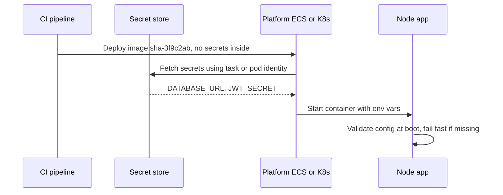

Leaked credentials are one of the most common root causes of real breaches, and most leaks are self-inflicted: an `.env` committed to git, an API key compiled into a React bundle, a database password visible in `docker history`, or a secret printed in CI logs. At the same time, configuration that differs across environments needs to reach your app somehow. This guide separates config from secrets, shows where each should live, and covers rotation without downtime.

## How it works

The twelve-factor principle is that config, anything that varies between deploys, is supplied by the environment, not the code. The build produces one artifact; each environment injects its own values at runtime. For secrets, the environment should fetch values from a dedicated secret store using the workload's identity, not from files that humans copy around.



## Config vs secrets

| | Examples | Where it lives |
|---|---|---|
| Non-secret config | `LOG_LEVEL`, feature defaults, service URLs, pool sizes | Env vars, ConfigMaps, SSM parameters, IaC |
| Secrets | DB passwords, JWT signing keys, Stripe keys, OAuth client secrets | Secret manager, injected at runtime |
| Public client config | API base URL, Sentry DSN, publishable Stripe key | Frontend build or runtime `config.js`; assume public |

## Validate config at startup

Read env vars in one place, validate them, and crash immediately if something is missing. A missing secret should fail the deploy's health check, not a customer's checkout three hours later.

```ts
import { z } from 'zod';

const Env = z.object({
  NODE_ENV: z.enum(['development', 'test', 'production']),
  PORT: z.coerce.number().default(3000),
  DATABASE_URL: z.string().url(),
  MONGO_URL: z.string().startsWith('mongodb'),
  JWT_SECRET: z.string().min(32),
});

export const config = Env.parse(process.env);
```

Never log the whole `config` object, and redact secret fields in your logger.

## The .env file and its pitfalls

`.env` files with `dotenv` (or Node's built-in `--env-file` flag in recent versions) are fine for local development. Problems start when they become the production mechanism:

- They get committed. Add `.env*` to `.gitignore` and commit only a `.env.example` with dummy values. Run a secret scanner (gitleaks, GitHub secret scanning, trufflehog) in CI and pre-commit hooks.
- They get baked into images when `.dockerignore` is missing. Anyone who can pull the image can read every layer.
- They live on servers forever, copied by hand, with no audit log and no rotation.
- They are shared over chat. Rotate anything that has ever been pasted into Slack.

If a secret was ever committed, removing it from history is not enough; assume it is compromised and rotate it.

## Never bake secrets into images or React bundles

Docker build args and `ENV` instructions are stored in image metadata. Use BuildKit secret mounts for build-time credentials such as private npm tokens:

```dockerfile
RUN --mount=type=secret,id=npmrc,target=/root/.npmrc npm ci
```

```bash
docker build --secret id=npmrc,src=$HOME/.npmrc .
```

For React, every `VITE_*` or `REACT_APP_*` variable is inlined into JavaScript that ships to every browser. There is no way to hide a secret in the frontend. If the browser needs to call a third-party API that requires a secret key, proxy the call through your backend.

## AWS: Secrets Manager and SSM Parameter Store

**SSM Parameter Store** holds hierarchical parameters like `/shop/prod/api/LOG_LEVEL`, with `SecureString` encrypted by KMS. Standard parameters are free, which makes it good for config and simple secrets. **Secrets Manager** charges per secret per month and per API call, and adds built-in rotation (with managed rotation for RDS credentials), cross-region replication and versioning with staging labels. A common split: Parameter Store for config, Secrets Manager for credentials that need rotation.

ECS injects both natively through the `secrets` field of a task definition, using the task execution role. For runtime fetching in code, cache the value and refresh periodically:

```ts
import { SecretsManagerClient, GetSecretValueCommand } from '@aws-sdk/client-secrets-manager';

const sm = new SecretsManagerClient({});
let cached: { value: string; at: number } | undefined;

export async function getDbSecret() {
  if (cached && Date.now() - cached.at < 5 * 60_000) return cached.value;
  const out = await sm.send(new GetSecretValueCommand({ SecretId: 'prod/api/db' }));
  cached = { value: out.SecretString!, at: Date.now() };
  return cached.value;
}
```

Scope IAM policies tightly: the prod API role can read `prod/api/*` and nothing else.

## Kubernetes Secrets and External Secrets

Kubernetes Secrets are base64-encoded objects stored in etcd. Enable encryption at rest, restrict `get secrets` with RBAC, and do not commit secret manifests. The External Secrets Operator syncs values from AWS Secrets Manager, GCP Secret Manager, Vault and others into native Secrets:

```yaml
apiVersion: external-secrets.io/v1
kind: ExternalSecret
metadata: { name: api-secrets }
spec:
  refreshInterval: 1h
  secretStoreRef: { name: aws-secrets, kind: ClusterSecretStore }
  target: { name: api-secrets }
  data:
    - secretKey: DATABASE_URL
      remoteRef: { key: prod/api/db, property: url }
```

Alternatives include Sealed Secrets (encrypted manifests safe to commit) and the Secrets Store CSI driver (mounts secrets as files). Note that env vars from a Secret do not update in a running Pod; you need a restart (tools like Reloader automate this) or file mounts that the app re-reads.

## HashiCorp Vault

Vault is a dedicated secret platform, cloud-agnostic, with a killer feature: **dynamic secrets**. Instead of one shared Postgres password, Vault creates a unique database user per app instance with a short TTL and revokes it on expiry. A leaked credential is useful only briefly and traceable to one workload. The cost is running and unsealing a highly available Vault cluster, or paying for a managed version.

## Rotation without downtime

Rotation needs two valid credentials to overlap:

1. Create the new credential (a second DB user, or a new key version) alongside the old.
2. Update the secret store; apps pick it up on refresh or rolling restart.
3. Verify nothing uses the old credential, then revoke it.

For JWT signing keys, publish multiple keys with a `kid` header (a JWKS endpoint), sign with the new key, and keep verifying the old one until existing tokens expire.

## Trade-offs and pitfalls

- **Secrets in env vars** can leak through crash dumps, `/proc`, child processes and error trackers that capture environment. File mounts or runtime fetch reduce exposure.
- **Over-centralised secret stores** become a dependency for startup; cache values and handle store outages.
- **Shared credentials across environments** turn a staging leak into a production breach.
- **No audit trail** means you cannot tell who read a secret; managed stores log access.

## Interview angle

- Explain twelve-factor config and why one artifact with runtime injection beats per-environment builds.
- State plainly that frontend code cannot hold secrets and describe the backend proxy pattern.
- Describe identity-based access (IAM roles, workload identity) instead of static keys.
- Walk through zero-downtime rotation with overlapping credentials.

## Key takeaways

- Keep config in the environment and validate it at startup.
- Store secrets in a managed secret store and inject them using workload identity.
- Never put secrets in git, image layers, build args or frontend bundles.
- Use External Secrets or similar to bridge cloud stores into Kubernetes.
- Plan rotation with overlapping credentials, and rotate anything that has leaked.
