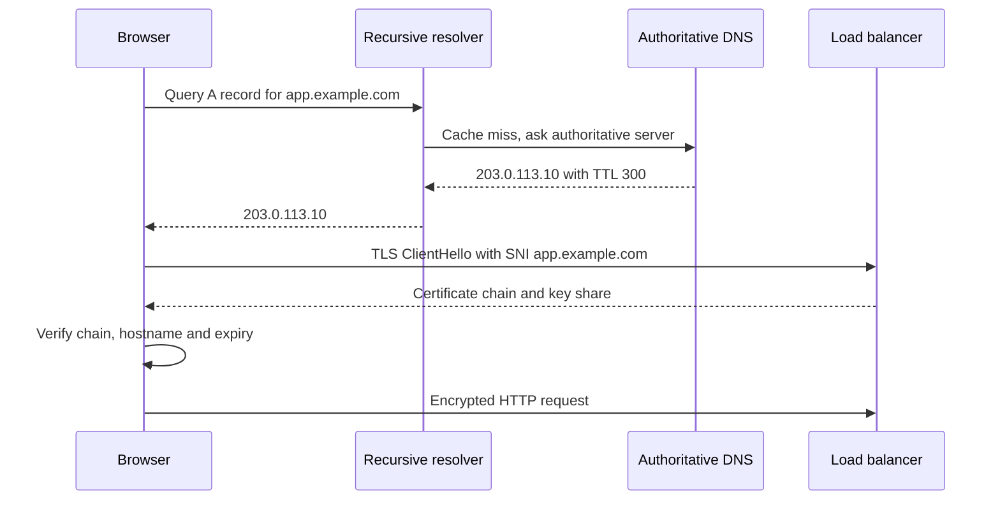

Two common causes of total outages are not code at all: a DNS change pointing the domain at the wrong place, and a certificate that quietly expired at 03:00 on a Sunday. Both are cheap to get right and painful to get wrong because their failures are global and cached.

## How it works

The browser resolves `app.example.com` through a recursive resolver, which queries your authoritative nameservers and caches the answer for the record's TTL. It then connects and performs a TLS handshake, where the server presents a certificate chain that must be unexpired, issued for that hostname, and chain to a trusted CA.



## DNS records for an app

- **A / AAAA**: hostname to IPv4 / IPv6 address. Use for a VM or a static IP. Add AAAA only if every hop actually serves IPv6.
- **CNAME**: alias one name to another, for example `www.example.com CNAME d1234.cloudfront.net`. A CNAME cannot coexist with other records on the same name, so it is not allowed at the zone apex (`example.com`), which always has SOA and NS records.
- **ALIAS / ANAME**: provider-specific apex aliasing. Route 53 alias records point `example.com` at an ALB, CloudFront distribution or S3 endpoint, resolve server-side, follow the target's IP changes, and cost nothing to query for AWS targets. Cloudflare calls the same idea CNAME flattening.
- **TXT**: verification, SPF, DMARC and ACME DNS-01 challenges.

```hcl
resource "aws_route53_record" "apex" {
  zone_id = aws_route53_zone.main.zone_id
  name    = "example.com"
  type    = "A"
  alias {
    name                   = aws_lb.api.dns_name
    zone_id                = aws_lb.api.zone_id
    evaluate_target_health = true
  }
}
```

### TTL strategy before a migration

Resolvers cache answers for the TTL you published, so a record with a 24-hour TTL can keep sending traffic to the old server for a day after you change it. Plan migrations in steps:

1. At least one old-TTL period before the cutover, lower the TTL to 60 seconds. If the TTL was 86400, do this two days ahead.
2. Keep the old server healthy during cutover; some clients ignore TTLs.
3. Switch the record, verify with `dig +short app.example.com @1.1.1.1`, and watch traffic drain.
4. Once stable, raise the TTL back to 300 to 3600 seconds to cut query volume and soften resolver outages.

Negative caching matters too: querying a name before it exists caches the NXDOMAIN for the SOA minimum, often up to an hour.

## Issuing certificates

### Let's Encrypt and ACME

Let's Encrypt issues free domain-validated certificates via the ACME protocol. You prove control of the domain with a challenge:

- **HTTP-01**: the CA fetches `http://app.example.com/.well-known/acme-challenge/<token>` on port 80. Easy, but needs port 80 reachable and cannot issue wildcards.
- **DNS-01**: you publish a `_acme-challenge` TXT record. Works behind firewalls and across load-balanced servers, and is the only method for **wildcard** certificates like `*.example.com`. It needs DNS API credentials, so scope them tightly.

```bash
# HTTP-01 with the nginx plugin
sudo certbot --nginx -d example.com -d www.example.com

# DNS-01 wildcard via Route 53 (needs route53:ChangeResourceRecordSets on the zone)
sudo certbot certonly --dns-route53 -d example.com -d '*.example.com'

# renewal is installed as a systemd timer; verify it works
sudo certbot renew --dry-run
systemctl list-timers | grep certbot
```

Certbot renews when about 30 days remain and can reload Nginx with `--deploy-hook "systemctl reload nginx"`. Caddy, Traefik and Kubernetes cert-manager automate ACME natively.

Let's Encrypt certificates last 90 days, and Let's Encrypt has announced a phased move to 45 days by 2028, with optional 6-day short-lived certificates already available. The CA/Browser Forum has also cut the maximum lifetime for all public certificates to 200 days from March 2026, falling to 100 days in 2027 and 47 days in 2029. Manual renewal is no longer viable; automate everything.

### ACM on AWS

AWS Certificate Manager issues public certificates for free for use on ALB, CloudFront, API Gateway and other integrated services. With DNS validation, ACM renews automatically as long as the validation CNAME stays in place, so never delete it. Standard ACM keys never leave AWS, so terminate TLS at the ALB rather than on EC2 Nginx. CloudFront requires the certificate in `us-east-1`; ALB requires it in the ALB's region.

```bash
aws acm request-certificate --domain-name example.com \
  --subject-alternative-names '*.example.com' --validation-method DNS --region us-east-1
```

## TLS configuration

Allow TLS 1.2 and 1.3 only; TLS 1.0 and 1.1 are deprecated by RFC 8996 and disabled in all current browsers. On an ALB, choose a current security policy such as `ELBSecurityPolicy-TLS13-1-2-2021-06`. On Nginx, the Mozilla "intermediate" profile is a good default:

```nginx
ssl_protocols TLSv1.2 TLSv1.3;
ssl_ciphers ECDHE-ECDSA-AES128-GCM-SHA256:ECDHE-RSA-AES128-GCM-SHA256:ECDHE-ECDSA-AES256-GCM-SHA384:ECDHE-RSA-AES256-GCM-SHA384:ECDHE-ECDSA-CHACHA20-POLY1305:ECDHE-RSA-CHACHA20-POLY1305;
ssl_prefer_server_ciphers off;
ssl_session_timeout 1d;
ssl_session_cache shared:SSL:10m;
ssl_session_tickets off;
add_header Strict-Transport-Security "max-age=63072000; includeSubDomains; preload" always;
```

`ssl_ciphers` does not affect TLS 1.3 suites; OpenSSL's defaults are fine. Prefer ECDSA P-256 keys for faster handshakes.

### HSTS and preload

`Strict-Transport-Security` tells browsers to use only HTTPS for the given period, preventing downgrade attacks after the first visit. Roll out gradually: `max-age=300`, then a week, then two years. Add `includeSubDomains` only when every subdomain, including internal tools and old marketing sites, serves HTTPS. Preloading (submitting to hstspreload.org with `max-age` of at least one year, `includeSubDomains` and `preload`) bakes your domain into browsers so even the first visit is HTTPS. Removal takes months to reach users, so treat preload as permanent.

### OCSP stapling is fading

OCSP let browsers check revocation; stapling let servers attach the CA's signed response. Let's Encrypt stopped including OCSP URLs in certificates in May 2025 and shut down its OCSP responders in August 2025, relying on CRLs, which browsers distribute in compressed form. For Let's Encrypt certificates, `ssl_stapling on` does nothing except log a warning, so remove it. Short lifetimes are becoming the main defence against compromised keys.

## CAA records

CAA records restrict which CAs may issue for your domain; CAs must check them before issuing.

```text
example.com.  CAA 0 issue "letsencrypt.org"
example.com.  CAA 0 issue "amazon.com"
example.com.  CAA 0 issuewild "amazon.com"
example.com.  CAA 0 iodef "mailto:security@example.com"
```

Add a CAA record for every CA you actually use, or issuance and renewals start failing.

## Monitoring expiry

Let's Encrypt stopped sending expiry emails in June 2025, so your own monitoring is the only warning. Alert below 14 days remaining; renewal runs at 30, so this fires only when automation is broken. Use the blackbox exporter's `probe_ssl_earliest_cert_expiry`, ACM's `DaysToExpiry` CloudWatch metric, an uptime service, or:

```bash
echo | openssl s_client -connect app.example.com:443 -servername app.example.com 2>/dev/null \
  | openssl x509 -noout -enddate
```

Certificate Transparency search (crt.sh) reveals certificates for your domains that you did not request.

## Trade-offs and pitfalls

- **Long TTLs during a migration** stretch cutover and rollback to hours.
- **CNAME at the apex** is invalid; use ALIAS or flattening.
- **Deleting ACM validation CNAMEs** silently breaks auto-renewal.
- **HSTS includeSubDomains or preload too early** breaks HTTP-only subdomains for a year or more.
- **Missing CAA entries** for a newly adopted CA fail issuance at the worst time.

## Interview angle

- Walk through resolution and the TLS handshake, including SNI and certificate validation.
- Explain why CNAME cannot sit at the apex and how ALIAS solves it.
- Describe the TTL-lowering plan for a zero-surprise DNS migration.
- Compare HTTP-01 and DNS-01 and when a wildcard requires DNS-01.

## Key takeaways

- Use ALIAS at the apex, CNAME for subdomains, and lower TTLs well before any migration.
- Automate certificates with ACME or ACM; lifetimes are shrinking toward 47 days.
- Serve TLS 1.2 and 1.3 only, roll out HSTS gradually, and preload only when sure.
- Drop OCSP stapling for Let's Encrypt certificates, which no longer carry OCSP URLs.
- Publish CAA records and alert on expiry below 14 days.
