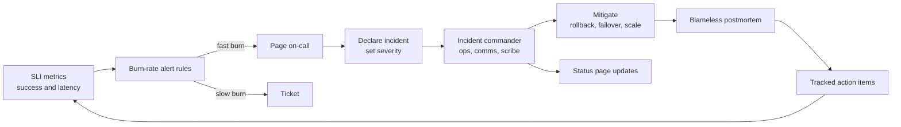

Every production system breaks; mature teams differ in how quickly they notice, how calmly they respond, and whether the same failure happens twice. SLOs give a numeric definition of "working" that drives alerts and release decisions. An incident process turns a 2 a.m. page into routine: someone is in charge, customers hear the truth, and fixes actually ship.

## How it works

You measure a few user-facing indicators, set a target for each, and treat the allowed failure as a budget. Alerts fire when it burns too fast; on-call declares an incident, mitigates, communicates, and later writes a postmortem with tracked action items.



## SLIs, SLOs and SLAs

- **SLI** (indicator): a ratio of good events to valid events, measured as close to the user as possible. Examples: proportion of non-5xx responses on `/api/*`, proportion of checkout requests faster than 500 ms, proportion of orders processed within 5 minutes of placement.
- **SLO** (objective): the target for an SLI over a window, for example 99.9 percent availability over a rolling 28 days. It is an internal engineering goal.
- **SLA** (agreement): a contract with customers that carries penalties such as service credits. Set SLAs looser than SLOs, for example SLA 99.5 percent against an SLO of 99.9, so you breach your own target long before you owe money.

Pick 2 to 4 SLIs per user journey. Measure at the load balancer so failures that never reach your code count; synthetic checks cover traffic stopping entirely.

## Error budgets

The error budget is 1 minus the SLO. At 99.9 percent over 28 days you may fail 0.1 percent of requests, or the equivalent of about 40 minutes of full downtime. At 99.99 it is about 4 minutes, beyond most teams without automated failover.

The budget turns reliability arguments into policy: while budget remains, ship freely; past 50 percent spent, require canaries for risky changes; when exhausted, freeze non-critical releases and prioritise reliability work until the window recovers.

## Burn-rate alerts

Burn rate is budget spend relative to plan. A rate of 1 uses exactly the whole budget over the window; 14.4 uses 2 percent of a 30-day budget in one hour. It pages fast for real outages and stays quiet for blips.

Use two windows: the long one proves the burn is significant, the short one proves it is still happening, so alerts resolve quickly after a fix. Google SRE workbook thresholds for a 30-day SLO:

| Severity | Long window | Short window | Burn rate | Budget spent |
| --- | --- | --- | --- | --- |
| Page | 1 h | 5 min | 14.4 | 2% |
| Page | 6 h | 30 min | 6 | 5% |
| Ticket | 3 days | 6 h | 1 | 10% |

```yaml
groups:
  - name: checkout-slo
    rules:
      - record: slo:checkout_errors:ratio_rate5m
        expr: |
          sum(rate(http_requests_total{route="/api/checkout",status=~"5.."}[5m]))
          / sum(rate(http_requests_total{route="/api/checkout"}[5m]))
      - record: slo:checkout_errors:ratio_rate1h
        expr: |
          sum(rate(http_requests_total{route="/api/checkout",status=~"5.."}[1h]))
          / sum(rate(http_requests_total{route="/api/checkout"}[1h]))
      - alert: CheckoutErrorBudgetFastBurn
        expr: |
          slo:checkout_errors:ratio_rate1h > (14.4 * 0.001)
          and slo:checkout_errors:ratio_rate5m > (14.4 * 0.001)
        labels: { severity: page }
        annotations:
          summary: "Checkout burning error budget 14x faster than allowed"
          runbook: "https://runbooks.internal/checkout-errors"
```

Sloth or Pyrra generate these rules from a short SLO spec. For low-traffic services, add a minimum request count so two failures do not page.

## On-call

A sustainable rotation has 5 to 8 people, a primary and a secondary, a written handoff, and compensation or time off in lieu. Follow-the-sun rotations avoid night pages once you have the people. Track page volume: more than about two actionable pages per shift means systems need fixing, and every non-actionable page should lead to a tuned or deleted alert. Configure PagerDuty or incident.io to escalate to the secondary after 5 minutes unacknowledged.

## Severity levels

Define severities by customer impact so nobody debates them mid-incident:

- **SEV1**: full outage, data loss or security breach. Page, incident commander required, status page within 15 minutes.
- **SEV2**: major feature broken or severe degradation for a subset, for example checkout failing for one payment method. Page, status page if customer-visible.
- **SEV3**: minor degradation with a workaround. Business hours, ticket.
- **SEV4**: cosmetic or internal-only. Backlog.

Err on declaring higher; downgrading is cheap, a late escalation is not.

## Incident roles

For SEV1 and SEV2, split roles even on a small team:

- **Incident commander (IC)**: owns coordination and decisions, not debugging. Sets the severity, assigns tasks, runs 15 to 30 minute check-ins, decides on rollback, and declares the incident resolved.
- **Operations lead**: hands on keyboard; may pull in subject experts.
- **Communications lead**: updates the status page and internal channels on a fixed cadence.
- **Scribe**: timestamps decisions and actions in the incident channel; the postmortem timeline comes from here.

Use a channel per incident, such as `#inc-2026-11-03-checkout`. Mitigate before finding root cause: roll back, flip the feature flag, fail over, scale out or shed load.

## Runbooks

Every paging alert links a runbook a tired engineer can follow: what it means, dashboards and log queries to open, likely causes, exact mitigation commands, and who to escalate to. Keep runbooks beside the alert definitions, update them in postmortems, and automate recurring steps like rollback.

## Communication and status page

Customers forgive outages more readily than silence. Post within 15 minutes for SEV1, even just "We are investigating elevated checkout errors", then every 30 minutes with impact, actions and next update time. Do not speculate about cause. Host the status page outside your infrastructure, such as Statuspage or Instatus, so it survives the outage.

## Blameless postmortems

Write a postmortem for every SEV1 and SEV2 within five business days. Blameless means assuming people acted reasonably with what they knew and looking for the system conditions that allowed the failure: missing tests, unsafe defaults, confusing dashboards. Blame makes people hide information.

```text
Title: Checkout 5xx after payments client upgrade (SEV1)
Date / duration: 2026-10-28 14:02–14:51 UTC (49 min)
Impact: 38% of checkout requests failed; ~1,900 orders delayed; 34% of monthly error budget
Detection: burn-rate page at 14:06 (4 min after deploy)
Timeline: 14:02 deploy sha-3f9c2ab ... 14:31 rollback started ... 14:51 recovered
Root cause and contributing factors: new SDK default timeout of 2s; canary skipped for "minor" bump
What went well / what went poorly / where we got lucky
Action items: owner, priority, ticket, due date
  - Enforce canary for all API deploys (P1, @platform, OPS-412, 2026-11-10)
  - Contract test for payment timeouts (P2, @payments, PAY-208, 2026-11-17)
```

## Follow-up tracking

Postmortems fail when action items rot. File each as a ticket with an owner and due date, review open items weekly, and report completion rate. Quarterly, look across postmortems for recurring themes that justify larger investments.

## Trade-offs and pitfalls

- **SLOs at 100 percent** forbid change and are impossible; pick a target users actually notice.
- **Too many SLIs** dilute attention; a handful per journey is enough.
- **Single-window alerts** either page on blips or keep firing long after recovery.
- **IC also debugging** loses coordination exactly when it matters.

## Interview angle

- Define SLI, SLO and SLA and explain why the SLA is looser.
- Compute an error budget and explain how it governs release velocity.
- Explain multiwindow burn-rate alerting and why it beats static thresholds.
- Describe the IC role and mitigate-first incident handling.

## Key takeaways

- Measure a few user-centric SLIs and set SLOs that leave a meaningful error budget.
- Alert on multiwindow burn rate: page on fast burns, ticket on slow ones.
- Run a humane on-call rotation with clear severities and escalation.
- Separate incident command from hands-on work, mitigate first, and communicate on a cadence.
- Write blameless postmortems and track every action item to done.
