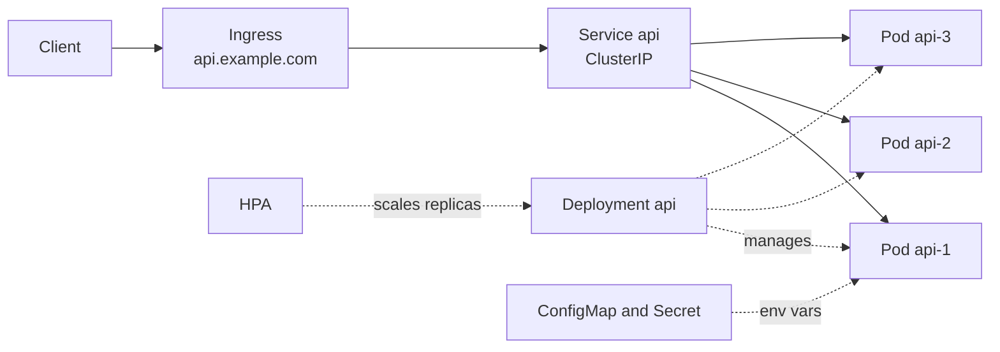

Kubernetes will happily run a Node container that is misconfigured in a dozen subtle ways: it gets killed during slow startups, receives traffic before its database connection is ready, drops in-flight requests on every deploy, or is OOM-killed because its memory limit and V8 heap disagree. This guide covers the objects you need for a production Express API and the settings that make deploys and scaling uneventful.

## How it works

A **Deployment** declares how many replicas of a Pod template should run and manages rolling updates through ReplicaSets. A **Service** gives those Pods a stable virtual IP and DNS name and load balances across the Pods that are currently Ready. An **Ingress** (implemented by a controller such as ingress-nginx or the AWS Load Balancer Controller) routes external HTTP traffic to Services. The **HPA** changes the replica count based on metrics.



## Deployment with probes, resources and shutdown

```yaml
apiVersion: apps/v1
kind: Deployment
metadata:
  name: api
spec:
  replicas: 3
  selector:
    matchLabels: { app: api }
  strategy:
    type: RollingUpdate
    rollingUpdate: { maxSurge: 25%, maxUnavailable: 0 }
  template:
    metadata:
      labels: { app: api }
    spec:
      terminationGracePeriodSeconds: 45
      securityContext:
        runAsNonRoot: true
        runAsUser: 1000
      containers:
        - name: api
          image: ghcr.io/acme/shop-api:3f9c2ab
          ports: [{ containerPort: 3000, name: http }]
          envFrom:
            - configMapRef: { name: api-config }
            - secretRef: { name: api-secrets }
          env:
            - name: NODE_OPTIONS
              value: "--max-old-space-size=384"
          resources:
            requests: { cpu: 250m, memory: 384Mi }
            limits: { memory: 512Mi }
          startupProbe:
            httpGet: { path: /healthz, port: http }
            periodSeconds: 2
            failureThreshold: 30
          readinessProbe:
            httpGet: { path: /readyz, port: http }
            periodSeconds: 5
            failureThreshold: 2
          livenessProbe:
            httpGet: { path: /healthz, port: http }
            periodSeconds: 10
            failureThreshold: 3
          lifecycle:
            preStop:
              exec: { command: ["sleep", "10"] }
```

### Liveness vs readiness vs startup

| Probe | Question | On failure |
|---|---|---|
| Startup | Has the app finished booting? | Keeps checking until threshold, then restarts. Liveness and readiness wait for it. |
| Readiness | Should this Pod receive traffic now? | Removed from Service endpoints, not restarted. |
| Liveness | Is the process stuck beyond recovery? | Container is restarted. |

The classic mistake is a liveness probe that checks the database. When Mongo has a hiccup, every Pod fails liveness and restarts at once, turning a brief blip into a full outage. Liveness should only check that the event loop responds. Readiness may check critical dependencies, so a Pod that lost its DB connection stops receiving traffic but is not killed.

```js
let shuttingDown = false;
app.get('/healthz', (_req, res) => res.sendStatus(200));
app.get('/readyz', async (_req, res) => {
  if (shuttingDown) return res.sendStatus(503);
  try {
    await mongoose.connection.db.admin().ping();
    res.sendStatus(200);
  } catch {
    res.sendStatus(503);
  }
});
```

### Resources and the V8 heap

`requests` are what the scheduler reserves and what HPA percentages are computed against. `limits.memory` is a hard ceiling; exceeding it gets the container OOM-killed. Node's default heap sizing may not match the container limit, so set `--max-old-space-size` to roughly 70 to 80 percent of the memory limit, leaving room for buffers and native memory. Many teams omit a CPU limit, because CPU limits cause throttling that inflates latency, while keeping a CPU request for scheduling. A single Node process mostly uses one core for JavaScript, so prefer more small Pods over one large Pod.

### Graceful shutdown

On deletion, Kubernetes runs `preStop`, then sends `SIGTERM`, and sends `SIGKILL` after `terminationGracePeriodSeconds`. Endpoint removal happens in parallel and takes a few seconds to propagate to ingress controllers and kube-proxy, so a Pod can still receive requests just after termination starts. The `preStop` sleep covers that window. Then the app should stop accepting connections and finish in-flight work:

```js
process.on('SIGTERM', async () => {
  shuttingDown = true;
  server.close(async () => {
    await mongoose.disconnect();
    await pgPool.end();
    process.exit(0);
  });
  server.closeIdleConnections?.();
  setTimeout(() => process.exit(1), 30_000).unref();
});
```

This only works if Node is PID 1 or behind an init that forwards signals; use exec-form `CMD` in the Dockerfile, not `npm start`. The `sleep` command must exist in the image, which is not true for distroless; newer Kubernetes versions support a native `sleep` lifecycle action instead.

## Service, Ingress, config and secrets

```yaml
apiVersion: v1
kind: Service
metadata: { name: api }
spec:
  selector: { app: api }
  ports: [{ port: 80, targetPort: http }]
---
apiVersion: networking.k8s.io/v1
kind: Ingress
metadata:
  name: api
  annotations:
    cert-manager.io/cluster-issuer: letsencrypt
spec:
  ingressClassName: nginx
  tls: [{ hosts: [api.example.com], secretName: api-tls }]
  rules:
    - host: api.example.com
      http:
        paths:
          - path: /
            pathType: Prefix
            backend: { service: { name: api, port: { number: 80 } } }
---
apiVersion: v1
kind: ConfigMap
metadata: { name: api-config }
data:
  NODE_ENV: production
  LOG_LEVEL: info
```

Secrets are base64-encoded, not encrypted, in the manifest. Do not commit them; create them from a secret manager via External Secrets Operator or Sealed Secrets, and enable encryption at rest in etcd.

## Autoscaling and disruption budgets

```yaml
apiVersion: autoscaling/v2
kind: HorizontalPodAutoscaler
metadata: { name: api }
spec:
  scaleTargetRef: { apiVersion: apps/v1, kind: Deployment, name: api }
  minReplicas: 3
  maxReplicas: 20
  metrics:
    - type: Resource
      resource:
        name: cpu
        target: { type: Utilization, averageUtilization: 65 }
---
apiVersion: policy/v1
kind: PodDisruptionBudget
metadata: { name: api }
spec:
  minAvailable: 2
  selector:
    matchLabels: { app: api }
```

HPA needs metrics-server and CPU requests set. Remove `replicas` from the Deployment manifest once HPA owns it, or every `kubectl apply` resets the count. The PDB ensures voluntary disruptions such as node drains during cluster upgrades never take you below two ready Pods. Add `topologySpreadConstraints` across zones so one AZ failure does not take all replicas.

## Trade-offs and pitfalls

- **Liveness probes on dependencies** cause cascading restarts.
- **No startup probe** on slow boots leads to restart loops.
- **Memory limits without heap flags** produce OOM kills that look like random crashes.
- **Missing preStop delay** causes 502s on every rollout.
- **In-process state** (sessions in memory, local file uploads) breaks with multiple replicas; use Redis and object storage.
- **Node cluster mode or PM2 inside Pods** fights the orchestrator; scale with replicas instead.

## Interview angle

- Explain the three probes precisely and why liveness should not check the database.
- Walk through Pod termination ordering and how you avoid dropped requests.
- Discuss HPA on CPU versus custom metrics like requests per second or queue depth.
- Mention PDBs and zone spreading when asked about availability during maintenance.

## Key takeaways

- Deployment, Service and Ingress are the core trio; ConfigMaps and Secrets inject configuration.
- Startup protects slow boots, readiness gates traffic, liveness restarts only truly stuck processes.
- Set memory requests and limits and align `--max-old-space-size` with the limit.
- Combine a preStop delay, SIGTERM handling and `server.close()` for zero-drop rollouts.
- Use HPA for elasticity and PodDisruptionBudgets plus zone spreading for availability.
