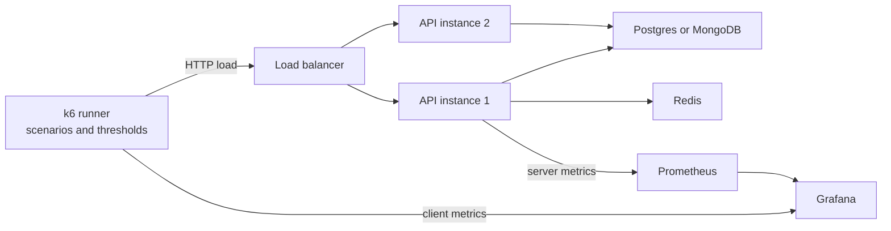

Load testing answers concrete questions before users do: how many requests per second one instance sustains under your latency target, which resource gives out first, and how many instances next quarter's traffic needs. k6 is a good default for Node teams: tests are JavaScript, it runs as a single Go binary, and one machine generates tens of thousands of requests per second.

## How it works

A load generator replays realistic user journeys against a production-like environment while you watch server-side metrics. The generator measures what the client experiences; your dashboards explain why.



## Test types

- **Smoke**: 1 to 5 virtual users for a minute. Proves the script and environment work.
- **Load**: ramp to expected peak traffic and hold for 15 to 30 minutes. Does the system meet its SLO at normal peak?
- **Stress**: keep ramping beyond peak, for example 2x then 3x, until latency or errors break the threshold. Where is the knee, and how does it fail?
- **Spike**: jump from baseline to 5x or 10x within seconds. Do autoscaling, pools and queues cope, or does everything time out while new instances boot?
- **Soak**: moderate load for 4 to 12 hours. Finds memory and connection leaks, growing queues and token expiry bugs.

## A k6 script with stages and thresholds

Prefer arrival-rate executors over looping virtual users. With `constant-vus`, a slow server makes each VU wait, so load drops exactly when the system struggles. `ramping-arrival-rate` starts iterations on schedule regardless of response time.

```js
// load-test.js  —  run: k6 run -e BASE_URL=https://staging.example.com load-test.js
import http from 'k6/http';
import { check, sleep } from 'k6';
import { SharedArray } from 'k6/data';

const users = new SharedArray('users', () => JSON.parse(open('./users.json')));
const BASE = __ENV.BASE_URL;

export const options = {
  scenarios: {
    browse_and_buy: {
      executor: 'ramping-arrival-rate',
      startRate: 20,
      timeUnit: '1s',
      preAllocatedVUs: 200,
      maxVUs: 2000,
      stages: [
        { target: 200, duration: '5m' },   // ramp to expected peak
        { target: 200, duration: '20m' },  // hold
        { target: 400, duration: '5m' },   // stress: 2x peak
        { target: 0, duration: '2m' },
      ],
    },
  },
  thresholds: {
    http_req_failed: ['rate<0.01'],
    'http_req_duration{name:checkout}': ['p(95)<500', 'p(99)<1200'],
    'http_req_duration{name:product}': ['p(95)<200'],
    dropped_iterations: ['count<100'],
  },
};

export default function () {
  const u = users[Math.floor(Math.random() * users.length)];
  const login = http.post(`${BASE}/api/login`, JSON.stringify(u),
    { headers: { 'Content-Type': 'application/json' }, tags: { name: 'login' } });
  const token = login.json('token');
  const auth = { headers: { Authorization: `Bearer ${token}` } };

  const id = Math.floor(Math.random() * 50000) + 1;
  const p = http.get(`${BASE}/api/products/${id}`, { ...auth, tags: { name: 'product' } });
  check(p, { 'product 200': (r) => r.status === 200 });
  sleep(Math.random() * 3 + 1);

  const c = http.post(`${BASE}/api/checkout`, JSON.stringify({ productId: id, qty: 1 }),
    { headers: { ...auth.headers, 'Content-Type': 'application/json' }, tags: { name: 'checkout' } });
  check(c, { 'checkout 201': (r) => r.status === 201 });
}
```

Thresholds make the test a pass/fail gate: k6 exits non-zero when one fails, so a nightly CI job catches regressions. The `name` tag groups dynamic URLs into one metric. `dropped_iterations` means k6 ran out of VUs and could not hold the requested rate, which invalidates the run.

## Realistic data and traffic mix

Hitting the same product ID 10,000 times measures your cache, not your system. Seed staging with anonymised production-sized data, randomise IDs across the whole range, use many test accounts so per-user rate limits and row locks behave realistically, and match the production read/write mix from access logs, for example 80 percent browse, 15 percent search, 5 percent checkout. Include think time, and reuse tokens the way real clients do.

## Coordinated omission and reading percentiles

Coordinated omission happens when the generator waits for a slow response before sending the next request. A 3-second stall produces one slow sample instead of the hundreds of requests real users would have sent, so latency looks far better than reality. Open-model executors avoid most of it because arrivals are scheduled independently of responses.

Read percentiles, never averages. If p50 is 40 ms and p99 is 2.1 s, a page making 20 API calls hits that tail on roughly 18 percent of loads (1 − 0.99^20). Watch p95 and p99 per endpoint over time: a p99 that climbs steadily during a soak usually means a leak or a growing queue. Check error rate alongside latency; a server failing fast with 503s shows excellent latency.

## Finding the bottleneck

When a threshold breaks, correlate the moment with server metrics. Common culprits in a Node stack:

- **Database connection pool**: requests queue for a connection while database CPU sits at 30 percent. Watch pool wait time and pending count. Fix slow queries first, then size the pool, and add PgBouncer if total connections approach `max_connections`.
- **Event loop lag**: a 50 ms synchronous JSON parse, bcrypt hash or regex blocks every other request. `monitorEventLoopDelay` from `perf_hooks` or prom-client's `nodejs_eventloop_lag_seconds` exposes it; lag above roughly 100 ms means CPU-bound work on the main thread.
- **CPU**: one Node process uses about one core. At 100 percent, add instances or move heavy work to worker threads or a queue.
- **Downstream limits and GC**: third-party rate limits, a saturated Redis, or long GC pauses showing as periodic spikes.

Change one variable at a time, and profile one instance with `node --cpu-prof` under load.

## Little's law and capacity planning

Little's law ties the numbers together: concurrency L equals arrival rate λ times time in system W. At 1,000 requests per second with a 200 ms average response time, 200 requests are in flight at once. That directly sizes pools: if each request holds a DB connection for 20 ms, you need about 1,000 × 0.02 = 20 busy connections on average, so a pool totalling 40 to 50 leaves headroom for bursts.

Capacity planning follows from the stress test. Suppose one instance holds p95 under 300 ms up to 350 requests per second, then degrades sharply. Run each instance at 60 to 70 percent of that knee, about 230 requests per second, to absorb a lost instance or a burst while autoscaling reacts. For a forecast peak of 2,000 requests per second you need 2,000 / 230 ≈ 9 instances, plus one for N+1 redundancy across availability zones.

## Staging versus production

Staging is the default, with the same instance types, database class, data volume and WAF setup, or results do not transfer. A half-size staging cluster does not reliably predict full size, because the shared database does not shrink in proportion.

Testing production finds real limits, but do it deliberately: a low-traffic window, a header tagging test traffic so analytics can filter it, dedicated test accounts and a payment sandbox, a gradual ramp with an abort threshold, and on-call informed first.

## Trade-offs and pitfalls

- **Generator bottleneck**: a k6 box at 100 percent CPU measures itself.
- **Testing through the CDN cache** reports cache throughput, not origin capacity.
- **Ignoring warm-up**: JIT, caches and pools need a minute; exclude the ramp.

## Interview angle

- Distinguish load, stress, spike and soak tests and what each reveals.
- Explain coordinated omission and why open-model arrival rates fix it.
- Use Little's law to size connection pools or estimate concurrency on the spot.
- Size capacity from measured per-instance throughput at the SLO, derated for headroom.

## Key takeaways

- Script realistic journeys in k6 with arrival-rate executors, tags and thresholds that encode your SLO.
- Read p95 and p99 per endpoint alongside error rate, never averages.
- Correlate client results with server metrics to find the first saturated resource, usually the DB pool or event loop.
- Size with Little's law and plan to run at 60 to 70 percent of the measured knee.
- Test in production-like staging by default, and in production only with guardrails.
