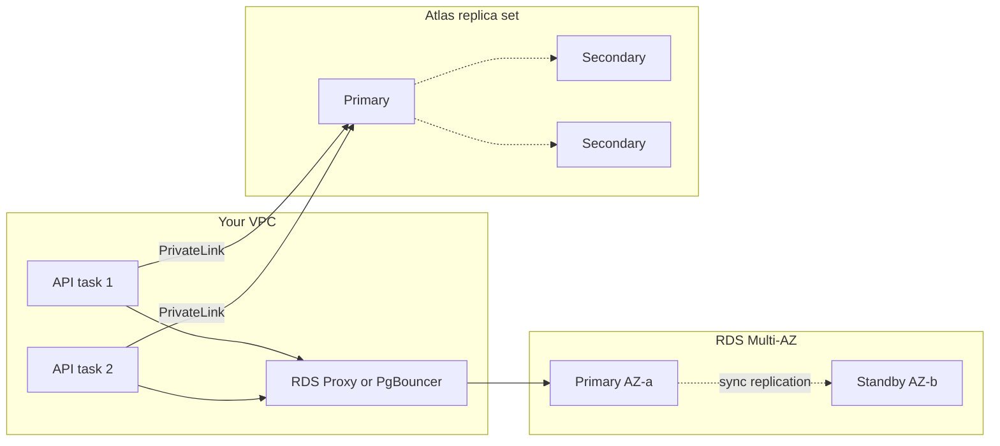

Stateless containers are easy to replace; databases are not. Running MongoDB or Postgres yourself means owning replication, failover, backups, upgrades, disk growth and security patches, and getting any of those wrong loses data. For most teams the right move is a managed service, but the options differ in compatibility, failover behaviour, scaling model and, above all, cost. This guide compares them and covers the operational details that bite after launch: connection limits, private networking and surprise bills.

## How it works

A managed database runs a replicated cluster in the provider's account. You get an endpoint (or several), automated backups, monitoring and push-button upgrades. Your app connects over a private network path, and the provider handles failover by promoting a replica and moving the endpoint.



## MongoDB options

| | MongoDB Atlas | Amazon DocumentDB | Self-hosted on VMs or Kubernetes |
|---|---|---|---|
| Engine | Real MongoDB | AWS engine with a MongoDB-compatible API | Real MongoDB |
| Feature coverage | Full, plus Atlas Search, Vector Search, triggers | Subset; check aggregation operators, change stream and index support for your version | Full |
| Clouds | AWS, GCP, Azure | AWS only | Anywhere |
| Scaling | Vertical tiers, auto-scaling, sharding | Up to many read replicas on shared storage, elastic clusters for sharding | You build it |
| Backups | Snapshots and continuous backup with point-in-time restore | Continuous backup with point-in-time restore | You build it |
| Ops burden | Low | Low | High |

Atlas is the default for MERN teams because it is genuine MongoDB, so drivers, Mongoose features and documentation behave as expected. DocumentDB appeals to AWS-only shops wanting IAM integration and a single bill, but it is a different engine; test your actual queries and indexes against it before committing. Self-hosting with the MongoDB Kubernetes operator or Ansible makes sense only with in-house database expertise or strict data residency needs.

## Postgres options

| | RDS for PostgreSQL | Aurora PostgreSQL | Self-hosted |
|---|---|---|---|
| Storage | EBS volumes per instance | Distributed storage replicated six ways across three AZs | Your disks |
| HA | Multi-AZ standby, failover typically within a minute or two | Replicas share storage, failover usually faster | Patroni or similar |
| Read scaling | Read replicas via async replication | Up to 15 low-lag replicas | Streaming replicas |
| Extensions | Large supported list | Large supported list | Anything |
| Pricing | Instance plus provisioned storage | Instance plus storage plus I/O, or I/O-Optimized config | VM cost plus your time |

RDS is the straightforward choice for most apps. Aurora pays off with heavy read scaling, large datasets, or a need for fast failover and features like global databases. Aurora Serverless v2 scales capacity in fine-grained units, useful for spiky workloads, though it does not scale to zero in all configurations, so check current behaviour before counting on idle savings. Alternatives outside AWS include Google Cloud SQL and AlloyDB, Azure Database for PostgreSQL, and developer-focused services like Neon, Supabase and Crunchy Bridge.

## Sizing

Start from the working set: frequently accessed data plus indexes should fit in RAM. For MongoDB, WiredTiger's cache defaults to about half of RAM minus 1 GB; for Postgres, `shared_buffers` is commonly around a quarter of RAM, with the OS page cache doing the rest. Watch cache hit ratios, disk IOPS and replication lag, and resize before they degrade. Prefer scaling up instance size first; it is simpler than sharding or splitting databases. Provision storage with headroom and enable storage autoscaling where offered, because running out of disk is a hard outage.

## Connection limits

This is the most common production surprise for Node apps.

Each Postgres connection is a backend process using several MB of memory. RDS sets `max_connections` from instance memory, so small instances allow only modest numbers. With horizontal scaling the arithmetic gets ugly: 30 containers times a `pg` pool of 10 is 300 connections before any admin tools or migrations.

```ts
import { Pool } from 'pg';
export const pool = new Pool({
  connectionString: process.env.DATABASE_URL,
  max: 10,
  idleTimeoutMillis: 30_000,
  connectionTimeoutMillis: 5_000,
});
```

Fixes: keep per-instance pools small, put RDS Proxy or PgBouncer in transaction mode in front (beware that transaction pooling breaks session features like prepared statements in some drivers and `SET` without `LOCAL`), and cap autoscaling so the total stays under the limit.

MongoDB connections are lighter but still cost memory, and Atlas tiers have connection limits that low tiers hit quickly. Mongoose defaults `maxPoolSize` to 100 per client; across many containers or Lambda instances that adds up. Set it deliberately:

```ts
await mongoose.connect(process.env.MONGO_URL!, { maxPoolSize: 20, serverSelectionTimeoutMS: 5000 });
```

## Network access

Never expose a production database to `0.0.0.0/0`, even with a password.

- **RDS and Aurora** live in your VPC private subnets; security groups allow only the app tier. Enable `rds.force_ssl` and use IAM authentication if you want token-based logins.
- **Atlas** runs in MongoDB's cloud account. Options from most to least preferred: **Private Endpoint (PrivateLink)**, which exposes the cluster as interface endpoints in your VPC and needs no CIDR coordination; **VPC peering**, which requires non-overlapping CIDRs; and **IP access lists**, which only work if your egress IPs are stable, for example through a NAT gateway's Elastic IP. Never allowlist `0.0.0.0/0` to fix a connectivity issue.

## Cost traps

- **Data transfer**: cross-AZ and cross-region traffic is billed. An app in one region talking to Atlas in another pays egress on every query and adds latency.
- **NAT gateway processing** when reaching Atlas over public endpoints from private subnets.
- **Aurora I/O charges** on I/O-heavy workloads under the standard configuration; compare with I/O-Optimized.
- **Provisioned IOPS** left at high values after a migration.
- **Idle dev and staging clusters** running full-size around the clock; downsize or pause them.
- **Backup retention and snapshots** that accumulate indefinitely.
- **Atlas tier jumps** when you only needed more storage or connections.

## Trade-offs and pitfalls

- Managed does not mean tuned; you still own indexes, query plans and schema.
- Maintenance windows and minor-version upgrades can restart instances; make drivers retry (`retryWrites`, pool reconnection).
- Failover changes the primary; apps must reconnect via the cluster endpoint and tolerate seconds of errors.
- Vendor-specific features (Atlas Search, Aurora global databases) increase lock-in.

## Interview angle

- Justify managed databases by the ops burden of backups, failover and patching.
- Show the connection math for horizontally scaled Node services and propose pooling.
- Discuss private connectivity: PrivateLink and peering versus public endpoints.
- Compare RDS and Aurora on failover, read scaling and cost model.

## Key takeaways

- Default to Atlas for MongoDB and RDS for Postgres; consider Aurora or DocumentDB for specific needs.
- Size so the working set fits in memory and monitor cache hit ratio and disk.
- Calculate total connections across all instances and use RDS Proxy or PgBouncer when needed.
- Connect privately via security groups, PrivateLink or peering, never via open IP ranges.
- Watch data transfer, I/O, idle environments and backup retention for hidden costs.
