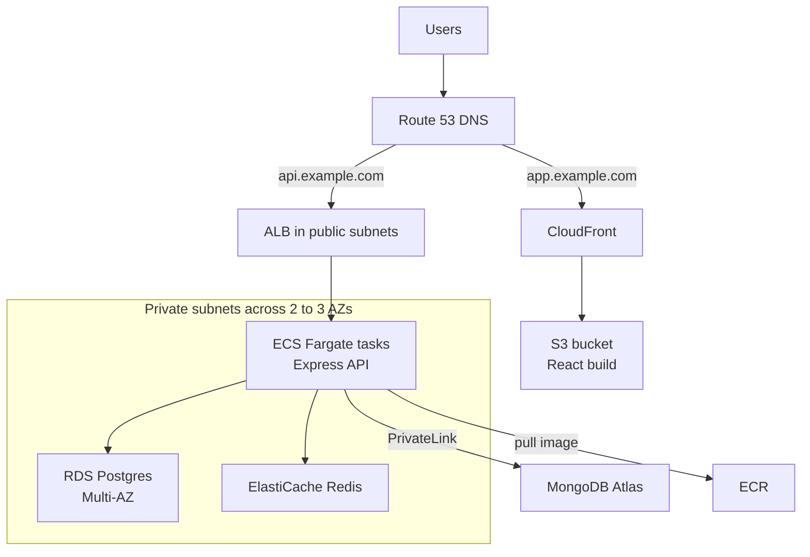

When a MERN app outgrows a single server, AWS is the most common destination, and the number of services involved can be intimidating. The good news is that a solid production layout uses a small, well-understood set of building blocks, and the same shape appears in almost every interview answer about deploying a web app on AWS. This guide walks through each piece, why it is there, and how traffic and permissions flow between them.

## How it works

Two separate paths serve users. Static React assets come from S3 through the CloudFront CDN. API calls go to an Application Load Balancer in public subnets, which forwards to ECS Fargate tasks in private subnets. Those tasks reach the databases, also in private subnets, and nothing in the private tier has a public IP.



A common variant puts both under one domain: CloudFront serves `/` from S3 and forwards `/api/*` to the ALB as a second origin, which removes CORS entirely.

## The network: VPC and subnets

Create a VPC, for example `10.0.0.0/16`, spanning two or three Availability Zones. In each AZ:

- **Public subnet** (`10.0.0.0/24`, ...): route table points `0.0.0.0/0` at an Internet Gateway. Holds the ALB and NAT gateways.
- **Private app subnet** (`10.0.10.0/24`, ...): default route through a NAT gateway so tasks can call external APIs. Holds Fargate tasks.
- **Private data subnet** (`10.0.20.0/24`, ...): no internet route needed. Holds RDS, ElastiCache, DocumentDB.

NAT gateways are billed per hour and per GB processed, and one per AZ is the highly available setup. Add VPC endpoints (gateway endpoint for S3, interface endpoints for ECR, CloudWatch Logs, Secrets Manager) so image pulls and logs do not traverse the NAT, which saves money and keeps traffic private.

## Security groups as the real firewall

Security groups are stateful and can reference each other, which gives a clean chain:

| Security group | Inbound rule |
|---|---|
| `alb-sg` | 443 from `0.0.0.0/0` |
| `api-sg` | 3000 from `alb-sg` only |
| `rds-sg` | 5432 from `api-sg` only |
| `redis-sg` | 6379 from `api-sg` only |

No database accepts traffic from the internet or even from other workloads in the VPC.

## Compute: ECR and ECS Fargate

CI pushes images tagged with the git SHA to ECR. An ECS service runs N copies of a task definition across private subnets and registers them with the ALB target group.

```json
{
  "family": "api",
  "requiresCompatibilities": ["FARGATE"],
  "networkMode": "awsvpc",
  "cpu": "512",
  "memory": "1024",
  "executionRoleArn": "arn:aws:iam::123456789012:role/ecsTaskExecutionRole",
  "taskRoleArn": "arn:aws:iam::123456789012:role/api-task-role",
  "containerDefinitions": [{
    "name": "api",
    "image": "123456789012.dkr.ecr.us-east-1.amazonaws.com/api:3f9c2ab",
    "portMappings": [{ "containerPort": 3000 }],
    "environment": [{ "name": "NODE_ENV", "value": "production" }],
    "secrets": [
      { "name": "DATABASE_URL", "valueFrom": "arn:aws:secretsmanager:us-east-1:123456789012:secret:prod/api/db" }
    ],
    "logConfiguration": {
      "logDriver": "awslogs",
      "options": { "awslogs-group": "/ecs/api", "awslogs-region": "us-east-1", "awslogs-stream-prefix": "api" }
    }
  }]
}
```

Two IAM roles matter. The **execution role** lets ECS pull the image and read the secrets referenced above. The **task role** is what your Node code gets through the AWS SDK, for example permission to write to one S3 bucket. Never put access keys in environment variables.

Configure the ALB target group health check on `/healthz`, set the service's minimum healthy percent to 100 and maximum to 200 for rolling deploys, and enable the deployment circuit breaker with rollback. Add target-tracking auto scaling on CPU around 60 percent or on ALB requests per target. Set `deregistration_delay` (default 300 seconds) lower, perhaps 30, if your requests are short.

## Data tier

- **MongoDB:** MongoDB Atlas is the usual choice; deploy the cluster in the same AWS region and connect over PrivateLink or VPC peering instead of public IP allowlists. Amazon DocumentDB is an AWS-native alternative that implements a MongoDB-compatible API on a different engine; check feature compatibility (aggregation stages, change streams, transactions behaviour) before choosing it.
- **Postgres:** RDS for PostgreSQL in Multi-AZ, or Aurora PostgreSQL for faster failover and read scaling. Enable automated backups and deletion protection.
- **Redis:** ElastiCache with a replica and automatic failover, encryption in transit enabled, for sessions, caching and BullMQ queues.

## Frontend, DNS and certificates

Upload the Vite build to a private S3 bucket and serve it through CloudFront with Origin Access Control, so the bucket is never public. Upload hashed assets with long cache headers and `index.html` with `no-cache`, then invalidate `/index.html` on deploy. Configure a custom error response mapping 403 and 404 to `/index.html` with status 200 so client-side routing works.

Request TLS certificates in AWS Certificate Manager. ACM certs are free and auto-renew. The certificate for CloudFront must be in `us-east-1`; the one for the ALB must be in the ALB's region. Route 53 alias records point `app.example.com` at CloudFront and `api.example.com` at the ALB.

```bash
aws s3 sync dist/ s3://shop-web-prod --delete \
  --cache-control "public,max-age=31536000,immutable" --exclude index.html
aws s3 cp dist/index.html s3://shop-web-prod/index.html --cache-control "no-cache"
aws cloudfront create-invalidation --distribution-id E123ABC --paths /index.html
```

## Infrastructure as code

Build all of this with Terraform, AWS CDK or CloudFormation, never by clicking in the console. Separate state per environment, and keep staging structurally identical to production with smaller sizes.

## Trade-offs and pitfalls

- **NAT gateway costs** often exceed compute for small apps. Use VPC endpoints, and for dev environments consider a single NAT.
- **Tasks in public subnets with public IPs** avoid NAT costs but widen the attack surface. Acceptable for dev, not for production data access.
- **Connection limits:** 20 Fargate tasks with a pool of 20 each means 400 Postgres connections; smaller RDS instances cannot handle that. Use RDS Proxy or smaller pools.
- **Wrong ACM region** for CloudFront is the most common certificate mistake.
- **Single-AZ anything** in production undoes the multi-AZ design.

## Interview angle

- Draw the public versus private subnet split and the security group chain; interviewers look for defence in depth.
- Explain why static assets go to S3 plus CloudFront rather than the API servers.
- Discuss scaling: ALB plus ECS auto scaling for stateless compute, read replicas and caching for the data tier.
- Know the IAM split between execution role and task role, and that secrets come from Secrets Manager.

## Key takeaways

- Public subnets hold only the load balancer and NAT; compute and data live in private subnets across multiple AZs.
- Chain security groups by reference so each tier accepts traffic only from the tier in front of it.
- Run the API on ECS Fargate from SHA-tagged ECR images with health checks, rolling deploys and auto scaling.
- Serve React from private S3 through CloudFront with ACM certificates and Route 53 aliases.
- Use managed data services and connect privately; codify everything in infrastructure as code.
