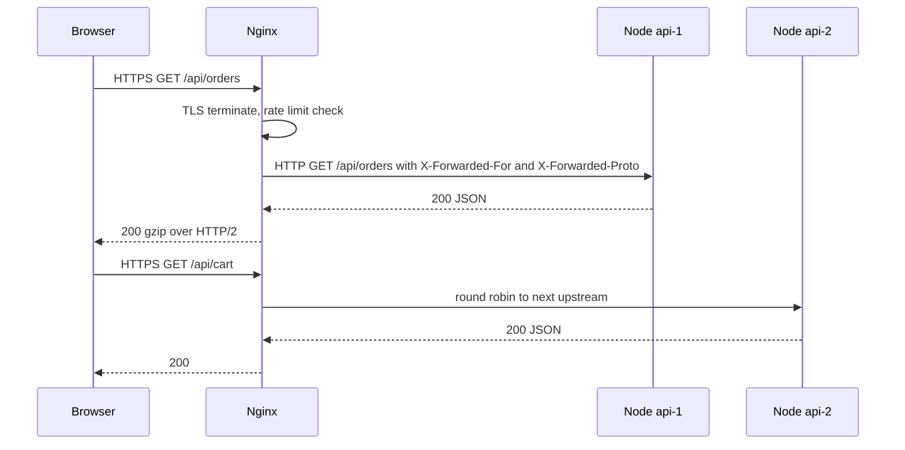

Node is good at running application code and mediocre at the boring edge work: terminating TLS, compressing responses, serving static files, buffering slow clients and shedding abusive traffic. Putting Nginx in front of Express offloads that work to a battle-tested event-driven server written in C and lets you run several Node processes behind one public port. You need this the moment you deploy on a VM or with Compose; managed load balancers like an AWS ALB cover part of the same ground in the cloud.

## How it works

Nginx accepts the client connection, completes the TLS handshake, and forwards the request over plain HTTP on a private network to one of several upstream Node processes. It adds headers describing the original client so the app can still see the real IP and protocol. Responses flow back through Nginx, which can compress and cache them.



## A complete server config

```nginx
upstream api {
  least_conn;
  server api-1:3000 max_fails=3 fail_timeout=10s;
  server api-2:3000 max_fails=3 fail_timeout=10s;
  keepalive 32;
}

limit_req_zone $binary_remote_addr zone=api_rl:10m rate=10r/s;
limit_req_zone $binary_remote_addr zone=login_rl:10m rate=5r/m;

map $http_upgrade $connection_upgrade {
  default upgrade;
  ''      close;
}

server {
  listen 80;
  server_name app.example.com;
  location /.well-known/acme-challenge/ { root /var/www/certbot; }
  location / { return 301 https://$host$request_uri; }
}

server {
  listen 443 ssl;
  http2 on;
  server_name app.example.com;

  ssl_certificate     /etc/letsencrypt/live/app.example.com/fullchain.pem;
  ssl_certificate_key /etc/letsencrypt/live/app.example.com/privkey.pem;
  ssl_protocols TLSv1.2 TLSv1.3;
  add_header Strict-Transport-Security "max-age=31536000; includeSubDomains" always;

  client_max_body_size 10m;

  gzip on;
  gzip_comp_level 5;
  gzip_min_length 1024;
  gzip_types application/json application/javascript text/css image/svg+xml;

  root /usr/share/nginx/html;

  location /assets/ {
    expires 1y;
    add_header Cache-Control "public, immutable";
    access_log off;
  }

  location /api/auth/login {
    limit_req zone=login_rl burst=5 nodelay;
    proxy_pass http://api;
    include /etc/nginx/proxy_params.conf;
  }

  location /api/ {
    limit_req zone=api_rl burst=20 nodelay;
    limit_req_status 429;
    proxy_pass http://api;
    include /etc/nginx/proxy_params.conf;
  }

  location /socket.io/ {
    proxy_pass http://api;
    proxy_http_version 1.1;
    proxy_set_header Upgrade $http_upgrade;
    proxy_set_header Connection $connection_upgrade;
    proxy_set_header Host $host;
    proxy_read_timeout 1h;
  }

  location / {
    try_files $uri /index.html;
  }
}
```

And the shared proxy headers file:

```nginx
proxy_http_version 1.1;
proxy_set_header Connection "";
proxy_set_header Host $host;
proxy_set_header X-Real-IP $remote_addr;
proxy_set_header X-Forwarded-For $proxy_add_x_forwarded_for;
proxy_set_header X-Forwarded-Proto $scheme;
proxy_connect_timeout 5s;
proxy_read_timeout 60s;
```

### Upstreams and keepalive

`least_conn` sends each request to the backend with the fewest active connections, which beats round robin when request durations vary. `keepalive 32` keeps idle connections to Node open, but only works if you also set `proxy_http_version 1.1` and clear the `Connection` header, as the include does. Without that, Nginx opens a new TCP connection to Node for every request. Make Node's `server.keepAliveTimeout` longer than Nginx's upstream idle timeout so Node never closes a connection Nginx is about to reuse, which otherwise causes sporadic 502s.

### TLS with Let's Encrypt

Certbot proves domain ownership through the HTTP-01 challenge served from `/.well-known/acme-challenge/` on port 80, then writes certificates under `/etc/letsencrypt/live/`. Let's Encrypt certificates are short-lived (90 days historically, with shorter lifetimes being phased in), so renewal must be automated:

```bash
certbot certonly --webroot -w /var/www/certbot -d app.example.com --email ops@example.com --agree-tos
# cron or systemd timer, twice daily
certbot renew --quiet --deploy-hook "nginx -s reload"
```

### HTTP/2 and compression

HTTP/2 multiplexes many requests over one connection, which helps SPAs that load dozens of assets. Nginx speaks HTTP/2 to the browser and HTTP/1.1 to Node, which is fine. Gzip at level 4 to 6 is the usual sweet spot; higher levels burn CPU for little gain. Brotli compresses text better but needs the `ngx_brotli` module, which is not in the stock image, so many teams pre-compress assets at build time and serve them with `gzip_static` or `brotli_static`.

### WebSockets

A WebSocket starts as an HTTP request with `Upgrade: websocket`. Nginx does not forward hop-by-hop headers by default, so without the explicit `Upgrade` and `Connection` headers the handshake fails and Socket.IO silently falls back to long polling. Raise `proxy_read_timeout` because idle sockets would otherwise be cut after 60 seconds. With several upstreams, Socket.IO polling requires sticky sessions (`ip_hash` or a cookie) or a Redis adapter plus WebSocket-only transport.

## Express behind a proxy

Behind Nginx, every request appears to come from the proxy's IP over HTTP. Tell Express to trust the forwarded headers:

```js
import express from 'express';
import rateLimit from 'express-rate-limit';

const app = express();
app.set('trust proxy', 1); // trust exactly one hop: our Nginx

app.use(rateLimit({ windowMs: 60_000, limit: 300 }));

app.get('/whoami', (req, res) => {
  res.json({ ip: req.ip, secure: req.secure, protocol: req.protocol });
});
```

With `trust proxy` set, `req.ip` reads `X-Forwarded-For`, `req.secure` reflects `X-Forwarded-Proto`, and `cookie({ secure: true })` sessions work. Setting `trust proxy` to `true` is a security bug if the app is ever reachable directly, because any client can then spoof its IP and bypass IP-based rate limits. Use the hop count or the proxy's subnet.

## Trade-offs and pitfalls

- **Nginx rate limiting is per instance.** With three Nginx nodes, the effective limit triples. For global limits per user or API key, use Redis-backed limiting in the app or at an API gateway.
- **`client_max_body_size` defaults to 1 MB**, so uploads fail with 413 until you raise it.
- **Proxy buffering** is great for normal responses but breaks server-sent events; set `proxy_buffering off` on SSE routes.
- **DNS caching.** Nginx resolves upstream hostnames at startup. If container IPs change, use a `resolver` directive or reload.
- **Behind a cloud load balancer** you may not need Nginx at all; the ALB terminates TLS and routes, and static assets belong on a CDN.

## Interview angle

- Explain TLS termination at the edge and why traffic inside a private network is often plain HTTP, and when you would re-encrypt (compliance, zero trust).
- Be precise about `X-Forwarded-For` and trust boundaries; spoofed IPs are a classic follow-up.
- WebSocket scaling questions lead to upgrade headers, sticky sessions and pub/sub fan-out with Redis.
- Distinguish edge rate limiting (cheap, coarse, per node) from application rate limiting (shared state, per identity).

## Key takeaways

- Nginx handles TLS, compression, static files and slow clients so Node can focus on application logic.
- Use upstream keepalive with HTTP/1.1 and a cleared `Connection` header, and keep Node's keepalive timeout longer.
- Forward `Upgrade` and `Connection` headers and extend timeouts for WebSockets.
- Set `trust proxy` to a specific hop count so `req.ip` and `req.secure` are correct and unspoofable.
- Automate certificate renewal and reload Nginx after it.
