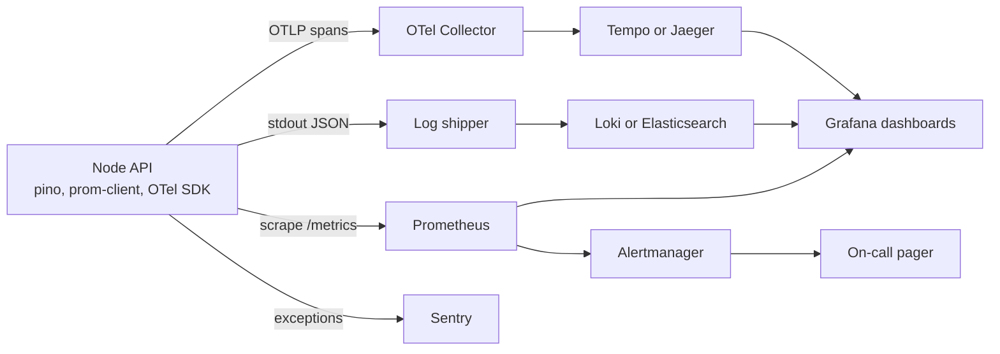

Once your app runs on several containers behind a load balancer, `console.log` and SSH stop working as a debugging strategy. A customer reports that checkout was slow at 14:02; which of twelve Pods served them, which Mongo query was slow, and was it one user or everyone? Observability is the ability to answer questions like that from the outside. It rests on three signals, logs, metrics and traces, tied together by shared identifiers, plus alerts that wake you only when users are actually hurting.

## How it works

The app emits structured JSON logs to stdout, exposes metrics on an endpoint that Prometheus scrapes, and sends trace spans via OpenTelemetry to a collector. Every log line carries the trace ID of the request, so you can jump from a slow trace to its logs and from an alert to the traces behind it.



## Structured logging with pino

Pino is a fast JSON logger for Node, with much lower overhead than older loggers because it defers formatting. Log JSON to stdout and let the platform ship it; never write log files inside containers.

```ts
import pino from 'pino';
import pinoHttp from 'pino-http';
import { randomUUID } from 'node:crypto';

export const logger = pino({
  level: process.env.LOG_LEVEL ?? 'info',
  redact: ['req.headers.authorization', 'req.headers.cookie', '*.password'],
});

app.use(pinoHttp({
  logger,
  genReqId: (req, res) => {
    const id = (req.headers['x-request-id'] as string) ?? randomUUID();
    res.setHeader('x-request-id', id);
    return id;
  },
}));

app.post('/orders', async (req, res) => {
  req.log.info({ userId: req.user.id, items: req.body.items.length }, 'creating order');
  // ...
});
```

Rules that pay off: log events with fields, not interpolated strings (`{ orderId }`, not `"order " + id`); keep levels meaningful (error means someone should look); redact credentials and personal data; and use `pino-pretty` only in development.

### Correlation IDs

A correlation ID ties together everything that happened for one request across services and queues. Accept an incoming `x-request-id` (or the W3C `traceparent` header), generate one if missing, attach it to every log line, return it in the response, and forward it on outgoing HTTP calls and job payloads. Node's `AsyncLocalStorage` lets deep code access the current ID without passing it through every function. If you adopt OpenTelemetry, the trace ID serves this purpose and pino can include it automatically through the OTel instrumentation for pino.

## Metrics with Prometheus

Metrics are cheap numeric time series, ideal for dashboards and alerts. Two frameworks tell you what to measure:

- **RED** for request-driven services: **R**ate (requests per second), **E**rrors (failed requests per second), **D**uration (latency distribution).
- **USE** for resources: **U**tilisation, **S**aturation, **E**rrors, for CPU, memory, connection pools, event loop and queues.

```ts
import client from 'prom-client';

client.collectDefaultMetrics(); // heap, GC, event loop lag, CPU

const httpDuration = new client.Histogram({
  name: 'http_request_duration_seconds',
  help: 'HTTP request latency',
  labelNames: ['method', 'route', 'status'],
  buckets: [0.01, 0.05, 0.1, 0.25, 0.5, 1, 2.5, 5],
});

app.use((req, res, next) => {
  const end = httpDuration.startTimer();
  res.on('finish', () => {
    end({ method: req.method, route: req.route?.path ?? 'unmatched', status: res.statusCode });
  });
  next();
});

app.get('/metrics', async (_req, res) => {
  res.set('Content-Type', client.register.contentType);
  res.send(await client.register.metrics());
});
```

Use the route template (`/orders/:id`), never the raw URL, as a label; user IDs or raw paths as labels create unbounded cardinality that can take down Prometheus. Keep `/metrics` off the public internet.

Useful PromQL for a Grafana dashboard:

```text
# p95 latency per route
histogram_quantile(0.95, sum by (le, route) (rate(http_request_duration_seconds_bucket[5m])))

# error ratio
sum(rate(http_request_duration_seconds_count{status=~"5.."}[5m]))
  / sum(rate(http_request_duration_seconds_count[5m]))
```

For Node specifically, watch event loop lag, heap used versus limit, GC pause time, and the size and wait time of your Mongo and Postgres connection pools.

## Distributed tracing with OpenTelemetry

A trace is a tree of spans showing where time went in one request: Express handler, Mongo query, Postgres query, Redis call, outgoing HTTP. OpenTelemetry is the vendor-neutral standard; auto-instrumentation covers Express, http, mongodb, pg, ioredis and more without code changes.

```ts
// tracing.ts, loaded before the app with: node --import ./tracing.js dist/server.js
import { NodeSDK } from '@opentelemetry/sdk-node';
import { getNodeAutoInstrumentations } from '@opentelemetry/auto-instrumentations-node';
import { OTLPTraceExporter } from '@opentelemetry/exporter-trace-otlp-http';

new NodeSDK({
  serviceName: 'shop-api',
  traceExporter: new OTLPTraceExporter({ url: 'http://otel-collector:4318/v1/traces' }),
  instrumentations: [getNodeAutoInstrumentations()],
}).start();
```

Instrumentation must load before the libraries it patches. Send spans to an OpenTelemetry Collector, which batches, samples and forwards to Jaeger, Grafana Tempo, Honeycomb, Datadog or another backend. At high traffic, sample: keep a percentage of normal traces and, with tail sampling in the collector, all slow or failed ones.

## Alerting on SLOs

Alerting on every CPU spike causes fatigue and ignored pages. Instead, define Service Level Objectives from the user's view, for example 99.9 percent of checkout requests succeed and 95 percent complete under 500 ms over 30 days. The 0.1 percent allowed failure is your error budget. Alert on burn rate, how fast you are consuming that budget:

- Page when the budget burns very fast over a short window (for example, a rate that would exhaust a month's budget in about two days, sustained over an hour and confirmed over five minutes).
- Open a ticket for slow burns over longer windows.

Symptom-based alerts (users see errors) page; cause-based signals (disk 80 percent full) usually become tickets, except where they predict imminent outage.

## Error tracking with Sentry

Logs tell you an error happened; an error tracker groups occurrences, shows stack traces with source maps, links releases, and tells you which deploy introduced a regression. Initialise Sentry early, set `release` to the git SHA, and upload source maps for the React build in CI (but do not serve them publicly). Configure `beforeSend` to scrub personal data.

## Trade-offs and pitfalls

- **High-cardinality labels** explode metric storage and cost.
- **Logging everything at debug** in production costs real money with managed log services; sample noisy logs.
- **Unsampled tracing** at scale is expensive; sampling without tail rules hides the interesting failures.
- **Dashboards nobody reads**: build a small number around RED for each service and the key dependencies.
- **Alerts without runbooks** waste the first 20 minutes of every incident.

## Interview angle

- Name the three pillars and explain how correlation IDs or trace IDs connect them.
- Use RED for services and USE for resources when asked what you would monitor.
- Describe SLOs, error budgets and burn-rate alerts rather than threshold alerts on CPU.
- Mention OpenTelemetry as the standard to avoid vendor lock-in.

## Key takeaways

- Log structured JSON to stdout with pino, redact secrets, and include a request or trace ID on every line.
- Expose RED metrics with bounded labels and watch Node-specific signals like event loop lag and pool saturation.
- Use OpenTelemetry auto-instrumentation and a collector for traces, with sensible sampling.
- Alert on SLO burn rate, not raw resource thresholds.
- Track exceptions with Sentry, tied to releases and source maps.
