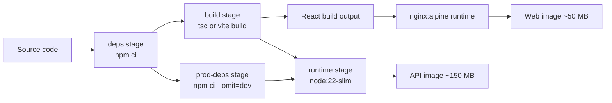

A Dockerfile that works on your laptop is not the same as one that belongs in production. The naive version, `FROM node`, `COPY . .`, `npm install`, `npm start`, produces a 1 GB image that runs as root, ships your dev dependencies and test fixtures, rebuilds every layer on any file change, and sometimes bakes a `.env` file into the image. You notice this when CI takes ten minutes per build, when a security scanner flags hundreds of CVEs, or when a container restart takes long enough to page someone. This guide covers the patterns that fix all of that for an Express API and a React single-page app.

## How it works

A multi-stage build uses several `FROM` instructions in one Dockerfile. Early stages have the full toolchain (compilers, dev dependencies, TypeScript, Vite); the final stage copies only the build output into a small runtime image. Docker caches each instruction as a layer, and a layer is reused only if its inputs and every layer above it are unchanged. Ordering instructions from least to most frequently changed is what makes rebuilds fast.



## The Node API Dockerfile

```dockerfile
# syntax=docker/dockerfile:1
FROM node:22-slim AS deps
WORKDIR /app
COPY package.json package-lock.json ./
RUN --mount=type=cache,target=/root/.npm npm ci

FROM deps AS build
COPY tsconfig.json ./
COPY src ./src
RUN npm run build

FROM node:22-slim AS prod-deps
WORKDIR /app
COPY package.json package-lock.json ./
RUN --mount=type=cache,target=/root/.npm npm ci --omit=dev

FROM node:22-slim AS runtime
ENV NODE_ENV=production
WORKDIR /app
COPY --from=prod-deps --chown=node:node /app/node_modules ./node_modules
COPY --from=build --chown=node:node /app/dist ./dist
COPY --chown=node:node package.json ./
USER node
EXPOSE 3000
HEALTHCHECK --interval=30s --timeout=3s --start-period=10s --retries=3 \
  CMD node -e "fetch('http://127.0.0.1:3000/healthz').then(r=>process.exit(r.ok?0:1)).catch(()=>process.exit(1))"
CMD ["node", "dist/server.js"]
```

Points worth calling out:

- **`npm ci`, not `npm install`.** `npm ci` installs exactly what the lockfile says, fails if `package.json` and the lockfile disagree, and deletes any existing `node_modules` first. It is reproducible; `npm install` may silently update the lockfile.
- **Copy manifests before source.** Because `package.json` and the lockfile are copied alone, the expensive `npm ci` layer is reused whenever only application code changes.
- **BuildKit cache mounts** (`--mount=type=cache`) keep the npm cache between builds without putting it in the image.
- **`USER node`.** The official Node images ship a `node` user with UID 1000. Running as non-root limits the damage of a container escape or a path traversal bug, and many Kubernetes clusters enforce `runAsNonRoot`.
- **Exec-form `CMD`.** `CMD ["node", "dist/server.js"]` makes Node PID 1 so it receives `SIGTERM` directly. Running through `npm start` adds a process that may not forward signals, which breaks graceful shutdown. If you need proper zombie reaping, run with `docker run --init` or add `tini`.
- **Healthcheck without curl.** Slim images do not include `curl`; Node 18+ has a global `fetch`, so a one-liner avoids installing extra packages. Note that Kubernetes ignores Docker `HEALTHCHECK` and uses its own probes.

### Choosing a base image

| Base | Approx size | Notes |
|---|---|---|
| `node:22` | ~1 GB | Full Debian plus build tools. Fine for build stages only. |
| `node:22-slim` | ~200 MB | Debian, glibc, good default for runtime. |
| `node:22-alpine` | ~150 MB | musl libc; some native modules (bcrypt, sharp) need care. |
| `gcr.io/distroless/nodejs22-debian12` | ~130 MB | No shell or package manager; harder to debug, smallest attack surface. |

Pin a major version tag at minimum, and pin by digest (`node:22-slim@sha256:...`) if you want fully reproducible builds. Rebuild regularly so you pick up OS security patches.

## The .dockerignore file

Without it, `COPY . .` sends your whole working directory, including `node_modules` and `.git`, to the build context.

```text
node_modules
npm-debug.log
dist
build
.git
.github
.env
.env.*
coverage
*.md
Dockerfile*
docker-compose*.yml
```

Excluding `.env` is a security control, not just an optimisation: a secret copied into any layer stays in the image history even if a later layer deletes it.

## The React Dockerfile served by Nginx

A built React app is just static files. There is no reason to ship Node in the runtime image.

```dockerfile
# syntax=docker/dockerfile:1
FROM node:22-slim AS build
WORKDIR /app
COPY package.json package-lock.json ./
RUN --mount=type=cache,target=/root/.npm npm ci
COPY . .
ARG VITE_API_URL
ENV VITE_API_URL=$VITE_API_URL
RUN npm run build

FROM nginx:1.27-alpine
COPY nginx.conf /etc/nginx/conf.d/default.conf
COPY --from=build /app/dist /usr/share/nginx/html
EXPOSE 80
HEALTHCHECK CMD wget -qO- http://127.0.0.1/ || exit 1
```

```nginx
server {
  listen 80;
  root /usr/share/nginx/html;

  location /assets/ {
    expires 1y;
    add_header Cache-Control "public, immutable";
  }

  location / {
    try_files $uri /index.html;
    add_header Cache-Control "no-cache";
  }
}
```

`try_files $uri /index.html` makes client-side routes like `/orders/42` work on refresh. Hashed assets get a one-year immutable cache; `index.html` must not be cached so users pick up new deploys. Remember that `VITE_*` (or `REACT_APP_*`) variables are inlined at build time and visible to anyone, so they must never hold secrets. If you want one image for every environment, serve a small `config.js` generated at container start instead of build args. For a hardened variant, `nginxinc/nginx-unprivileged` runs as non-root on port 8080.

## Trade-offs and pitfalls

- **Alpine and native modules.** musl-based images can break prebuilt binaries or cause subtle DNS and performance differences. If you hit odd issues, switch to `-slim`.
- **Busting the cache by accident.** `COPY . .` before `npm ci` means every code change reinstalls dependencies. Also watch for build args that change on every build (like a timestamp) placed early in the file.
- **Secrets in build args.** `ARG NPM_TOKEN` is recorded in the image history. Use `RUN --mount=type=secret,id=npmrc` for private registries.
- **`latest` tags.** Both for base images and your own images, `latest` makes rollbacks and audits impossible. Tag with the git SHA.
- **Distroless debugging.** No shell means no `docker exec sh`. Use ephemeral debug containers or keep a `-debug` variant.
- **Building on ARM laptops for x86 servers.** Use `docker buildx build --platform linux/amd64` or multi-arch builds, or you get `exec format error` in production.

## Interview angle

- Asked how to shrink an image or speed up CI, explain multi-stage builds plus layer ordering, and quantify it (1 GB to under 200 MB, minutes to seconds on cache hits).
- Container security questions: non-root user, minimal base, no secrets in layers, image scanning (Trivy, Grype) in CI, pinned base images.
- Graceful shutdown questions often trace back to PID 1 and exec-form `CMD`.
- For the frontend, point out that a SPA is a static artifact best served by Nginx or a CDN, not a Node process.

## Key takeaways

- Use multi-stage builds: full toolchain to build, slim runtime to run.
- Copy lockfiles first and use `npm ci` so dependency layers cache and installs are reproducible.
- Run as a non-root user, use exec-form `CMD`, and add a health endpoint.
- Keep `.env`, `.git` and `node_modules` out of the build context with `.dockerignore`.
- Serve the React build from Nginx with immutable caching on hashed assets and no-cache on `index.html`.
