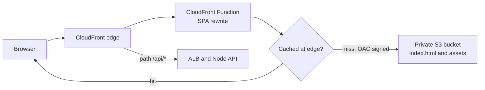

A built React app is just files: one HTML page, a few JavaScript and CSS bundles, fonts and images. It needs no Node server at all. Serving those files from object storage through a CDN gives you global low latency, near-unlimited scale and a bill measured in cents for most apps. The work is in the details: caching rules that make deploys instant without serving stale code, a bucket that is not public, client-side routes that do not 404, and headers that keep the browser safe.

## How it works

CloudFront edge locations receive every request. On a cache miss, CloudFront fetches the object from a private S3 bucket, signing the request with Origin Access Control so the bucket never has to be public. A small CloudFront Function rewrites client-side routes like `/orders/42` to `/index.html` before the cache lookup. API calls go to a second origin, usually an ALB, under `/api/*`.



## Vite build output and caching rules

`vite build` writes `dist/index.html` plus content-hashed files such as `dist/assets/index-B7f3kQ2a.js` and `index-Dx91pLm0.css`. The hash changes whenever the content changes, which allows two opposite caching policies:

- **Hashed assets** never change under the same name, so cache them for a year: `Cache-Control: public, max-age=31536000, immutable`. `immutable` stops browsers revalidating on reload.
- **index.html** references the current hashes, so it must always be fresh: `Cache-Control: no-cache`. That means "revalidate before use", not "do not store"; with an ETag the check costs a tiny 304.

Upload with separate commands so each file gets the right header:

```bash
npm ci && npm run build

# 1. assets first, long-lived; no --delete so old hashes survive for open tabs
aws s3 sync dist/assets s3://shop-web-prod/assets \
  --cache-control "public, max-age=31536000, immutable"

# 2. everything else except index.html, short cache
aws s3 sync dist s3://shop-web-prod --exclude "assets/*" --exclude "index.html" \
  --cache-control "public, max-age=300"

# 3. index.html last, so it never points at assets that are not uploaded yet
aws s3 cp dist/index.html s3://shop-web-prod/index.html \
  --cache-control "no-cache" --content-type "text/html; charset=utf-8"

aws cloudfront create-invalidation --distribution-id E2ABCDEF123 --paths "/index.html"
```

Order matters: a user who loads the new `index.html` before the new bundles exist gets a blank page. Keep old hashed assets for at least a few releases, since users with a tab open will lazy-load chunks from the previous build; an S3 lifecycle rule can expire them after 30 to 90 days.

## Private bucket with Origin Access Control

Do not enable S3 static website hosting or public reads. Use a normal private bucket with Block Public Access on, and grant only your distribution read access. OAC replaced the older Origin Access Identity and supports SSE-KMS and all regions.

```hcl
resource "aws_cloudfront_origin_access_control" "web" {
  name                              = "shop-web-oac"
  origin_access_control_origin_type = "s3"
  signing_behavior                  = "always"
  signing_protocol                  = "sigv4"
}

data "aws_iam_policy_document" "web" {
  statement {
    actions   = ["s3:GetObject"]
    resources = ["${aws_s3_bucket.web.arn}/*"]
    principals {
      type        = "Service"
      identifiers = ["cloudfront.amazonaws.com"]
    }
    condition {
      test     = "StringEquals"
      variable = "AWS:SourceArn"
      values   = [aws_cloudfront_distribution.web.arn]
    }
  }
}
```

In the distribution, the S3 origin uses the bucket's regional REST endpoint with `origin_access_control_id` set, the default behaviour uses the managed `CachingOptimized` cache policy, `viewer_protocol_policy = "redirect-to-https"`, and `default_root_object = "index.html"`. Attach an ACM certificate from `us-east-1` for your custom domain, since CloudFront only reads certificates from that region.

## SPA routing with a CloudFront Function

A deep link like `/orders/42` has no matching object in S3. The common hack maps 403 and 404 errors to `/index.html` with status 200 via custom error responses. It works, but it applies to the whole distribution, so a genuinely missing image or a 404 from your `/api/*` origin also returns HTML with a 200, which confuses clients, caches and monitoring.

A viewer-request CloudFront Function is cleaner: rewrite only paths without a file extension.

```js
function handler(event) {
  var req = event.request;
  var uri = req.uri;
  if (uri.startsWith('/api/')) return req;
  // no dot in the last path segment means a client-side route
  if (!uri.split('/').pop().includes('.')) {
    req.uri = '/index.html';
  }
  return req;
}
```

Attach it only to the default behaviour. CloudFront Functions run at every edge in under a millisecond and cost $0.10 per million invocations; Lambda@Edge is overkill for this.

## Invalidations

With hashed assets you only ever invalidate `/index.html` and the few unhashed files. The first 1,000 invalidation paths each month are free and then cost $0.005 per path; a wildcard such as `/*` counts as one path but evicts everything, forcing every edge to refetch your whole bundle. Invalidations usually complete in under a minute or two. Because `index.html` is `no-cache`, browsers revalidate it anyway; the invalidation clears the edge copy.

## Compression

Enable compression in the cache policy (`CachingOptimized` already supports gzip and Brotli) and CloudFront compresses compressible types between 1,000 bytes and 10 MB on the fly, choosing Brotli when the browser sends `Accept-Encoding: br`. A typical 600 KB JavaScript bundle drops to around 150 to 180 KB with Brotli. Make sure S3 objects carry correct `Content-Type` values, since CloudFront only compresses known text types; `aws s3 sync` infers them from extensions.

## Security headers

Attach a response headers policy instead of hand-rolling headers. The managed `SecurityHeadersPolicy` adds HSTS, `X-Content-Type-Options: nosniff`, `X-Frame-Options: SAMEORIGIN`, `Referrer-Policy: strict-origin-when-cross-origin` and `X-XSS-Protection`. For a real app create a custom policy that also sets a Content Security Policy, for example `default-src 'self'; connect-src 'self' https://api.example.com; img-src 'self' data:; frame-ancestors 'none'`. Vite output has no inline scripts by default, which makes a strict CSP achievable.

## Runtime environment config

`import.meta.env.VITE_API_URL` is baked in at build time, so one bundle cannot move from staging to production. To build once and promote the same artifact, serve a small config file per environment:

```js
// public/config.json is replaced per environment at deploy time, uploaded with no-cache
const config = await fetch('/config.json', { cache: 'no-cache' }).then((r) => r.json());
createRoot(document.getElementById('root')).render(<App config={config} />);
```

Only put public values there: API base URL, Sentry DSN, feature flags. Anything in a browser bundle or config file is readable by every user, so never ship secrets to the front end.

## Alternatives

Vercel, Netlify and Cloudflare Pages do all of the above by default: hashed-asset caching, SPA fallbacks, preview deploys per pull request, TLS and a global CDN, with a git push as the deploy step. Cloudflare Pages has no bandwidth charge on static requests; Vercel and Netlify include generous free tiers and bill bandwidth beyond them. Choose S3 and CloudFront when the rest of the stack is on AWS, you need the API behind the same domain without CORS, or you need WAF, private networking and IAM-based controls in one account. Choose a platform when speed of setup and preview environments matter more.

## Trade-offs and pitfalls

- **Caching index.html for long** strands users on old builds; always `no-cache` it.
- **Deleting old assets on deploy** breaks lazy-loaded chunks in open tabs.
- **403/404 error mapping** hides real missing files and API 404s.
- **Certificate in the wrong region**: CloudFront needs ACM in `us-east-1`.
- **Public website endpoint** bypasses CloudFront and its headers and WAF.
- **Build-time env vars** force a rebuild per environment and blur what you tested.

## Interview angle

- Explain content hashing and why it permits `immutable` caching while the HTML entry stays fresh.
- Describe OAC with a bucket policy scoped to the distribution ARN.
- Contrast a viewer-request rewrite with the error-page fallback.
- Discuss build once, deploy many with runtime config.

## Key takeaways

- Upload hashed assets with a one-year `immutable` header and `index.html` with `no-cache`, assets first.
- Keep the bucket private and grant read access to CloudFront via OAC only.
- Route client-side paths with a small CloudFront Function, not error-page mapping.
- Invalidate only unhashed files, enable Brotli, and attach security headers with a response headers policy.
- Platforms like Vercel, Netlify and Cloudflare Pages are valid shortcuts when you do not need AWS-level control.
