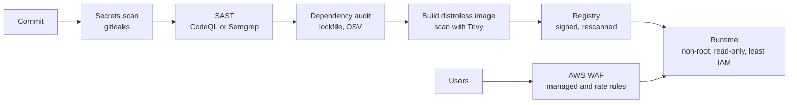

Most breaches of ordinary web apps are not clever zero-days. They are a vulnerable dependency left unpatched for months, a leaked access key in a public repo, an over-privileged role, or a compromised npm package that ran a postinstall script on a CI runner. Hardening is a layered checklist that removes those easy paths: filter traffic at the edge, control what code enters the build, ship minimal images that run with few privileges, and keep patching on a schedule.

## How it works

Controls sit at each stage from commit to runtime. Scanners in CI stop known-bad code and images before they ship; runtime controls limit what an attacker can do if something still gets through.



## Edge: AWS WAF

Attach a web ACL to CloudFront or the ALB. Start with AWS managed rule groups, which are maintained by AWS and cover common attacks: `AWSManagedRulesCommonRuleSet` (OWASP-style injection and bad inputs), `AWSManagedRulesKnownBadInputsRuleSet` (for example Log4Shell patterns), `AWSManagedRulesAmazonIpReputationList` and `AWSManagedRulesSQLiRuleSet`. Run new groups in count mode for a week, check sampled requests for false positives such as large JSON bodies tripping `SizeRestrictions_BODY`, then switch to block.

Add rate-based rules to blunt credential stuffing and scraping:

```hcl
rule {
  name     = "login-rate-limit"
  priority = 10
  action { block {} }
  statement {
    rate_based_statement {
      limit                 = 100    # requests per IP per evaluation window
      evaluation_window_sec = 300
      aggregate_key_type    = "IP"
      scope_down_statement {
        byte_match_statement {
          search_string         = "/api/login"
          positional_constraint = "STARTS_WITH"
          field_to_match { uri_path {} }
          text_transformation {
            priority = 0
            type     = "NONE"
          }
        }
      }
    }
  }
  visibility_config {
    cloudwatch_metrics_enabled = true
    metric_name                = "login-rate-limit"
    sampled_requests_enabled   = true
  }
}
```

A WAF is a filter, not a fix: keep app-level rate limiting and input validation too.

## Dependencies and the supply chain

A typical Express plus React project pulls in over 1,000 transitive packages. Treat them as code you ship.

- **Lockfiles**: commit `package-lock.json` or `pnpm-lock.yaml` and install with `npm ci` or `pnpm install --frozen-lockfile` so CI never resolves new versions on its own.
- **Audit**: `npm audit --omit=dev --audit-level=high` in CI; OSV-Scanner (`osv-scanner scan -r .`) checks lockfiles against the open OSV database across ecosystems; Snyk adds reachability analysis and fix PRs.
- **Automated updates**: Dependabot or Renovate opening weekly grouped PRs, with security updates immediately. Renovate's `minimumReleaseAge` and pnpm's equivalent setting delay brand-new versions a few days, which would have avoided most malicious releases that were caught and pulled within hours, such as the 2025 Shai-Hulud worm that spread through compromised maintainer tokens.
- **Install scripts**: `npm ci --ignore-scripts` in CI blocks postinstall payloads; pnpm 10 skips dependency lifecycle scripts by default and lets you allowlist the few that need them, like `esbuild` or `sharp`.
- **Provenance**: publish your own packages with `npm publish --provenance` from CI via trusted publishing instead of long-lived tokens, and verify registry signatures with `npm audit signatures`.
- **CI actions**: pin third-party GitHub Actions to a full commit SHA, not a tag; the 2025 `tj-actions/changed-files` compromise rewrote tags to exfiltrate secrets from thousands of repos.

## Container images

Smaller images mean fewer packages to patch and fewer tools for an attacker. Build with a Node image, then copy the result into a distroless or slim runtime:

```dockerfile
FROM node:22-bookworm-slim AS build
WORKDIR /app
COPY package*.json ./
RUN npm ci --omit=dev --ignore-scripts
COPY dist ./dist

FROM gcr.io/distroless/nodejs22-debian12:nonroot
WORKDIR /app
COPY --from=build /app /app
USER nonroot
CMD ["dist/server.js"]
```

Distroless images contain the Node runtime and its libraries but no shell or package manager, which typically cuts reported CVEs from hundreds to a handful. Chainguard and Docker Hardened Images offer similar minimal, frequently rebuilt bases. Pin base images by digest and let Renovate bump them.

Scan in CI and fail on fixable high or critical findings:

```bash
trivy image --severity HIGH,CRITICAL --ignore-unfixed --exit-code 1 ghcr.io/acme/api:sha-3f9c2ab
grype ghcr.io/acme/api:sha-3f9c2ab --fail-on high
```

Enable registry scanning too (ECR enhanced scanning with Amazon Inspector) so images already deployed are rescanned when new CVEs are published.

## Runtime least privilege

Run containers as a non-root user with a read-only root filesystem, no added Linux capabilities, and a writable `tmpfs` only where the app needs scratch space.

```yaml
# Kubernetes pod spec excerpt
securityContext:
  runAsNonRoot: true
  runAsUser: 65532
  seccompProfile: { type: RuntimeDefault }
containers:
  - name: api
    securityContext:
      readOnlyRootFilesystem: true
      allowPrivilegeEscalation: false
      capabilities: { drop: ["ALL"] }
    volumeMounts: [{ name: tmp, mountPath: /tmp }]
```

On ECS, set `readonlyRootFilesystem: true` and `user` in the task definition. Give each service its own IAM task role scoped to exact actions and ARNs, for example `s3:PutObject` on `arn:aws:s3:::shop-uploads/users/*` rather than `s3:*` on `*`. Use IAM Access Analyzer to generate policies from CloudTrail activity and flag unused permissions. Never use long-lived access keys in apps or CI; use roles and OIDC federation from GitHub Actions. Require IMDSv2 on EC2 to block SSRF credential theft.

## Secrets scanning

Run gitleaks as a pre-commit hook and in CI over every push, and enable GitHub secret scanning with push protection so known key formats are rejected before they land. If a secret is committed, rotate it immediately; rewriting git history does not help once it has been pushed or cloned.

```bash
gitleaks git --redact --exit-code 1 .
```

## Static analysis

SAST catches injection, unsafe deserialization, path traversal and prototype pollution patterns in your own code. GitHub CodeQL is free for public repos and included with GitHub Advanced Security for private ones; Semgrep runs fast with community rules for Express and React such as `p/javascript` and `p/react`. Run on every pull request, block on high-confidence findings, and triage the rest weekly so the tool does not become noise.

## Security headers

Set headers at the edge or with `helmet` in Express: `Strict-Transport-Security`, a Content Security Policy that restricts script sources, `X-Content-Type-Options: nosniff`, `Referrer-Policy: strict-origin-when-cross-origin`, and `frame-ancestors 'none'` to prevent clickjacking. Cookies carrying sessions need `Secure`, `HttpOnly` and `SameSite=Lax` or `Strict`. Remove `X-Powered-By` with `app.disable('x-powered-by')`.

## Patch cadence

Write the policy down: critical vulnerabilities in internet-facing components patched within 48 hours, high within 7 days, others in the normal weekly dependency cycle. Rebuild images at least weekly even without code changes so base layers pick up OS fixes, and keep Node on an active or maintenance LTS line; a Node release past end of life gets no security fixes. Managed services like RDS and Fargate patch the platform, but you still choose when to apply engine minor versions, so schedule maintenance windows.

## Trade-offs and pitfalls

- **Scanner fatigue**: failing builds on unfixable or unreachable CVEs trains people to bypass the gate; use `--ignore-unfixed` and documented exceptions with expiry dates.
- **Distroless debugging**: no shell means `kubectl debug` with an ephemeral container instead of `exec`.
- **WAF false positives** block real users if you skip count mode.
- **Wildcard IAM** written to unblock a deploy rarely gets tightened later.
- **Read-only filesystems** break libraries that write caches; mount `tmpfs` paths explicitly.

## Interview angle

- Describe defence in depth from edge to runtime rather than one tool.
- Explain supply-chain risks: lockfiles, install scripts, release-age delays, SHA-pinned actions and provenance.
- Justify distroless, non-root and read-only containers by blast radius.
- Show least-privilege IAM with roles and OIDC instead of static keys.

## Key takeaways

- Put AWS WAF managed rules and targeted rate rules in front of the app, tuned in count mode first.
- Lock dependencies, block install scripts, delay fresh releases and automate updates.
- Ship distroless, non-root, read-only images and scan them in CI and in the registry.
- Scope IAM per service, scan for secrets and run SAST on every pull request.
- Enforce a written patch SLA and rebuild images weekly.
