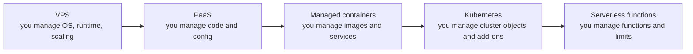

Picking a hosting model is one of the highest-leverage decisions in a project, and one of the easiest to get wrong in both directions. Teams of three run Kubernetes clusters they cannot debug, while teams with real traffic stay on a single hand-configured VPS until it falls over. The right answer depends on team size, traffic shape, budget and how much operational work you are willing to own. This guide compares the five main options for an Express API plus React SPA plus database, and ends with a decision table.

## How it works

Every option sits on a spectrum: the more the platform manages, the less control and the higher the unit price, but the lower the people cost. A useful mental model is to ask what you are responsible for at 3 a.m.



The arrow is not a ranking. Kubernetes is more flexible than Cloud Run but more work; Lambda is less work than ECS but has different constraints. Regardless of choice, the React build should go to a CDN or static host (S3 plus CloudFront, Netlify, Vercel, Cloudflare Pages), and the database should usually be managed (Atlas, RDS, Neon, Supabase).

## The options

### VPS: EC2, DigitalOcean, Hetzner, Linode

You rent a Linux VM and run Docker Compose or PM2 with Nginx. It is the cheapest way to get a lot of CPU and RAM; a few-dollar to tens-of-dollars monthly droplet runs a small app comfortably. You own OS patching, TLS renewal, backups, monitoring, and recovery when the box dies. Scaling is vertical (resize) unless you add a load balancer and more VMs yourself. No cold starts.

Good for: side projects, MVPs, cost-sensitive apps with predictable load, teams comfortable with Linux.

### PaaS: Render, Railway, Fly.io, Heroku

You push code or an image, and the platform builds, runs, routes, issues certificates, and restarts crashed processes. Most offer managed Postgres and Redis add-ons; Mongo typically means Atlas. Deploy previews per PR are often built in. Per-resource pricing is higher than raw VMs, and you get less control over networking and instance types. Free or hobby tiers may sleep idle services, which looks like a cold start. Fly.io runs your containers as lightweight VMs close to users in many regions, which is attractive for latency-sensitive apps.

Good for: small teams that want to ship features, not run infrastructure.

### Managed containers: AWS ECS Fargate, Google Cloud Run, Azure Container Apps

You supply a container image and a service definition; the cloud runs it on capacity you never see. ECS Fargate keeps tasks always running behind an ALB and scales on CPU or request count; you design the VPC, subnets and IAM. Cloud Run scales on concurrent requests, can scale to zero, and bills per request time, so idle cost is near zero but the first request after idle pays a container start (often around a second or more for Node, depending on image and init work). Setting a minimum instance count removes that at a cost.

Good for: production apps that need autoscaling, private networking, and cloud-native integrations without cluster management.

### Kubernetes: EKS, GKE, AKS

A full orchestration platform: Deployments, Services, Ingress, autoscalers, operators, service mesh. You get portability and enormous flexibility, at the price of a steep learning curve and a lot of moving parts (ingress controllers, cert-manager, external-dns, metrics, logging, upgrades every few months). EKS charges a per-cluster control plane fee on top of nodes. It pays off with many services, multiple teams, or special scheduling needs.

Good for: organisations with a platform team or a dozen-plus services.

### Serverless functions: AWS Lambda, Vercel and Netlify functions

Each request invokes a function; you pay per invocation and duration, and it scales to zero and to thousands of concurrent executions. An Express app can be wrapped with an adapter, but it fits poorly: cold starts of hundreds of milliseconds or more, a maximum execution time (15 minutes on Lambda, often much less behind API Gateway), no long-lived WebSockets without extra services, and connection storms against databases because each concurrent instance opens its own pool. With MongoDB, cache the client outside the handler and keep `maxPoolSize` small; with Postgres, use RDS Proxy or a pooled serverless driver.

```js
// Reuse the Mongo client across warm invocations
import { MongoClient } from 'mongodb';
let clientPromise;
export const handler = async (event) => {
  clientPromise ??= new MongoClient(process.env.MONGO_URL, { maxPoolSize: 5 }).connect();
  const db = (await clientPromise).db('shop');
  const items = await db.collection('products').find().limit(20).toArray();
  return { statusCode: 200, body: JSON.stringify(items) };
};
```

Good for: spiky or low-volume APIs, webhooks, background jobs, and event-driven glue.

## Comparison table

| | VPS | PaaS | ECS Fargate / Cloud Run | Kubernetes | Lambda |
|---|---|---|---|---|---|
| Monthly cost at low traffic | Lowest | Low to medium | Medium; Cloud Run near zero idle | High floor (control plane, nodes, LB) | Near zero |
| Cost at steady high traffic | Lowest per unit | Highest per unit | Medium | Low to medium with good bin packing | Can exceed containers |
| Ops burden | High | Very low | Low to medium | Highest | Low |
| Scaling | Manual | Simple autoscale | Autoscale, scale to zero on Cloud Run | Fine-grained HPA and cluster autoscaling | Automatic per request |
| Cold starts | None | Only on sleeping tiers | Cloud Run when scaled to zero | None with min replicas | Yes |
| WebSockets and long jobs | Yes | Yes | Yes, with timeouts on Cloud Run | Yes | Awkward |
| Lock-in | Low | Medium | Medium | Low | High |

## Decision guide

- **Solo developer or MVP, under a few thousand users:** a PaaS, or a VPS with Compose if budget is tight and you know Linux.
- **Startup with real customers and 2 to 10 engineers:** ECS Fargate or Cloud Run with managed databases. This is the default sweet spot.
- **Large org, many services, platform team:** Kubernetes.
- **Spiky, event-driven or rarely used endpoints:** Lambda, possibly alongside containers for the main API.

You can mix models: React on a CDN, API on Cloud Run, image processing on Lambda, database on Atlas.

## Trade-offs and pitfalls

- **Ignoring people cost.** An engineer-week spent on cluster upgrades often costs more than a year of PaaS premium.
- **Egress and NAT charges** surprise teams on AWS; private subnets talking to the internet through a NAT gateway pay per GB.
- **Serverless plus relational databases** without pooling exhausts connections under load.
- **Premature Kubernetes** adds failure modes (DNS, networking, probes) that a small team cannot diagnose.
- **Stateful data on ephemeral platforms.** Containers and functions have no durable local disk; uploads belong in object storage.

## Interview angle

- State assumptions (team size, traffic, budget) before choosing, and justify with ops burden, not just features.
- Know the serverless constraints: cold starts, execution limits, connection management.
- Show an evolution path: PaaS or VPS now, managed containers as traffic grows, Kubernetes only when service count demands it.

## Key takeaways

- Choose the least operational burden that meets your scaling and networking needs.
- Managed containers (ECS Fargate, Cloud Run) are the default sweet spot for production MERN APIs.
- Serve the React build from a CDN and use managed databases whatever you pick for compute.
- Serverless is excellent for spiky workloads but needs care with cold starts and database connections.
- Kubernetes pays off at organisational scale, not app scale.
