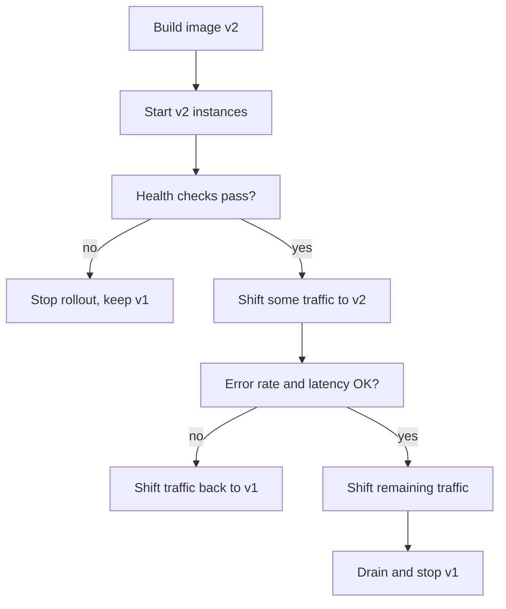

Users should not notice that you deployed. In practice, outages during deploys come from three places: requests dropped while instances are replaced, new code that is broken and reaches everyone at once, and database changes that the old or new version cannot handle. Deployment strategies address the first two; disciplined migrations address the third. This guide covers all of them with a MERN and Postgres lens.

## How it works

Every strategy follows the same loop: start new instances, verify they are healthy, shift traffic, keep the old version available until you are confident, then retire it. The strategies differ in how much traffic moves at once and how much spare capacity you need.



## The strategies

### Rolling update

Replace instances in batches: start one v2, wait for it to pass readiness, remove one v1, repeat. This is the default in Kubernetes Deployments and ECS services. It needs little extra capacity, but for a while both versions serve traffic simultaneously, and rollback is another rolling update in reverse, which takes as long as the rollout. With `maxUnavailable: 0` and `maxSurge: 1` you never drop below full capacity.

### Blue-green

Run a full copy of the new version (green) alongside the current one (blue). Test green directly, then switch all traffic at the load balancer or DNS level. Rollback is flipping the switch back, which takes seconds. The costs are double capacity during the switch and the fact that both environments share the database, so schema compatibility still matters. On AWS, an ALB listener rule with two target groups, or CodeDeploy for ECS, implements this cleanly. Prefer load balancer switching to DNS, since DNS caches ignore low TTLs more often than you would like.

### Canary

Send a small slice of traffic, say 1 to 5 percent, to the new version, compare its error rate and latency with the baseline, and increase stepwise (5, 25, 50, 100) if metrics hold. This limits the blast radius of a bad release to a small fraction of users. It requires good metrics and, ideally, automation: Argo Rollouts or Flagger on Kubernetes, weighted target groups on ALB, or traffic splitting on Cloud Run.

```yaml
# Argo Rollouts canary steps
strategy:
  canary:
    steps:
      - setWeight: 5
      - pause: { duration: 10m }
      - setWeight: 25
      - pause: { duration: 10m }
      - setWeight: 50
      - pause: { duration: 10m }
```

### Feature flags

Flags decouple deploy from release. Code ships dark behind a flag and is enabled for internal users, then a percentage of customers, then everyone. Turning a flag off is the fastest rollback there is: no deploy required.

```js
const showNewCheckout = await flags.isEnabled('new-checkout', {
  userId: req.user.id,
  country: req.user.country,
});
return showNewCheckout ? newCheckout(req, res) : legacyCheckout(req, res);
```

Use a service like LaunchDarkly, Unleash, Flagsmith or GrowthBook, or a simple table with a cache for small teams. Delete flags once fully rolled out; stale flags become untested code paths.

## Health checks and connection draining

Traffic shifting is only safe if the platform knows when an instance is ready and when it is leaving. A readiness endpoint should return 200 only once database connections and caches are warmed. On shutdown, the instance must stop receiving new requests before it stops serving old ones:

1. Load balancer marks the target as draining and stops sending new requests.
2. The app receives `SIGTERM`, fails readiness, calls `server.close()` and finishes in-flight requests.
3. After the drain window (ALB `deregistration_delay`, Kubernetes `terminationGracePeriodSeconds`), the process exits.

Long-lived connections such as WebSockets need explicit handling: send clients a reconnect hint and let them reconnect to new instances.

## Database migrations: expand and contract

During any rollout, old and new code run against the same database. So every schema change must be compatible with both. The expand and contract pattern splits a breaking change into safe steps. Example: renaming `users.name` to `full_name` in Postgres.

| Step | Deploy | Database change | Code |
|---|---|---|---|
| 1 Expand | Migration | `ALTER TABLE users ADD COLUMN full_name text;` | Old code unaffected |
| 2 Dual write | App v2 | none | Writes both columns, reads `name` |
| 3 Backfill | Job | `UPDATE users SET full_name = name WHERE full_name IS NULL` in batches | |
| 4 Switch reads | App v3 | none | Reads `full_name`, still writes both |
| 5 Contract | App v4 then migration | `ALTER TABLE users DROP COLUMN name;` | No references to `name` |

Each step can be rolled back independently because the previous version still works. Postgres specifics that bite during migrations:

```sql
SET lock_timeout = '3s';
-- Building an index without blocking writes
CREATE INDEX CONCURRENTLY idx_orders_user_id ON orders (user_id);
-- Adding a constraint without a long scan under lock
ALTER TABLE orders ADD CONSTRAINT orders_user_fk
  FOREIGN KEY (user_id) REFERENCES users (id) NOT VALID;
ALTER TABLE orders VALIDATE CONSTRAINT orders_user_fk;
```

Adding a column with a constant default is fast in modern Postgres, but adding `NOT NULL` to an existing column, changing a column type, or creating an index without `CONCURRENTLY` can lock a busy table. `lock_timeout` makes a migration fail fast rather than queueing every other query behind it.

MongoDB is schemaless at the database level but not in your code. The same pattern applies: make new fields optional, write both shapes, backfill with batched `updateMany` calls, then remove the old field. Build indexes on large collections during low traffic and watch replication lag.

Run migrations as a separate pipeline step before rolling out the code that needs them, never automatically inside every app replica at boot.

## Fast rollback

- Keep previous images and deploy by immutable tag so rollback is redeploying the last good SHA.
- Automate it: ECS deployment circuit breaker, Argo Rollouts analysis, or a CI job that triggers on alert.
- Make database changes forward-only and compatible, so rolling back code never requires rolling back the schema. Down migrations that drop data are rarely safe in production.
- Practice rollback; a procedure no one has run is not a procedure.

## Trade-offs and pitfalls

- **Mixed versions** during rolling and canary releases mean API responses and job payloads must be backward and forward compatible.
- **Sticky sessions or caches** keyed by response shape can serve v2 data to v1 clients.
- **Blue-green with migrations** can still break blue if the migration is not compatible.
- **Canary without good metrics** is just a slow rollout.
- **Frontend deploys:** a user with an old SPA bundle may call a new API. Keep APIs backward compatible for at least one release, and keep old hashed assets around for a while so lazy-loaded chunks do not 404.

## Interview angle

- Compare rolling, blue-green and canary on capacity cost, rollback speed and blast radius.
- Walk through expand and contract for a column rename; this is a very common follow-up.
- Explain deploy versus release and how feature flags enable instant rollback.
- Mention draining and readiness when asked how you avoid errors during deploys.

## Key takeaways

- Rolling is cheap, blue-green gives instant rollback, canary limits blast radius.
- Feature flags separate shipping code from exposing it.
- Readiness checks and connection draining prevent dropped requests.
- Use expand and contract so old and new code both work with the schema at every step.
- Keep rollback a redeploy of a previous immutable image, and rehearse it.
