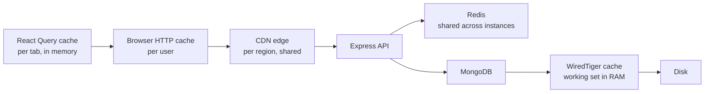

A request for a product list can be answered by at least five different caches before MongoDB ever touches disk. Each layer has a different scope (one tab, one user, one region, the whole fleet), a different invalidation mechanism, and a different failure mode. Teams usually add a Redis cache first and then wonder why users still see stale prices. Knowing all the layers, and which one owns freshness for a given piece of data, is what makes caching predictable.

## How it works



| Layer | Scope | Typical TTL | Invalidated by |
|---|---|---|---|
| React Query | One tab | Seconds to minutes (`staleTime`) | `invalidateQueries`, refetch on focus |
| Browser HTTP cache | One user | `max-age`, revalidated with ETag | Expiry, new URL |
| CDN | All users in a region | Seconds to a year | Expiry, purge API, new URL |
| Redis | All API instances | Seconds to hours | TTL, explicit delete on write |
| WiredTiger cache | One mongod | Managed by LRU-like eviction | Automatic |

The closer a cache is to the user, the faster it is and the harder it is to invalidate.

## Browser HTTP caching

Two mechanisms: **freshness** (`Cache-Control: max-age`) means the browser does not ask at all; **validation** (`ETag` / `If-None-Match`) means it asks but gets a tiny `304 Not Modified` if nothing changed.

```js
// Public, shared catalog data: cache 60s in browsers, 5 min at the CDN,
// and serve stale for up to 10 min while the CDN refetches in the background
app.get('/api/categories', async (req, res) => {
  res.set('Cache-Control', 'public, max-age=60, s-maxage=300, stale-while-revalidate=600');
  res.json(await getCategories());
});

// Per-user data must never be stored by shared caches
app.get('/api/me/orders', auth, async (req, res) => {
  res.set('Cache-Control', 'private, no-cache');
  res.json(await Order.find({ userId: req.user.id }).sort({ createdAt: -1 }).limit(20));
});
```

Express generates weak ETags for `res.json` and `res.send` bodies by default and answers `304` when `If-None-Match` matches. That saves bandwidth, but the handler still runs and still queries MongoDB. For hashed static assets, use `public, max-age=31536000, immutable`.

## CDN

A CDN caches responses at edge locations, using `s-maxage` when present, otherwise `max-age`. Rules that matter:

- Only cache `GET` responses that are identical for everyone. Anything reading `Authorization` or cookies must be `private` or bypass the CDN.
- Keep the cache key small. Strip tracking query parameters (`utm_*`) and avoid `Vary: Cookie`, or the hit ratio collapses.
- For invalidation, prefer versioned URLs for assets and tag-based purges (surrogate keys) for API responses, so a product update purges only pages that include that product.

## API response cache in Redis

Redis is the shared, application-controlled layer. The standard pattern is **cache-aside**: read from Redis, on a miss load from MongoDB and populate Redis with a TTL.

```js
async function getProduct(id) {
  const key = `product:v1:${id}`;
  const hit = await redis.get(key);
  if (hit) return JSON.parse(hit);

  const product = await Product.findById(id).lean();
  if (!product) {
    await redis.set(key, 'null', { EX: 30 });      // negative caching, short TTL
    return null;
  }
  const ttl = 300 + Math.floor(Math.random() * 60); // jitter so keys do not expire together
  await redis.set(key, JSON.stringify(product), { EX: ttl });
  return product;
}
```

### Invalidation

On writes, update MongoDB first, then delete the key. Deleting is safer than overwriting because concurrent writers cannot leave an older value behind as easily.

```js
async function updateProduct(id, patch) {
  const updated = await Product.findByIdAndUpdate(id, patch, { new: true }).lean();
  await redis.del(`product:v1:${id}`);
  await redis.del('products:list:featured'); // lists containing it, too
  return updated;
}
```

A race still exists: a reader can load the old document, the writer updates and deletes, then the reader writes the old value into Redis. The TTL bounds that staleness. When it matters, use a short delayed second delete, or drive invalidation from MongoDB change streams so every write path, including scripts and other services, invalidates consistently. List and search results are hardest to invalidate precisely; give them shorter TTLs or a version counter in the key (`products:list:v{n}`) that you increment on any catalog write.

### Stampede protection

When a hot key expires, hundreds of concurrent requests miss at once and all hit MongoDB. Three defenses, often combined:

1. **TTL jitter**, as above, so many keys do not expire at the same instant.
2. **Request coalescing / locking**: one request rebuilds, the others wait briefly or serve stale.
3. **Early refresh**: refresh in the background before expiry when a key is hot.

```js
async function getWithLock(key, loader, ttl = 300) {
  const cached = await redis.get(key);
  if (cached) return JSON.parse(cached);

  const lock = await redis.set(`lock:${key}`, '1', { NX: true, PX: 5000 });
  if (!lock) {
    await new Promise((r) => setTimeout(r, 50));
    return getWithLock(key, loader, ttl);        // retry; bound attempts in real code
  }
  try {
    const value = await loader();
    await redis.set(key, JSON.stringify(value), { EX: ttl });
    return value;
  } finally {
    await redis.del(`lock:${key}`);
  }
}
```

Within a single Node process you can also dedupe in-flight promises with a `Map` so concurrent callers share one load.

## MongoDB working set

MongoDB has its own cache. WiredTiger by default uses the larger of 50% of (RAM minus 1 GB) or 256 MB, and the OS file cache holds compressed data on top of that. Performance stays good while the **working set**, the indexes and documents actively used, fits in memory. When it does not, reads go to disk and latency rises sharply.

```js
// mongosh: check cache usage and pressure
const c = db.serverStatus().wiredTiger.cache;
c['bytes currently in the cache'] / c['maximum bytes configured'];
c['pages read into cache']; // steadily climbing under steady load suggests the working set does not fit
db.products.stats().totalIndexSize;
```

A Redis layer reduces load, but the most effective MongoDB "cache" is often a covering index and a projection that keeps the working set small.

## React Query cache

The browser-side layer for API data. Set `staleTime` per query to match how fresh the data must be, and invalidate after mutations.

```js
useQuery({ queryKey: ['categories'], queryFn: fetchCategories, staleTime: 10 * 60_000 });
useQuery({ queryKey: ['cart'], queryFn: fetchCart, staleTime: 0 });
```

Stacked TTLs add up: React Query 60 s plus browser 60 s plus CDN 300 s plus Redis 300 s means a user may see data up to about 12 minutes old in the worst case. Decide the acceptable staleness per data type and budget it across layers.

## Trade-offs and pitfalls

- **Caching personalized responses publicly.** A missing `private` once served one user's account page to others. Default API responses to `no-store` and opt in to caching.
- **Unbounded keys.** Caching every search query string fills Redis with one-hit entries. Set `maxmemory` and an eviction policy such as `allkeys-lru`.
- **Cache as source of truth.** Redis eviction or restart must never lose data you cannot rebuild from MongoDB.
- **Serialization cost.** Huge JSON blobs in Redis can be slower than an indexed MongoDB read. Cache what is expensive to compute, not everything.
- **Cold starts.** After a deploy or Redis failover, every request misses. Warm critical keys and keep stampede protection in place.

## Interview angle

- Walk through the layers from client to disk and state who owns freshness at each.
- Explain cache-aside, write paths that delete keys, and the race that TTL bounds.
- Describe stampede protection with jitter, locking and stale-while-revalidate.
- Mention working set sizing as the MongoDB-side cache concern.

## Key takeaways

- Each layer trades speed for harder invalidation; budget staleness across all of them.
- Use `Cache-Control` plus ETag for browsers, `s-maxage` and tag purges for CDNs.
- Redis cache-aside with TTL, jitter and delete-on-write is the default server-side pattern.
- Keep MongoDB's working set in RAM with good indexes and projections.
- Never cache per-user data in shared layers.
