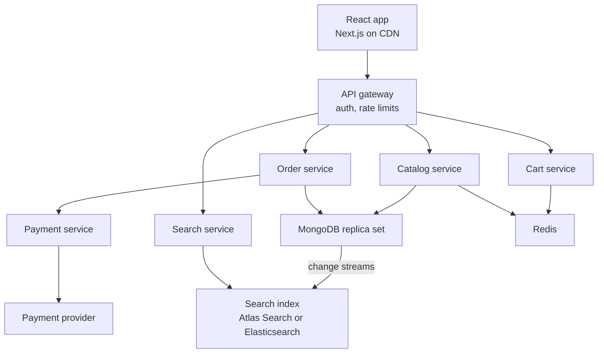
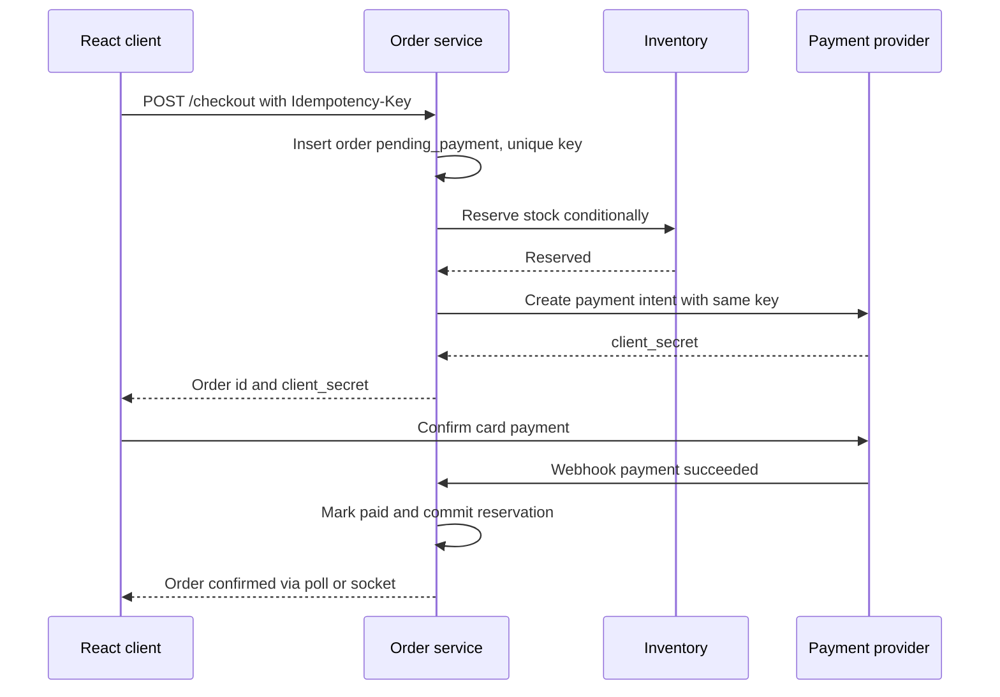

"Design an online store" is one of the most common system design interview prompts, and a realistic project for a MERN team. It looks like CRUD, but three parts are genuinely hard: never overselling inventory, never charging a customer twice, and keeping browse and search fast during a sale when traffic spikes tenfold. This case study works through the design the way you would in an interview, using the stack covered in earlier guides.

## Requirements

**Functional:** browse categories and product pages, full-text search with filters, cart (guest and logged in), checkout with card payment, order history and status, admin catalog and inventory management.

**Non-functional:** product pages p95 under 300 ms at the API; checkout correctness above all (no oversell, no double charge); 99.9% availability for browsing; tolerate a 10x flash-sale spike; eventual consistency is acceptable for search results and recommendations, not for stock and payments.

## Capacity estimates

Assume 5 million monthly active users, 1 million daily active users.

- Each daily user views about 20 pages, so roughly 20 million page views per day, or about 230 requests per second on average. Assume peak is 5x average, and a flash sale another 2x: plan for about 2,500 read RPS.
- Conversion around 2% gives about 20,000 orders per day, under 1 order per second on average, peaking near 50 per second during a sale. Writes are small; reads dominate by two to three orders of magnitude.
- Catalog: 2 million products at about 4 KB each is roughly 8 GB, plus images in object storage. Easily fits a single replica set; the working set of hot products fits in RAM.
- Orders: 20,000 per day at about 2 KB is about 15 GB per year. Fine for years on one replica set, with sharding as a later option.

The conclusion drives the design: optimize the read path with caching and CDN, and focus write-path effort on correctness, not throughput.

## How it works



Start as a **modular monolith**: one Express codebase with clear modules (catalog, cart, orders, payments, search) and separate collections. Split a module into its own deployable service only when it has different scaling or release needs. Search and payments webhooks are the usual first candidates.

## Data model in MongoDB

```js
// products: read-heavy, embed what is displayed together
{
  _id: ObjectId, sku: "SNK-1042", slug: "air-runner-2",
  title: "Air Runner 2", brand: "Acme", categoryIds: [ObjectId],
  price: { amount: 8999, currency: "USD" },          // integer minor units, never floats
  attributes: { color: "black", sizes: ["8", "9", "10"] },
  images: ["https://cdn.example.com/p/1042-1.avif"],
  rating: { avg: 4.4, count: 812 },                    // precomputed, not aggregated per request
  status: "active", updatedAt: ISODate
}

// inventory: separate collection, small and write-hot
{ _id: "SNK-1042-9", sku: "SNK-1042", size: "9", available: 37, reserved: 4 }

// orders: snapshot prices and addresses at purchase time
{
  _id: ObjectId, userId: ObjectId, status: "pending_payment",
  idempotencyKey: "c1f0...", items: [{ skuVariant: "SNK-1042-9", title: "Air Runner 2", qty: 1, unitPrice: 8999 }],
  total: 8999, shippingAddress: { ... }, paymentIntentId: "pi_...",
  history: [{ status: "pending_payment", at: ISODate }], createdAt: ISODate
}
```

```js
db.products.createIndex({ slug: 1 }, { unique: true });
db.products.createIndex({ categoryIds: 1, status: 1, 'price.amount': 1 });
db.orders.createIndex({ userId: 1, createdAt: -1 });
db.orders.createIndex({ idempotencyKey: 1 }, { unique: true });
```

Orders embed item snapshots because a later price or title change must not rewrite history. Inventory lives apart from products so frequent stock updates do not churn large catalog documents or invalidate product caches.

## Inventory consistency

The oversell problem: two buyers read `available: 1` and both buy. The fix is a **conditional atomic update**, which MongoDB guarantees at the single-document level.

```js
const res = await Inventory.updateOne(
  { _id: variantId, available: { $gte: qty } },
  { $inc: { available: -qty, reserved: qty } },
);
if (res.modifiedCount === 0) throw new OutOfStockError(variantId);
```

Stock is **reserved** at checkout start, and reservations expire (for example after 15 minutes) via a scheduled job that returns stock if payment never completes. For multi-item carts, reserve items inside a transaction so a partial failure rolls back all reservations, or reserve one by one and release on failure. During flash sales a single hot SKU document becomes a write hotspot; options include splitting stock into several bucket documents or serializing purchases through a queue.

## Checkout flow with idempotency

Networks retry and users double-click. Every state-changing step takes an idempotency key generated by the client when the checkout page loads.



```js
app.post('/api/checkout', auth, async (req, res) => {
  const key = req.get('Idempotency-Key');
  const existing = await Order.findOne({ idempotencyKey: key, userId: req.user.id });
  if (existing) return res.status(200).json(existing);   // replay, not a new order

  const session = await mongoose.startSession();
  try {
    const order = await session.withTransaction(async () => {
      const [o] = await Order.create([buildOrder(req.user.id, req.body.cart, key)], { session });
      for (const item of o.items) await reserve(item.skuVariant, item.qty, session);
      return o;
    });
    const intent = await stripe.paymentIntents.create(
      { amount: order.total, currency: 'usd', metadata: { orderId: String(order._id) } },
      { idempotencyKey: key },
    );
    await Order.updateOne({ _id: order._id }, { paymentIntentId: intent.id });
    res.status(201).json({ orderId: order._id, clientSecret: intent.client_secret });
  } catch (e) {
    if (e.code === 11000) return res.status(409).json({ error: 'duplicate checkout in progress' });
    throw e;
  } finally {
    session.endSession();
  }
});
```

Treat the **webhook** as the source of truth for payment, not the browser redirect. Webhooks can arrive late, twice, or out of order, so make the handler idempotent: only transition `pending_payment` to `paid` with a conditional update, and store processed event ids. Side effects such as confirmation emails and warehouse notifications go to a queue (BullMQ, or an outbox collection read by a worker) so they are retried independently.

## Search

MongoDB regex queries do not scale for relevance-ranked text search with facets. Two good options:

- **Atlas Search** (Lucene-based, on Atlas): no extra cluster to operate, index stays in sync automatically, queried with a `$search` aggregation stage.
- **Elasticsearch / OpenSearch**: more control and features, but you own the sync pipeline, typically MongoDB change streams feeding an indexer worker with a resume token.

```js
db.products.aggregate([
  { $search: { index: 'products', compound: {
      must: [{ text: { query: 'running shoes', path: ['title', 'brand'], fuzzy: { maxEdits: 1 } } }],
      filter: [{ range: { path: 'price.amount', lte: 15000 } }],
  } } },
  { $limit: 24 },
  { $project: { title: 1, slug: 1, price: 1, images: { $slice: ['$images', 1] }, score: { $meta: 'searchScore' } } },
]);
```

Search is eventually consistent by design; show stock status from the inventory service on the product page, not from the search index.

## Scaling plan

1. **Day one:** Next.js with ISR for product and category pages on a CDN, stateless Express fleet, Redis cache-aside for products and carts, MongoDB replica set.
2. **Growth:** move search to Atlas Search or Elasticsearch, route analytics queries to a secondary or analytics node, add queues for emails and fulfillment.
3. **Flash sales:** pre-warm caches, a waiting room or rate limit at the gateway, bucketed inventory for hot SKUs, autoscaling on request latency.
4. **Large scale:** shard `orders` on `{ userId: "hashed" }` or a compound key, extract payments and search into separate services, multi-region read replicas for the catalog.

## Trade-offs and pitfalls

- **Floats for money** cause rounding errors. Store integer minor units or `Decimal128`.
- **Trusting client totals.** Always recompute prices server-side from the catalog at checkout.
- **Reserving stock on add-to-cart.** Ties up inventory for abandoned carts; reserve at checkout with expiry.
- **Synchronous side effects** in checkout make payment success depend on the email provider.
- **Microservices too early** add network failure modes before the team needs independent scaling.

## Interview angle

- Lead with estimates that show reads dwarf writes, then justify caching and CDN for reads and transactional rigor for writes.
- Explain the conditional `$inc` for stock and how reservations expire.
- Walk through idempotency keys end to end, including duplicated webhooks.
- Discuss how search stays in sync and why it is allowed to lag.

## Key takeaways

- E-commerce is read-heavy; cache and pre-render the catalog aggressively.
- Prevent overselling with atomic conditional updates and time-limited reservations.
- Use idempotency keys on checkout and payment calls, and treat webhooks as the source of truth.
- Snapshot prices in orders and store money as integers.
- Start with a modular monolith and extract services when scaling needs differ.
