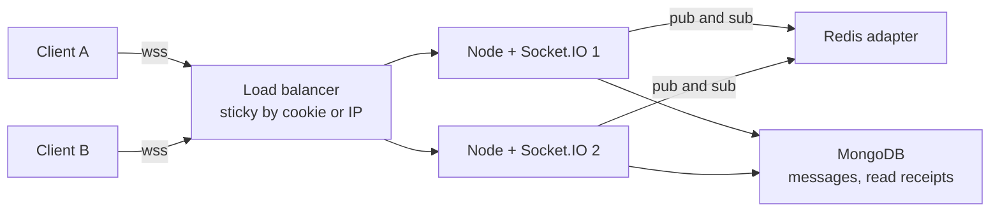

Chat, live order tracking, notifications and collaborative editing all need the server to push data to the browser. Socket.IO is the default choice in MERN apps because it layers reconnection, rooms, acknowledgements and a fallback transport on top of WebSockets. It works out of the box on one server. The interesting problems appear when you run several Node instances behind a load balancer, need to know who is online, and must not lose messages when a phone drops off the network.

## How it works

Socket.IO is not plain WebSocket; it has its own protocol on top (Engine.IO). A client starts with an HTTP long-polling handshake, then upgrades to WebSocket when possible. That fallback is why polling requires sticky sessions: several HTTP requests from the same client must reach the same server. If you force `transports: ['websocket']`, you skip polling and the sticky requirement, at the cost of failing on networks that block WebSockets.



When server 1 calls `io.to('room:42').emit(...)`, it delivers to its own local sockets in that room and publishes the packet to Redis. Server 2 receives it and delivers to its local sockets in the same room. No server needs to know where every user is connected.

## Server setup with auth on connect

Authenticate during the handshake, not after. Reject before the connection is established, and attach the user to the socket.

```js
import { createServer } from 'node:http';
import { Server } from 'socket.io';
import { createAdapter } from '@socket.io/redis-adapter';
import { createClient } from 'redis';
import jwt from 'jsonwebtoken';

const httpServer = createServer(app);
const io = new Server(httpServer, {
  cors: { origin: process.env.CORS_ORIGIN, credentials: true },
  pingInterval: 25000,
  pingTimeout: 20000,
});

const pub = createClient({ url: process.env.REDIS_URL });
const sub = pub.duplicate();
await Promise.all([pub.connect(), sub.connect()]);
io.adapter(createAdapter(pub, sub));

io.use((socket, next) => {
  try {
    const token = socket.handshake.auth?.token;
    socket.data.user = jwt.verify(token, process.env.JWT_SECRET);
    next();
  } catch {
    next(new Error('unauthorized'));
  }
});

io.on('connection', (socket) => {
  const { sub: userId } = socket.data.user;
  socket.join(`user:${userId}`);            // personal room for direct notifications

  socket.on('room:join', async (roomId, ack) => {
    if (!(await canAccessRoom(userId, roomId))) return ack({ ok: false });
    socket.join(`room:${roomId}`);
    ack({ ok: true });
  });
});

httpServer.listen(4000);
```

```js
// client
import { io } from 'socket.io-client';
const socket = io('https://api.example.com', {
  auth: (cb) => cb({ token: getAccessToken() }), // re-read on every reconnect
});
socket.on('connect_error', (err) => { if (err.message === 'unauthorized') refreshAndRetry(); });
```

Using a function for `auth` matters: short-lived JWTs expire, and reconnects must send a fresh token. Long-lived connections also outlive token expiry, so for sensitive apps periodically re-check and call `socket.disconnect()` when access is revoked.

## Rooms and namespaces

- **Namespaces** (`io.of('/admin')`) are separate communication channels with their own middleware and event handlers, multiplexed over one connection. Use them for different trust levels or app areas.
- **Rooms** are server-side groupings inside a namespace. Clients cannot join rooms themselves; the server decides, which makes rooms the authorization boundary.

Good room conventions: `user:<id>` for per-user pushes across all their devices, `room:<chatId>` for conversations, `order:<orderId>` for tracking pages.

Emitting from outside a socket handler, for example from an Express route after an order ships, works the same on any instance because of the adapter:

```js
app.post('/api/orders/:id/ship', async (req, res) => {
  const order = await Order.findByIdAndUpdate(req.params.id, { status: 'shipped' }, { new: true });
  io.to(`user:${order.userId}`).emit('order:updated', { id: order._id, status: order.status });
  res.json(order);
});
```

Workers that are not Socket.IO servers can publish through `@socket.io/redis-emitter`.

## Sticky sessions

If polling is enabled, configure stickiness at the load balancer (cookie-based affinity on AWS ALB, or `ip_hash` / a hash on a cookie in Nginx). With Node's cluster module on one machine, use `@socket.io/sticky` or run one process per container instead.

```nginx
upstream sockets {
  ip_hash;
  server 10.0.0.11:4000;
  server 10.0.0.12:4000;
}
location /socket.io/ {
  proxy_pass http://sockets;
  proxy_http_version 1.1;
  proxy_set_header Upgrade $http_upgrade;
  proxy_set_header Connection "upgrade";
  proxy_read_timeout 120s;
}
```

Without the `Upgrade` and `Connection` headers, Nginx will not proxy the WebSocket upgrade and clients stay stuck on polling.

## Presence

A user may have several tabs and devices, and servers crash without running disconnect handlers. Track presence per connection with expiry rather than a single boolean.

```js
// on connection and on each heartbeat
await redis.sAdd(`presence:${userId}`, socket.id);
await redis.expire(`presence:${userId}`, 60);

socket.on('disconnect', async () => {
  await redis.sRem(`presence:${userId}`, socket.id);
  if ((await redis.sCard(`presence:${userId}`)) === 0) {
    io.to(`contacts:${userId}`).emit('presence', { userId, online: false });
  }
});
```

Refresh the TTL periodically so a crashed instance's entries age out. For large friend lists, publish presence changes only to interested rooms, and debounce flapping connections by a few seconds.

## Delivery guarantees

Socket.IO by default is **at most once**: if a client is disconnected when you emit, the event is lost. Design for this explicitly.

1. **Persist first.** Write the message to MongoDB, then emit. MongoDB is the source of truth.
2. **Acknowledge.** Use acks for client-to-server sends, with a client-generated id so retries are idempotent (a unique index on `clientMsgId`).
3. **Catch up on reconnect.** The client sends its last seen message id or timestamp, and the server replays missed messages from MongoDB.

```js
socket.on('msg:send', async ({ clientMsgId, roomId, text }, ack) => {
  try {
    const msg = await Message.create({ clientMsgId, roomId, text, from: userId });
    io.to(`room:${roomId}`).emit('msg:new', msg);
    ack({ ok: true, id: msg._id });
  } catch (e) {
    if (e.code === 11000) return ack({ ok: true, duplicate: true }); // retry of a saved message
    ack({ ok: false });
  }
});
```

Socket.IO 4.6+ also offers connection state recovery, which replays missed packets after short disconnects, but it is bounded in time and not a substitute for a persistent catch-up path.

## Trade-offs and pitfalls

- **Forgetting the adapter.** With two instances, users on different servers silently stop seeing each other's messages.
- **Polling without stickiness.** Produces repeated "session ID unknown" errors and reconnect loops.
- **Trusting client room joins.** Always authorize joins on the server.
- **Large fan-out.** Emitting to a room of 100,000 sockets through Redis pub/sub is expensive; consider sharded adapters or a dedicated pub/sub service at that scale.
- **Connection limits.** Each socket holds memory and a file descriptor; plan per-instance capacity and raise `ulimit`.
- **Load balancer idle timeouts** shorter than the ping interval cause periodic disconnects.

## Interview angle

- Explain why horizontal scaling needs both a pub/sub adapter and, with polling, sticky sessions.
- Describe how you guarantee no message loss: persist, ack with idempotency keys, replay on reconnect.
- Discuss presence across multiple devices and crashed servers using TTLs.
- Compare with SSE for one-way updates, and with managed services when connection counts are very large.

## Key takeaways

- Socket.IO adds handshake, fallback, rooms and acks on top of WebSockets.
- The Redis adapter broadcasts across instances; sticky sessions are required only if polling is enabled.
- Authenticate in handshake middleware and authorize every room join.
- Delivery is at most once by default; MongoDB plus acks plus catch-up makes it reliable.
