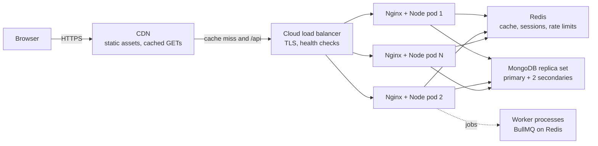

Tutorials end with `npm run dev` on two ports and a MongoDB connection string in a `.env` file. Production needs more: a CDN in front of static assets, TLS termination, multiple stateless Node processes, a shared cache, a replica set, and configuration that differs safely between environments. This guide lays out a reference architecture that a team of a few engineers can run, and that scales to millions of requests per day without redesign.

## How it works



A request for the product page flows like this:

1. **DNS and CDN.** `shop.example.com` resolves to the CDN edge. Hashed JS, CSS and images under `/assets/` are served directly from the edge with a one-year cache. `index.html` is revalidated.
2. **Load balancer.** `/api/*` misses the CDN and reaches a regional load balancer (AWS ALB, GCP LB), which terminates TLS, health-checks targets and spreads traffic.
3. **Nginx.** An optional reverse proxy next to each Node process handles gzip or Brotli, request size limits, buffering slow clients, and serving static files when there is no CDN.
4. **Node/Express.** Stateless API processes validate input, authenticate the JWT or session, apply business logic and call data stores. Running several processes per machine (cluster mode or multiple containers) uses all CPU cores, since one Node process runs JavaScript on one thread.
5. **Redis.** Cache-aside reads, session store, rate-limit counters, Socket.IO adapter and job queues.
6. **MongoDB.** A three-member replica set for high availability. Writes go to the primary; reads can be routed to secondaries where staleness is acceptable.

The key property is that the Node tier holds **no state**. Any request can hit any instance, so you scale horizontally by adding instances and survive instance loss without user impact.

## Express app structure

```js
// apps/api/src/server.js
import express from 'express';
import helmet from 'helmet';
import compression from 'compression';
import mongoose from 'mongoose';
import { config } from './config.js';
import { router } from './routes/index.js';

const app = express();
app.set('trust proxy', 1);          // honor X-Forwarded-For from the LB
app.use(helmet());
app.use(compression());
app.use(express.json({ limit: '1mb' }));
app.get('/healthz', (req, res) => res.send('ok'));     // liveness
app.get('/readyz', (req, res) =>
  res.status(mongoose.connection.readyState === 1 ? 200 : 503).end()); // readiness
app.use('/api', router);
app.use((err, req, res, next) => {
  req.log?.error(err);
  res.status(err.status ?? 500).json({ error: err.expose ? err.message : 'Internal error' });
});

await mongoose.connect(config.mongoUri, { maxPoolSize: 20 });
const server = app.listen(config.port);

process.on('SIGTERM', () => {       // graceful shutdown during deploys
  server.close(() => mongoose.disconnect().then(() => process.exit(0)));
});
```

Size the MongoDB connection pool with the whole fleet in mind: 30 instances with `maxPoolSize: 20` can open 600 connections to the primary.

## Nginx in front of Node

```nginx
upstream api {
  server 127.0.0.1:4000;
  keepalive 64;
}
server {
  listen 80;
  client_max_body_size 2m;
  gzip on;
  gzip_types application/json text/css application/javascript;

  location /api/ {
    proxy_pass http://api;
    proxy_http_version 1.1;
    proxy_set_header Connection "";
    proxy_set_header Host $host;
    proxy_set_header X-Forwarded-For $proxy_add_x_forwarded_for;
    proxy_set_header X-Forwarded-Proto $scheme;
    proxy_read_timeout 30s;
  }
  location / {
    root /var/www/web;
    try_files $uri /index.html;   # SPA fallback for client-side routes
  }
}
```

On Kubernetes, an Ingress controller often takes Nginx's role, and the pod runs only Node.

## Dev vs production topology

| Concern | Development | Production |
|---|---|---|
| Frontend | Vite dev server with HMR on port 5173 | Static build on CDN or object storage |
| API routing | Vite proxy `/api` to localhost:4000 | CDN and LB route `/api` to Node fleet |
| MongoDB | Single node in Docker (as a one-member replica set if you use transactions) | Managed replica set, e.g. Atlas, backups and monitoring |
| Redis | Local container | Managed Redis with replica and persistence settings chosen per use |
| Secrets | `.env.local`, not committed | Secret manager injected as env vars |
| Processes | One `node --watch` | N containers, autoscaled on CPU or latency |

```yaml
# docker-compose.yml for local development
services:
  mongo:
    image: mongo:7
    command: ["--replSet", "rs0", "--bind_ip_all"]
    ports: ["27017:27017"]
  redis:
    image: redis:7
    ports: ["6379:6379"]
```

Run `rs.initiate()` once in mongosh so local code can use transactions and change streams, just like production.

## Monorepo layout

```text
repo/
  apps/
    web/          React (Vite or Next.js)
    api/          Express
    worker/       BullMQ consumers, cron jobs
  packages/
    shared/       zod schemas, types, constants used by web and api
    config/       eslint, tsconfig presets
  docker/
  pnpm-workspace.yaml
  turbo.json
```

Shared validation schemas are the main payoff: the same zod schema validates the form in React and the request body in Express, so the contract cannot drift. Turborepo or Nx caches builds and runs only affected tasks in CI.

## Environment config

Follow twelve-factor style: config comes from environment variables, validated once at startup, and the process refuses to boot if anything is missing.

```js
// apps/api/src/config.js
import { z } from 'zod';

const schema = z.object({
  NODE_ENV: z.enum(['development', 'test', 'production']),
  PORT: z.coerce.number().default(4000),
  MONGO_URI: z.string().url(),
  REDIS_URL: z.string().url(),
  JWT_SECRET: z.string().min(32),
  CORS_ORIGIN: z.string(),
});

const env = schema.parse(process.env);
export const config = { port: env.PORT, mongoUri: env.MONGO_URI, ...env };
```

On the frontend, remember that anything in `VITE_*` or `NEXT_PUBLIC_*` is embedded in the public bundle. Never put secrets there.

## Trade-offs and pitfalls

- **Sticky state in Node memory.** In-memory sessions, caches or rate limiters break as soon as you run two instances. Move them to Redis.
- **Missing graceful shutdown.** Rolling deploys drop in-flight requests if the process exits immediately on SIGTERM.
- **Connection storms.** Autoscaling to many instances multiplies MongoDB connections. Watch the connection count, not only CPU.
- **Readiness vs liveness confusion.** A liveness probe that checks MongoDB restarts every pod during a database blip, making the outage worse.
- **Wrong client IP.** Without `trust proxy`, rate limiting sees the load balancer's IP for every user.

## Interview angle

- Draw the request path end to end and say what each hop is responsible for.
- Emphasize the stateless API tier and where state lives instead (Redis, MongoDB, object storage).
- Explain how you would scale reads (cache, secondaries) and writes (sharding, queues) separately.
- Mention health checks, graceful shutdown and connection pool sizing; they signal production experience.

## Key takeaways

- CDN for static assets, load balancer for TLS and distribution, stateless Node fleet, Redis and MongoDB for state.
- Keep dev close to prod: run a one-member replica set and Redis locally.
- A monorepo with shared schemas keeps the frontend and API contract aligned.
- Validate configuration at boot and keep secrets out of client bundles.
