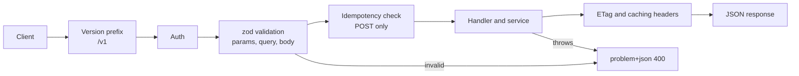

An API is a contract that outlives the code behind it. Once a React app, a mobile release and two partners depend on `GET /api/getOrdersForUser?page=3`, every inconsistency becomes permanent: one endpoint returns `{ error: "..." }`, another `{ message: "..." }`, page 3 skips records when new ones arrive, and a retried POST charges the customer twice. A handful of conventions, applied everywhere from day one, prevent most of this.

## How it works

Every request passes through the same pipeline, so conventions are enforced once in middleware rather than re-implemented per route.



## Resource design

Name resources with plural nouns and let HTTP methods carry the verb.

| Operation | Method and path | Success status |
| --- | --- | --- |
| List orders | `GET /v1/orders` | 200 |
| Get one | `GET /v1/orders/{id}` | 200, 404 if missing |
| Create | `POST /v1/orders` | 201 with `Location` header |
| Partial update | `PATCH /v1/orders/{id}` | 200 |
| Delete | `DELETE /v1/orders/{id}` | 204 |
| Action | `POST /v1/orders/{id}/cancel` | 200 or 202 |

Nest at most one level (`/v1/users/{id}/orders`); deeper hierarchies become rigid. State transitions that are not plain field edits, such as cancel or refund, are clearer as action sub-resources than as `PATCH { status: "cancelled" }`, because they carry their own rules and permissions. Use `camelCase` JSON fields, ISO 8601 UTC timestamps, string IDs, and integer cents for money.

## Pagination: offset versus cursor

Offset pagination (`?page=3&limit=20`) is simple and supports jumping to page 50, but `skip(1000)` still scans 1,000 documents, and rows shift when new ones are inserted, so users see duplicates or miss items. Cursor pagination uses an opaque token encoding the last seen sort key; the query becomes an indexed range scan with constant cost at any depth.

```ts
// GET /v1/orders?limit=20&cursor=eyJ0IjoiMjAyNi0xMS0wMlQxMDowMDowMFoiLCJpZCI6Ii4uLiJ9
const enc = (o: { createdAt: Date; _id: Types.ObjectId }) =>
  Buffer.from(JSON.stringify({ t: o.createdAt, id: o._id })).toString('base64url');

export async function listOrders(userId: string, limit: number, cursor?: string) {
  const filter: FilterQuery<Order> = { userId };
  if (cursor) {
    const { t, id } = JSON.parse(Buffer.from(cursor, 'base64url').toString());
    filter.$or = [
      { createdAt: { $lt: new Date(t) } },
      { createdAt: new Date(t), _id: { $lt: new Types.ObjectId(id) } },
    ];
  }
  const rows = await OrderModel.find(filter).sort({ createdAt: -1, _id: -1 }).limit(limit + 1).lean();
  const hasMore = rows.length > limit;
  const data = rows.slice(0, limit);
  return { data, nextCursor: hasMore ? enc(data.at(-1)!) : null };
}
```

Fetching `limit + 1` tells you whether there is a next page without a count query. Back it with an index on `{ userId: 1, createdAt: -1, _id: -1 }`; the `_id` tiebreaker matters because timestamps collide. Cap `limit` at something like 100. Use offset only for small admin tables where page numbers matter.

## Filtering and sorting

Whitelist everything. Accept `?status=paid&createdAfter=2026-10-01&sort=-createdAt`, parse it with a schema, and map it to a query you control. Never pass `req.query` straight into `find()`: a body like `{ "email": { "$ne": null } }` is a NoSQL injection. Only allow sorting on indexed fields, or a single request can trigger a full collection scan with an in-memory sort.

## Validation with zod

Validate params, query and body in one middleware, and replace the raw values with the parsed, coerced output.

```ts
const listQuery = z.object({
  limit: z.coerce.number().int().min(1).max(100).default(20),
  cursor: z.string().max(200).optional(),
  status: z.enum(['pending', 'paid', 'shipped', 'cancelled']).optional(),
  sort: z.enum(['createdAt', '-createdAt', 'totalCents', '-totalCents']).default('-createdAt'),
});

router.get('/orders', validate({ query: listQuery }), ordersController.list);
```

## Consistent errors with RFC 9457

RFC 9457 (which obsoletes RFC 7807) defines `application/problem+json`, a standard error body. Pick it and use it for every error, including 404s from unknown routes and 500s.

```ts
app.use((err, req, res, _next) => {
  const status = err.status ?? 500;
  res.status(status).type('application/problem+json').json({
    type: `https://api.example.com/problems/${err.code ?? 'internal'}`,
    title: status === 500 ? 'Internal Server Error' : err.message,
    status,
    detail: err.detail,
    instance: req.originalUrl,
    traceId: req.id,
    ...(err.errors && { errors: err.errors }), // field-level validation issues
  });
});
```

Clients can branch on `type` instead of parsing messages. Never leak stack traces; include a trace ID that maps to your logs. Use 400 for malformed input, 401 for missing credentials, 403 for insufficient permissions, 404, 409 for conflicts, 422 for business rule failures, and 429 with `Retry-After` for rate limits.

## Idempotency keys for POST

Networks drop responses, and mobile clients retry. GET, PUT and DELETE are idempotent by definition; POST is not. The client sends `Idempotency-Key: <uuid>`, and the server stores the first response under that key for about 24 hours.

```ts
export const idempotent = async (req, res, next) => {
  const key = req.get('Idempotency-Key');
  if (!key) return next();
  const id = `idem:${req.user.id}:${key}`;
  const claimed = await redis.set(id, JSON.stringify({ state: 'processing' }), 'EX', 86400, 'NX');
  if (!claimed) {
    const saved = JSON.parse((await redis.get(id))!);
    if (saved.state === 'processing') return res.status(409).json({ title: 'Request in progress' });
    return res.status(saved.status).json(saved.body);
  }
  const json = res.json.bind(res);
  res.json = (body) => {
    redis.set(id, JSON.stringify({ state: 'done', status: res.statusCode, body }), 'EX', 86400);
    return json(body);
  };
  next();
};
```

Scope keys to the user, store a hash of the request body and reject reuse of a key with a different payload (422), and do not cache 5xx responses so the client can retry. Stripe's API is the reference design.

## ETags and conditional requests

An ETag is a version identifier for a representation. On GET, return `ETag: "v7"`; the client sends `If-None-Match: "v7"` next time and gets `304 Not Modified` with no body. Express sets weak ETags on `res.json` automatically, which saves bandwidth but still runs the query. For writes, require `If-Match` to get optimistic concurrency: `PATCH` with a stale version returns `412 Precondition Failed` instead of silently overwriting another user's edit. Mongoose's `__v` or an `updatedAt` timestamp makes a good version.

## Versioning

Put the major version in the path (`/v1`) for public APIs; it is visible, cacheable and easy to route. Make additive changes freely: new optional fields, new endpoints, new enum values documented as extensible. Breaking changes, such as removing or renaming fields or changing types, require `/v2`. Announce removal with the `Deprecation` and `Sunset` headers and give clients 6 to 12 months.

## OpenAPI

An OpenAPI 3.1 document gives you docs, client SDKs, mock servers and contract tests. Write the spec by hand and validate requests with `express-openapi-validator`, or generate it from your zod schemas with `@asteasolutions/zod-to-openapi` so code and docs cannot drift. Serve it with Scalar or Swagger UI, and lint it in CI with Spectral.

## Trade-offs and pitfalls

- **Cursor pagination** cannot jump to arbitrary pages and needs a stable, indexed sort key.
- **Total counts** on large collections are expensive; return them only when asked, or estimate.
- **Idempotency storage** must be atomic; a check-then-set race lets two retries both execute.
- **Over-fetching** from fixed resources pushes some teams to GraphQL; sparse fieldsets (`?fields=id,status`) handle the common case.
- **Inconsistent conventions** are worse than imperfect ones. Write a short API style guide and lint for it.

## Interview angle

- Explain why offset pagination degrades and drifts, and how a compound cursor on `(createdAt, _id)` fixes both.
- Walk through how an idempotency key prevents a double charge when a response is lost.
- Distinguish 401 from 403 and 400 from 422, and justify a single problem+json error format.

## Key takeaways

- Plural nouns, HTTP verbs, one level of nesting, action sub-resources for state transitions.
- Use cursor pagination with a tiebreaker and a matching compound index.
- Validate every input with zod and return RFC 9457 problem+json for every error.
- Make POST safe to retry with idempotency keys; use ETags for caching and optimistic locking.
- Version in the path, evolve additively, and keep an OpenAPI spec in sync with code.
