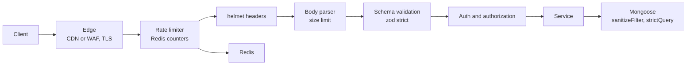

A public Express API sees credential stuffing, scrapers and crafted payloads within days of launch. Most real incidents in MERN apps are not exotic: a login endpoint without throttling, a query that accepts `{"$ne": null}` as a password, a `.env` committed to Git. This guide covers the defenses that stop those, in the order a request meets them.

## How it works

Security is layered so one missed check is not fatal.



Cheap checks run first: reject abusive clients before you parse bodies or touch the database.

## helmet and basic hardening

`helmet()` sets defensive response headers: `Content-Security-Policy`, `Strict-Transport-Security`, `X-Content-Type-Options: nosniff`, `X-Frame-Options` (via CSP `frame-ancestors` too), `Referrer-Policy`, and removes `X-Powered-By`. For a JSON API the CSP matters little, but for an Express server that also serves the React build it is your main XSS backstop.

```ts
app.use(helmet({
  contentSecurityPolicy: {
    directives: { defaultSrc: ["'self'"], scriptSrc: ["'self'"], objectSrc: ["'none'"], frameAncestors: ["'none'"] },
  },
}));
app.use(express.json({ limit: '100kb' }));
app.set('trust proxy', 1); // needed so rate limits see the real client IP
```

`trust proxy` must match your topology. Too permissive and clients spoof `X-Forwarded-For` to dodge IP limits; missing and every request appears to come from the load balancer.

## NoSQL injection

MongoDB queries are objects, so if user input lands in a query unchanged, an attacker can inject operators instead of values.

```ts
// Vulnerable: body is {"email":"admin@x.com","password":{"$ne":null}}
const user = await User.findOne({ email: req.body.email, password: req.body.password });
```

Query strings are also vulnerable, since Express's default `qs` parser turns `?role[$ne]=user` into `{ role: { $ne: 'user' } }`. Defenses, in order of strength:

1. **Validate types at the edge.** `z.string().email()` rejects objects outright. This alone stops operator injection.
2. **Mongoose `sanitizeFilter`.** Wraps any `$`-prefixed keys from untrusted input in `$eq`, so they match literally.
   ```ts
   mongoose.set('sanitizeFilter', true);
   // or per query: User.findOne(filter).setOptions({ sanitizeFilter: true })
   ```
3. **`strictQuery`** drops filter keys not in the schema.
4. **`express-mongo-sanitize`** strips keys starting with `$` or containing `.` from `req.body`, `req.query` and `req.params`. Note it mutates `req.query`, which is a getter in Express 5, so check compatibility or sanitize manually.

Also never pass user input to `$where`, `$function` or `$accumulator`, which execute JavaScript, and never build aggregation pipelines from raw client JSON. Never compare passwords in a query; fetch by email and use `bcrypt.compare` or `argon2.verify`.

Avoid mass assignment the same way: `User.create(req.body)` lets a client set `role: 'admin'`. Pick fields explicitly from validated input.

## Rate limiting with a Redis store

`express-rate-limit` keeps counters in process memory by default, which is wrong once you run more than one process: each instance allows the full limit. Use a shared store.

```ts
import { rateLimit } from 'express-rate-limit';
import { RedisStore } from 'rate-limit-redis';
import { createClient } from 'redis';

const redis = createClient({ url: env.REDIS_URL });
await redis.connect();

const store = (prefix: string) =>
  new RedisStore({ prefix, sendCommand: (...args: string[]) => redis.sendCommand(args) });

export const apiLimiter = rateLimit({
  windowMs: 60_000,
  limit: 300,
  standardHeaders: 'draft-7', // RateLimit header, Retry-After on 429
  legacyHeaders: false,
  store: store('rl:api:'),
  keyGenerator: (req) => req.user?.id ?? req.ip,
});

app.use('/api', apiLimiter);
```

Key by user ID when authenticated and IP otherwise; many users can share one NAT IP, and attackers rotate IPs. Behind a CDN, also apply coarse limits at the edge (Cloudflare, AWS WAF rate rules), which stops floods before they cost you compute.

### Algorithms

| Algorithm | How it works | Burst behaviour | Cost |
| --- | --- | --- | --- |
| Fixed window | Counter per window, reset at boundary | Up to 2x limit across a boundary | One INCR plus EXPIRE |
| Sliding window log | Sorted set of timestamps | Exact | Memory per request |
| Sliding window counter | Weighted current and previous window | Smooth, approximate | Two counters |
| Token bucket | Tokens refill at rate r, bucket size b | Allows bursts up to b, then steady r | Atomic script for refill math |

`express-rate-limit` with the Redis store is a fixed window. For a token bucket or sliding window, use `rate-limiter-flexible` or a small Lua script so read-refill-decrement is atomic. Token bucket fits APIs where short bursts are normal (a page load firing ten requests); sliding window fits strict quotas.

## Brute-force protection

Login, password reset, OTP verification and signup need tighter, multi-key limits:

```ts
import { RateLimiterRedis } from 'rate-limiter-flexible';

const byIpAndUser = new RateLimiterRedis({ storeClient: ioredis, keyPrefix: 'login_fail_ip_user', points: 5, duration: 15 * 60, blockDuration: 15 * 60 });
const byIp = new RateLimiterRedis({ storeClient: ioredis, keyPrefix: 'login_fail_ip', points: 100, duration: 24 * 3600 });

async function onLoginFailure(ip: string, email: string) {
  await Promise.allSettled([byIpAndUser.consume(`${ip}_${email}`), byIp.consume(ip)]);
}
```

Count failures only, reset the user key on success, and return the same generic error for unknown email and wrong password. Locking accounts outright lets attackers lock out real users; prefer per IP plus user throttles, CAPTCHA after a few failures, and MFA. Hash passwords with argon2id or bcrypt (cost 12 is a common starting point), and remember bcrypt work runs on the libuv thread pool.

## Secrets handling

- Load secrets from the environment, validated at boot with zod so a missing `JWT_SECRET` fails fast.
- In production, source them from a secrets manager (AWS Secrets Manager, SSM Parameter Store, Vault, Kubernetes Secrets with encryption at rest), never from a committed `.env`.
- Add `.env` to `.gitignore` and run secret scanning (gitleaks, GitHub push protection) in CI.
- Use separate credentials per environment and least-privilege MongoDB users (`readWrite` on one database, not `root`).
- Redact `authorization`, `cookie` and password fields in logs.
- Plan for rotation: support two valid JWT keys at once via `kid` so you can rotate without logging everyone out.

## Trade-offs and pitfalls

- **In-memory rate limits** silently multiply by your instance count.
- **IP-only limits** punish offices and mobile carriers behind NAT while barely slowing botnets.
- **Fail-open vs fail-closed**: if Redis is down, decide whether the limiter blocks all traffic or lets it through. Most APIs fail open with an alert; login endpoints may fail closed.
- **Sanitizer libraries are a backstop**, not a replacement for schema validation.
- **Rate limit headers** help good clients back off; return `429` with `Retry-After`.

## Interview angle

- "Design a rate limiter" is a classic: cover algorithm choice, Redis with atomic Lua or INCR, keying strategy, distributed consistency and fail-open behaviour.
- Explain NoSQL operator injection concretely and how type validation prevents it.
- Discuss brute-force protection as multi-dimensional limits rather than account lockout.

## Key takeaways

- Put cheap rejections first: edge limits, Redis-backed rate limits, body size limits.
- Validate types strictly and enable Mongoose `sanitizeFilter` to stop operator injection.
- Pick token bucket for bursty traffic and sliding window for strict quotas.
- Keep secrets out of Git, validate them at boot, and design for rotation.
