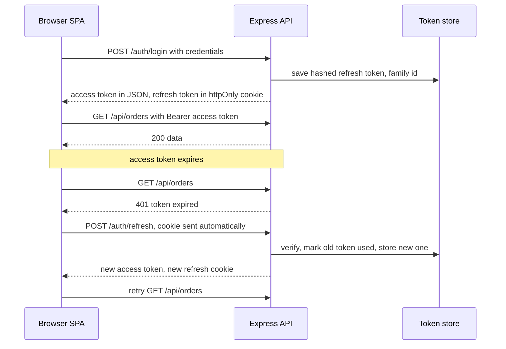

The default MERN tutorial signs a JWT valid for 30 days and stores it in `localStorage`. Any XSS bug can then read the token and impersonate the user for a month, and logout only deletes a local copy while the token stays valid. A production design separates a short-lived access token from a long-lived, revocable refresh token, stores the dangerous one where JavaScript cannot reach it, and detects stolen refresh tokens.

## How it works

- **Access token**: a signed JWT, valid 5 to 15 minutes, sent on every API call. Stateless to verify, so the API does not hit the DB per request.
- **Refresh token**: an opaque random string, valid days to weeks, stored server side (hashed) and in an httpOnly cookie scoped to the refresh endpoint. Used only to get a new access token.



## Where to store tokens

| Option | XSS can steal it | CSRF risk | Notes |
| --- | --- | --- | --- |
| `localStorage` | Yes | No | Simple, survives reloads, worst XSS exposure |
| JS memory variable | Only while page is open and compromised | No | Lost on reload, needs refresh on boot |
| httpOnly cookie | No | Yes, needs SameSite or CSRF token | Browser sends it automatically |

A solid pattern: access token in memory (a React context or module variable), refresh token in an httpOnly cookie. On page load the SPA calls `/auth/refresh` to get an access token. XSS can still make requests while the page is open, so httpOnly is damage limitation, not a cure for XSS; a strict Content Security Policy matters too.

## Issuing tokens

```ts
import jwt from 'jsonwebtoken';
import { randomBytes, createHash } from 'node:crypto';

const sha256 = (s: string) => createHash('sha256').update(s).digest('hex');

async function issueTokens(res: Response, userId: string, familyId = randomUUID()) {
  const accessToken = jwt.sign({ sub: userId }, env.JWT_SECRET, { expiresIn: '10m', algorithm: 'HS256' });
  const refresh = randomBytes(32).toString('base64url');
  await RefreshToken.create({
    hash: sha256(refresh), userId, familyId,
    expiresAt: new Date(Date.now() + 14 * 864e5),
  });
  res.cookie('rt', refresh, {
    httpOnly: true,
    secure: true,
    sameSite: 'strict',          // or 'lax'; 'none' only for cross-site, requires secure
    path: '/auth',               // not sent to other endpoints
    maxAge: 14 * 864e5,
  });
  return accessToken;
}
```

Store a hash, not the raw refresh token, so a DB leak does not hand out sessions. Add a TTL index on `expiresAt` in MongoDB so expired rows clean themselves up. Pin `algorithms: ['HS256']` (or RS256 with a key pair if other services verify tokens) when calling `jwt.verify`.

## Rotation and reuse detection

Every refresh returns a new refresh token and invalidates the old one. If an old, already-used token shows up again, either the user or an attacker has a copy that should not exist. You cannot tell which, so revoke the entire family and force re-login.

```ts
app.post('/auth/refresh', async (req, res) => {
  const raw = req.cookies.rt;
  if (!raw) throw new AppError(401, 'NO_REFRESH', 'Not signed in');
  const doc = await RefreshToken.findOne({ hash: sha256(raw) });
  if (!doc || doc.expiresAt < new Date()) throw new AppError(401, 'INVALID_REFRESH', 'Sign in again');

  if (doc.usedAt || doc.revokedAt) {
    await RefreshToken.updateMany({ familyId: doc.familyId }, { revokedAt: new Date() });
    throw new AppError(401, 'REFRESH_REUSE', 'Session revoked');
  }
  // atomic claim so two parallel refreshes cannot both succeed
  const claimed = await RefreshToken.updateOne({ _id: doc._id, usedAt: null }, { usedAt: new Date() });
  if (claimed.modifiedCount === 0) throw new AppError(401, 'REFRESH_RACE', 'Retry');

  res.json({ accessToken: await issueTokens(res, doc.userId, doc.familyId) });
});
```

Multiple tabs refreshing at once will trip reuse detection. Mitigate by funnelling refreshes through a single promise in the client, and optionally allow a grace window of a few seconds in which the previous token still returns the same successor.

## CSRF

Cookies are sent automatically, so a malicious site could submit a form to `/auth/refresh` or any cookie-authenticated endpoint. Defenses, strongest combined:

- `SameSite=Strict` or `Lax` on the cookie. Lax blocks cross-site POSTs but allows top-level GET navigations.
- Only accept state-changing requests with `Content-Type: application/json`, which a plain HTML form cannot send without a CORS preflight.
- Check the `Origin` header against an allowlist on cookie-authenticated routes.
- If you must use `SameSite=None` (API and SPA on unrelated sites), add a double-submit CSRF token.

APIs authenticated purely by a `Bearer` header are not CSRF-prone, since the browser never attaches that header on its own.

## CORS with credentials

If the SPA is on `app.example.com` and the API on `api.example.com`, these are same-site (same registrable domain), so SameSite cookies still flow, but they are cross-origin, so CORS applies.

```ts
app.use(cors({
  origin: ['https://app.example.com'], // cannot be '*' when credentials are allowed
  credentials: true,
}));
// client
fetch('https://api.example.com/auth/refresh', { method: 'POST', credentials: 'include' });
```

Simplest of all is serving SPA and API from the same origin through a reverse proxy (`/api` routed to Express), which removes CORS entirely.

## Logout and revocation

Logout revokes the refresh token family server side and clears the cookie with the same `path` and attributes it was set with. The access token remains valid until it expires, which is why it is short. For "log out everywhere" or a banned user, revoke all families for the user. If you need instant access token revocation, keep a `tokenVersion` on the user (checked in a cached lookup) or a Redis denylist of `jti` values until expiry, accepting the per-request lookup cost.

## Trade-offs and pitfalls

- **Long-lived JWTs** cannot be revoked without state; keep access tokens short.
- **Putting PII or roles that change often** in the JWT means stale claims until expiry.
- **`jwt.decode` instead of `jwt.verify`** skips signature checks entirely.
- **Clearing a cookie with a different path** silently fails.
- **Server-side sessions** (express-session plus Redis) are a perfectly good alternative for a single web app; JWTs pay off with multiple services or mobile clients.

## Interview angle

- Justify the access plus refresh split: stateless verification on hot paths, revocable state on the cold path.
- Compare cookies and localStorage in terms of XSS and CSRF, and name SameSite.
- Explain refresh token rotation with reuse detection as theft detection.
- Mention that sessions in Redis are often simpler and say when you would choose them.

## Key takeaways

- Short-lived JWT access token in memory, opaque rotating refresh token in an httpOnly Secure SameSite cookie.
- Store refresh tokens hashed, rotate on every use, revoke the family on reuse.
- Defend cookie routes with SameSite, Origin checks and JSON-only bodies.
- CORS with credentials needs an explicit origin list and `credentials: include` on the client.
