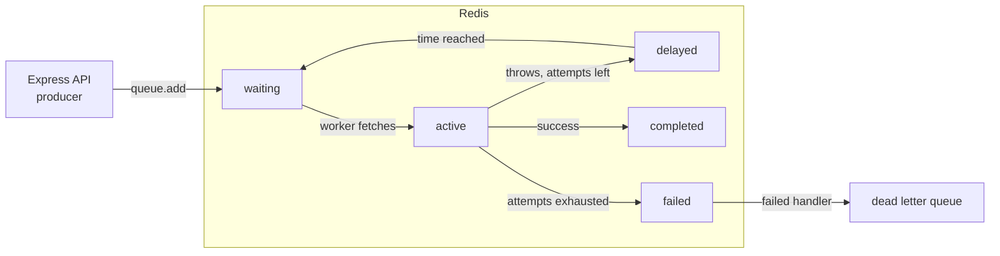

Sending a welcome email, generating an invoice PDF, calling a slow third-party API or resizing images inside an HTTP handler makes the user wait, ties up the event loop, and loses the work entirely if the process restarts mid-request. A job queue lets the API record the intent in milliseconds and respond, while separate workers do the work with retries. In the Node ecosystem, BullMQ on Redis is the common default.

## Why not do it in the request

- **Latency**: the user waits for SMTP or a PDF renderer that has nothing to do with their response.
- **Reliability**: a deploy or crash mid-request loses the work, and there is no retry.
- **Coupling to third parties**: an email provider outage turns into 500s on your signup endpoint.
- **Load spikes**: 10,000 signups in a minute means 10,000 concurrent outbound calls. A queue smooths that to whatever concurrency workers allow.
- **Fire-and-forget promises** (calling an async function without `await`) look like a fix but have none of the durability or retry guarantees.

## How it works

BullMQ stores jobs in Redis data structures and moves them between states atomically with Lua scripts. Producers add jobs; workers, usually separate processes, pull and process them.



A worker holds a lock on an active job and renews it. If the worker dies, the lock expires and BullMQ marks the job stalled and moves it back to waiting, so it runs again. That means delivery is **at least once**: every job handler must tolerate running twice.

## Producer and worker

```ts
// queues.ts (shared)
import { Queue } from 'bullmq';
import IORedis from 'ioredis';

export const connection = new IORedis(env.REDIS_URL, { maxRetriesPerRequest: null }); // required by workers
export const emailQueue = new Queue('email', {
  connection,
  defaultJobOptions: {
    attempts: 5,
    backoff: { type: 'exponential', delay: 2_000 }, // 2s, 4s, 8s, 16s
    removeOnComplete: { age: 24 * 3600, count: 10_000 },
    removeOnFail: { age: 7 * 24 * 3600 },
  },
});

// in a service
await emailQueue.add('welcome', { userId: user.id }, { jobId: `welcome:${user.id}` });
```

```ts
// worker.ts (separate process / deployment)
import { Worker, UnrecoverableError } from 'bullmq';

const worker = new Worker('email', async (job) => {
  const user = await User.findById(job.data.userId).lean();
  if (!user) throw new UnrecoverableError('user deleted'); // do not retry
  await job.updateProgress(50);
  await mailer.send({ to: user.email, template: job.name, idempotencyKey: job.id });
  return { sentAt: Date.now() };
}, { connection, concurrency: 20, limiter: { max: 50, duration: 1_000 } });

worker.on('failed', (job, err) => logger.error({ jobId: job?.id, err }, 'job failed'));

process.on('SIGTERM', async () => { await worker.close(); process.exit(0); });
```

Pass IDs, not whole documents, in job data. The worker loads fresh state, and Redis memory stays small. `concurrency` is per worker process; `limiter` is a global rate limit across all workers for that queue, useful for third-party API quotas. `worker.close()` waits for active jobs to finish, which plugs into the graceful shutdown pattern from earlier in this series.

## Retries and backoff

Exponential backoff with a few attempts handles transient failures (timeouts, 503s, rate limits). Distinguish failure types:

- **Transient**: throw a normal error and let backoff retry.
- **Permanent** (validation, missing record): throw `UnrecoverableError` so the job fails immediately.
- **Rate limited by the provider**: call `worker.rateLimit(ms)` and throw `Worker.RateLimitError()` to pause the queue instead of burning attempts.

## Idempotency

Because jobs can run more than once, design handlers so a second run is harmless:

- **Dedupe on enqueue** with a deterministic `jobId` (`welcome:${userId}`). BullMQ ignores an add whose ID already exists while that job is still kept.
- **Record side effects**: write `welcomeEmailSentAt` on the user with a conditional update, and skip if already set.
  ```ts
  const r = await User.updateOne({ _id: id, welcomeEmailSentAt: null }, { welcomeEmailSentAt: new Date() });
  if (r.modifiedCount === 0) return 'already sent';
  ```
- **Pass idempotency keys downstream** (Stripe and most email APIs accept them).
- **Enqueue reliably**: if you save an order and then crash before `queue.add`, the job is lost. For critical flows, use an outbox: write the job intent to MongoDB in the same transaction as the order and have a relay push it to the queue.

## Delayed and repeatable jobs

```ts
// send a reminder in 24 hours
await emailQueue.add('cart-reminder', { cartId }, { delay: 24 * 3600 * 1000, jobId: `cart:${cartId}` });

// cron-style schedule, runs once per tick across all workers
await reportsQueue.upsertJobScheduler('nightly-report', { pattern: '0 2 * * *', tz: 'UTC' }, { name: 'nightly' });
```

Job schedulers (older versions used the `repeat` option) replace `setInterval` or `node-cron` inside API processes, which would fire once per instance when you scale out. Cancel a delayed job by removing it via its known `jobId`.

## Dead letter handling

BullMQ has no built-in DLQ; jobs that exhaust attempts sit in the failed set. Two common patterns:

1. Keep failed jobs (with `removeOnFail` by age), alert on the failed count, and retry from a dashboard after fixing the bug (`job.retry()`).
2. In the worker's `failed` event, when `job.attemptsMade >= job.opts.attempts`, copy the job into a separate `email-dlq` queue for manual inspection or replay.

Either way, failures must be visible. A failed set nobody looks at is data loss with extra steps.

## Monitoring

- **Dashboards**: Bull Board (`@bull-board/express`) mounted behind admin auth, or Taskforce.sh.
- **Metrics**: export `getJobCounts('waiting','active','failed','delayed')` to Prometheus. Alert on waiting growing steadily (workers cannot keep up) and on failed rate.
- **Queue latency**: time from enqueue to start (`job.processedOn - job.timestamp`) is the number users feel.
- **Redis**: set `maxmemory-policy noeviction`. An LRU policy would silently evict job keys.

## Trade-offs and pitfalls

- **Redis is now critical infrastructure**: use a managed, persistent setup (AOF on) with replication.
- **Large payloads** in job data bloat Redis; store blobs in S3 or MongoDB and pass references.
- **CPU-heavy processors** block the worker's event loop and stall lock renewal; use sandboxed processors (a file path instead of a function) or worker threads.
- **Ordering is not guaranteed** with concurrency above 1 or multiple workers.
- **Alternatives**: SQS for managed AWS queues, RabbitMQ for routing-heavy messaging, Kafka for event streams and replay. BullMQ is best for task queues within a Node system.

## Interview angle

- When a design involves email, notifications, video processing or webhooks, say "enqueue and return 202" and draw the worker tier.
- Expect follow-ups on at-least-once delivery; answer with idempotent handlers and dedupe keys.
- Explain how retries, backoff and a DLQ prevent a downstream outage from becoming data loss.

## Key takeaways

- Queue anything slow, unreliable or not needed for the response; run workers as separate processes.
- Delivery is at least once, so make every handler idempotent.
- Use exponential backoff for transient errors and `UnrecoverableError` for permanent ones.
- Monitor queue depth, wait time and failures, and never let Redis evict job keys.
