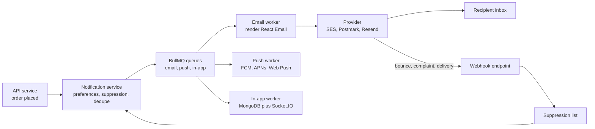

Sending one email from Node takes five lines. Sending a million a month that actually land in the inbox is a different problem. The naive version calls the provider inside the signup request, so a slow provider adds two seconds to signup and an outage loses the welcome email entirely. Without SPF, DKIM and DMARC, Gmail sends your password resets to spam. Without bounce handling, you keep mailing dead addresses until the provider suspends your account. And once you add push and in-app notifications, you need one system that decides what to send, on which channel, respecting what the user asked for.

## How it works

Business code emits a notification intent, not an email. A notification service checks preferences and suppression, renders a template per channel, and enqueues delivery jobs. Workers talk to providers; provider webhooks feed bounces and complaints back into the suppression list.



## Choosing a provider

| Provider | Strengths | Typical cost | Notes |
| --- | --- | --- | --- |
| Amazon SES | Cheapest at volume | About $0.10 per 1,000 | Starts in sandbox; events via SNS or EventBridge |
| Postmark | Fast delivery, strict transactional focus | About $15 for 10,000 per month | Separate message streams for broadcast |
| SendGrid | Marketing plus transactional, mature | Tiered plans | Shared IP reputation varies |
| Resend | Developer experience, React Email native | Free tier then about $20 per month | Newer, simple API |

Keep transactional mail (password resets, receipts) separate from marketing mail, either by provider stream or by subdomain such as `mail.example.com` versus `news.example.com`, so a bad campaign does not hurt reset delivery. Wrap the provider behind a small interface so you can switch or fail over.

## Sending through a queue

Never send from the request handler. Enqueue a job and return. BullMQ gives retries with backoff, rate limiting, and visibility into failures.

```ts
// notify.ts
import { Queue } from 'bullmq';
export const emailQueue = new Queue('email', { connection });

export async function sendOrderConfirmation(orderId: string, userId: string) {
  await emailQueue.add('order-confirmation', { orderId, userId }, {
    jobId: `order-confirmation:${orderId}`, // dedupe on retry of the caller
    attempts: 6,
    backoff: { type: 'exponential', delay: 30_000 },
    removeOnComplete: 1000,
  });
}
```

```ts
// email.worker.tsx
import { Worker } from 'bullmq';
import { render } from '@react-email/components';
import { Resend } from 'resend';
import { OrderConfirmation } from './templates/OrderConfirmation';

const resend = new Resend(process.env.RESEND_API_KEY);

new Worker('email', async (job) => {
  const { orderId, userId } = job.data;
  const [user, order] = await Promise.all([users.get(userId), orders.get(orderId)]);
  if (await suppression.has(user.email)) return { skipped: 'suppressed' };

  const html = await render(<OrderConfirmation order={order} name={user.name} />);
  const text = await render(<OrderConfirmation order={order} name={user.name} />, { plainText: true });
  const { error } = await resend.emails.send({
    from: 'Acme <orders@mail.example.com>',
    to: user.email,
    subject: `Order ${order.number} confirmed`,
    html, text,
    headers: { 'X-Entity-Ref-ID': orderId },
  }, { idempotencyKey: job.id });
  if (error) throw new Error(error.message); // let BullMQ retry
}, { connection, concurrency: 20, limiter: { max: 14, duration: 1000 } });
```

The `limiter` caps the worker at 14 sends per second, which matches SES's default production rate. Load data inside the worker rather than putting the whole order in the job payload, so the email reflects current state and job payloads stay small. Pass an idempotency key where the provider supports one, so a worker crash after the API call does not send twice.

## Templates

Email HTML is stuck around 2005: tables for layout, inline CSS, no flexbox in many Outlook versions. React Email lets you write components (`<Section>`, `<Button>`, `<Text>`) that render to compatible HTML, and fits a React codebase naturally. MJML is the language-neutral alternative with a similar markup-to-HTML compiler. Either way, always send a plain-text part, keep the HTML under 102 KB because Gmail clips larger messages, preview templates in a local dev server, and test rendering across clients with a tool like Litmus or Email on Acid before major changes. Store translations alongside templates and select by the user's locale.

## SPF, DKIM and DMARC

These DNS records prove you are allowed to send for your domain. Since 2024, Gmail and Yahoo require all three for anyone sending over 5,000 messages a day, plus one-click unsubscribe for marketing mail and a spam complaint rate below 0.3%.

- **SPF**: a TXT record listing servers allowed to send, for example `v=spf1 include:amazonses.com ~all`. It checks the envelope sender, and is limited to 10 DNS lookups.
- **DKIM**: the provider signs each message with a private key; you publish the public key as a DNS record. It survives forwarding better than SPF.
- **DMARC**: a TXT record at `_dmarc.example.com` that tells receivers what to do when SPF or DKIM fail alignment with the From domain, and where to send reports. Start with `v=DMARC1; p=none; rua=mailto:dmarc@example.com`, read the reports for a few weeks, then move to `p=quarantine` and finally `p=reject`.

Use a custom MAIL FROM or return-path domain so SPF aligns, and warm up a new dedicated IP gradually over 2 to 4 weeks.

## Bounces, complaints and suppression

Providers report events by webhook: delivered, bounced, complained, opened. A hard bounce (unknown mailbox) means never send to that address again. A soft bounce (mailbox full) can be retried a few times before suppressing. A complaint (user clicked "report spam") must suppress immediately. Keep your own suppression list in MongoDB with a unique index on the normalized address, check it in the worker before every send, and verify the provider's webhook signature on that endpoint. Providers like SES enforce limits: a bounce rate above 5% or a complaint rate above 0.1% puts your account under review.

## In-app and push notifications

In-app notifications are just documents: `{ userId, type, title, body, link, readAt, createdAt }` with an index on `{ userId: 1, createdAt: -1 }`, served by a paginated endpoint and pushed live over Socket.IO to the user's room. Push notifications go through Firebase Cloud Messaging for Android and web, APNs for iOS, or the Web Push protocol with VAPID keys from a service worker. Store device tokens per user, and delete tokens when the provider reports them invalid, or you will pay for sends that go nowhere.

## User preferences

Store preferences per notification category and channel, for example `{ orderUpdates: { email: true, push: true }, marketing: { email: false } }`. Some categories are mandatory (security alerts, receipts) and should not be switchable off. Respect quiet hours in the user's timezone for push, batch noisy events into a digest ("5 new comments"), and include a signed unsubscribe link plus the `List-Unsubscribe` and `List-Unsubscribe-Post` headers on non-transactional mail.

## Trade-offs and pitfalls

- **Synchronous sends** couple request latency and availability to the provider.
- **Missing dedupe** sends three receipts when the order service retries.
- **Shared domains** let marketing reputation damage password reset delivery.
- **Ignoring bounce webhooks** leads to account suspension.
- **Open tracking** is unreliable since Apple Mail Privacy Protection preloads images; do not base logic on opens.

## Interview angle

- Explain why notifications go through a queue and how idempotent job IDs prevent duplicates.
- Describe what SPF, DKIM and DMARC each verify and the rollout order for DMARC policy.
- Design a multi-channel notification service with preferences, suppression and digests.

## Key takeaways

- Emit notification intents, then render and deliver from BullMQ workers with retries and rate limits.
- Choose a provider by volume and focus, and isolate transactional from marketing mail.
- Configure SPF, DKIM and DMARC with alignment, and move DMARC to reject over time.
- Process bounce and complaint webhooks into a suppression list checked before every send.
- Model in-app, push and email as channels governed by one set of user preferences.
