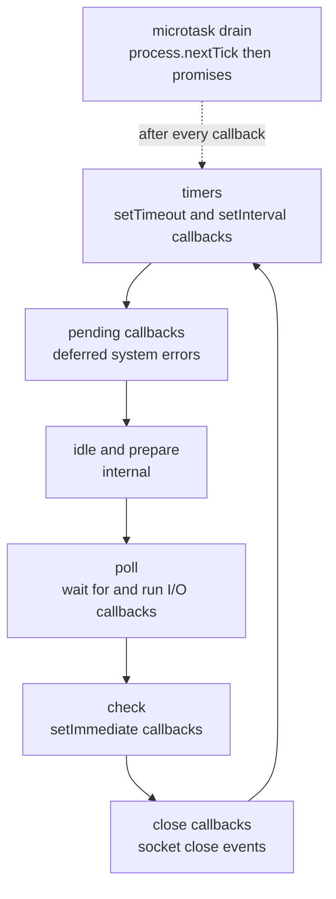

A single Node.js process can hold tens of thousands of open sockets because it never parks a thread waiting on I/O. The price is that all of your JavaScript runs on one thread. When an Express API suddenly shows p99 latency in seconds while CPU sits at 100% on one core, the cause is almost always something that blocked the event loop. Understanding the loop is the foundation for every scaling decision later in this series.

## How it works

Node is V8 (runs JavaScript) plus libuv (a C library that provides the event loop, non-blocking network I/O via epoll/kqueue/IOCP, and a thread pool). Your code registers callbacks; libuv calls them back on the main thread when something is ready. Each turn of the loop walks a fixed set of phases.



- **timers**: runs callbacks whose `setTimeout`/`setInterval` threshold has passed. A timer of 10 ms means "no earlier than 10 ms", not "exactly".
- **poll**: the heart of the loop. It computes how long it can block, waits for I/O events from the OS, and runs their callbacks (incoming HTTP data, completed file reads). If nothing else is scheduled, the process sits here.
- **check**: runs `setImmediate` callbacks, right after poll.
- **close**: runs `'close'` handlers such as `socket.on('close')`.

### Microtasks

Between every individual callback (not just between phases, since Node 11), Node drains two queues: first the `process.nextTick` queue, then the promise microtask queue. Both are drained to empty before the loop moves on, which means a recursive `nextTick` or an endless chain of resolved promises can starve I/O completely.

```js
setTimeout(() => console.log('timeout'), 0);
setImmediate(() => console.log('immediate'));
Promise.resolve().then(() => console.log('promise'));
process.nextTick(() => console.log('nextTick'));
console.log('sync');
// sync, nextTick, promise, then timeout/immediate (order of those two
// is not guaranteed from the main module; inside an I/O callback,
// setImmediate always fires first)
```

### The thread pool

Network sockets are truly non-blocking at the OS level, so they do not use threads. Some work has no portable async OS API, so libuv runs it on a thread pool: `fs.*` file operations, `dns.lookup` (used by default by `http.get` with hostnames), `crypto.pbkdf2`, `crypto.scrypt`, `crypto.randomBytes` async, and `zlib` async functions. The pool defaults to **4 threads**, set by `UV_THREADPOOL_SIZE` (max 1024), and it must be set before the pool is first used.

```bash
UV_THREADPOOL_SIZE=16 node server.js
```

If your login endpoint calls `bcrypt` (native async uses the pool) or `scrypt`, four concurrent logins can saturate the pool, and unrelated `fs.readFile` calls queue behind them. That shows up as mysterious latency rather than CPU on the main thread.

## What blocks the loop

Anything synchronous and long-running on the main thread:

- `JSON.parse` / `JSON.stringify` of multi-megabyte payloads.
- Sync APIs: `fs.readFileSync`, `crypto.pbkdf2Sync`, `zlib.gzipSync` inside request handlers.
- Catastrophic regex backtracking (ReDoS), for example `/(a+)+$/` against user input.
- Big loops: sorting 1M items, building a CSV in memory, image manipulation in pure JS.
- Unbounded `Array.prototype` work on unpaginated MongoDB results.

A 200 ms block does not slow one request by 200 ms; it delays every in-flight request on that process by 200 ms, and health checks along with them.

## Detecting event loop lag

Event loop lag (or delay) is how late a timer fires compared to when it should have. Node ships a histogram for it in `perf_hooks`:

```ts
import { monitorEventLoopDelay, performance } from 'node:perf_hooks';

const h = monitorEventLoopDelay({ resolution: 20 });
h.enable();

setInterval(() => {
  const p99ms = h.percentile(99) / 1e6; // values are nanoseconds
  const elu = performance.eventLoopUtilization();
  console.log({ p99ms: p99ms.toFixed(1), maxMs: (h.max / 1e6).toFixed(1), elu: elu.utilization.toFixed(2) });
  h.reset();
}, 10_000).unref();
```

`eventLoopUtilization()` gives the fraction of time the loop was busy rather than idle in poll; above roughly 0.9 the process is effectively saturated. `prom-client` exposes `nodejs_eventloop_lag_seconds` automatically through `collectDefaultMetrics()`. For finding the culprit, use `node --cpu-prof`, `0x`, or Clinic.js Doctor/Flame to get a flame graph of the hot synchronous function.

You can also use lag as a load-shedding signal: libraries like `under-pressure` (Fastify) or a small Express middleware return `503` when p99 lag crosses a threshold, so the load balancer routes elsewhere instead of letting the queue grow.

## Fixing blocking work

- Stream instead of buffering: `pipeline(readStream, transform, res)`.
- Paginate and project in MongoDB instead of loading whole collections.
- Move CPU work to `worker_threads` or a background job (covered later in this series).
- Break long loops into chunks and yield with `setImmediate` between chunks.
- Validate regexes with tools like `safe-regex` and cap input length.

## Trade-offs and pitfalls

- **Raising `UV_THREADPOOL_SIZE` is not free**: more threads compete for the same cores. Size it to the concurrent fs/crypto work you actually have.
- **`process.nextTick` recursion** starves I/O. Prefer `setImmediate` for "do this later" logic.
- **`async` does not mean non-blocking.** An `async` function that runs a tight loop still blocks; `await` only yields at the await point.
- **Container CPU limits**: one Node process uses one core for JS. A pod with 2 CPU limit running one process wastes a core.
- **Unhandled promise rejections** crash the process by default since Node 15; treat that as a feature and fix the source.

## Interview angle

- Expect "Why is Node good for I/O-bound but weak for CPU-bound work?" Answer with the single JS thread plus OS-level async I/O, then name worker threads and job queues as the escape hatch.
- Ordering puzzles with `nextTick`, promises, `setTimeout` and `setImmediate` are common; explain the microtask drain rule rather than memorizing outputs.
- When asked how you would debug a latency spike, mention event loop lag metrics, ELU, and CPU profiling before adding servers.

## Key takeaways

- libuv runs phases in order: timers, pending, poll, check, close; microtasks drain after every callback.
- Network I/O is OS-async; fs, dns.lookup, crypto and zlib use a 4-thread pool by default.
- Any long synchronous work delays every request on that process.
- Measure with `monitorEventLoopDelay` and `eventLoopUtilization`, and alert on p99 lag.
