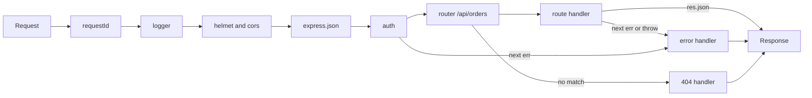

Express is small: almost everything it does is a chain of functions with the signature `(req, res, next)`. Most production bugs in Express apps come from that chain being wrong: a body parser registered after the route, an auth check that runs after the handler, an async error that never reaches the error handler and leaves the request hanging. Getting the pipeline right gives you consistent errors, traceable logs and one place to enforce cross-cutting rules.

## How it works

When a request arrives, Express walks its stack of middleware and routes in the order they were registered. Each function either ends the response (`res.json`, `res.send`) or calls `next()` to pass control on. Calling `next(err)` skips all normal middleware and jumps to the next error handler, which is any function with four parameters `(err, req, res, next)`.



The order of `app.use` calls is the order of execution. A path prefix only filters which middleware runs; it does not change the order.

## A production-shaped app

```ts
import express from 'express';
import helmet from 'helmet';
import cors from 'cors';
import { randomUUID } from 'node:crypto';
import pinoHttp from 'pino-http';
import { ordersRouter } from './orders/orders.routes.js';
import { errorHandler, notFound } from './http/errors.js';

const app = express();
app.disable('x-powered-by');
app.set('trust proxy', 1); // behind one LB, so req.ip is the client IP

// 1. correlation id first, so every later log line has it
app.use((req, res, next) => {
  const id = req.get('x-request-id') ?? randomUUID();
  req.id = id;
  res.setHeader('x-request-id', id);
  next();
});

// 2. structured access logging
app.use(pinoHttp({ genReqId: (req) => req.id, redact: ['req.headers.authorization', 'req.headers.cookie'] }));

// 3. security headers and CORS before any route
app.use(helmet());
app.use(cors({ origin: ['https://app.example.com'], credentials: true }));

// 4. body parsing with a limit
app.use(express.json({ limit: '100kb' }));

// 5. routes
app.get('/healthz', (_req, res) => res.send('ok'));
app.use('/api/orders', ordersRouter);

// 6. 404 then error handler, always last
app.use(notFound);
app.use(errorHandler);
```

### Router-level middleware

`express.Router()` is a mini app with its own stack. Use it to scope middleware to a feature:

```ts
export const ordersRouter = express.Router();
ordersRouter.use(requireAuth);                  // all order routes
ordersRouter.get('/', listOrders);
ordersRouter.post('/', validate(createOrderSchema), createOrder);
ordersRouter.delete('/:id', requireRole('admin'), deleteOrder);
```

Middleware placed on a route (`validate`, `requireRole`) runs only for that route, after the router-level `requireAuth`.

## Async errors: Express 4 vs Express 5

In **Express 4**, a rejected promise inside a handler is not caught. The request hangs until the client times out, and Node logs an unhandled rejection (which crashes the process on Node 15+).

```ts
// Express 4: this error never reaches errorHandler
app.get('/users/:id', async (req, res) => {
  const user = await User.findById(req.params.id).orFail(); // throws
  res.json(user);
});
```

The Express 4 fixes are a wrapper or the `express-async-errors` patch:

```ts
export const asyncHandler =
  (fn: express.RequestHandler): express.RequestHandler =>
  (req, res, next) => Promise.resolve(fn(req, res, next)).catch(next);
```

**Express 5** (stable since late 2024) forwards rejected promises from handlers and middleware to `next(err)` automatically, so plain `async` handlers are safe. Express 5 also changed path syntax (named wildcards like `/*splat` instead of `*`, no inline regex in strings), removed `req.param()`, and made `req.query` a getter. Upgrade with tests in place.

## A centralized error handler

Throw typed errors from anywhere; translate them to HTTP once.

```ts
export class AppError extends Error {
  constructor(public status: number, public code: string, message: string, public details?: unknown) {
    super(message);
  }
}

export const notFound: express.RequestHandler = (req, _res, next) =>
  next(new AppError(404, 'NOT_FOUND', `No route for ${req.method} ${req.path}`));

export const errorHandler: express.ErrorRequestHandler = (err, req, res, _next) => {
  if (res.headersSent) return _next(err); // let Express close the socket
  const known = err instanceof AppError;
  const status = known ? err.status : err.type === 'entity.too.large' ? 413 : 500;
  if (status >= 500) req.log.error({ err }, 'unhandled error');
  res.status(status).json({
    error: {
      code: known ? err.code : 'INTERNAL',
      message: known ? err.message : 'Something went wrong',
      details: known ? err.details : undefined,
      requestId: req.id,
    },
  });
};
```

Key points: never leak stack traces to clients in production, always include the request ID so support can find the log line, and keep the handler's four-parameter signature or Express will treat it as normal middleware.

## Request IDs and logging

A request ID ties together the access log, application logs, downstream calls and the error response. Accept an incoming `x-request-id` from your load balancer (or `traceparent` if you use OpenTelemetry), generate one otherwise, and forward it on outgoing HTTP calls. To access it deep in services without threading `req` through every function, use `AsyncLocalStorage`:

```ts
import { AsyncLocalStorage } from 'node:async_hooks';
export const ctx = new AsyncLocalStorage<{ requestId: string }>();
app.use((req, _res, next) => ctx.run({ requestId: req.id }, next));
// anywhere: ctx.getStore()?.requestId
```

Use a JSON logger (pino is the fastest common choice) so logs are queryable, and redact authorization headers and cookies.

## Trade-offs and pitfalls

- **Body parser after routes** means `req.body` is undefined. Parsers go before routers.
- **Forgetting to call `next()`** or to respond leaves requests hanging until timeouts fire.
- **Calling `next()` after responding** causes "Cannot set headers after they are sent".
- **Global middleware is paid by every request**, including health checks. Scope heavy work (auth, DB lookups) to routers.
- **No body size limit** lets clients send huge JSON that blocks the loop during parsing. The default limit is 100kb; do not raise it globally.
- **Logging full request bodies** leaks passwords and tokens into your log store.

## Interview angle

- Explain the middleware chain as a chain-of-responsibility pattern and why ordering expresses policy (auth before handler, error handler last).
- Describe how you guarantee a consistent error contract across a large API.
- Mention correlation IDs when discussing observability across multiple services.

## Key takeaways

- Middleware runs in registration order; `next(err)` jumps to four-argument error handlers.
- Express 4 needs a wrapper for async errors; Express 5 handles rejected promises natively.
- One central error handler maps typed errors to HTTP and hides internals.
- Assign a request ID first, log in JSON, and propagate the ID everywhere.
