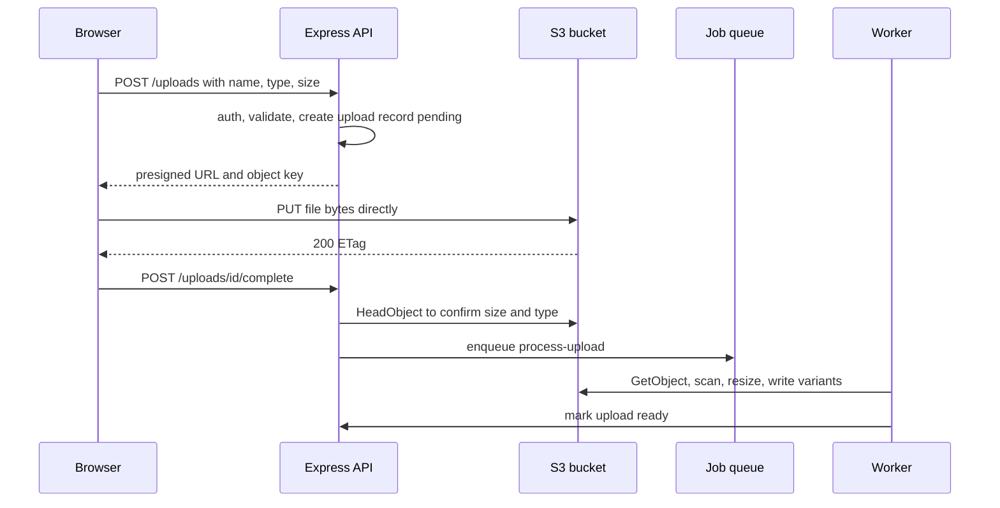

The first version of uploads in most MERN apps is `multer` writing to the API server's disk or memory. It works on one instance with small files. It falls over when users upload 200 MB videos, when there are three instances behind a load balancer, or when a container restart wipes the local disk. The scalable pattern is to keep file bytes off your Node servers entirely: the API hands out permission to upload, the browser sends bytes straight to S3, and workers process the file afterwards.

## Multer pitfalls

- **`memoryStorage`** holds the whole file in the Node heap. A few concurrent large uploads can exhaust memory and crash the process.
- **`diskStorage`** on an ephemeral container or one of several instances means the file exists on one machine only.
- **Bandwidth and connections**: every upload byte passes through the load balancer and the event loop, and slow mobile uploads hold connections for minutes.
- **No default limits**: without `limits: { fileSize }`, a client can stream gigabytes.
- **Trusting `file.mimetype`**: it comes from the client and can be anything.

Multer is still fine for small internal uploads (a CSV import of a few MB) with strict limits. For user-generated media, use presigned URLs.

## How it works



Instead of the client calling `complete`, you can trigger processing from S3 Event Notifications (to SQS, EventBridge or Lambda). That is more robust, since it fires even if the browser closes, but adds infrastructure. Many teams do both: client confirmation for fast UX, and the event as the source of truth.

## Presigned PUT

A presigned URL is a normal S3 URL with a signature in the query string that grants one operation on one key until it expires. The server signs it locally with its credentials; no call to S3 is needed.

```ts
import { S3Client, PutObjectCommand } from '@aws-sdk/client-s3';
import { getSignedUrl } from '@aws-sdk/s3-request-presigner';
import { randomUUID } from 'node:crypto';

const s3 = new S3Client({ region: env.AWS_REGION });
const ALLOWED = new Map([['image/jpeg', 'jpg'], ['image/png', 'png'], ['image/webp', 'webp']]);
const MAX_BYTES = 10 * 1024 * 1024;

app.post('/uploads', requireAuth, validate(uploadRequest), async (req, res) => {
  const { contentType, size } = req.body;
  const ext = ALLOWED.get(contentType);
  if (!ext) throw new AppError(415, 'BAD_TYPE', 'Unsupported file type');
  if (size > MAX_BYTES) throw new AppError(413, 'TOO_LARGE', 'Max 10 MB');

  const key = `uploads/raw/${req.user.id}/${randomUUID()}.${ext}`; // never use the client file name as the key
  const upload = await Upload.create({ userId: req.user.id, key, contentType, size, status: 'pending' });

  const url = await getSignedUrl(s3, new PutObjectCommand({
    Bucket: env.UPLOAD_BUCKET, Key: key, ContentType: contentType, ContentLength: size,
  }), { expiresIn: 300 });

  res.json({ uploadId: upload.id, url, key });
});
```

```ts
// browser
await fetch(url, { method: 'PUT', headers: { 'Content-Type': file.type }, body: file });
```

Signing `ContentType` and `ContentLength` means the browser must send matching headers or S3 rejects the request with a signature mismatch. Note that the length is declared by the client up front, so recheck the real object.

## Presigned POST: server-enforced limits

A presigned POST uses a policy document, and S3 itself enforces conditions such as a size range. That is the stronger option when you need hard limits.

```ts
import { createPresignedPost } from '@aws-sdk/s3-presigned-post';

const { url, fields } = await createPresignedPost(s3, {
  Bucket: env.UPLOAD_BUCKET,
  Key: key,
  Conditions: [
    ['content-length-range', 1, MAX_BYTES],
    ['starts-with', '$Content-Type', 'image/'],
  ],
  Fields: { 'Content-Type': contentType },
  Expires: 300,
});
// browser sends multipart/form-data: all fields, then the file field last
```

| | Presigned PUT | Presigned POST |
| --- | --- | --- |
| Client code | Simple `fetch` PUT | `FormData` with fields |
| Size enforcement | Signed declared length | Policy range enforced by S3 |
| Large files | Use multipart upload, one presigned URL per part | Single request, max 5 GB |

For files over roughly 100 MB, use S3 multipart upload: the server calls `CreateMultipartUpload`, presigns `UploadPart` URLs, the client uploads parts in parallel with resume, and the server calls `CompleteMultipartUpload`. Add a lifecycle rule to abort incomplete multipart uploads after a day or so, or orphaned parts keep costing money.

## Validation that actually holds

1. **Before signing**: authenticated user, allowlisted type, declared size within limit, per-user quota or rate limit on `/uploads`.
2. **At S3**: signed content type and length, or POST policy conditions; short expiry.
3. **After upload**: `HeadObject` to check real size, then in the worker read the first bytes and detect the type from magic numbers (the `file-type` package) rather than trusting headers. Reject and delete mismatches.
4. **Processing**: re-encode images with `sharp`, which strips metadata such as GPS EXIF and neutralizes many malformed-file exploits. Run a malware scan for documents if your threat model needs it.

## Post-upload processing

```ts
app.post('/uploads/:id/complete', requireAuth, async (req, res) => {
  const up = await Upload.findOne({ _id: req.params.id, userId: req.user.id, status: 'pending' });
  if (!up) throw new AppError(404, 'NOT_FOUND', 'Upload not found');
  const head = await s3.send(new HeadObjectCommand({ Bucket: env.UPLOAD_BUCKET, Key: up.key }));
  if ((head.ContentLength ?? 0) > MAX_BYTES) throw new AppError(413, 'TOO_LARGE', 'File too large');
  await Upload.updateOne({ _id: up._id }, { status: 'processing' });
  await mediaQueue.add('process-image', { uploadId: up.id }, { jobId: `img:${up.id}` });
  res.status(202).json({ status: 'processing' });
});
```

The worker writes variants (`uploads/public/<id>/320.webp`, `1280.webp`) and sets the record to `ready`. The client polls, or gets notified over a WebSocket. Keep `raw/` and `public/` prefixes separate so unprocessed files are never served.

## Serving via CloudFront

Keep the bucket private with Block Public Access on. Put CloudFront in front with Origin Access Control (OAC) so only the distribution can read the bucket.

- Public assets (avatars, product images): long cache TTLs with immutable keys, since each upload gets a new UUID key, so no invalidation is needed.
- Private files (invoices, user documents): CloudFront signed URLs or signed cookies with short expiry, generated by the API after an authorization check. Alternatively, presigned S3 GET URLs for low-traffic private downloads.
- Set `Content-Disposition: attachment` for user documents so a crafted HTML or SVG upload cannot run script in your domain's context. Serve user content from a separate domain to contain any XSS.

## Trade-offs and pitfalls

- **CORS on the bucket**: browser PUT and POST to S3 need a bucket CORS rule allowing your origin, the method and the `Content-Type` header.
- **Orphaned objects**: users get URLs and never complete. A lifecycle rule expiring `uploads/raw/` after a few days, plus a sweep of stale `pending` records, keeps storage clean.
- **Long expiries** turn a leaked URL into an open upload slot. Keep minutes, not hours.
- **Client file names** in keys enable path tricks and collisions; generate keys server side.
- **Clock skew** on servers produces signatures that look expired; keep NTP running.

## Interview angle

- In designs like "Instagram" or "Dropbox", say uploads go direct to object storage via presigned URLs and the API only handles metadata.
- Explain how you enforce size and type when bytes never touch your server.
- Describe the async pipeline: upload, event or queue, worker, variants, CDN.

## Key takeaways

- Keep file bytes off Node: issue presigned PUT or POST URLs and let the browser talk to S3.
- Use presigned POST policies or multipart uploads for enforced limits and large files.
- Verify after upload with HeadObject and magic-number checks, then process in a queue worker.
- Serve from a private bucket through CloudFront with OAC, signed URLs for private content.
